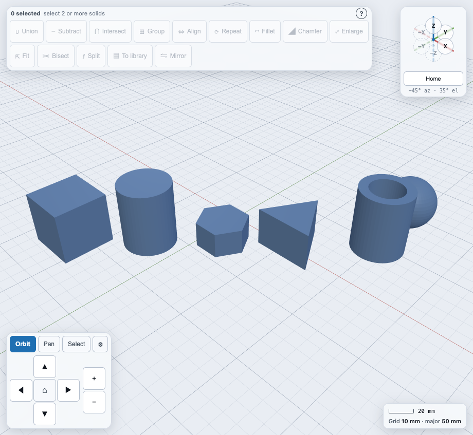
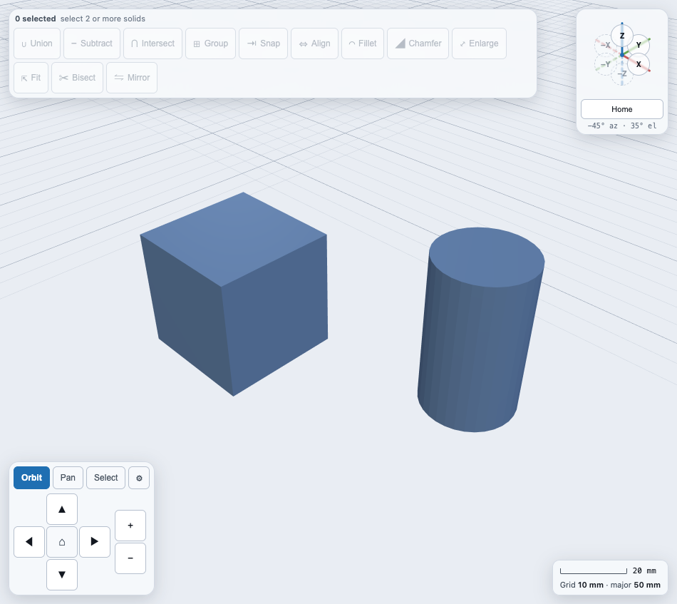
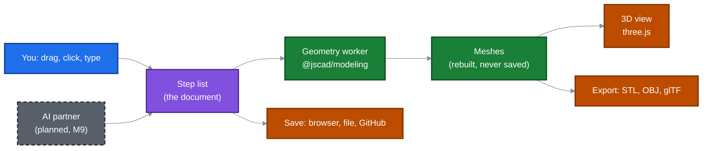
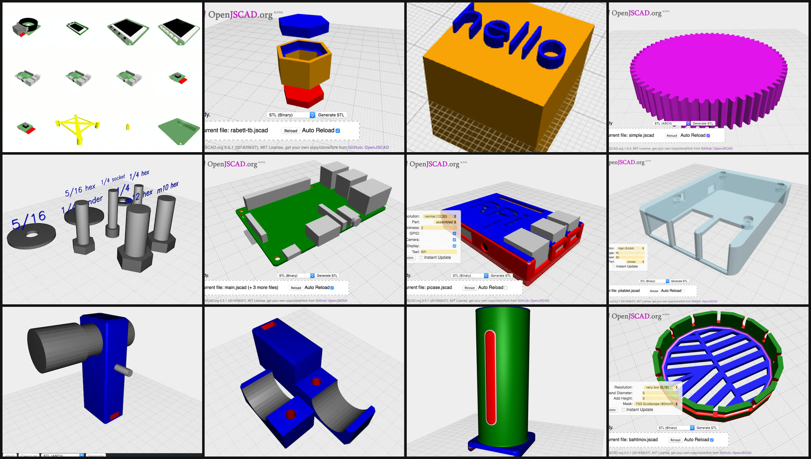
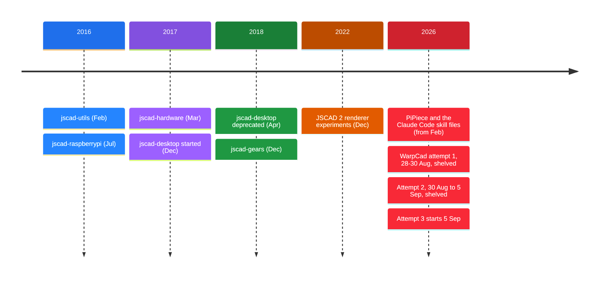

# WarpCad

**A parametric CAD program that runs in a web page. Drag shapes in, combine them, cut them, and export them for printing.**

WarpCad is for people who make physical things: enclosures for a Raspberry Pi, brackets, gear
trains, 3D-printable parts. It keeps the part of CAD that matters here, which is solids you
combine and cut into a finished shape. Nothing has to be installed, because it runs in your
browser, and it works on a phone, a tablet or a laptop. Your model is a list of steps rather
than a lump of mesh, so you can go back to step 3, change a number, and watch everything after
it rebuild.


## Launch WarpCad

> **Not hosted yet.** The app will be published on GitHub Pages and linked from here. Until
> then, [run it locally](#run-it-yourself), which takes about a minute.
>
> **▶ Launch WarpCad:** _link goes here once GitHub Pages is switched on_

## Why it exists

Most CAD tools make you choose between two ways of working:

- **Click-and-drag programs** are quick to start but awkward to repeat. Changing a hole size
  on part 7 of 12 means redoing the work by hand.
- **Code-based programs** (OpenSCAD, JSCAD) are precise and repeatable, but you can't see
  anything until you run the script, and you can't grab a part and nudge it.

WarpCad aims to give you both. You place and move parts by hand with real 3D handles. Every
action is also recorded as a numbered step, so the model stays editable and reproducible.
The same step list is what an AI assistant will read and write, so you and an AI partner
can work on the same part.

WarpCad is also a test of how to build a whole application with AI tools on a modest budget
(the Claude Pro plan), as a follow-on to the author's
[PiPiece](https://johnwebbcole.gitlab.io/pipiece-ui) project. The
[story below](#where-warpcad-came-from) covers what that has taken, including the two attempts
that failed.

A few rules shape the design:

| Principle | What it means in practice |
|---|---|
| **Place things by dragging** | Nothing appears at a hidden origin. You drag a shape out of the Library, a ghost preview follows your pointer, and it lands where you drop it. |
| **Buttons say what they need** | Union, Subtract and Intersect stay greyed out until you've selected two shapes, so the toolbar never offers something that can't work. |
| **History is the document** | Every step is kept. You can inspect, retune, switch off, reorder or branch from any past step. Meshes are never saved. They are rebuilt from the steps. |
| **Phones are a target, not an afterthought** | Orbit, pan and zoom have on-screen buttons, and the panels collapse into sheets at phone width. |
| **Every control is documented** | A feature is not finished until it has a docs page with a worked example and generated pictures. |

## What it looks like

Drag any shape out of the Library into the 3D view. A snap guide appears when the new shape
lines up with one you've already placed.


The basic solids, ready-made fasteners, kit parts, real Raspberry Pi boards and accessories,
and a 3D text label are all in the Library:



Moving around has its own on-screen controls, so a phone doesn't need a keyboard. There is an
orbit/pan/zoom pad, plus an orientation triad you can tap to snap to a standard view.

| Orbit | Pan | Zoom |
|---|---|---|
|  |  |  |


The grid shows minor lines every 10 mm and major lines every 50 mm, with a scale bar, so you can
read real sizes off it without opening a panel.



## What works today

Everything below is built, tested against the running app, and documented. Select a row's
link for the page that explains it, with a step-by-step example.

| Area | What you can do | Docs |
|---|---|---|
| **Placing shapes** | Drag Cube, Cylinder, Cone, Hexagon, Triangle, Tube, Sphere and 3D Text into the scene, with snap guides against what's already there | [Placing a shape](docs/primitive-placement.md) |
| **Real parts** | Bolt, Nut, Washer, Bearing, Board and Board Frame, and real Raspberry Pi boards and accessories, descended from the author's `jscad-hardware` and `jscad-raspberrypi` libraries | [Placing a shape](docs/primitive-placement.md) |
| **Selecting and sizing** | Click to select, move and rotate with 3D gizmos, read dimension lines, and edit exact values in the Inspector. The Inspector can also reach shapes buried inside others | [Selection and the Inspector](docs/selection-and-inspector.md) |
| **Combining** | Union, Subtract and Intersect, plus Group to keep shapes together without merging them | [Booleans](docs/booleans.md), [Groups](docs/groups.md) |
| **Precise placement** | Snap and Align move one shape to an exact position against another | [Snap and Align](docs/snap-align.md) |
| **Shaping** | Fillet and Chamfer a face's rim, Enlarge, Fit to an exact size, Bisect into two parts (including at an angle), Mirror across a plane | [Fillet and Chamfer](docs/fillet-chamfer.md), [Resize and Bisect](docs/resize-bisect.md), [Mirror](docs/mirror.md) |
| **Sketches** | A Sketch is a Library item. Draw lines, rectangles, circles and polygons, mark each Solid or Hole, stack slices, and turn the result into a solid by Linear, Revolve, Helical, Outline or Loft | [Sketch primitives](docs/sketch-mode.md) |
| **History** | A step list for the whole model: look at any past step, change its numbers, switch it off, reorder, or branch from it | [History](docs/timeline.md) |
| **Undo and redo** | Ctrl/Cmd+Z that never undoes someone else's change | [Undo and redo](docs/undo-redo.md) |
| **Saving** | Autosave, save or open a file, or keep a copy in a GitHub repository | [Save and load](docs/save-load.md) |
| **Exporting** | STL, OBJ and glTF for the whole scene or just your selection, at a resolution you choose | [Export](docs/export.md), [Resolution](docs/resolution.md) |
| **Bill of materials** | A running tally of the bolts, nuts, boards and parts you've placed, by size | [Bill of materials](docs/bill-of-materials.md) |
| **Navigation** | Orbit, pan, zoom, orientation triad, touch gestures | [Moving around the 3D view](docs/viewport-navigation.md) |

The complete list of pages is in [docs/README.md](docs/README.md).

## What's coming

Progress by milestone, from [TODO/ROADMAP.md](TODO/ROADMAP.md) (updated 2026-10-02):

| Milestone | What it delivers | Status |
|---|---|---|
| M0–M1 | Decisions, scaffold, viewport, first shapes | ✅ Done |
| M1.5–M3 | Selection and gizmo fixes, hardware catalogue, snap-guide placement, booleans | ✅ Done |
| M4 | Raspberry Pi accessory catalogue and first sketch mode | ✅ Done |
| M5 | Hardware Library: bolts, nuts, washers and bearings you can actually reach | ✅ Done |
| M6 | Saving, exporting and editing history | 🔶 In progress |
| M7 | Colour, Mirror, Screw family, Bill of materials | 🔶 In progress |
| M8 | Sketch primitives | 🔶 In progress |
| **M9** | **AI partner**: ask for a part in plain language, such as "an airfoil wing I can print" or "turn this drawing of a board into a library part", through an MCP server and a bring-your-own-key chat panel | ⬜ Planned |
| **M10** | Screenshots and GIFs for every docs page, generated by Playwright rather than captured by hand | 🔶 Started (the pictures on this page) |
| **M11** | **Gears**: spur, helical, ring, rack, bevel, worm and planetary gears that mesh correctly | ⬜ Planned |

Other things you can expect over time: installing WarpCad as an app (PWA) and hosting it on
GitHub Pages, and a live bridge so an AI assistant can edit the model you have open.



## Where WarpCad came from



WarpCad has two roots. The first is about ten years of designing parts in code with JSCAD v1.
The author's first helper library, `jscad-utils`, appeared in February 2016 to make JSCAD scripts
less repetitive. `jscad-raspberrypi` followed in July 2016, with accurate Raspberry Pi boards and
cases, and `jscad-hardware` in March 2017, with bolts, nuts, washers and bearings. A desktop
app, `jscad-desktop`, was started in December 2017 and deprecated by April 2018. `jscad-gears`
came in December 2018, and in December 2022 the author was experimenting with the JSCAD 2
renderer. The work was always the same: write a script, reload, look at the result, change a
number, repeat. It produced real enclosures, gear trains and clamps, and it was slow whenever the
shape you wanted to change was one you could already see on screen. WarpCad is the CAD that
works the way those scripts do, without the reload.

The second root is about learning to build whole applications with AI tools, not only parts.
Earlier in 2026 the author built [PiPiece](https://johnwebbcole.gitlab.io/pipiece-ui), a
Raspberry Pi camera controller with a Vue touchscreen UI (451 commits and counting), mostly with
Claude Code. That project is where the working method came from. An AI told the author two
misaligned buttons were fixed, twice, when they weren't, and the cure turned out to be writing
down how the author works as slash-command files: ask clarifying questions first, write tests
first, keep one finding per TODO file, and tag each with the cheapest model that can do it. The
write-ups are [Your AI Doesn't Know How You Work](https://johnwebbcole.gitlab.io/articles/ai-workflows),
[A Side Effect I Didn't Expect](https://johnwebbcole.gitlab.io/articles/ai-workflows-part2) and
[Out of Claude Time? Write It Down.](https://johnwebbcole.gitlab.io/articles/todo-backlog). WarpCad
is the harder test of that method. A camera controller's screen is a few buttons. A 3D viewport
with gizmos, selection rules and a geometry kernel is a place where "the tests pass" and "a
person can use it" can be a long way apart. It is also being built on the Claude **Pro** plan,
with its five-hour session window and weekly cap, and that has turned out to be difficult. A big
build doesn't fit the windows, a cold session has to be able to resume without being re-briefed,
and a loop that keeps firing on a schedule burns the weekly budget without noticing. Making the
process work inside those limits is part of what this project is for, so its failures are
recorded here along with its features.

The first attempt at a browser CAD started on 28 August 2026, from a single prompt asking for
Vue, a CRDT, CSG and a PWA, plus "ask a lot of questions". It was shelved two days later, after 38
commits and 33 of 44 planned tasks. Every component worked in isolation, but nobody had
assembled them. The editor screen still showed placeholder text left from its first scaffold, the
whole 2D-to-3D sketch pipeline could not be reached from the running app, and the boolean
operations menu was a flat list of every feature type, including Union, with no way to say which
two shapes it applied to. Most of its end-to-end tests drove Storybook rather than the real app,
so "the tests pass" never meant "a person can use it". It also ran its task loop on a fixed
two-hour timer and used roughly half a week of the plan's tokens in two days. The full story is in
[PREVIOUS-ATTEMPT.md](PREVIOUS-ATTEMPT.md).

The second attempt began on 30 August and fixed exactly those problems: the app was assembled
early, every control needed a spec for its trigger and feedback, and a recurring audit checked
that everything was reachable. It was stopped on 5 September after 231 commits and 57 finished
tasks, and it failed in a harder way. The author's note was that adding an item overwrote the
previous one, the scene was too dark to see, sketch mode never opened, and dragging in the
viewport just rotated the grid. Two of those had been fixed days before and had quietly come
back. The checklist of things to verify had grown to about 2,000 lines no human could work
through, and passing tests proved the code matched its own test script, not that a person could
use it. The loop that paced the work against the Pro plan's limits estimated its own token use
and was off by between 1.2x and 40x, so it had to be re-tuned by hand twice in three days. See
[SECOND-ATTEMPT.md](SECOND-ATTEMPT.md).

This third attempt started on 5 September, and its process is built from both failures.
[TODO/ACCEPTANCE.md](TODO/ACCEPTANCE.md) holds a small fixed set of use cases, such as "add a
cube and a sphere and subtract one from the other", that are re-driven by hand in the running
app, not just replayed from a script. Every control must be reachable from the real app, run
on phone, tablet and laptop sizes, and have documentation before it counts as done. The backlog
runner now does a small fixed batch of tasks and then stops to ask whether to continue, instead
of guessing at a budget it can't read. It's the first attempt where a box dragged out of the
Library lands where it's dropped, and the whole account is in
[Third Time's the Charm](https://johnwebbcole.gitlab.io/articles/third-times-the-charm).
The app is usable, if only just, and getting it there on a Pro plan is the real story.



## Documentation

- **[User documentation](docs/README.md)**: how to use each feature, with pictures and GIFs.
- **[Roadmap](TODO/ROADMAP.md)** and **[acceptance scenarios](TODO/ACCEPTANCE.md)**: what's planned and how it's checked.
- **[Design decisions](docs/decisions/)**: why `@jscad/modeling`, three.js and no CRDT, with the options that lost and why.
- **[Project brief (CLAUDE.md)](CLAUDE.md)** and [Initial design.md](Initial%20design.md): the rules the project is built under.
- [PREVIOUS-ATTEMPT.md](PREVIOUS-ATTEMPT.md) and [SECOND-ATTEMPT.md](SECOND-ATTEMPT.md): the retrospectives.

The pictures in the docs are generated by Playwright specs in `e2e/docs/` (`npm run docs:media`)
and checked by `e2e/docs-media.spec.js`, so they stay in step with the app.

## Run it yourself

Requires Node 24+.

```
npm install
npm run dev
```

This serves the app at `http://localhost:5183` (a dedicated, strict port; see `vite.config.js`).

### Test

```
npm run typecheck          # vue-tsc --noEmit
npm run test:unit          # Vitest, watch mode (add -- --run for a single pass)
npm run test:e2e:headless  # Playwright, against a real running app
npm test                   # all three, in order, single-pass
```

### Other commands

```
npm run storybook      # component workshop
npm run build          # production build
npm run preview        # serve the production build locally
npm run docs:media     # regenerate every docs screenshot and GIF
```

## Built with

Vue 3, Vite and Vitest for the app. [three.js](https://threejs.org) draws the 3D view, and
[`@jscad/modeling`](https://github.com/jscad/OpenJSCAD.org) (JSCAD V3) does the solid geometry in a web worker, so the page
never freezes while a boolean runs. Playwright tests the running app and produces the
documentation pictures.

## License

WarpCad is copyleft. The code is [AGPL-3.0-or-later](LICENSE); the prompts, TODO specs,
slash commands and docs that were used to build it are [CC BY-SA 4.0](LICENSE-DOCS). If you
modify or build on either and share the result, you share it under the same terms. See
[LICENSING.md](LICENSING.md) for the path-by-path map and [CONTRIBUTING.md](CONTRIBUTING.md)
for the sign-off every contribution needs.

<!-- SPDX-License-Identifier: CC-BY-SA-4.0 -->
