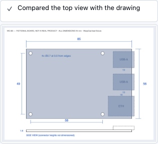
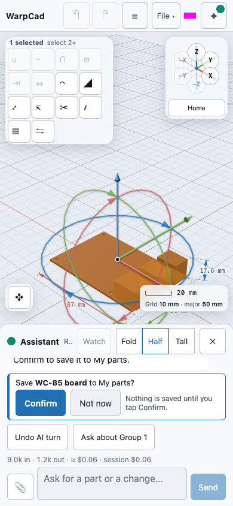

# The Assistant: getting a key

WarpCad's Assistant is an AI partner you talk to about your model. It uses **your own
Anthropic API key**: there is no WarpCad server in between, so the key, and what you say to
the Assistant, go from your browser straight to Anthropic and nowhere else.

The **Assistant** button in the top bar opens the key sheet until a key is saved, and the chat
after that. This page covers [getting a key](#getting-a-key), then
[asking for a part](#asking-for-a-part), [what the assistant checks](#what-the-assistant-checks)
and [stopping and undoing](#stopping-and-undoing).

## Getting a key

1. Open the [Anthropic console](https://console.anthropic.com/settings/keys) and create a key.
   Put it in a **workspace with a monthly spend limit**. That limit is your safety net: if a key
   ever leaked, it could only spend up to it.
2. In WarpCad, tap **Assistant** in the top bar. With no key stored, it opens the **Assistant
   key** sheet.
3. Paste the key into **API key**. On a phone, press and hold in the field and choose **Paste**.
4. Tap **Save and test**.

**Save and test** keeps the key and then asks Anthropic to check it. The check doesn't use the
model, so it costs nothing. When it works, the sheet says **Connected** and shows the model:

Tap **Done**. From now on **Assistant** opens the connected panel, with a dot and the model name.
The dot is a hollow ring when a key is saved but not yet checked this visit, a filled dot after a
good check, and a red **✕** after a failed one. The key is still there after you close the tab and
come back.

## Where the key lives

- **Only in this browser.** It is stored in this browser's IndexedDB, next to the token the
  File menu's *Connect repository* uses. Anyone who can run code on this site in your browser
  could read it, which is why a spend limit matters.
- **It is sent only to `api.anthropic.com`**, as the request's `x-api-key`, and nowhere else.
  The page also tells your browser to refuse connections to any other site except the ones
  WarpCad already uses (`api.github.com` for repository saving), so a script that got into the
  page couldn't send the key elsewhere.
- **It is never part of your project.** It isn't in the file you save or download, in an
  exported STL, in the autosave, in a gist, or in the address bar.
- **The sheet never shows it back.** Once saved, the field is gone. **Replace key** gives you an
  empty one.
- **Private windows:** if the browser won't let WarpCad store anything, the sheet says so (*this
  session only*): the Assistant still works until you close the tab, and you paste the key again
  next time.

## Asking for a part

With a key saved, **Assistant** opens the chat. On a phone or tablet it is a sheet over the bottom
of the screen, so the model stays visible above it; on a laptop it is a column beside the viewport.
The sheet has three heights, **Fold**, **Half** and **Tall**. **Fold** shrinks it to one line of
status (*Working… step 4*), so a long request stays in view while you look at the model.

1. Type what you want in the box. Enter sends; Shift+Enter starts a new line; **Send** does the
   same on a touch screen.
2. Watch the chat. The Assistant's words stream in, and every change it makes to the model is one
   **activity row**: *Created Cube 1*, *Subtract Cube 1 − Cylinder 2*. A row that failed has a ✕,
   the reason, and a *Then:* line for what the Assistant did next.
3. Tap an activity row to select the body it made. The viewport and the Inspector answer.
4. **Attach image** (the paperclip) adds a photo or drawing to your message. On a phone the picker
   offers the camera. Tap ✕ on the thumbnail to take it off again.
5. With one body selected, **Ask about** *name* puts a reference to it in the box.

The row under the transcript shows the tokens the turn has used so far. It does not show a price:
Anthropic's rates change, and a number that drifts from your real bill is worse than none.

**Example.** Tap **Assistant**, type *a 40 mm cube with a 10 mm hole through the middle*, and tap
**Send**. A few activity rows appear (the cube, the hole, the cut), and the part shows in the
viewport. Open **History** and its rows are marked as written by the Assistant.

A turn lands all at once, when it is finished. Until then the Assistant works on a private copy, so
a turn that is stopped, fails, or runs into a limit changes nothing in your project.

## What the assistant checks

Before the Assistant calls a part finished it has to check it. It can do four things, and none of
them changes your project:

- **Look at it** from a named view: iso (the Home view), top, front, right, back, bottom or left.
  It can also cut the model open along a plane to see inside a hollow part. The picture is drawn
  off screen, so your camera, your selection and your screen stay as they are.
- **Measure** a body: its size and position in millimetres, its volume, surface area and centre of
  mass. A group counts as one body.
- **Check printability**: whether the surface is closed (watertight), whether the part fits the
  printer's build volume and which way round, the thinnest wall it can find, and any wall thinner
  than the nozzle. Unless you or your project's standing rules say otherwise, it assumes a
  220 × 220 × 250 mm bed, a 0.4 mm nozzle and a 1.2 mm minimum wall.
- **Check clearance** between two bodies: the smallest gap between them, or how much they
  overlap. This is how it checks that a board fits its case or a joint can slide.

Each check is an activity row like any other. A look shows the picture it took as a thumbnail:
tap the thumbnail to open it full width, and tap again to fold it. That is exactly what the
Assistant saw. A measurement or check shows its numbers on a second line. A check that found a
problem has a ⚠ and a dashed red edge, so it stands out from the rows that passed.

The checks are estimates, not guarantees. Walls are sampled, so a feature finer than the sampling
can be missed. Fit is only tried square to the bed. Overhangs and supports are not checked. The
Assistant says what it checked and never promises that a part will print. Slice the part before
you trust it.

**Example.** With a wing in the scene, type *check whether this fits a 220 mm bed, with walls of
at least 1.6 mm* and tap **Send**. A *Looked at the top view* row shows a thumbnail of the wing.
Below it, a *Checked printability* row with a ⚠ reads *Wall 1.2 mm thick at (98, 4, 2) — below
the 1.6 mm minimum wall*. The Assistant's reply gives the size it measured (*Fits at 214 × 52 ×
18 mm*) and asks whether to thicken the trailing edge or accept it.

## Making a part from a drawing or photo

The Assistant can turn a dimensioned drawing, or a photo of a part next to a ruler, into a group
for your **My parts** library: a board with its mounting holes, and each connector as its own named
part.

1. Tap **Assistant**, then **Attach** (the paperclip) and pick the drawing or photo. On a phone the
   picker offers the camera. On a laptop you can also drag an image file onto the viewport, which
   opens the chat with the image attached. PNG, JPEG and WebP work. An SVG, an image too large to
   open safely, or a damaged file is refused with a line under the box, and nothing is sent.
2. Say what it is and what you want, and tap **Send**.
3. The Assistant first lists the dimensions it can read off the drawing in a table, with the view
   each one came from. Then it sets the image's scale from one of them. The activity row reads
   *Set scale 85.0 mm from "board length"*. It checks the other printed dimensions against that
   scale, and one that disagrees is flagged on the same row with ⚠ and its two values. A chain of sizes
   that doesn't add up to the overall length is pointed out in the reply.
4. If a size it needs isn't printed (a connector's height is the usual one, since a top view can't
   show it), the Assistant asks you rather than guessing. It has no memory of your board, so it
   won't fill a gap with what a similar product "usually" measures. If you tell it to go ahead
   anyway, it says which sizes it assumed.
5. It builds the part where the drawing is: the outline and holes as one sketch with the image
   under it at real size, and each connector as a separate body. It then groups them, names each
   part, and selects the group, so the Inspector lists the parts.
6. It checks its work against the picture. The *Compared the top view with the drawing* row has a
   thumbnail of the part laid over the drawing; tap it to open it full width. The Assistant reports
   how far off it is ("the SD slot is 1.5 mm off") rather than calling it a match.
7. If you asked for a library part, a *Save … to My parts?* card appears above the box. Nothing is
   saved yet. Tap **Confirm** to save it to **My parts**, or **Not now** to leave it out. The
   Assistant can only propose a save; it can't write to your library on its own.

The image goes only to Anthropic, inside your own request, using your key. The first time you
send one in a project, the chat says *Image sent*. Only the copy you build on is kept in the
project, as the sketch's reference photo, and that copy is cleaned the same way as **Add image…**
in a sketch: just the pixels, with no hidden data. The photo is not saved into the library part.

**Example.** Tap **Assistant**, **Attach** a photo of the board next to a ruler, type *this is a
Raspberry Pi 5-style board, make a library part*. When it asks, say the board is 85 mm long.
Check the overlay thumbnail, then tap **Confirm** on the *Save … to My parts?* card. The part
appears at the top of **My parts** in the Library, and you can drag it into any project.

## Variables

The Assistant can use your project's [variables](variables.md), the same way you do in the
**Variables** panel. To *make this for a Pi 5*, it changes the `piModel` variable once instead of
editing the Pi, and everything tied to it follows. It has seven tools for this:

| Tool | Changes the project? | For example |
|---|---|---|
| `list_variables` | no | `{}` lists every variable, its value and what uses it; `{ "id": "pi-1" }` also lists which of the Pi's settings can be tied to one. |
| `define_variable` | yes | `{ "name": "wall", "kind": "number", "value": 2, "unit": "mm" }` |
| `set_variable` | yes | `{ "name": "piModel", "value": 5 }` |
| `bind_param` | yes | `{ "id": "pi-1", "path": "model", "name": "piModel" }` ties the Pi's model to `piModel`. |
| `unbind_param` | yes | `{ "id": "pi-1", "path": "model" }` unties it, keeping its current model. |
| `rename_variable` | yes | `{ "from": "piModel", "to": "boardModel" }` |
| `delete_variable` | yes | `{ "name": "wall", "keepValues": true }` |

Before it changes a value, the Assistant checks what the change would break, exactly as the
Variables panel does. If a Pi 5 would leave a shape snapped to a connector the Pi 5 doesn't have,
nothing changes: the activity row shows the error with what would break, and the Assistant tells
you instead of guessing. A rotation, a Union or a Group can't be tied to a variable; the Assistant
is told why if it tries.

**Example.** In a case with a `piModel` variable, type *make this case for a Pi 5* and tap
**Send**. An activity row appears, *Set piModel to 5*, with a second line that reads *piModel
Pi 4 → Pi 5 — 3 parameters on 2 parts changed*. The Variables panel shows **Pi 5**. Tap **Undo AI turn** and it is
back to **Pi 4**, with every part where it was.

## Stopping and undoing

- **Stop** replaces **Send** while the Assistant is working. Tap it and the turn ends within a
  step; the chat says *Nothing from this turn was kept*, and the project is exactly as it was.
- **Undo AI turn** takes back everything the Assistant did in its last turn, in one tap. It is
  available only while nothing newer has happened: the moment you edit the model yourself, drop in
  a shape, or undo, it switches itself off, so it can never undo something of yours by accident.
  It is separate from the **Undo** button in the top bar, which stays yours.

**Example.** After the cube above, tap **Undo AI turn**. The cube and both History rows are gone and
the button greys out.

## Test, replace and forget

Open **Assistant** (then **Key and model…** if the connected panel opens) to get these:

- **Test** checks the stored key again.
- **Replace key** swaps in a new one.
- **Forget key** deletes the key from this browser. The sheet goes back to the empty form, and
  reloading finds no key.
- **Model** chooses **Claude Opus 5.5** (the default, the most capable) or **Claude Sonnet 5.5**
  (faster and cheaper). Changing it re-checks the connection.

## If the test fails

Each failure has its own message, so you can tell what to fix:

| You see | What it means |
|---|---|
| *Anthropic rejected this key* | The key was mistyped, cut short when copied, or deleted in the console. Create a new one. |
| *This key isn't allowed to do that* | The key's workspace can't use the chosen model. |
| *Rate limit reached* | Too many requests for now. Wait a moment, then tap **Test**. |
| *Anthropic is having trouble right now* | Anthropic's service is down or overloaded. Try again shortly. |
| *You appear to be offline* | Your device has no connection. |
| *The browser couldn't reach api.anthropic.com* | Something between the page and Anthropic refused the request: a content blocker, a firewall, or a browser extension that blocks it. Try another browser or turn the blocker off for this site. |

A failed test **keeps** the key, because the usual cause is a connection problem. Tap **Test**
again, or **Forget key** to start over. None of these messages ever contains your key.

## A worked example

1. Create a key in your Anthropic console, in a workspace limited to a few dollars a month.
2. Tap **Assistant**, paste the key, and tap **Save and test**. Wait for *Connected*.
3. Tap **Done**, then reload the page. The **Assistant** button shows a hollow ring: your key is
   saved.
4. Tap **Assistant**, then **Key and model…**, then **Test**. The ring fills in.

That's all of it. The chat opens from the same button; see [asking for a part](#asking-for-a-part).

## See also

- [Design intent](design-intent.md): what the Assistant records about each step, and your
  project's standing rules.
- [Saving and reopening your work](save-load.md): the key is never in a saved file.

<!-- SPDX-License-Identifier: CC-BY-SA-4.0 -->
