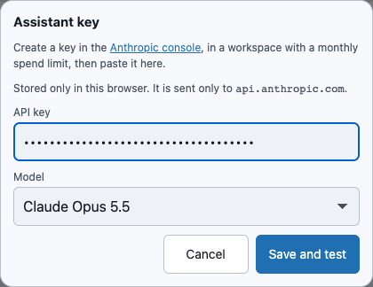
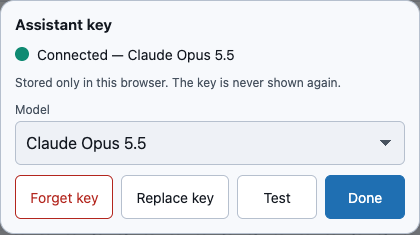

# The Assistant: getting a key

WarpCad's Assistant is an AI partner you talk to about your model. It uses **your own
Anthropic API key**: there is no WarpCad server in between, so the key, and what you say to
the Assistant, go from your browser straight to Anthropic and nowhere else.

The **Assistant** button in the top bar opens the key sheet until a key is saved, and the chat
after that. This page covers [getting a key](#getting-a-key), then
[asking for a part](#asking-for-a-part) and [stopping and undoing](#stopping-and-undoing).

## Getting a key

1. Open the [Anthropic console](https://console.anthropic.com/settings/keys) and create a key.
   Put it in a **workspace with a monthly spend limit**. That limit is your safety net: if a key
   ever leaked, it could only spend up to it.
2. In WarpCad, tap **Assistant** in the top bar. With no key stored, it opens the **Assistant
   key** sheet.
3. Paste the key into **API key**. On a phone, press and hold in the field and choose **Paste**.
4. Tap **Save and test**.

**Save and test** keeps the key and then asks Anthropic to check it. The check doesn't use the
model, so it costs nothing. When it works, the sheet says **Connected** and shows the model:

Tap **Done**. From now on **Assistant** opens the connected panel, with a dot and the model name.
The dot is a hollow ring when a key is saved but not yet checked this visit, a filled dot after a
good check, and a red **✕** after a failed one. The key is still there after you close the tab and
come back.

## Where the key lives

- **Only in this browser.** It is stored in this browser's IndexedDB, next to the token the
  File menu's *Connect repository* uses. Anyone who can run code on this site in your browser
  could read it, which is why a spend limit matters.
- **It is sent only to `api.anthropic.com`**, as the request's `x-api-key`, and nowhere else.
  The page also tells your browser to refuse connections to any other site except the ones
  WarpCad already uses (`api.github.com` for repository saving), so a script that got into the
  page couldn't send the key elsewhere.
- **It is never part of your project.** It isn't in the file you save or download, in an
  exported STL, in the autosave, in a gist, or in the address bar.
- **The sheet never shows it back.** Once saved, the field is gone. **Replace key** gives you an
  empty one.
- **Private windows:** if the browser won't let WarpCad store anything, the sheet says so (*this
  session only*): the Assistant still works until you close the tab, and you paste the key again
  next time.

## Asking for a part

With a key saved, **Assistant** opens the chat. On a phone or tablet it is a sheet over the bottom
of the screen, so the model stays visible above it; on a laptop it is a column beside the viewport.
The sheet has three heights, **Fold**, **Half** and **Tall**. **Fold** shrinks it to one line of
status (*Working… step 4*), so a long request stays in view while you look at the model.

1. Type what you want in the box. Enter sends; Shift+Enter starts a new line; **Send** does the
   same on a touch screen.
2. Watch the chat. The Assistant's words stream in, and every change it makes to the model is one
   **activity row**: *Created Cube 1*, *Subtract Cube 1 − Cylinder 2*. A row that failed has a ✕,
   the reason, and a *Then:* line for what the Assistant did next.
3. Tap an activity row to select the body it made. The viewport and the Inspector answer.
4. **Attach image** (the paperclip) adds a photo or drawing to your message. On a phone the picker
   offers the camera. Tap ✕ on the thumbnail to take it off again.
5. With one body selected, **Ask about** *name* puts a reference to it in the box.

The row under the transcript shows the tokens the turn has used so far. It does not show a price:
Anthropic's rates change, and a number that drifts from your real bill is worse than none.

**Example.** Tap **Assistant**, type *a 40 mm cube with a 10 mm hole through the middle*, and tap
**Send**. A few activity rows appear (the cube, the hole, the cut), and the part shows in the
viewport. Open **History** and its rows are marked as written by the Assistant.

A turn lands all at once, when it is finished. Until then the Assistant works on a private copy, so
a turn that is stopped, fails, or runs into a limit changes nothing in your project.

## Stopping and undoing

- **Stop** replaces **Send** while the Assistant is working. Tap it and the turn ends within a
  step; the chat says *Nothing from this turn was kept*, and the project is exactly as it was.
- **Undo AI turn** takes back everything the Assistant did in its last turn, in one tap. It is
  available only while nothing newer has happened: the moment you edit the model yourself, drop in
  a shape, or undo, it switches itself off, so it can never undo something of yours by accident.
  It is separate from the **Undo** button in the top bar, which stays yours.

**Example.** After the cube above, tap **Undo AI turn**. The cube and both History rows are gone and
the button greys out.

## Test, replace and forget

Open **Assistant** (then **Key and model…** if the connected panel opens) to get these:

- **Test** checks the stored key again.
- **Replace key** swaps in a new one.
- **Forget key** deletes the key from this browser. The sheet goes back to the empty form, and
  reloading finds no key.
- **Model** chooses **Claude Opus 5.5** (the default, the most capable) or **Claude Sonnet 5.5**
  (faster and cheaper). Changing it re-checks the connection.

## If the test fails

Each failure has its own message, so you can tell what to fix:

| You see | What it means |
|---|---|
| *Anthropic rejected this key* | The key was mistyped, cut short when copied, or deleted in the console. Create a new one. |
| *This key isn't allowed to do that* | The key's workspace can't use the chosen model. |
| *Rate limit reached* | Too many requests for now. Wait a moment, then tap **Test**. |
| *Anthropic is having trouble right now* | Anthropic's service is down or overloaded. Try again shortly. |
| *You appear to be offline* | Your device has no connection. |
| *The browser couldn't reach api.anthropic.com* | Something between the page and Anthropic refused the request: a content blocker, a firewall, or a browser extension that blocks it. Try another browser or turn the blocker off for this site. |

A failed test **keeps** the key, because the usual cause is a connection problem. Tap **Test**
again, or **Forget key** to start over. None of these messages ever contains your key.

## A worked example

1. Create a key in your Anthropic console, in a workspace limited to a few dollars a month.
2. Tap **Assistant**, paste the key, and tap **Save and test**. Wait for *Connected*.
3. Tap **Done**, then reload the page. The **Assistant** button shows a hollow ring: your key is
   saved.
4. Tap **Assistant**, then **Key and model…**, then **Test**. The ring fills in.

That's all of it. The chat opens from the same button; see [asking for a part](#asking-for-a-part).

## See also

- [Design intent](design-intent.md): what the Assistant records about each step, and your
  project's standing rules.
- [Saving and reopening your work](save-load.md): the key is never in a saved file.

<!-- SPDX-License-Identifier: CC-BY-SA-4.0 -->
