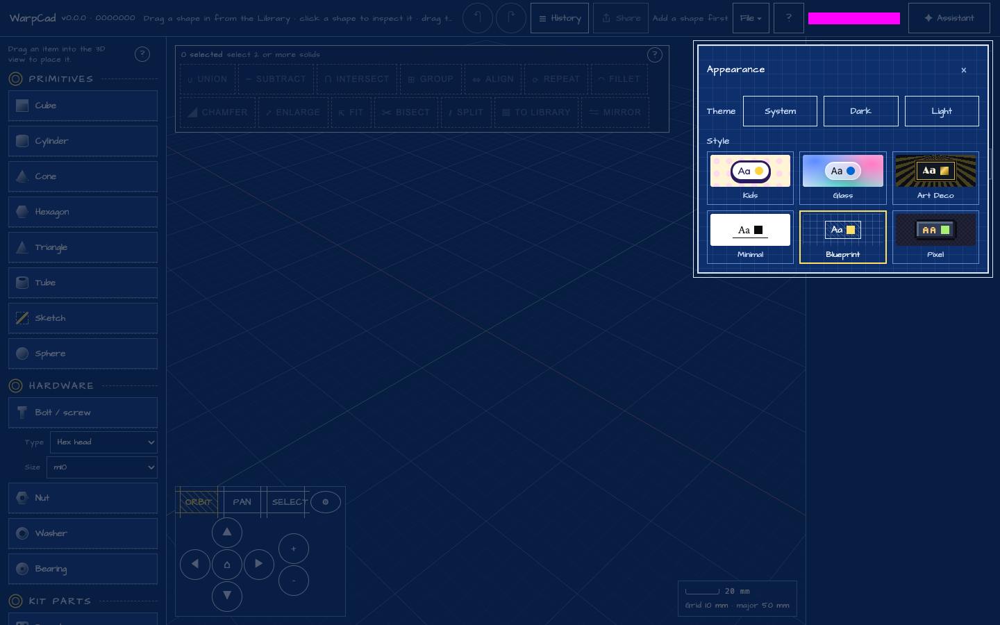

# Appearance: theme and style

WarpCad follows your device's light or dark setting until you tell it otherwise. You can also pick a
whole **style**, which changes the buttons, panels, lettering and the 3D view's grid as well as the
colours. Both live in one place and need no network and no open project.

## Light and dark

1. Tap **File** in the header, then **Appearance…**.
2. Under **Theme**, tap **Light**. The panels and the 3D view turn light at once.
3. Close the sheet (**×**, the Escape key, or a tap outside it). WarpCad remembers the choice the next
   time you open it on this device.
4. To follow your device again, open **File ▾ → Appearance…** and tap **System**. Tap **Dark** to keep
   the dark look whatever your device says.

Pictures in Help follow the theme you chose, not the device's setting.

When you start WarpCad with a theme that differs from your device's, the first frame can show the
device's look for an instant before your choice is applied.

In the iPhone and iPad app the clock, battery and signal icons at the top of the screen follow the
look too. Tap **Light** (or a light style such as **Minimal**) and they turn dark so they stay
readable on the light header; tap **Dark** and they turn light again. **System** hands the choice back
to your device. The launch screen, shown before WarpCad has started, follows your device's setting
only, so if you chose a look that differs from your device's, one frame of the device's colour shows
at launch. This status bar has no picture here, because the screenshots of this page come from a
browser, which has no status bar to draw.

## Styles

A style changes more than the colours: buttons, panels, lettering and the 3D view's grid all take a
different look. There are six:

| Style | Look |
|---|---|
| **Kids** | Cream paper, bold outlines, chunky rounded buttons that press down |
| **Glass** | Frosted, see-through panels over the 3D view |
| **Art Deco** | Black and gold, angled corners, a sunburst behind each panel |
| **Minimal** | White, black lines and plenty of space; no boxes or shadows |
| **Blueprint** | A blue drafting sheet with hand-drawn lines and hatching |
| **Pixel** | A retro game console: square pixels and raised blocky buttons |

To try one:

1. Tap **File** in the header, then **Appearance…**.
2. Under **Theme**, tap **Light**. The panels and the 3D view turn light.
3. Under **Style**, tap **Blueprint**. Each tile shows a small preview of its style. Buttons, panels,
   lettering and the grid take the blueprint look, the Blueprint tile is outlined, and **Theme** no
   longer shows a mode selected, because a style replaces it.
4. The sheet stays open, so tap other tiles to compare. Close it and reload the page: WarpCad opens in
   Blueprint.
5. To follow your device again, open **File ▾ → Appearance…** and tap **System**.

Each style is either light or dark, so while one is chosen your device's light or dark setting does
not change it. Pictures in Help use the light or dark version to match the style.

The lettering comes with WarpCad. The first time you open Appearance (or Help), its style tiles are
drawn in their own lettering, so that lettering downloads then; a style's full look downloads the first
time you choose it. If either happens while you are offline, a similar built-in font stands in until
you are back online.

On a phone the sheet is a full-width bottom sheet with two columns of tiles; on a tablet or laptop it
is a card with three.

## Also in Help

The same **Theme** and **Style** controls are at the bottom of the Help sheet (**File ▾ → Help and
documentation**). They work even when a Help page cannot load.

## See also

- [Using the built-in help](help.md)
- [Using WarpCad on a phone or tablet](mobile.md)
- [The full list of pages](README.md)

<!-- SPDX-License-Identifier: CC-BY-SA-4.0 -->
