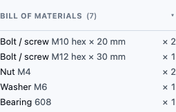

# Bill of materials: what hardware is in your model

Once you've placed bolts, nuts, washers, bearings, board parts or Raspberry Pi boards, the
**Bill of materials** section of the Inspector keeps a running count of them — the list you'd
need to buy or print. It's read-only: you never edit it, it just reflects what's in your
model.

## Where it is

It's a section of the **Inspector**, just under the object list, and it appears as soon as
you place your first hardware, kit or Raspberry Pi part. Before that — or in a model that is
only plain shapes — it isn't shown, because there's nothing to list.

- On a **laptop or tablet** it sits in the Inspector's side panel.
- On a **phone** it's inside the Inspector's bottom sheet: tap the Inspector's tab at the
  bottom of the screen. (The Library and the Inspector share the one sheet, so close the
  Library first.)

Tap the **Bill of materials** header to fold the list away or open it again; the total in
brackets stays visible when it's folded.

## What a line means

Each line is one distinct part and how many of it you have, e.g. `Bolt / screw M4 socket × 12 mm  × 3`.

- **Bolts and screws** are told apart by size *and* length, so an M4 × 12 and an M4 × 20 are
  two lines.
- **Nuts, washers and bearings** are told apart by their size or bearing number.
- **Fit** (loose / tight) is ignored: it only changes the clearance room around the part, not
  the part you'd buy.
- **Kit parts** (Board, Board Frame, Anchor) show their width × height.
- **Raspberry Pi** boards show the model.
- **Bought dowels from a split** appear when you split with **Steel or filament dowels**
  ([Printing a part that is bigger than your printer](print-prep.md#choosing-a-joint)):
  `Steel dowel pin Ø4 × 10 mm  × 2`, or `1.75 mm filament Ø1.75 × 4.5 mm lengths  × 2`. Dowels you
  print are not listed: they are in the Print pieces zip.
- **Magnets from a split** appear when you split with **Magnets**, or hand-place a **Magnet**:
  `Magnets 6 × 3 mm  × 4` (two per pocket pair). Printed tenons are in the Print pieces zip, not here.
- Plain shapes (cube, cylinder, sphere, text labels) never appear.

The list updates as you work — placing, changing a part's size in the Inspector, deleting,
undoing — and while you're previewing an earlier step in History it shows that step's parts.

Parts you place by dragging them from the Library are listed the moment they land. The
**Bolt / screw**, **Nut**, **Washer** and **Bearing** rows are described in
[Hardware, kit parts and Raspberry Pi parts](hardware-library.md).

## Example

1. Open the **Library** and drag **Bolt / screw** into the 3D view twice, then **Washer** once.
2. Open the Inspector (on a phone, close the Library first, then tap the Inspector tab).
3. The **Bill of materials** shows `Bolt / screw M10 hex × 20 mm  × 2` and `Washer M6  × 1`, total `(3)`.
   
4. With the washer still selected, press **Delete**. The washer line disappears and the total
   drops to `(2)`.

<!-- SPDX-License-Identifier: CC-BY-SA-4.0 -->
