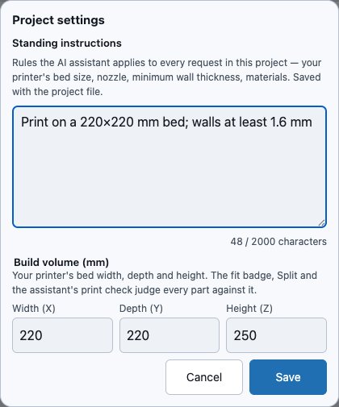
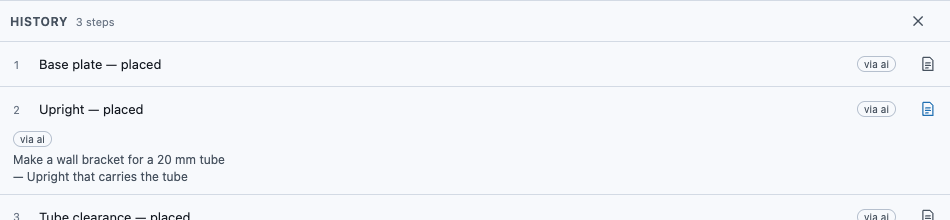
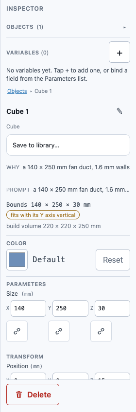

# Design intent: why each step exists, and your project's standing rules

A WarpCad project remembers **why** things are the way they are, not just their shape:

- **Standing instructions** are rules for the whole project, written once: your printer's bed
  size, the nozzle, the thinnest wall you trust, the material. The AI assistant applies them
  to every request in this project.
- **Design intent** is a short note on a step in History saying why the step was made. When
  the assistant (or another AI tool connected to WarpCad) adds a step, it saves what you asked
  for and a one-line reason with it.

Both are saved in the project file, so they come back when you reopen it, and a model picking
the project up next week can read them instead of guessing.

## Set your project's standing instructions

1. Open **File ▾** and choose **Project settings…** (in the *Design* group).
2. Type your rules in **Standing instructions**, for example *Print on a 220×220 mm bed;
   walls at least 1.6 mm*. The count under the box shows how much room is left (up to 2,000
   characters).
3. Press **Save**. The status light at the right of the top bar shows *Saving…* and then
   *Saved*, the same as for any other change.

**Cancel** throws away what you typed. Changing the instructions isn't a step in History, so
**Undo** doesn't change them, and undoing a shape doesn't touch them either.

On a phone the dialog fills the width of the screen and stays at the top, so the keyboard
can't cover it.

## See why a step was made

1. Open **History** in the top bar.
2. A step with design intent has a small **note icon** at the right end of its row. Tap it.
3. The row opens to show who made the step (*via ai*, *via mcp*) and why: first what was asked
   for, then the reason for that particular step after a dash.

Tap the note icon again to close it. Opening it doesn't select the row, so it doesn't change
what the 3D view shows.

When you select a body, the **Inspector** shows the same note on one line under the body's
name, labelled **Why**. If it's cut off, tap it to read all of it.

## A worked example

Open **File ▾ → Project settings…**, type *Print on a 220×220 mm bed; walls at least
1.6 mm*, and press **Save**. Ask the assistant for a bracket. Then open **History** and tap the
note icon on each new row: each one says what you asked for, and why that step is there.

> The in-app assistant chat is still being built. Until it arrives, you'll see design intent
> on steps made by an AI tool connected to WarpCad, or in a project file someone else's AI
> built. The standing instructions you save now are kept in the project and used once it's
> here.

## The prompt is saved with the part

When you ask an agent that is connected to WarpCad to build something (an agent working through
[your browser](webmcp.md), or [Claude Code](mcp.md)), it records your request in the project.
The in-app Assistant does this on its own from the message you type.

**Example.** Ask your agent *a 140 × 250 mm fan duct, 1.6 mm walls*. Select the duct in WarpCad:
the Inspector's **Prompt** row shows those words, on one line. Tap the row to read all of it, and
tap again to close it. Download the project: the words are in the file, so whoever opens it later
(a person or another model) can see what the duct was meant to be.

- **One prompt can cover many parts.** Every shape the agent made for that request shows it, and
  so does a shape made by combining them later.
- **Select several shapes** and the row only says how many prompts they have, such as *2 prompts*.
  Select one shape to read the text.
- **Long requests are cut at 4,000 characters** and end with an ellipsis. The agent is told what was
  stored, so a cut request is not silent.
- **It is only text.** Anything that looks like a link or markup is shown as typed and never
  followed. A prompt that came with a file is treated as data, not instructions, like the notes
  above.
- **Undo leaves it alone.** The prompt records what was asked, so undoing or deleting the part does
  not remove it. Two copies of a project that each gained a prompt keep both when they are merged.

Older versions of WarpCad open the file but don't show prompts, and drop them if you save from
there; merging a newer copy back restores them.

## Instructions that came with a file

A project file can carry someone else's standing instructions. WarpCad doesn't let a file
give the assistant orders on its own. If the instructions came with a file you opened (rather
than being typed by you in this browser), **Project settings…** says so:

- Read them. If they're what you want, press **Use this project's instructions**. This
  browser remembers that you confirmed exactly that text.
- If you'd rather change them, edit the text and press **Save**. What you save is yours, so
  it's used from then on.
- If you do neither, the assistant still sees them, but only as notes about the project,
  never as rules to follow.

If the file's instructions change later, even by a word, you'll be asked again. In a private
window the confirmation lasts until you close the window.

## Safe to open files from anyone

Notes and instructions in a file are only ever shown as plain text. Anything in them that
looks like a web page or a command, such as `<script>`, appears as those characters and is
never run. The assistant gets them clearly marked as text from the file, never mixed in with
its own instructions.

## Older versions of WarpCad

A version of WarpCad from before this feature still opens these files. It doesn't show the
notes or the instructions, and if you save the project from that older version they're
dropped from the file.

## Related

- [Undoing and redoing a change](undo-redo.md) — undoing works on steps; standing
  instructions aren't one.
- [The History panel](timeline.md) — everything else a History row can do.
- [Saving and reopening your work](save-load.md) — both are saved with the project.

<!-- SPDX-License-Identifier: CC-BY-SA-4.0 -->
