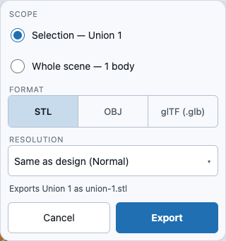

# Exporting your model: STL, OBJ and glTF

Export turns your model into a **mesh file** other tools read — an STL for a slicer, an OBJ for
a mesh viewer, a glTF for a web viewer or game engine. It is separate from
[saving](save-load.md): saving keeps your model editable in WarpCad; exporting hands a finished
shape to something else.

## Try it: export an STL

1. Drag a **Cylinder** and a **Cube** into the 3D view so they overlap, select both and press
   **Union** (the exports below show what that makes: one solid, `Union 1`).
2. Click the union in the 3D view to select it.
3. Open **File ▾**, choose **Export…**, leave the format on **STL**, and press **Export**.
4. The panel closes, your browser downloads **`union-1.stl`** (a body is named after itself,
   lowercased — a cube you never renamed would be `cube-1.stl`), and the status light at the
   right of the top bar reads `Exported union-1.stl — 668 triangles`.

## Exporting a file, step by step

1. Select the body you want — click it in the 3D view. (Select nothing to export
   **everything**; select several to export just those, together in one file.)
2. Open **File ▾** in the top bar and choose **Export…**. A small panel opens under the button.
3. Read the panel before you touch anything:

   

   - **Scope** says what is going to be written. With something selected it is already set to
     `Selection — Union 1` (or `Selection — 2 bodies, in one file`); with nothing selected it is
     `Whole scene — 3 bodies, in one file`. You can switch between the two.
   - **Format** is **STL** unless you picked something else last time — WarpCad remembers your
     last choice on this device.
   - **Resolution** is **Same as design (Normal)**: the file's curves have exactly as many
     sides as the 3D view shows. Pick **Fine** or **Print** to export smoother curves for this
     file only. The design itself is not changed, and a note says so. See
     [Resolution](resolution.md) for what each setting means for how holes and pegs fit.
   - The line underneath spells out exactly what you will get, name included:
     `Exports Union 1 as union-1.stl`.
4. Press **Export**. The panel closes, your browser downloads the file, and the status light at
   the right of the top bar says `Exported union-1.stl — 1,234 triangles` (the count is how you
   can tell a higher **Resolution** really made a finer file). Open the file in your slicer or a
   mesh viewer: it should look exactly like what you had on screen.

### A big export tells you it is working

Most exports finish before you have let go of the mouse. A large one — a whole scene of
boards and bolts, or a single very detailed solid — takes longer, and WarpCad says so instead
of looking frozen: after about a tenth of a second the **Export** button changes to
**Exporting…** and a line appears under it naming the file being written, for example
`Writing warpcad-scene.stl…`. Both disappear the moment the download starts.

You can keep using the app while that line is showing. The file is built in the background,
so the 3D view still orbits and pans and the rest of the window still responds — on a phone
especially, where the same export takes several times longer than on a laptop. A quick export
never shows either of these; if you see them, the file really is a big one.

If something is wrong with what you asked for, the message that appears is a **red** one and
the panel stays open (see [When an export is refused](#when-an-export-is-refused)) — the
`Writing…` line is only ever about progress, never about a problem.

**Cancel**, **Esc**, or tapping anywhere outside the panel closes it without exporting anything.
Nothing in your model or your selection changes while you do any of this.

On a phone the panel is the same one, with 44-pixel tap targets. Your browser's own download
sheet is the confirmation there — on an iPhone or iPad the file lands in the Files app under
Downloads, and **Preparing…** shows on the button for a moment the first time you pick glTF.
A phone is several times slower at building the file than a laptop, so the **Exporting…**
state above is the one you are most likely to see on one.

## When Export… is greyed out

The menu item is never hidden; when it can't be used it says why, right under its name:

| You see under **Export…** | Why | What to do |
|---|---|---|
| **Nothing to export** | The scene has no solid bodies yet. A sketch still open in the editor is not a body until you tap **Done**. | Place a shape first, or finish the sketch. |
| **Return to the latest step to export** | The History panel is showing you a *past* step (it says **Previewing step 2 of 5**). Exporting what you see there would hand you a file that isn't your model. | Press **Back to latest** in the strip under the top bar (or **Esc**). |

If you have **rolled back** in History (the strip says **Rolled back to step 2 of 5**), Export
still works and exports the model **as it is at that point** — the panel reminds you with
`(rolled back — 3 later steps not included)` so you never export an earlier state by accident.

## If something changes while the panel is open

The panel always shows what would be exported **right now**. If you press Undo (Ctrl/Cmd+Z)
with it open and the selection changes, the line changes with it. If you had *explicitly*
chosen **Selection** and the selection disappears, Export is switched off and the panel says
`The selection changed — choose what to export` — it will not quietly export the whole scene
instead. Pick a scope again and go on.

## What gets exported

| You had selected | The file contains |
|---|---|
| Nothing | Every body in the scene |
| One body | Just that body |
| Several bodies | Just those bodies, **together in one file** |
| A part inside a group (you had drilled in to one bolt thread, say) | The **whole body** that part belongs to |

Several bodies always go into a single file, never one file per body — that is what a
slicer plate or a mesh viewer expects, and the suggested name says so.

A body made of several named parts (a bolt, a nut, a library item) exports as the **one
combined solid** you would actually print: its visible parts fused together, with any
holes cut out. A part that is hidden stays out, exactly as it is on screen. A finished
[sketch shape](sketch-mode.md) exports like any other solid.

## The three formats

| Format | File | Best for | Notes |
|---|---|---|---|
| **STL** | `.stl` (binary) | Slicers and 3D printing | The default. Written so the surface is closed — no gaps for a slicer to complain about or "repair" into the wrong shape. |
| **OBJ** | `.obj` | Mesh viewers and other modelling tools | Triangles, with shared corner points. Closed, exactly like the STL — it is written from the same solid. |
| **glTF** | `.glb` (one binary file) | Web viewers, game engines, AR | A single self-contained file — there is no separate `.bin` to lose. Closed, like the other two. |

How smooth the curves in any of the three are is the **Resolution** choice above, which
defaults to the design's own setting. Round holes in a mesh always print slightly small,
by an amount that depends on the number of sides; [Resolution](resolution.md) has the
table and how to choose.

STL and OBJ carry no unit of their own; they are written in **millimetres**, with **Z up**,
which is what slicers assume — your 40 mm cube is a 40-unit cube.

glTF is the exception, because the format itself insists on **metres** and **Y up**. The
file records that conversion in one place (so it opens the right way up and the right
size in a glTF viewer) and leaves your geometry untouched.

## File names

- One body: its name, lowercased — `Union 1` becomes `union-1.stl`, `Cube 1` becomes
  `cube-1.obj`.
- Several bodies, or the whole scene: `warpcad-scene.stl` (or `.obj` / `.glb`).

## When an export is refused

WarpCad would rather tell you than hand you a file that will not open. A refusal appears in red
inside the panel, which stays open so you can change the scope or format and try again — no file
is downloaded:

| You see | Why |
|---|---|
| **Nothing to export** | The scene has no bodies (normally the menu item is greyed out before you get here). |
| **Cannot export "Ghost": it has no triangles** | That body has no surface to write — an empty result of a boolean, say. The message names the body. |
| **Cannot export "Hollow One": …** | That body's shape could not be reduced to one solid (a group with every part hidden). Named so you know which one to fix. |
| **The selection no longer matches anything** | Something you had selected was changed or absorbed by an operation before you exported; reselect and try again. |

## Checking a file

The quickest check is to open it somewhere else. Any slicer (PrusaSlicer, Cura, Bambu
Studio), a mesh viewer (MeshLab, Blender, macOS Quick Look for STL and OBJ), or an online
glTF viewer will do. The shape should match your viewport, at the size you built it.

Every file WarpCad writes — STL, OBJ **and** glTF — is a **closed surface**: every edge is
shared by exactly two triangles. If your slicer offers a mesh check — PrusaSlicer's *Fix by
Netfabb*, Bambu Studio's repair prompt, MeshLab's **Filters → Selection → Select
non-manifold edges** — it should find nothing to repair, whether you exported a plain box, a
Union of two shapes, a bolt from the library, or a whole scene of them in one file.

### Trying it on a shape that used to be the hard case

Worth doing once, because this is the shape that was wrong until recently and it is quick:

1. Drag a **Cylinder** into the viewport, then a **Cube**, and drag the cube so the two
   overlap.
2. Select both (click one, Shift-click the other) and press **Union**.
3. **File ▾ → Export…**, choose **glTF (.glb)**, press **Export**. You get `union-1.glb`.
4. Open it in Blender (**File → Import → glTF 2.0**) or at
   [gltf-viewer.donmccurdy.com](https://gltf-viewer.donmccurdy.com/).

The solid should stand upright, read **0.04 m** across if you built a 40 mm cube, and — the
part that changed — import as **one closed shell**, not a surface with holes along the seam
where the cylinder meets the cube. In Blender, *Edit Mode → Select → All by Trait →
Non Manifold* should select nothing. Export the same body as STL and you should see the
same solid, with the same closed surface: the three formats do not disagree about the shape
you built.

## Related

- [Resolution](resolution.md) — how many sides curves get, in the design and per export,
  and why it matters for fit.
- [Saving and reopening your work](save-load.md) — saving your *model* (which you can
  edit again) is separate from exporting a *mesh* (a finished shape other tools read).
- Why STL is written from the modelling kernel rather than from what is drawn on screen,
  and why the glTF is closed too although a viewer does not need it to be:
  [`decisions/persistence-export.md`](decisions/persistence-export.md).

<!-- SPDX-License-Identifier: CC-BY-SA-4.0 -->
