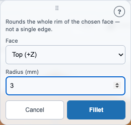
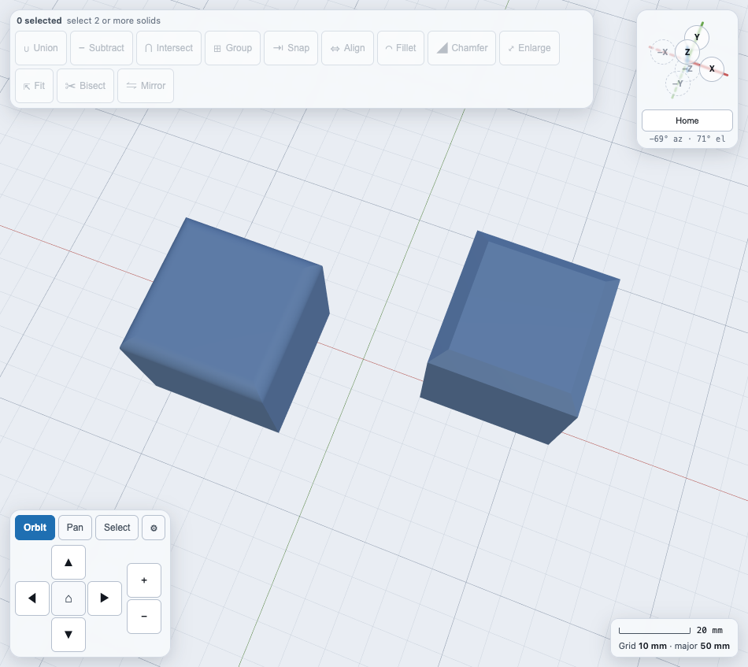
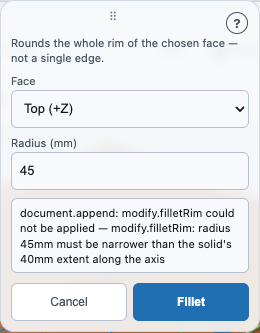
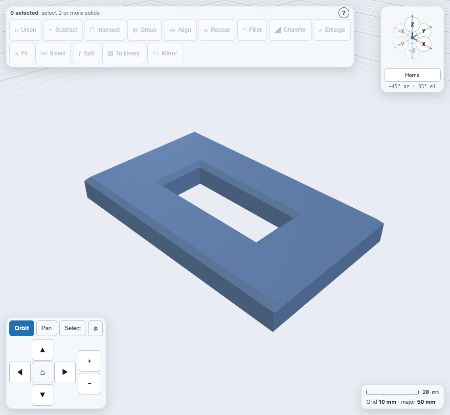

# Rounding or bevelling an edge: Fillet and Chamfer

**Fillet** and **Chamfer** round or bevel the whole rim where a shape's flat top,
bottom, or side face meets its walls — a rounded-over box lid, a bevelled shelf
corner. They live on the same **Operations toolbar** as
[Union, Subtract and Intersect](booleans.md), [Group](groups.md) and
[Align](snap-align.md), as the sixth and seventh buttons.

## This rounds a whole face's rim, not one edge you click on

If you came here expecting to click a single edge of a shape and round just that
one edge, read this section before the rest — it explains why that isn't offered
and what you get instead.

WarpCad's geometry engine (`@jscad/modeling`) can only fillet or chamfer the
entire rim of one flat, axis-aligned face at once — the same limitation the
predecessor tool this app grew out of always had. There is no "pick one edge"
mode. Choosing **Top (+Z)**, for example, rounds *all four* top edges of a box
together, not whichever one you might have clicked. See
[the geometry kernel decision doc's own addendum](decisions/geometry-kernel.md#addendum-todocore-003-filletchamfer-and-bearing-spiked)
if you want the full technical reasoning for why arbitrary-edge fillets aren't
available, and what a future geometry engine would need to offer them.

| Button | What it does |
|---|---|
| **◠ Fillet** | Rounds the whole rim of the chosen face with a quarter-circle profile. |
| **◢ Chamfer** | Bevels the whole rim of the chosen face at a straight 45° angle. |

## You need exactly 1 shape selected

Fillet and Chamfer are a **single-object** tool, unlike every other button on
this toolbar. They stay dimmed and unclickable unless **exactly one** shape is
selected — not zero, and not two or more. Click one shape to select it, and
both buttons light up.

## The short version

Select the cube, press **Fillet**, choose **Top (+Z)** in the **Face** dropdown, type `3`
(mm) into **Radius (mm)**, and press **Fillet** in the popover: the top edges round off.

## A worked example

1. Drag a **Cube** into the 3D view and click it to select it.
2. Click **Fillet**. A popover opens with a **Face** dropdown and a
   **Radius (mm)** field.
3. Choose **Top (+Z)** from the Face dropdown, and type `3` into Radius.
4. Click the **Fillet** button inside the popover. The cube's top rim rounds
   off — the top edges are now smoothly curved — while the rest of the cube
   stays sharp-edged. The popover closes, and the cube stays selected.
5. Click **Chamfer**, choose **Bottom (−Z)**, and set Radius to `2`. Click
   **Chamfer** inside the popover — the bottom rim now bevels at 45°.

Chamfer works the same way and bevels the rim instead of rounding it:

Here are the two results side by side, a Fillet on the left cube and a Chamfer on the
right one, both with the top face chosen and a radius of 4:

Both faces are now rounded or bevelled independently on the same cube — Fillet
and Chamfer can be used more than once on the same shape, on different faces,
and each use builds on the last rather than starting over from the original
sharp shape.

## The popover's fields

- **Face** — which flat, axis-aligned face's rim to round or bevel: **Top
  (+Z)**, **Bottom (−Z)**, **Front (+Y)**, **Back (−Y)**, **Right (+X)**, or
  **Left (−X)**. These are the six faces of the shape's own bounding box, named
  by which way they face — not "edges."
- **Radius (mm)** — how far the rounding or bevelling reaches, in millimetres.
  There's no default value: you have to type one before the popover's own
  Fillet/Chamfer button turns on. If the radius you type is too large for the
  shape — larger than (or equal to) the shape's own size along that
  direction — the operation is rejected and an explanation appears directly in
  the popover rather than only in the browser's own console.
- **Cancel** closes the popover without changing anything. **Fillet**/
  **Chamfer** (the popover's own commit button, labelled to match whichever one
  you opened) applies the rounding or bevelling.

A radius of 45 on a 40 mm cube is refused like this, and the cube is left as it was:

## What happens to the shape's size, in the Inspector

Rounding or bevelling a rim removes material — a filleted or chamfered shape is
measurably smaller in volume — but it does **not** shrink the shape's overall
footprint: the face you rounded still reaches exactly as far as it did before,
just with its corners eased rather than sharp. The Inspector's own Size fields
for the shape stay unchanged, since they describe the shape's own original
creation parameters, not its current rounded-off silhouette.

## Shapes with holes

If the face you pick has a hole in it, **the rim of the hole is rounded or
bevelled too**, not just the outside edge. Fillet and Chamfer work on the whole
face's rim, and a hole is part of that rim. The cut on a hole makes the hole
**wider** at the face by the radius you typed, the same way the outside edge is
cut back by it.

Try it:

1. In Sketch mode, draw a rectangle and then a smaller rectangle inside it, and
   mark the inner one as a hole (a 100 x 60 mm outer with a 50 x 20 mm hole works
   well).
2. Extrude the sketch 10 mm.
3. Select the extruded body.
4. Click **Chamfer**, set **Face** to **Top (+Z)**, type **2** as the radius and
   press **Chamfer**.

Both the outer edge and the edge of the hole come out bevelled by 2 mm:

Several holes, a hole near a corner, round holes, and an island standing inside a
hole all work the same way.

### When the radius is too big for the wall

Because the cut eats into the material from **both** sides of a wall, a wall
between a hole and the outside edge (or between two holes) can only take a radius
under half its width. A larger radius is refused and the shape is left alone. For
a 2 mm wall and a radius of 1.5:

> radius 1.5mm is too large for this face — the wall between a hole and the
> outside edge is only 2.00mm wide, and the rim cuts into it by 1.5mm from each
> side, so the two cuts would run into each other. Use a radius under 1.00mm.

(On a very thin plate, a radius that would use up the whole cross-section is
refused earlier, with a message that says the radius is wider than the
cross-section can absorb. The fix is the same: use a smaller radius.)

A negative radius (a flare) goes the other way: it makes every hole smaller, and
one that is too small to take it is refused too:

> a 3mm flare closes a hole in this face — a flare shrinks every hole by 3mm on
> each side, and this one is too small to take it. Use a smaller flare, or fill
> the hole first.

## Not yet supported

- **Picking an edge directly.** As covered above, this isn't offered by the
  current geometry engine at all — only whole-face-rim rounding or bevelling.
- **A graphical face picker.** The Face field is a plain dropdown list rather
  than a clickable cube icon showing which face is which. A visual picker is a
  planned polish pass, not built yet.
- **A custom segment count for Fillet's curve.** The smoothness of the rounded
  profile uses a fixed internal default; there's no field to make it coarser or
  finer.

## Notes and gotchas

- **Units are millimetres**, as everywhere else in WarpCad.
- **A rejected radius doesn't close the popover.** If your typed radius is too
  large for the shape, fix the value and try again — nothing was committed, and
  the shape is unchanged.
- **The shape stays selected throughout**, including after a successful Fillet
  or Chamfer — the gizmo, dimension lines, and Inspector panel all keep working
  on it normally, so you can immediately round a different face without
  reselecting.

## See also

- [Combining shapes: Union, Subtract and Intersect](booleans.md) and
  [Combining shapes into a group](groups.md) — the toolbar's other buttons,
  which need two or more shapes selected rather than exactly one.
- [Precise placement: Align](snap-align.md) — the toolbar's other
  selection-count-gated tool (one or two, rather than Fillet/Chamfer's exactly
  one), and the popover pattern Fillet/Chamfer's own popover reuses.
- [Resizing and cutting a shape: Enlarge, Fit and Bisect](resize-bisect.md) —
  the toolbar's other exactly-1-gated trio, reusing this pair's own popover
  pattern a third time.
- [The geometry kernel decision, and its fillet/chamfer addendum](decisions/geometry-kernel.md#addendum-todocore-003-filletchamfer-and-bearing-spiked) —
  the full technical reasoning behind the rim-only limitation.
- [Selecting a shape, and reading its size](selection-and-inspector.md) — what
  selection does, and how the Inspector's Size fields relate to a shape's
  actual current geometry.

<!-- SPDX-License-Identifier: CC-BY-SA-4.0 -->
