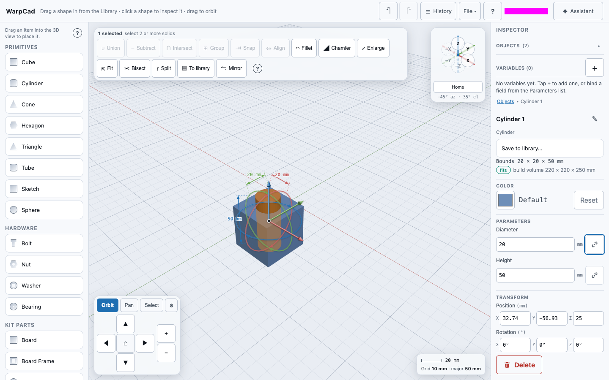
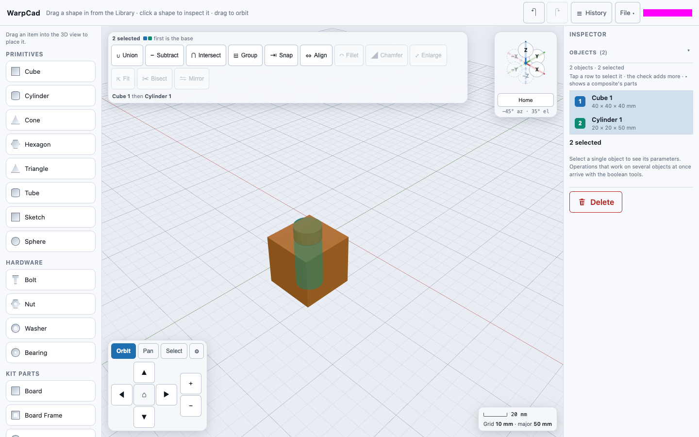
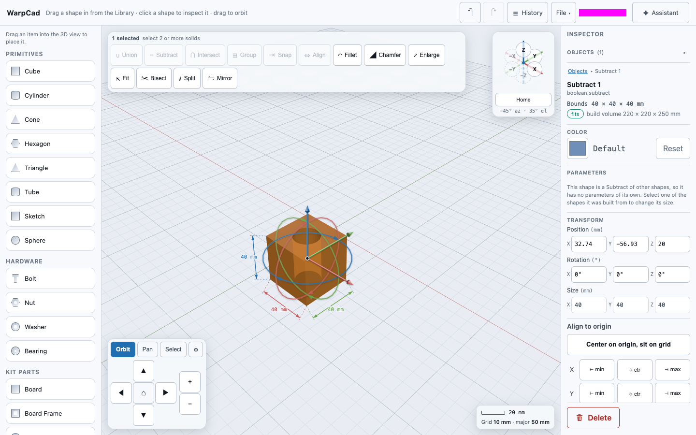
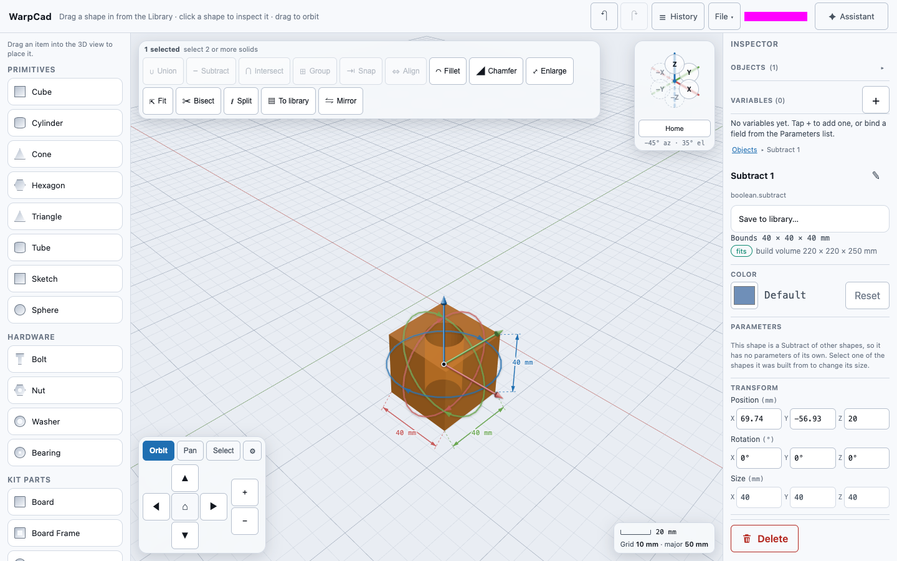
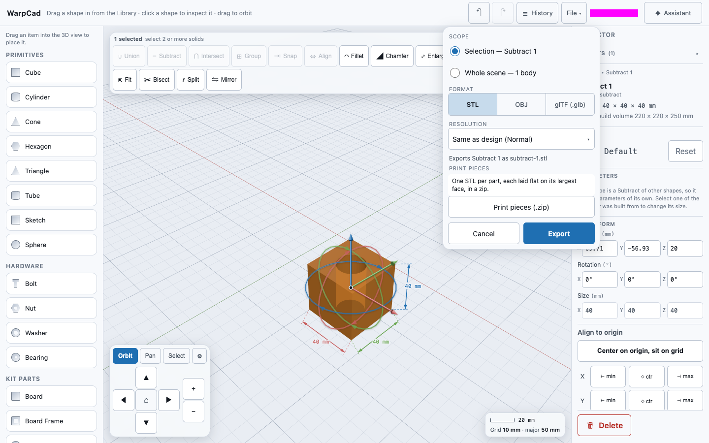

# Getting started in five minutes

This page walks you from an empty scene to a finished part on disk: a 40 mm cube with a 20 mm
hole through it, moved to where you want it, saved out as an `.stl` file you can send to a
slicer. Every step uses the real controls and says what you should see when it worked. The
animation above is the whole thing at once; the steps below are the same moves one at a time.

You need WarpCad open in a browser. Go to **https://app.warpcad.com**; there is nothing to
install. (To run your own copy instead, see [Run it yourself](../README.md#run-it-yourself) in the
README.) It starts empty: the **Library** on the left, the 3D view in the
middle with its grid, and the **Inspector** on the right. On a phone or tablet the panels
fold into sheets; the steps are the same, and [Using WarpCad on a phone or
tablet](mobile.md) says where each control moved to.

Where you drop a shape decides where it lands, so the numbers you read off the Inspector
(such as a position) will differ from the ones shown here. Sizes you type are in
**millimetres (mm)**.

## 1. Place a Cube and a Cylinder

1. In the Library's **Primitives** list, press on **Cube** and drag it into the 3D view. A ghost
   preview follows your pointer. Let go over the grid, and the cube lands there: a 40 mm cube
   with a gizmo on it.
2. Do the same with **Cylinder**, letting go over the **same spot**. The new cylinder is
   concentric with the cube, 40 mm across and 50 mm tall, so it pokes 10 mm out of the top.
3. The cylinder is now selected, and the Inspector shows its **Diameter** and **Height**.
   Click the **Diameter** field, replace `40` with `20` (mm) and press **Tab**. The cylinder is
   now 20 mm across.

You should see two shapes (the Inspector's object list says **Objects (2)**) and the Inspector
reading **Cylinder 1**. The details are in [Placing a shape](primitive-placement.md) and
[Selecting a shape, and reading its size](selection-and-inspector.md).

## 2. Select the Cube, then the Cylinder

Subtract cuts the **second** shape out of the **first**, so the order you pick them in matters.

1. Click the **cube** (on its side face, away from the gizmo's rings). Only the cube is selected.
2. Hold **Shift** and click the part of the **cylinder** that sticks out of the top.
3. The Operations toolbar lights up. It reads **2 selected**, and underneath it says
   `Cube 1 then Cylinder 1`: the cube is the base, and the cylinder is what gets removed.

If the toolbar stays dimmed, you have one shape selected, not two; its buttons need two. If it
says `Cylinder 1 then Cube 1`, you picked them the other way round: click empty grid to clear
the selection and start this step again. See [Combining shapes](booleans.md).

## 3. Press Subtract

Press **Subtract** on the Operations toolbar. The cube and the cylinder are replaced by one
solid, **Subtract 1**: a 40 mm cube with a 20 mm round hole through it. It is selected, and
the toolbar dims again because only one shape is selected.

Nothing was thrown away. Open **History** in the top bar to see the three steps (the cube,
the cylinder and the Subtract) and change any of them later; see [The History
panel](timeline.md). Pressed the wrong button? **Undo** at the top right takes it back, see
[Undoing and redoing a change](undo-redo.md).

## 4. Nudge the result with the gizmo

1. With **Subtract 1** selected, find the **red arrow** of the gizmo: it points along X.
2. Press on the arrow and drag along it. The part follows your pointer, and the **X** box under
   **Transform → Position (mm)** counts as you go. Let go and it stays.
3. To be exact instead, click that **X** box and type a number in mm. The gizmo and the box
   drive the same position.

The rings are for turning, and the cone-tipped arrows move; see [Moving and turning a
shape](selection-and-inspector.md#moving-and-turning-a-shape).

## 5. Export an STL

1. With the part still selected, open **File ▾** in the top bar and choose **Export…**.
2. A panel opens. Scope reads **Selection — Subtract 1** and Format is **STL**. The line at the
   bottom reads `Exports Subtract 1 as subtract-1.stl`: the file is named after the body.
3. Press **Export**. Your browser downloads **`subtract-1.stl`**, the panel closes and the
   status light at the top right reads `Exported subtract-1.stl`, with a triangle count.

Open the file in your slicer or a mesh viewer: it should look like what you had on screen.
Exporting is separate from saving. [Exporting your model](export.md) covers OBJ and glTF,
exporting a finer mesh, and the whole scene; [Saving and reopening your
work](save-load.md) covers keeping a copy you can edit again (your work also autosaves in this
browser as you go).

## Keep WarpCad on your home screen

WarpCad can be installed like an app, so it opens in its own window without the browser's
toolbars. Its icon is a dark cube in a blue-white flash, with stars streaking out around it.

- **iPhone or iPad (Safari):** tap the **Share** button, choose **Add to Home Screen**, then tap
  **Add**. The icon appears on your home screen, labelled **WarpCad**.
- **Android (Chrome):** open the **⋮** menu and choose **Install app** (on some phones it is
  called **Add to Home screen**), then confirm.
- **Computer (Chrome or Edge):** click the install icon at the right-hand end of the address bar,
  then **Install**. WarpCad gets its own window and a dock or Start-menu entry.

## Where to go next

- [Placing a shape](primitive-placement.md): every Library item, snap guides, and placing on a phone.
- [Moving around the 3D view](viewport-navigation.md): orbit, pan, zoom and the orientation triad.
- [Combining shapes](booleans.md), [Align](snap-align.md), [Fillet and Chamfer](fillet-chamfer.md): the rest of the Operations toolbar.
- [Sketch primitives](sketch-mode.md): draw an outline and turn it into a solid.
- [Using the built-in help](help.md): press the **?** in any tool's pop-up, or **File ▾ → Help and documentation**, to read about it without leaving your project.
- [The full list of pages](README.md).

<!-- SPDX-License-Identifier: CC-BY-SA-4.0 -->
