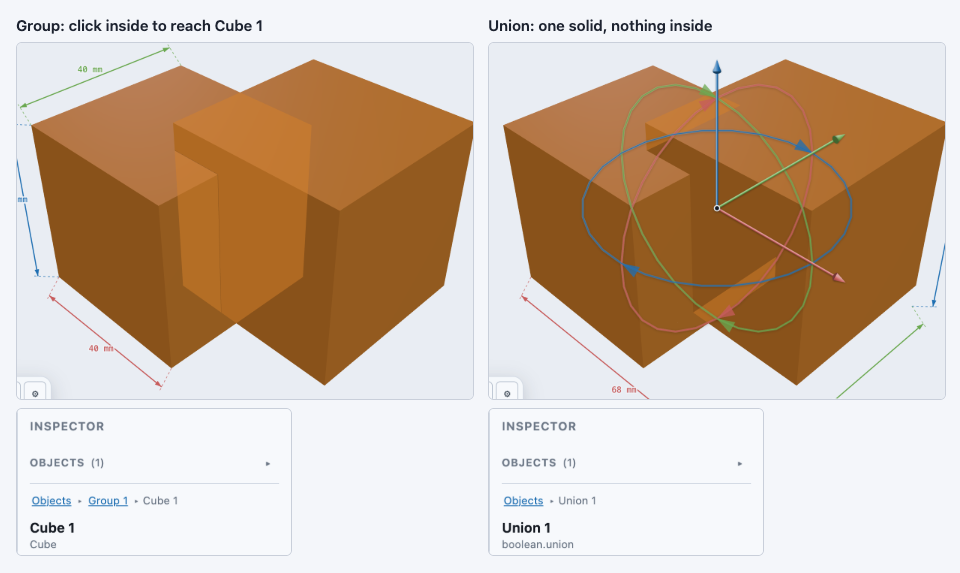
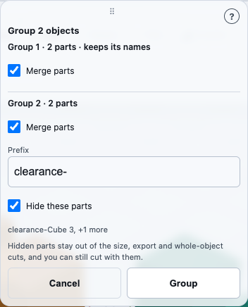

# Combining shapes into a group

**Group** turns several separate solids into one thing you can select, move and
rotate together — without merging their shapes into each other. It lives on the
same **Operations toolbar** as [Union, Subtract and Intersect](booleans.md), as the
fourth button.

Group is fundamentally different from a boolean: Union, Subtract and Intersect
compute a *new* volume and throw away the shapes that went into it. Group keeps
every original shape exactly as it was — nothing is added, removed or merged — and
just makes the whole collection behave as a single selectable body.

| Button | What it does |
|---|---|
| **⊞ Group** | Combines the selected solids into one body. Each solid's own geometry is preserved; only how you *select* them changes. |

## You need at least two shapes selected

Just like Union, Subtract and Intersect, the Group button stays **dimmed and
unclickable until two or more solids are selected** — see
[Combining shapes: Union, Subtract and Intersect](booleans.md#you-need-at-least-two-shapes-selected)
for how selecting more than one shape works (Shift-click on desktop, or the
**Select** marquee tool on a touch screen).

Unlike Subtract, **Group of plain solids does not care what order you pick things in.**
There is no base and no subtrahend — every selected solid is an equal member of the
resulting group, so the badge under the toolbar just shows the selected count, with no
"first is the base" note. Order does matter once a selected body has its own parts: see
[Grouping groups](#grouping-groups-merging-their-parts).

## A worked example

1. Open the Library panel and drag a **Cube** into the 3D view. Drag a **second
   Cube** in somewhere that does *not* overlap the first — leave some empty grid
   between them.
2. Click the first cube, then hold **Shift** and click the second. The Operations
   toolbar's badge reads `2 selected`, and all four buttons — Union, Subtract,
   Intersect and **Group** — light up.
3. Click **Group**. Both cubes become **one selectable body**: the transform gizmo
   now sizes itself to fit both cubes together, and dragging the gizmo's arrows
   moves both cubes at once, keeping their relative positions.
4. The result is selected on its own, named `Group 1` in the Inspector. Because
   only one thing is selected again, the toolbar dims until you select another
   two.

Look closely at the two cubes after grouping: **neither one changed shape.**
Nothing was unioned, cut, or intersected away — this is the difference from
running Union on the same pair, which would replace both cubes with a single
merged volume.

### Group or Union?

The same two overlapping cubes, grouped on the left and unioned on the right. Each result
is one thing in the scene, but only the group still has two cubes inside it: click a
grouped cube twice and the Inspector reads `Group 1 ▸ Cube 1`. Click a union twice and you
are still on `Union 1`, because there is no longer a cube in it to open.

Pick Group when you want to move a set of parts together but keep them separate shapes
(a screw and the board it sits on). Pick [Union](booleans.md) when you want one solid you
can cut or export as a single piece.

## What happens to the original shapes

The two shapes you grouped are **gone as independently-selectable bodies in the
scene list** — the group is one entry, the same way a boolean result replaces its
operands. The difference is what is *inside* the result: a boolean's result is one
computed volume, while a group's result still contains both original solids,
complete — and you can look at either one individually, as the next section shows.

A colour you gave a shape stays on it. To see that:

1. Drag two **Cubes** into the view, and colour the first one red in the Inspector.
2. Select both and press **Group**. The first Cube stays red.
3. Click it twice to reach `Group 1 ▸ Cube 1`. Press **Reset** under Color only if you
   have recoloured it since: Reset returns it to the red it had when you grouped it.

## Selecting a part inside a group

Once a group is selected as a whole, **clicking again on one of its parts narrows
the selection to just that part**. This is a two-step gesture on purpose: the first
click always gives you the whole group, so you never have to fight your way back
out to the assembly when that is what you meant to grab.

Continuing from the worked example above:

1. Click empty grid to deselect, then click either cube. The whole group is
   selected: the gizmo and the dimension lines span **both** cubes, and the
   Inspector shows the group as one object.
2. Click **the same cube a second time**. The selection narrows to that cube
   alone. Three things change together, so you can see it happened:
   - The Inspector header gains a breadcrumb reading **`Group 1 ▸ Cube 1`**.
   - The dimension lines shrink from the pair's combined span to that one cube's
     own size — 40 mm on each axis, for a default Cube.
   - The Inspector shows that cube's own name and parameters instead of the
     group's.
3. Click the **other** cube. You go straight to it — `Group 1 ▸ Cube 2` — without
   having to step back up to the group first.
4. Click the **`Group 1`** part of the breadcrumb to step back up to the whole
   group. The gizmo returns, sized to both cubes again.
5. Click empty grid to deselect everything.

### Looking inside a group is read-only

While you are looking at a part inside a group, **the transform gizmo disappears
and the Inspector's Position and Rotation fields stop being editable.** That is
deliberate, not a missing feature: WarpCad can move the *group*, but it has no way
yet to move one member independently of the others. Showing a gizmo that quietly
moved the whole assembly — while the panel beside it named a single part — would be
worse than showing none.

So while drilled in you can read a part's name, size, position and parameters, but
not change them. Click the breadcrumb's group segment to step back up, and the
gizmo and editable fields come back for the group as a whole.

One kind of group is an exception to the parameter half: parts that came from a
**built-in multi-part shape** (rather than from shapes you grouped yourself) show
their name and measurements but no parameter fields, because those parts were never
separate shapes you created and so have no parameters of their own to show. That stays
true after the built-in shape is [merged into a group](#grouping-groups-merging-their-parts).

### This works on shapes you have moved, too

A built-in multi-part shape — a **Bolt / screw** from the Hardware section, a **Raspberry Pi
board**, anything with named parts inside it — keeps those parts after you drag it in
and after you move or turn it with the gizmo. Drag a Bolt / screw into the view, move it
somewhere with the gizmo, then click it twice: the breadcrumb reads `Bolt / screw 1 ▸ head`,
and clicking its thread takes you straight there too. Earlier versions lost the
breakdown the moment the shape was placed, so clicking a Bolt twice did nothing at all.

A bolt's `tap` clearance body is a **hidden** part, so it has no surface to click on —
the second click above can only ever land on `head` or `thread`. Reach `tap` from the
Inspector's [**Parts**](selection-and-inspector.md#parts) section while the bolt is
selected, or from its row in the Inspector's
[object list](selection-and-inspector.md#picking-one-piece-of-a-hidden-shape), the same
way you would reach any other hidden piece.

## Grouping groups: merging their parts

Select bodies that have their own parts (two groups, a Raspberry Pi and a Cube, two bolts)
and press **Group**, and a small panel opens instead of grouping straight away. By default
every part lands in **one flat group**: you can still pick, measure and cut with each one,
hidden parts and colours included. Grouping plain solids stays one click, with no panel.

Try it (millimetres, Z up):

1. Drag two **Cubes** into the view, select both, and press **Group**: `Group 1`. Do the
   same with two more Cubes: `Group 2`.
2. Click `Group 1`, hold **Shift** and click `Group 2`, then press **Group**. A small panel
   opens.
3. In the `Group 2` row, leave **Merge parts** ticked and type `clearance-` in **Prefix**.
   The line below it shows `clearance-Cube 3, +1 more`. Tick **Hide these parts**, then
   press the panel's **Group**.
4. One body remains, still named `Group 1`. In the Inspector's **Parts** section it lists
   `Cube 1` and `Cube 2`, and `clearance-Cube 3` and `clearance-Cube 4` carry the **hidden**
   label. Turn on **Show hidden parts** to see those two drawn as well.
5. To keep a whole group as a single part instead, untick **Merge parts** for it.
6. To add to a built-in shape, drag in a **Raspberry Pi** and a **Cube**, select both and
   press **Group**, then press the panel's **Group**. The result is still named
   `Raspberry Pi 1`, its parts now include `Cube 1`, and `hole1` is still there to cut with.

What to know:

- **The first merging body gives the name and keeps its part names**, and the others follow
  in the order you picked them. A Cube picked before a Pi still joins that Pi. A pick depth
  is ignored: the whole body joins.
- **The prefix is used exactly as typed**, so include your own separator: `clearance` gives
  `clearanceScreen`, and `clearance-` gives `clearance-Screen`. A prefix cannot contain a
  comma or start with a space, and a part name can be at most 80 characters.
- **Two shapes with the same part names need a prefix, and the panel fills one in.** A Pi and
  a Camera both have `hole1`, so the Camera's row opens with its own name as the prefix. If
  you change it to something that clashes, the panel says which part clashes and **Group**
  dims until you fix it.
- **Hide these parts decides what counts.** Hidden parts stay out of the size, export and a
  whole-object cut. Leave it unticked and the added parts count as part of the object. A
  part that was already hidden stays hidden either way, so ticking nothing never reveals a
  bolt's `tap`.
- **Cutting with a hidden part leaves the group in place; cutting with a visible part uses it
  up.** So one kit of clearances can cut many pockets, one at a time. See
  [Cutting with just one part](booleans.md#cutting-with-just-one-part-of-a-multi-part-shape).
- **A merged built-in shape's options move to History.** A merged Pi has no **Model** field in
  the Inspector any more; change it from the Pi's own row in History, which rebuilds the
  merge. If the new model has a part name that is already taken, that step is refused and
  says which name.
- **Undo takes the whole merge back**, with each original group as it was, colours and hides
  included.
- **Groups you merged before are not changed.** A project saved with a group of groups keeps
  each one as a single part. Press **Group** again on new selections to merge them.

## Notes and gotchas

- **Units are millimetres**, as everywhere else in WarpCad.
- **More than two at once is fine.** Select three or more solids and Group
  combines all of them into one body, the same way Union does.
- **Order does not matter for plain solids.** Grouping A-then-B gives the same result
  as B-then-A — there is nothing analogous to Subtract's base/subtrahend distinction.
  When a selected body has its own parts, [order sets the name and the part
  order](#grouping-groups-merging-their-parts).
- **A group's dimension lines and Inspector report the combined bounding box** —
  the smallest box that contains every part — not any single part's own size. To
  read one part's own size, click into it as described above.
- **Shift-clicking works on whole groups, not on parts.** Adding to a selection
  always operates on entire bodies; looking inside a group is a display depth, not
  a second thing you can add to a multi-selection.

## See also

- [Combining shapes: Union, Subtract and Intersect](booleans.md) — the same
  toolbar's other three buttons, which compute a new volume instead of keeping
  every part intact.
- [Precise placement: Align](snap-align.md) — the same toolbar's Align
  button, which also keeps every shape intact but, unlike Group,
  never combine them into one selectable body at all.
- [Placing a shape](primitive-placement.md) — getting shapes into the view in the
  first place.
- [Selecting a shape, and reading its size](selection-and-inspector.md) — what
  selection does, and reading a group's combined size afterwards.

<!-- SPDX-License-Identifier: CC-BY-SA-4.0 -->
