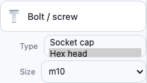
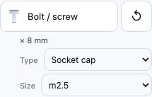
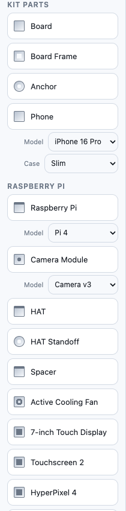
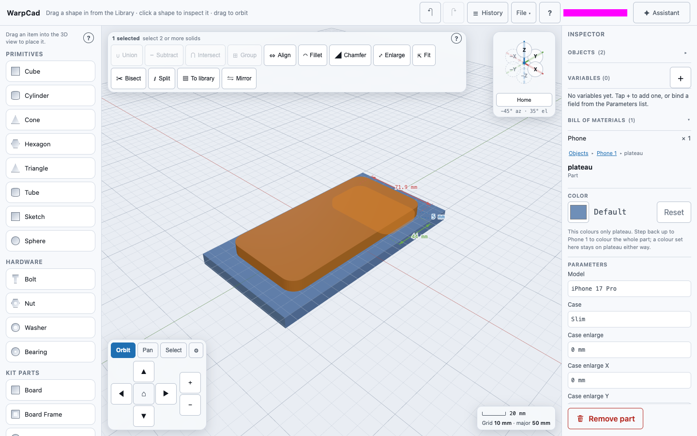
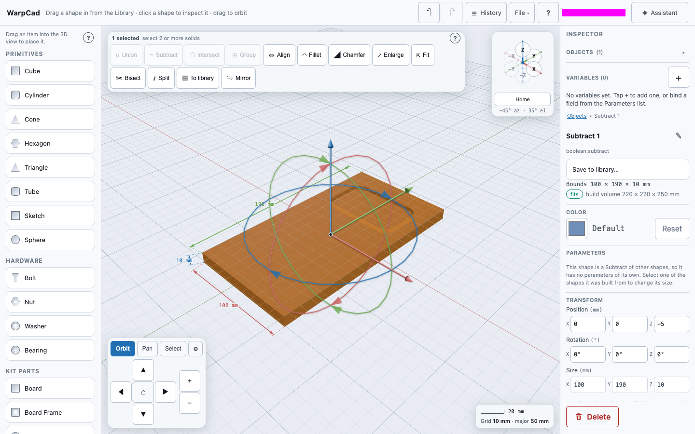

# Hardware, kit parts and Raspberry Pi parts

The Library has three sections of real-world parts you place the same way as a Cube: drag the
row into the 3D view and let go. This page is about what you get, how to pick the size you
actually want (an M4 screw, a 608 bearing, a Pi 5), and what the hidden extras on those parts
are for. The dragging itself is covered in [Placing a shape](primitive-placement.md); this
page doesn't repeat it.

Part names such as Raspberry Pi identify what a part is compatible with, not an endorsement; see [Trademarks and names](https://github.com/WarpCad/warpcad/blob/main/LICENSING.md#trademarks-and-names).

All sizes below are millimetres unless a part is named in inches (`1/4 socket`, `#8`).

## Hardware: bolts and screws, nuts, washers and bearings

| Row | Sizes you can pick | Starts as |
|---|---|---|
| **Bolt / screw** | Six **Types**, each with its own sizes: see [Bolts and screws](#bolts-and-screws) below | Hex head, M10, 20 mm long |
| **Nut** | A size for every bolt above: `m1.6` to `m20`, and imperial `#0 hex` to `1 hex` | M4 |
| **Washer** | `m1.6` to `m20`, plus `1/4`, `5/16` and `1/4 fender` | M6 |
| **Bearing** | Standard bearing numbers: `608`, `6000`-`6004`, `6200`-`6204`, `6300`-`6304` | 608 (22 mm outside, 8 mm bore, 7 mm wide) |

### Bolts and screws

Bolts and screws are one row, **Bolt / screw**. Before you drag it, choose a **Type** in the
dropdown beside the row; the **Size** list next to it then offers only the sizes that exist for
that Type. If the Size you had isn't offered for the new Type, it falls back to that Type's
usual size.

| Type | Sizes you can pick | Opens on |
|---|---|---|
| **Socket cap** | Metric `m1.6` to `m20` (`m2.5`, `m3`, ...) and imperial `#0` to `1` (`1/4`, `5/16`, ...) | `m3` |
| **Hex head** | Metric `m10` to `m20` and imperial `1/4` to `1`. There is no metric hex head below `m10`: small metric bolts are socket caps | `m10` |
| **Pan head** | `m4` only. That is the only metric machine-screw table the hardware library ships; more sizes are a table addition, not something to guess | `m4` |
| **Flat head** | Metric `m2`, `m2.5`, `m3`, `m4`, `m5`, `m6`, `m8`, `m10`. The head is a cone, for a countersunk hole | `m3` |
| **Wood screw, pan head** | Gauges `#2` to `#16` | `#8` |
| **Wood screw, flat head** | Gauges `#2` to `#16`. The head is a cone, for a countersunk hole | `#8` |

A fastener is as long as you say, so it has a **Length** box (mm); **Type**, **Size** and **Fit**
are lists. You can change the Type and the Size after you've placed it, in the Inspector, and the
part is rebuilt where it stands. A bolt and its nut share a size, so for an `m2.5` socket cap
pick `m2.5` on the nut and on the washer. A project saved before the Type list existed, with
`m10 hex`-style bolts or the old separate screws, opens and builds exactly as it did; nothing is
rewritten until you edit that part.

### The Library remembers your last choice

When you change a placed part in the Inspector, the Library remembers it, and the **next** part you
drag from that row starts the same way. Building an enclosure means placing the same screw six or
eight times; you set it up once.

- **What is remembered**: everything the Inspector lets you edit on that part (for a Bolt / screw,
  its **Type**, **Size**, **Length** and **Fit**; for a Raspberry Pi board, its **Model**). It is
  remembered per row, per device, and it survives closing the tab. It is not saved in your
  project file.
- **How you can tell**: the row's lists show the remembered value, and a line under the row's
  name spells out the rest (`× 8 mm`). The dragging preview shows the remembered part too.
- **Which rows**: every row in **Hardware**, **Kit Parts** and **Raspberry Pi**, and your own
  parts under **My parts** that have editable numbers. **Primitives** and **Text** always start from
  their defaults: a Cube's size describes that one Cube, and the next label should not repeat the
  last one's words.
- **Going back**: press **↺** at the right edge of the row. It goes back to its usual starting
  part (Hex head, `m10`, 20 mm for Bolt / screw), and the **↺** and the summary line disappear.
- **What does not change it**: **Undo** (undoing the M2.5 edit leaves the next drag at M2.5, because
  the memory is a preference of yours, not part of the drawing), an edit made by the AI partner
  or an MCP tool (an AI-placed M3 does not change what *your* next drag drops), merging or opening
  a file, and an edit you cancel in the repair dialog. The last edit you commit wins, even if it
  was to a part you placed last week.

#### Example: place eight M2.5 screws

1. Drag **Bolt / screw** into the 3D view.
2. In the Inspector set **Type** to **Socket cap**, **Size** to `m2.5` and **Length** to `8` (mm).
   The **Bolt / screw** row in the Library now shows **Socket cap** and `m2.5` in its lists, and
   `× 8 mm` under its label.
3. Drag **Bolt / screw** in again. The new screw is already an M2.5 socket cap, 8 mm long. Drag it
   in six more times; the first one stays where you put it.
4. To go back to the default, press **↺** on the **Bolt / screw** row. It returns to Hex head `m10`,
   20 mm.

### Example: a 30 mm M12 bolt, and the bill of materials

1. Open the **Library** and drag **Bolt / screw** into the 3D view. Let go; it lands on the grid
   and is selected, and the **Inspector** shows its parameters.
2. In the Inspector, set **Size** to `m12`. The bolt is rebuilt in place. (A new bolt
   already starts as a hex head `m10`, so the Type stays Hex head. If you have placed
   screws before, the row starts from your last choice instead: press **↺** on the row first.
   See [The Library remembers your last choice](#the-library-remembers-your-last-choice).)
3. Click the **Length** box, type `30` (mm) and press Enter. The bolt grows to 30 mm of thread
   under its head.
4. Look at **Bill of materials** just under the object list: one line, `Bolt / screw M12 hex × 30 mm × 1`.
   See [Bill of materials](bill-of-materials.md).

### Example: a matching M2.5 bolt and nut

1. In the Library, set the **Bolt / screw** row's **Type** to **Socket cap** and its **Size** to
   `m2.5`, then drag it into the 3D view. In the Inspector set **Length** to `8` (mm).
2. Drag **Nut** into the 3D view and set its **Spec** to `m2.5`.
3. **Bill of materials** shows `Bolt / screw M2.5 socket × 8 mm × 1` and `Nut M2.5 × 1`.

A bolt for every mounting hole of a board needs the same placement four times. To place one
and have the app do the rest, see
[Repeating a placement on every hole](snap-align.md#repeating-a-placement-on-every-hole).

### Example: a countersunk flat-head screw

1. Open **Library → Hardware**. Next to **Bolt / screw**, choose **Type: Flat head** and **Size:
   M3**, then drag it onto your part.
2. In the Inspector set **Length** to `10` (mm) and **Fit** to `close`.
3. To countersink the hole, tick **Show hidden parts**, select your part, then add the screw's
   `tap` as the second operand of **Subtract**.
4. The Bill of materials reads `Bolt / screw M3 flat × 10 mm × 1`.

### Example: a wood screw into a printed boss

Choose **Type: Wood screw, flat head** and **Size: #8**, drag it onto a printed boss, and set
**Fit** to `softwood`. Subtracting its `tap` leaves a pilot hole the thread bites into, plus the
countersink for the head.

### Fit: the part you can't see

A bolt or screw has a **Fit** list. Fit decides how much room its *clearance envelope* leaves
around the metal. That envelope is a hidden part named `tap`: a slightly fatter copy of the
fastener that you subtract from your own part to leave a hole it slides through, instead of one
it jams in. It is not drawn by default, and a plain Subtract uses the fastener's metal, not the
envelope.

- **Socket cap, hex, pan and flat head**: `tap`, `close` or `loose`, from the metric and imperial
  tap-size tables. A size with no fit data has no Fit field and no `tap` part; Fit is hidden
  rather than guessed. For a flat head the grown cone *is* the countersink.
- **Wood screws**: `clearance`, `hardwood` or `softwood`. `clearance` is the hole the shank
  passes through freely, in the piece being fastened down. `hardwood` and `softwood` are the pilot
  hole for the piece the thread bites into, narrower than the thread on purpose. A new wood
  screw opens on `softwood`, the closest to a printed-plastic boss. The holes come from Albany
  County Fasteners' *Wood Screw Pilot Hole Guide* (retrieved 2026-10-16), converted from inches.
  The chart covers gauges `#2` to `#10`, `#12` and `#14`; `#16` has no wood Fit, so it has no
  Fit field and no `tap` part.

To see it, select the fastener, tick **Show hidden parts** in the Inspector's **Parts** section,
and tap `tap` in the list. The envelope appears as a translucent red shape around the fastener.
To cut with it, select your part first and then add `tap` as the second operand, as in
[Cutting with just one part of a multi-part shape](booleans.md#cutting-with-just-one-part-of-a-multi-part-shape).

## Kit parts: boards, frames, anchors and a phone

Kit parts are general-purpose building blocks you size yourself: **Board** (a flat slab with
rounded corners), **Board Frame** (the same slab with a rectangular window cut out) and
**Anchor** (a post with a matching hole). Their sizes are numbers in mm in the Inspector (the Library [remembers your last choice](#the-library-remembers-your-last-choice) for them, too), and
the bill of materials lists each by width × height.

**Phone** is different: it is not a part you print but a *stand-in* you subtract, so a plate
can have a pocket for the phone's camera plateau and the phone can lie flat. It has a
**Model** and a **Case** dropdown beside the row, and it places as a group of separately
selectable parts, `body` and `plateau`. See
[Cutting a pocket for a phone's camera plateau](#cutting-a-pocket-for-a-phones-camera-plateau).
The defaults are in the table in [Placing a kit part](primitive-placement.md#placing-a-kit-part).

## Raspberry Pi parts

The Raspberry Pi section has the board, a camera module, a HAT and its standoff, a spacer, a
cooling fan, and one **Raspberry Pi Screen** row for all six screens. Boards and screens are
placed at their real size, with their connectors, chips and mounting holes. The **Raspberry
Pi** and **Camera Module** rows have a **Model** dropdown *beside* the row, and the screen row
has a **Screen model** dropdown: choose it before you drag. The Library keeps the model you
last chose, even if you changed it on a placed part in the Inspector: see
[The Library remembers your last choice](#the-library-remembers-your-last-choice). You can change it later in the
Inspector. For example, open **Library → Raspberry Pi**, choose **Screen model: Touchscreen 2**
and drag it onto the grid. Then select it and change **Screen model** to **Mini PiTFT** in the
Inspector, and it rebuilds in place. See
[Placing a Raspberry Pi part](primitive-placement.md#placing-a-raspberry-pi-part) for the
model lists and for why each part is placed on its own rather than mounted on a board.

Each piece of a board has its own colour, so you can tell the Ethernet jack from the header
at a glance. The board's four corner holes are drilled right through it, and you can see the
grid through them.

### Example: drill a Pi's mounting hole into your own plate

You want a plate with a hole exactly where one of the Pi's four 3.25 mm mounting holes
falls. Each hole is also kept as a hidden part (`hole1` to `hole4`) for exactly this.

1. Place your plate and a **Raspberry Pi** so the board sits over the plate.
2. Click the plate. In the Inspector, open **Objects**, tap the arrow beside **Raspberry Pi 1**
   to list its parts, and tick the check beside `hole1`.
3. The Operations toolbar names the plate and `hole1` as its two operands. Press **Subtract**.
4. The plate gets one round 3.25 mm hole, in the exact spot the Pi's hole is, through its
   full thickness. **The Pi stays where it is**: it is still in the Objects list, and the
   [Bill of materials](bill-of-materials.md) still counts one board.
5. For the next hole, click the drilled plate (it is now called **Subtract 1**), tick `hole2`
   under the same **Raspberry Pi 1**, and press **Subtract** again. Repeat with `hole3` and
   `hole4`. One Pi drills all four holes; you never place a second one.

The Pi's mounting holes (`hole1` to `hole4`, plus `fan1hole` and `fan2hole` on a Pi 5) are
the only parts that leave the Pi in place. Cutting with any other piece, such as the Ethernet
jack or a `clearance-*` keep-out, or with the Pi's hole *and* another piece together, still
uses the Pi up, as every other Subtract does (see [Combining shapes](booleans.md)).

Two things to know about a kept Pi:

- **Each Subtract reads the Pi as it was at that step.** If you later *move* the Pi, the holes
  already drilled stay where they were; only a Subtract you do after the move uses the new
  position. Change the Pi itself (say its model, in the Inspector) and the holes follow.
- **Repeat does not apply here.** [Repeat](snap-align.md#repeating-a-placement-on-every-hole) copies a part onto several holes;
  it cannot drill one plate four times, because each copy would be a whole new plate. Use
  one Subtract per hole, as above.

### Keep-out volumes

Some parts carry a hidden **keep-out**: a block of space nothing else should occupy, such as
the clearance a cable needs beside a connector. The 7-inch Touch Display has one called
`noGoPower`, 15 × 10 × 1 mm, by its power connector. Select the display, tick **Show hidden
parts** and tap `noGoPower` in the list: it shows as a translucent red block.

Subtract it from your own enclosure and the enclosure leaves that space free.

## Related

- [Placing a shape](primitive-placement.md): the drag itself, models and defaults.
- [Bill of materials](bill-of-materials.md): the running count of everything on this page.
- [Combining shapes](booleans.md): using a hidden part as a Subtract operand.
- [Selecting a shape, and reading its size](selection-and-inspector.md): the Inspector, the Objects list and Show hidden parts.

### Cutting a pocket for a phone's camera plateau

A phone's camera plateau stops it lying flat on a plate. The **Phone** row in Kit Parts is a
stand-in for the phone in its case: a slab the size of the handset plus its case, with the
camera plateau as a raised block on its back, protruding *below* the slab. Subtract the
plateau from the plate and only the plateau cuts; the plate's top stays flat everywhere the
phone rests.

**Choose the handset and the case before you drag**, the same way you choose a Raspberry Pi's
model:

- **Model** lists the current iPhone line-up (iPhone 17 Pro, 17 Pro Max, 17, Air, 16 Pro, 16
  Pro Max, 16, 16 Plus, 16e, SE 3rd gen) and three Android phones (Galaxy S25 Ultra, Pixel 10
  Pro, Pixel 10 Pro XL).
- **Case** is `None` (the bare handset), `Slim`, `Protective`, `Rugged`, `TechWeave` or
  `Custom`. `TechWeave` is the original default, kept as it was: 77 × 157 × 9 mm with a
  74 × 46 × 4 mm plateau, measured around an iPhone 17 Pro.

Both are also editable afterwards in the Inspector; changing the model rebuilds the same
group in place, and the plateau keeps its name, so a Subtract that uses `plateau` survives it.

#### How big is the case?

| Number | Where it comes from |
|---|---|
| Handset width, length, depth | The manufacturer's published outer size. Apple's rows were read from apple.com/iphone/compare on 2026-10-15 and are marked **verified**; the Android rows could not be read from Samsung's or Google's own pages that day, so they come from third-party listings and are marked **estimate**. |
| Plateau size, position and height | **Always an estimate.** No manufacturer publishes them; they were read from product photos. Measure yours with calipers. |
| Case margins | **Estimates**, except `Rugged`, which is OtterBox's own published size for the Defender Pro for iPhone 17 Pro (161.75 × 84.65 × 16.73 mm). `Slim` adds about 1.5 mm a side, `Protective` about 3 mm. |

Every row carries its source, the date it was read and its `verified` or `estimate` status in
the table the app is built from (`src/core/kernel/recipes/phoneModels.js`). A printed case
pocket should be test-fitted.

If your case is a millimetre bigger than the preset, you do not have to retype seven numbers:
set **Case enlarge** to `1` and the width, length and thickness each grow by 1 mm.
**Case enlarge X**, **Y** and **Z** add to one axis on top of that, and **Plateau clearance**
adds slack around every plateau so the pocket is not a press fit. Any size field you have
edited by hand (`width`, `plateauHeight` and so on) is kept when you change the model or case;
a field you have not touched follows the table.

#### Example: a camera pocket in a plate

1. Open **Library → Kit Parts**. Next to **Phone** choose **Model: iPhone 17 Pro** and
   **Case: Slim**, then drag it onto the grid.
2. Select the phone. The Inspector reads *iPhone 17 Pro in Slim case 1* and lists `body` and
   `plateau`. Your case is a millimetre bigger than the preset? Set **Case enlarge** to `1`.
3. Place a **Board** (or a Cube you have resized) under it so the phone's back sits on the
   plate's top face. The plateau is then inside the plate by its own height. Rotate the phone
   180° about Z if the camera end should be at the other end of the plate.
4. Select the **plate**. In the Inspector's **Objects** list, tap the arrow beside the phone
   to list its parts and tick the check beside `plateau`.

   

5. The Operations toolbar names the plate and `plateau` as its two operands. Press
   **Subtract**. The plate has a camera-bump pocket and is flat everywhere else.

   

If you subtract the *whole* phone instead of its `plateau`, the slab cuts too: with the
phone's back level with the plate that is the same pocket, but a phone sunk below the plate's
top face leaves a phone-shaped hole.

The stand-in is for cutting, not for printing: leave it out of the exported model.

**Projects saved before the Model and Case dropdowns existed** open unchanged: they keep one
fused `phone` body at the size they were saved at. Choose a model in the Inspector to move
them onto the new group.

<!-- SPDX-License-Identifier: CC-BY-SA-4.0 -->
