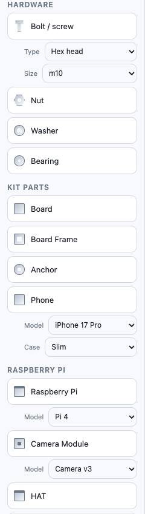
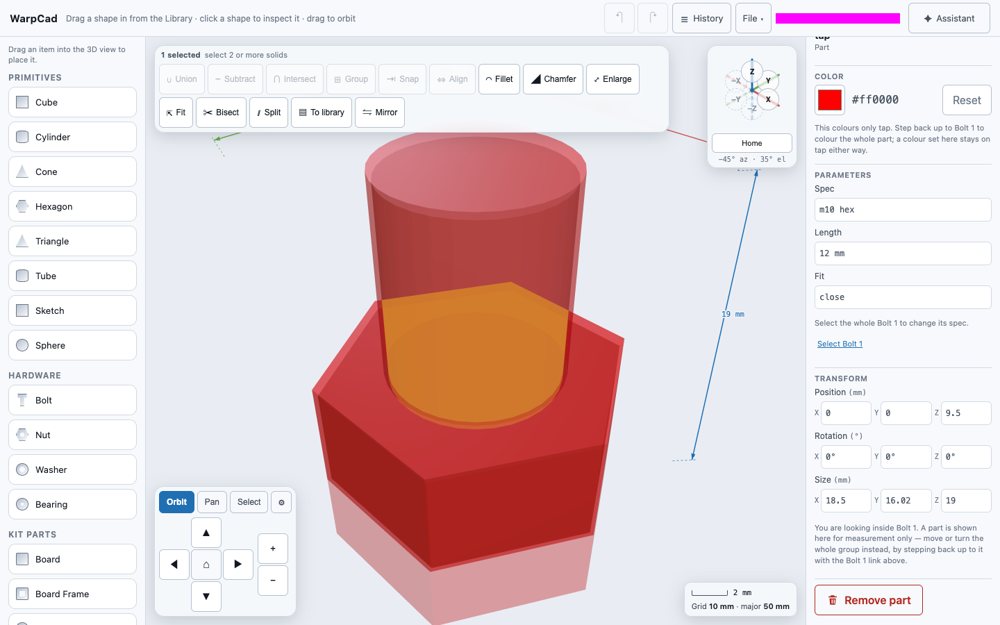
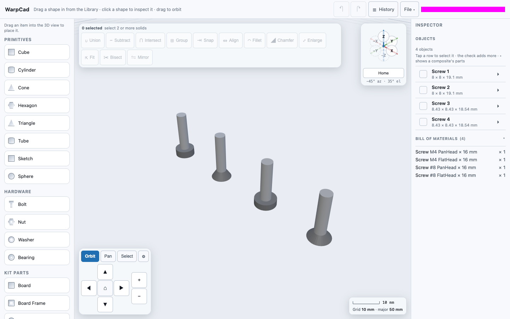
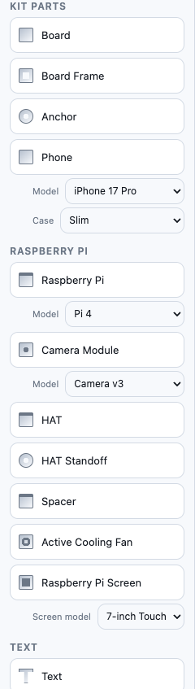
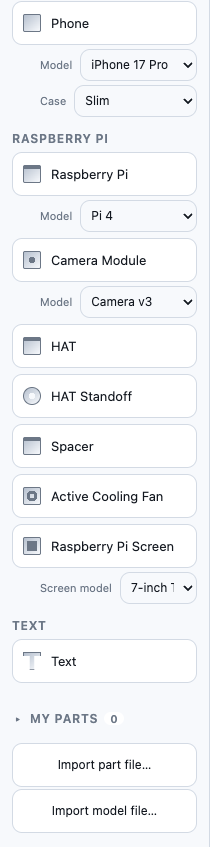
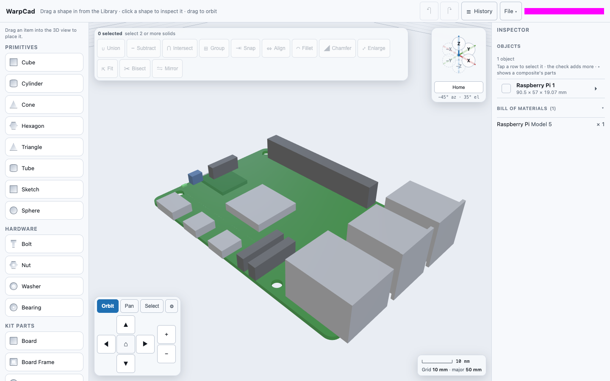
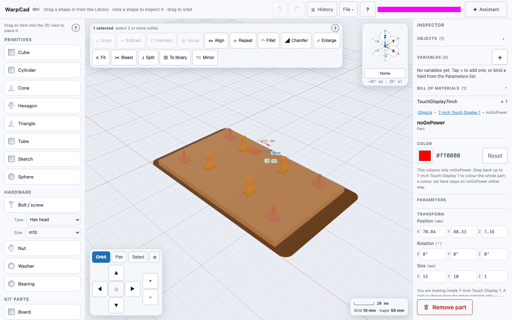

# Hardware, kit parts and Raspberry Pi parts

The Library has three sections of real-world parts you place the same way as a Cube: drag the
row into the 3D view and let go. This page is about what you get, how to pick the size you
actually want (an M4 screw, a 608 bearing, a Pi 5), and what the hidden extras on those parts
are for. The dragging itself is covered in [Placing a shape](primitive-placement.md); this
page doesn't repeat it.

All sizes below are millimetres unless a part is named in inches (`1/4 socket`, `#8`).

## Hardware: bolts, nuts, washers and bearings

| Row | Sizes you can pick | Starts as |
|---|---|---|
| **Bolt** | Metric socket cap `m1.6` to `m20` (`m2.5 socket`, `m3 socket`, ...), metric hex `m10` to `m20`, imperial socket `#0` to `1` and imperial hex `1/4` to `1` (`1/4 hex`, `5/16 hex`, ...) | M10 hex, 20 mm long |
| **Nut** | A size for every bolt above: `m1.6` to `m20`, and imperial `#0 hex` to `1 hex` | M4 |
| **Washer** | `m1.6` to `m20`, plus `1/4`, `5/16` and `1/4 fender` | M6 |
| **Bearing** | Standard bearing numbers: `608`, `6000`-`6004`, `6200`-`6204`, `6300`-`6304` | 608 (22 mm outside, 8 mm bore, 7 mm wide) |

A bolt is as long as you say, so it has a **Length** box (mm); the rest are fixed sizes you
pick from a list. The Spec list runs metric first (smallest to largest), then imperial. There
is no metric hex head below `m10`: small metric bolts are socket cap screws, which is how
small-board projects use them. A bolt and its nut share a size, so for an `m2.5 socket` bolt
pick `m2.5` on the nut and on the washer.

### Example: a 30 mm M12 bolt, and the bill of materials

1. Open the **Library** and drag **Bolt** into the 3D view. Let go; it lands on the grid and is
   selected, and the **Inspector** shows its parameters.
2. In the Inspector, set **Spec** to `m12 hex`. The bolt is rebuilt in place. (A new bolt
   already starts as `m10 hex`, so switching to that size changes nothing.)
3. Click the **Length** box, type `30` (mm) and press Enter. The bolt grows to 30 mm of thread
   under its head.
4. Look at **Bill of materials** just under the object list: one line, `Bolt M12 hex × 30 mm × 1`.
   See [Bill of materials](bill-of-materials.md).

### Example: a matching M2.5 bolt and nut

1. Drag **Bolt** into the 3D view. In the Inspector set **Spec** to `m2.5 socket` and **Length**
   to `8` (mm).
2. Drag **Nut** into the 3D view and set its **Spec** to `m2.5`.
3. **Bill of materials** shows `Bolt M2.5 socket × 8 mm × 1` and `Nut M2.5 × 1`.

### Fit: the part you can't see

A bolt has a **Fit** list: `tap`, `close` or `loose`. Fit decides how much room the bolt's
*clearance envelope* leaves around the metal. That envelope is a hidden part named `tap`: a
slightly fatter copy of the bolt that you subtract from your own part to leave a hole the
bolt slides through, instead of one it jams in. It is not drawn by default, and a plain
Subtract uses the bolt's metal, not the envelope.

To see it, select the bolt, tick **Show hidden parts** in the Inspector's **Parts** section,
and tap `tap` in the list. The envelope appears as a translucent red shape around the bolt.
To cut with it, select your part first and then add `tap` as the second operand, as in
[Cutting with just one part of a multi-part shape](booleans.md#cutting-with-just-one-part-of-a-multi-part-shape).

### Screws

There is a second fastener family, **screws**, with two head styles: `PanHead` (a flat-topped
round head) and `FlatHead` (a cone, for a countersunk hole), in sizes `m4`,
`#4`, `#6`, `#8`, `#10` and `#12`. **Screws have no Library row yet**, so you cannot drag one
in; they appear in a project that includes them (opened with **File ▾ → Open**, or built by
the AI partner). Once there, a screw behaves like a bolt: select it and the Inspector offers
**Spec**, **Head** and **Length**, and the bill of materials counts it by all three.

## Kit parts: boards, frames and anchors

Kit parts are general-purpose building blocks you size yourself: **Board** (a flat slab with
rounded corners), **Board Frame** (the same slab with a rectangular window cut out) and
**Anchor** (a post with a matching hole). Their sizes are numbers in mm in the Inspector, and
the bill of materials lists each by width × height. The defaults are in the table in
[Placing a kit part](primitive-placement.md#placing-a-kit-part).

## Raspberry Pi parts

The Raspberry Pi section has the board, a camera module, a HAT and its standoff, a spacer, a
cooling fan and six screens. Boards and screens are placed at their real size, with their
connectors, chips and mounting holes. The **Raspberry Pi** and **Camera Module** rows have a
**Model** dropdown *beside* the row: choose it before you drag. See
[Placing a Raspberry Pi part](primitive-placement.md#placing-a-raspberry-pi-part) for the
model list and for why each part is placed on its own rather than mounted on a board.

Each piece of a board has its own colour, so you can tell the Ethernet jack from the header
at a glance. The board's four corner holes are drilled right through it, and you can see the
grid through them.

### Example: drill a Pi's mounting hole into your own plate

You want a plate with a hole exactly where one of the Pi's four 3.25 mm mounting holes
falls. Each hole is also kept as a hidden part (`hole1` to `hole4`) for exactly this.

1. Place your plate and a **Raspberry Pi** so the board sits over the plate.
2. Click the plate. In the Inspector, open **Objects**, tap the arrow beside **Raspberry Pi 1**
   to list its parts, and tick the check beside `hole1`.
3. The Operations toolbar names the plate and `hole1` as its two operands. Press **Subtract**.
4. The plate gets one round 3.25 mm hole, in the exact spot the Pi's hole is, through its
   full thickness. The Pi is used up by the Subtract (see
   [Combining shapes](booleans.md)), so for the other three holes place another Pi in the
   same spot and repeat with `hole2`, `hole3` and `hole4`.

### Keep-out volumes

Some parts carry a hidden **keep-out**: a block of space nothing else should occupy, such as
the clearance a cable needs beside a connector. The 7-inch Touch Display has one called
`noGoPower`, 15 × 10 × 1 mm, by its power connector. Select the display, tick **Show hidden
parts** and tap `noGoPower` in the list: it shows as a translucent red block.

Subtract it from your own enclosure and the enclosure leaves that space free.

## Related

- [Placing a shape](primitive-placement.md): the drag itself, models and defaults.
- [Bill of materials](bill-of-materials.md): the running count of everything on this page.
- [Combining shapes](booleans.md): using a hidden part as a Subtract operand.
- [Selecting a shape, and reading its size](selection-and-inspector.md): the Inspector, the Objects list and Show hidden parts.

<!-- SPDX-License-Identifier: CC-BY-SA-4.0 -->
