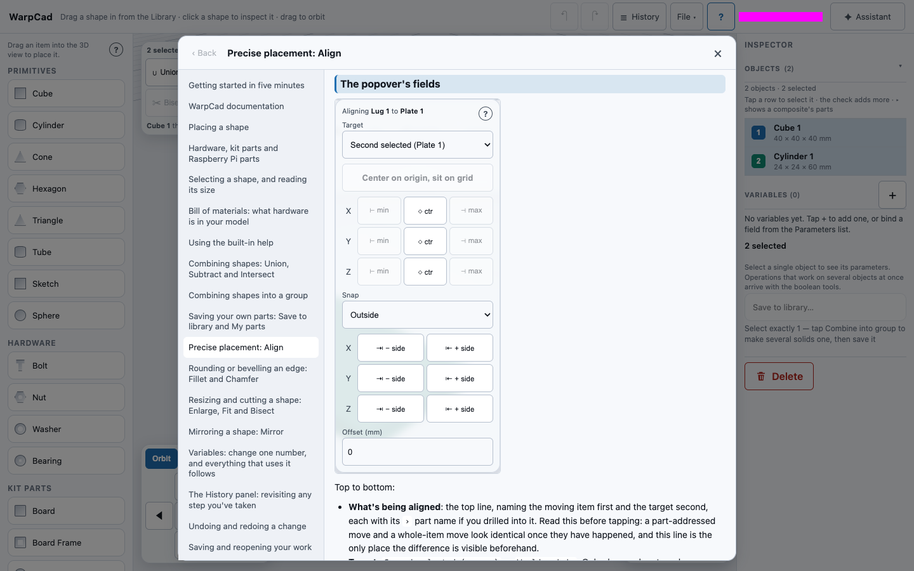
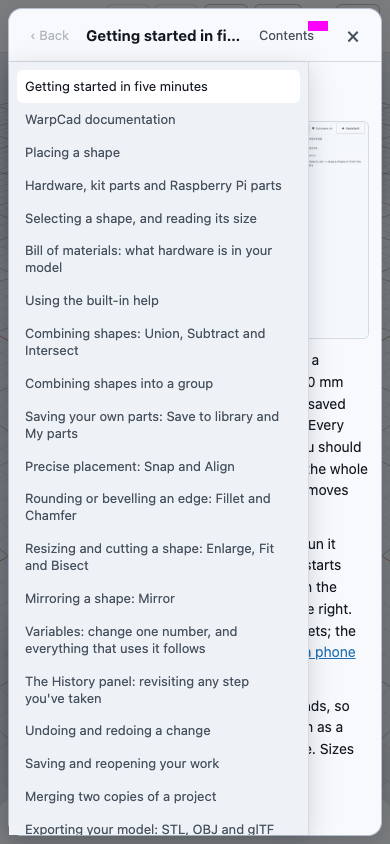

# Using the built-in help

WarpCad carries its own documentation. Every page in this folder is inside the app, so you
can read how a tool works without leaving the project you are editing, and it opens with the
network off.

There are three ways in, and they all open the same **Help** sheet:

| You want | Do this |
|---|---|
| The page for the tool you are using | Press the **?** in that tool's pop-up or sheet header. |
| To browse every page | **File ▾ → Help and documentation**, or the **?** at the top of the window (laptop and tablet). |
| To do it from a keyboard | Press **?** (Shift + /) or **F1**, when no text field has the cursor. |

## Try it: from the Align pop-up

1. Place a Cube and a Cylinder, then click the Cube and Shift-click the Cylinder. Both are
   selected.
2. Press **⇔ Align** on the Operations toolbar. The Align pop-up opens.
3. Set **Snap** to *Inside* and type `7` in **Offset**, so there is something of yours in the pop-up.
4. Press the **?** in the pop-up's top-right corner.

The Help sheet opens on *Precise placement: Align*, scrolled to the section about
the pop-up's fields, with that heading marked. Your selection and the pop-up stay exactly as
they were underneath it.

5. Close the sheet with **×** (or press Esc). The Align pop-up is still open, **Snap** still
   says *Inside* and the offset still says `7`. Tap an axis button to carry on.

## Reading the sheet

- **Back** returns along the pages you followed with in-page links, one step at a time.
- **Contents** lists every page. On a laptop it is the column on the left; on a phone it is
  folded behind the **Contents** button so the page gets the whole width.
- Links between pages stay inside the sheet. Links to other websites open in a new tab.
- **×**, **Esc**, or a tap outside the sheet closes it. Only the sheet closes: a pop-up under
  it stays open, and so do your selection and the tool you were using.
- Pictures load as you scroll to them. Short clips (GIFs) are kept for offline use the first
  time you see them, so a clip you have never opened online shows its description instead
  when you are offline.

## The ? is always there

The **?** is never greyed out, even when the tool it belongs to is. If **Align** is dimmed and
you do not know why, the **?** beside it still opens the page that says "you need 1 or 2
shapes selected".

Tools without a pop-up of their own (Union, Subtract, Intersect and Group commit on one
click) share the **?** at the right-hand end of the Operations toolbar's "2 selected" line,
which opens *Combining shapes*. On a phone, and in the narrow view column of a tablet, that line
has no room for it: open **File ▾ → Help and documentation** and pick *Combining shapes* from
Contents.

## Offline

The text of every page and its still pictures are saved on your device the first time WarpCad
loads (it is a progressive web app, so this happens when you install or first visit it). After
that **Help** works with no connection, and always shows the pages for the version of WarpCad
you are running, never a newer or older copy from the internet.

To check: open WarpCad once, turn the network off (airplane mode, or the browser's Offline
setting), reload, and open **File ▾ → Help and documentation**.

## Sharing a help view

While the sheet is open, the address ends in `#/help/align` (or whichever topic or page you
are on). Send that address and the other person's WarpCad opens straight onto the same page.
If the address already carries a shared project (`#/gist/…`), help leaves it alone.

## See also

- [Getting started in five minutes](getting-started.md)
- [Using WarpCad on a phone or tablet](mobile.md)
- [The full list of pages](README.md)

<!-- SPDX-License-Identifier: CC-BY-SA-4.0 -->
