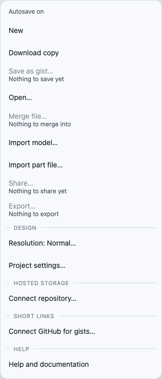
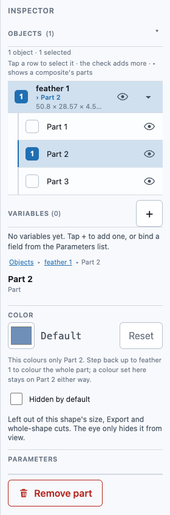

# Importing a model file

You don't have to build every part yourself. If you already have a model as an **STL** or
**3MF** file (from Thingiverse, a scan, a manufacturer's CAD download, a bracket someone else
designed), **File ▾ → Import model…** brings it into the project you have open. You place it in
the 3D view like a shape from the Library, and it works like any other body: you can select it,
move it, measure it, combine it and cut it.

An import goes into this project only. It does not appear in the Library's **My parts**. To keep
a model for other projects too, select it and choose **Save to library…**
([Keeping an imported model for other projects](#keeping-an-imported-model-for-other-projects)).

## Importing an STL: a bracket

1. Open **File** and choose **Import model…**. The system file picker opens, showing `.stl` and
   `.3mf` files. On a phone, it offers your Files.
2. Pick `bracket.stl`. *Reading bracket.stl…* shows at the top of the view while the file is
   read, with a **Cancel** button. If you pick a second file before the first is read, the
   second one replaces it.
3. A see-through bracket waits in the middle of the view, and a chip at the bottom reads
   **Place bracket.stl · Cancel**. Move the pointer over the grid and the bracket follows it.
   It snaps into line with what is already there, as a shape dragged from the Library does.
4. Click where it should go. The bracket lands on the ground under the pointer, selected. The
   Inspector shows its size, **40 × 20 × 10 mm**, and a note that a mesh is not parametric. It is
   listed in **Objects**, and History has a new step, *Import bracket.stl*. A line at the top of
   the view reads *Imported bracket.stl — 12 triangles, 40 × 20 × 10 mm* for a few seconds.
5. To cut a pocket in it, add a **Cube**, select the bracket first and the cube second, and tap
   **Subtract**.

One **Undo** takes the bracket out again. **Cancel** on the chip, or **Esc**, ends the placement
with nothing added.

**On a touch screen** the steps are the same, up to step 3. The see-through bracket starts in the
middle of the view. Put a finger on the view, drag it to where the bracket should go, and lift
your finger to place it. A tap places it where you tap.

**On a laptop you can drop the file instead.** Drag `bracket.stl` from your desktop onto the 3D
view. It is read and placed right where you let go, with no chip. (An image dropped on the view
still goes to the Assistant.)

### Units

STL files don't say what units they were drawn in. WarpCad reads them as millimetres, and with
the model selected the Inspector shows **Units** set to *mm* and a **Units assumed: mm** badge.
**Check the size.** If a bracket reads 0.04 × 0.02 × 0.01 mm, it was drawn in inches or
centimetres. Switch **Units** to *inch* or *cm* and the size updates. The change is one step in
History, so Undo puts it back. A 3MF file says what units it uses, so it has no **Units** control.

### What it reads, and its limits

- **Formats:** binary and ASCII **STL** (`.stl`), and **3MF** (`.3mf`), which keeps a model's
  components as separate parts (below). OBJ and glTF are planned. The importer is built so that
  each one is just one more reader.
- **Size caps:** a file up to 25 MB and **250,000 triangles**, and a stored mesh up to 5 MB.
  A file over a cap is refused, with its reason shown in the line at the top of the view, and
  nothing is added to the project. A file that is not an STL, or is cut short, is refused the same way.
- **Cleaned up on the way in:** corners that coincide are welded so the faces share edges,
  and triangles with no area are dropped, so the part exports as a closed shape.
- **Not parametric.** An imported mesh has no sizes to edit, so the Inspector shows its size as a
  measurement. You can move, rotate, combine and cut it (Union, Subtract and Intersect work as
  they do with any body), but you can't change its dimensions as numbers.
- **STEP, IGES and BREP are out of scope.** Those are exact solid models, not triangle meshes,
  and reading them needs a different kind of geometry engine than this app has. STEP not
  importing is how the app is built, not a bug. Export STL or 3MF from your other program
  instead (3MF keeps the parts). A `.step` or `.stp` file is refused with *STEP files are not
  read yet. Export 3MF or STL from your CAD program*.
- **It stays with the project.** The imported model is saved inside the project file, so it
  comes back when you reload, open the file elsewhere, share it as a gist or merge it. Nothing
  is written to My parts.

## Importing a model with its parts: 3MF

An STL is one fused shell. A circuit board's STL gives you nothing to design against but its
outline. A **3MF** file can hold each component of the model separately, and WarpCad keeps
them. The import is **one model** you place as a whole, and each component inside it is a
**sub-part** you can select, measure, align against or cut with, exactly like the named parts
of a Raspberry Pi ([Selecting a part inside a group](groups.md#selecting-a-part-inside-a-group)).

Many parts are published as STEP. WarpCad does not read STEP yet, so convert it to 3MF in
another program first. FreeCAD (free) can do it. The steps below were checked with FreeCAD 1.1.4.

### Example: the Adafruit Feather HUZZAH ESP8266

Millimetres, Z up.

1. Download `2821 Adafruit ESP8266 Feather.step` from Adafruit's
   [CAD parts repository](https://github.com/adafruit/Adafruit_CAD_Parts/tree/main/2821%20Feather%20HUZZAH%20ESP8266).
   Open it in FreeCAD with **File ▸ Import…**. The Model tree shows one top item,
   **Adafruit ESP8266 Feather v4**, holding a **PCB Component** group with the board and its
   28 components.
2. In the Model tree, click **only the top item**, then **File ▸ Export…**, choose the type
   **3D Manufacturing Format (\*.3mf)**, and save `feather.3mf`. (If you select every item in the
   tree instead, FreeCAD writes each component three times over. WarpCad notices the exact copies
   and skips them, so the result is the same, and the line after the import says how many it skipped.)
3. In WarpCad, open **File ▾ → Import model…** and choose `feather.3mf`. Move the see-through
   board over the grid and click to place it (on a touch screen, drag it and lift your finger).
   The board lands selected as a whole, and the line at the top of the view reads *Imported
   feather.3mf, 29 parts, 29,718 triangles, 51.3 × 22.9 × 6.37 mm.* (The triangle count depends
   on FreeCAD's export settings.) Drag a **Cube** in from the Library beside it.
4. **Click the board once**: all of it is selected, and the Inspector shows the whole model's
   size. **Click again on the large 24 × 16 mm module** (the ESP-12): the breadcrumb reads
   `feather 1 ▸ Part 22`, and the Inspector shows that part's own size, 24 × 16 × 2.95 mm.
5. Hold **Shift** and click the Cube, then press **⇔ Align**. The popover's top line reads
   **Aligning feather 1 › Part 22 to Cube 1**. The board is the shape you picked first, so it
   moves, and the part you addressed is the one measured. Tap the button you want, say
   **X center**. To move the **Cube** against the part instead, pick the Cube first, then
   tick `Part 22` under the board in the Inspector's **Objects** list.
6. To cut a pocket for a connector, follow
   [Cutting with just one part](booleans.md#cutting-with-just-one-part-of-a-multi-part-shape):
   select the plate, tick the part in the Objects list, and tap **Subtract**. A part used as a
   cutting shape uses the model up, the same as any cutting shape. Import another copy, or Undo.

**Small parts are easier to reach from the list.** A 1.6 mm resistor is hard to hit with a
click and impossible with a finger. Select the model, open the Inspector's **Objects** list,
and expand it with its **▸**: every part has its own row. Tap a row to select that part, or
its check box to add it to what is already selected.

### What a 3MF import keeps, and what it does not

- **Each placed component is one part**, in the place the file puts it. The whole model lands
  centred under the pointer with its lowest point on the ground, and the parts keep their
  places relative to each other. A component placed twice is two parts. An exact copy at the
  same place is skipped and counted in the line after the import.
- **Names only if the file has them.** A part takes its object's name from the file. FreeCAD
  writes no names, so its parts are `Part 1`, `Part 2`, … in the file's order. Click a part
  and read its size to tell them apart. A name used twice is numbered: `10K 1`, `10K 2`.
  Once you know which is which, give it a name of your own: tap `Part 22`, tap its name at the
  top of the Inspector, type `ESP-12` and press **Enter**
  ([Naming a part of a group](selection-and-inspector.md#naming-a-part-of-a-group)).
- **A hole in a part is not a part.** A board's mounting holes are holes in the `Board` mesh,
  not parts of their own. You can align against `Board` or the ESP-12 module, but not
  against one mounting hole by itself (unlike the Raspberry Pi, whose holes are named parts).
- **Units come from the file.** A 3MF says which units it is in, so there is no **Units**
  control and no *Units assumed* badge.
- **Not parametric**, like an STL: sizes are measurements, not settings.
- **Ignored:** colours and materials, thumbnails and slices. Beam lattices are refused. A 3MF
  whose objects live in separate files inside the package (the *production extension*, which
  some slicers write) is refused with a reason rather than imported in part. So is a file that
  requires an extension WarpCad does not understand.
- **The same caps as an STL:** 25 MB per file and 250,000 triangles in the whole model, every
  placed copy counted.
- **Exporting:** a component the source file left broken stays broken. In the Feather's file,
  `Part 19` (the JST connector) has 12 edges shared by more than two triangles and `Part 23`
  (the button) has 6 open edges, so **Export ▸ Print pieces** refuses at `Part 19` with its
  reason.

## Keeping an imported model for other projects

An imported model belongs to the project you imported it into. To use it in other projects too:

1. Select the model (click it, or tap its row in **Objects**).
2. Choose **Save to library…** in the Inspector, or **To library** in the Operations toolbar.
   The name field suggests the file's name, `bracket`.
3. Tap **Save**. A **bracket** row appears in My parts, with a **Mesh** tag and the same size,
   40 × 20 × 10 mm. You can drag it into any project from there
   ([Saving your own parts](user-library.md)).

If My parts already has a part with that name, the sheet says so and Save stays off until you
pick another name. Names you have used in a project never block a name in My parts.

## Importing a part file

**File ▾ → Import part file…** is different. It reads a WarpCad **part file** (`.json`, made by
**Export part file** on a My parts row), and the parts in it go into **My parts**, not the
project. A part file can hold several parts and the parts they are built from, so there is no
single thing to place. A toast says where the parts went, for example *Added Standoff to My
parts. Open Library to place it*. Then drag the part in from the Library. A part My parts already
has is skipped, never overwritten. See
[The ⋯ menu on a My parts row](user-library.md#the--menu-on-a-my-parts-row).

## When it is unavailable

While History is showing a past step, both **Import model…** and **Import part file…** are
dimmed, and the reason, *Return to the latest step to import*, appears under them. Leave the
preview and they work again.

<!-- SPDX-License-Identifier: CC-BY-SA-4.0 -->
