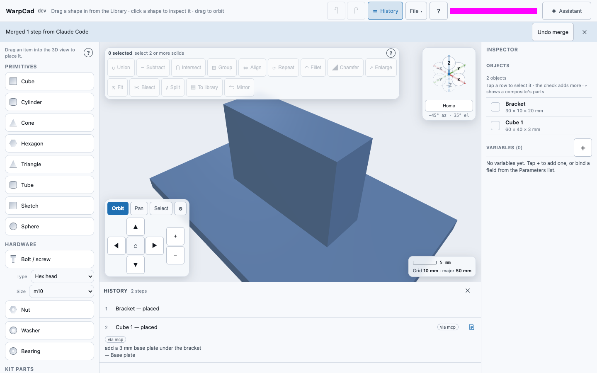
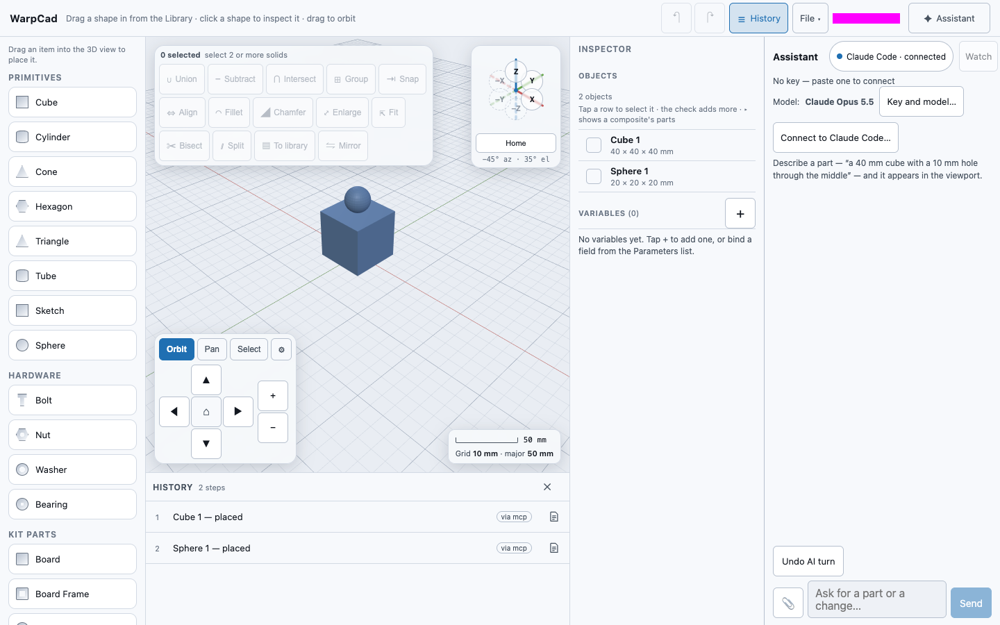

# Driving WarpCad from an MCP client (including Claude Code)

WarpCad comes with an **MCP server**: a small program that lets Claude Code, or any other MCP
client, open a WarpCad project file, read it, and add steps to it. It uses the same tools as the
in-app [Assistant](ai-partner.md): place a shape, run an operation, measure, check printability.
The steps it adds show up in the app's History marked **via mcp**, along with what you asked for.

It works on a project **file on your computer**, not on the app while it is running. If the app
has the same file open, it merges the changes into your open project when you come back to it
(see [Working on a project you have open](#working-on-a-project-you-have-open)). If you run WarpCad yourself with `npm run dev`, there is
also a [live mode](#live-mode-an-mcp-agent-edits-the-project-you-have-open) where an MCP agent's
changes appear in the open app as it makes them.

This is also the route for a **Claude Pro or Max subscription**: Claude Code is covered by it,
while the in-app Assistant needs an API key billed separately. See [No API key? Use your
subscription](ai-partner.md#no-api-key-use-your-subscription).

## Three ways in

An AI agent can reach WarpCad's tools three ways. All three use the same tools, follow the same
limits, and mark what they add in History. With your own API key, you can also type in the
[Assistant panel](ai-partner.md).

| Way in | What it needs | Where it works | Changes appear |
|---|---|---|---|
| **Claude Code on a project file** (this page) | Claude Code, a WarpCad checkout with Node.js 24+, a saved `.ndjson` file | Any computer. Chrome or Edge merge the changes into the open project when you switch back; other browsers use **File ▾ → Merge file…** | In the file, marked **via mcp** |
| **[Live mode](#live-mode-an-mcp-agent-edits-the-project-you-have-open)** | An MCP client and WarpCad running under `npm run dev`; access explicitly enabled in WarpCad | Any browser on the same computer as the local MCP client | In the open tab as they land, marked **via mcp** |
| **[Browser agents (WebMCP)](webmcp.md)** | Chrome with the WebMCP flag, and an agent that runs in the browser | Any copy of WarpCad, hosted or local, on desktop Chrome | In the open tab as they land, marked **via webmcp** |

## Try it: add a base plate from Claude Code

You need a WarpCad checkout (see [Run it yourself](../README.md#run-it-yourself) for how to
clone it) with Node.js 24 or newer, [Claude Code](https://claude.com/claude-code) installed, and
a project saved as a file. In the app, **File ▾ → Save** (or **Download copy**) writes a
`.ndjson` file.

1. Install the dependencies, once, from the WarpCad folder you cloned. The server uses the app's
   own code, so it needs both installs:

   ```sh
   npm install
   npm run mcp:install
   ```

2. Tell Claude Code about it. From the same folder, give it the project file to edit; it works out
   the path to `mcp/server.js` itself:

   ```sh
   npm run mcp:add -- bracket.ndjson
   ```

   It creates `bracket.ndjson` if it doesn't exist, replaces any earlier `warpcad` registration,
   and prints the two absolute paths it registered. Then start Claude Code in any folder and type
   `/mcp`: `warpcad` should say *connected*. If it says `CONNECTION_CLOSED`, run
   `claude mcp get warpcad` and check both paths exist; running `npm run mcp:add` again fixes a
   stale entry.

3. In Claude Code, say: *add a 3 mm base plate under the bracket*.

   Claude reads the scene, places a 3 mm plate and tells you which History row it added (for
   example *row 2, Place Cube 1*).

4. Open `bracket.ndjson` in WarpCad (**File ▾ → Open…**). If it was already open in Chrome or
   Edge, just switch back to the WarpCad window: the new step is merged in and a note says
   **Merged 1 step from Claude Code**. The step is in **History**, marked **via mcp**. Tap the
   note icon on the row to see *add a 3 mm base plate under the bracket*, the request that made
   it. In Safari, Firefox or on a phone, use **File ▾ → Merge file…** instead (see below).



The server edits exactly one file, the one named on the command line. If that file doesn't exist
yet, it starts an empty project and creates the file on the first change.

## What Claude can do with it

Lengths are millimetres, Z is up and angles are in degrees, as in the app.

| Tool | Changes the file? | What it does |
|---|---|---|
| `list_ops` | no | What can be placed (Cube, Sphere, a Bolt, a Raspberry Pi…) and which operations exist, with their sizes and defaults. |
| `describe_scene` | no | Every shape: id, name, size and position in mm. |
| `describe_body` | no | One shape in detail. |
| `get_timeline` | no | The History rows, who made each one, and why. |
| `create` | yes | Place one new shape at a position. |
| `operate` | yes | One operation on existing shapes by id: Union, Subtract, Fillet, Mirror, Move… |
| `apply_records` | yes | Several of the above as one change: all of them land, or none do. |
| `repeat` | yes | Put the same finished part, placed the same way, on other matching parts of the body it was placed against: `{ "source": "bolt-1", "seedBody": "pi-1", "seedPart": "hole1", "targets": ["hole2", "hole3", "hole4"] }`. One new shape, *Bolt 1 ×3*, appears. The copies are linked: later changes to the source's size, Align or Snap move or resize all of them. It is refused, with the reason, if the source's steps never name `seedPart` or a target isn't a part of `seedBody`. Up to 64 targets. |
| `measure` | no | Size, volume, surface area and centre of mass. |
| `check_printability` | no | Is it watertight, does it fit the printer, how thin are the walls. |
| `check_clearance` | no | The gap between two shapes, or how much they overlap. |
| `list_variables` | no | The project's [variables](variables.md), their values, and which shapes read each one. Given a shape's id, also which of its sizes or choices can be tied to a variable. |
| `define_variable` | yes | Add a variable, e.g. `{ "name": "piModel", "kind": "enum", "value": 4, "options": [{ "value": 4, "label": "Pi 4" }, { "value": 5, "label": "Pi 5" }] }`. |
| `set_variable` | yes | Change a variable's value, e.g. `{ "name": "piModel", "value": 5 }`. Every size or choice tied to it follows, and the result says how many changed on how many parts. If the new value would break something (a shape snapped to a part the Pi 5 doesn't have), nothing changes and the result names what would break. |
| `bind_param` | yes | Tie one size or choice of a shape to a variable, e.g. `{ "id": "pi-1", "path": "model", "name": "piModel" }`. |
| `unbind_param` | yes | Untie it again, e.g. `{ "id": "pi-1", "path": "model" }`. It keeps the value it has now. |
| `rename_variable` | yes | Rename a variable everywhere it's used, e.g. `{ "from": "piModel", "to": "boardModel" }`. |
| `delete_variable` | yes | Delete a variable, e.g. `{ "name": "piModel", "keepValues": true }`. Without `keepValues`, it's refused while anything still uses it. |

**Example: switch the board.** In a case design where the Pi's model is tied to a `piModel`
variable, ask Claude Code *make this case for a Pi 5*. Claude calls `set_variable { "name":
"piModel", "value": 5 }` instead of hunting for the Pi in the History, and the result reads
*piModel Pi 4 → Pi 5 — 3 parameters on 2 parts changed*. Open the file in the app and the Variables
panel shows the new value, with one History change for it.

**Example: the same screw on every hole.** With a bolt already on a Pi's `hole1`, ask Claude Code
*put the same screw on the other three holes*. Claude calls `describe_body` on the Pi to read its
part names, then `repeat` with `source: "bolt-1"`, `seedBody: "pi-1"`, `seedPart: "hole1"` and
`targets: ["hole2", "hole3", "hole4"]`. One History row, *Bolt 1 ×3*, appears in the file. Open it in
the app and the three bolts sit on holes 2, 3 and 4; change Bolt 1's **Length** and all three
follow.

The server also offers two read-only resources, `warpcad://scene` and `warpcad://op-catalogue`,
so a client can look at the scene or the catalogue without calling a tool.

Some Assistant tools aren't here. `capture_view` needs a graphics card to draw a picture, and the
server has none. The selection and reference-image tools need the app on screen.

Every change Claude makes carries **why** it was made: the words of your request, plus Claude's
own one-line reason. That's what you see on the History row's note, the same as for the in-app
Assistant ([Design intent](design-intent.md)).

## Working on a project you have open

You do not have to close the project first. Claude Code and the app can both edit the same file,
and WarpCad **merges** what Claude did into what you have open. Neither side's work is thrown away.

**Example.**

1. In Chrome or Edge, **File ▾ → Open…** your project file and leave it open. Move the cube; don't
   save yet.
2. In Claude Code say *add a 20 mm sphere on top of the cube*.
3. Click back into WarpCad. The sphere appears, the cube stays where you moved it, and a note says
   **Merged 1 step from Claude Code**. No dialog asks you anything.
4. Press **Undo merge** on the note if you do not want the sphere. Otherwise **Save**: the file now
   has your move and Claude's sphere.

How the app finds out depends on the browser:

| Browser | Notices the change? | What to do |
|---|---|---|
| Chrome or Edge on a computer | **Yes**, when you switch back to the WarpCad window or tab, and before every **Save** | Nothing. The change is merged in. |
| Safari, Firefox, and every phone and tablet | **No.** These browsers hand WarpCad a one-time copy of the file when you open it, so the app can't look at it again | **File ▾ → Merge file…**, then pick the project file. Your open project stays as it is and the file's new steps are added. See [Merging two copies of a project](merging.md). |

What you see:

- **A note** (**Merged 1 step from Claude Code**) with **Undo merge**. When some of the steps came
  from somewhere other than Claude Code it names the file instead, for example **Merged 2 steps
  from bracket.ndjson**.
- **A yellow strip** when you and Claude changed the same step in ways that can't both be kept,
  for example you moved a cube and Claude filleted it. **Show** opens the step in History. See
  [What a conflict is](merging.md#what-a-conflict-is).
- **Changes waiting to merge** in the status light, when the file changed while you were dragging
  or typing in a number field. It merges the moment you let go.
- **Save** merges first, then writes. It never writes over a change it hasn't merged.

The app still asks, with a dialog, in two cases, because there is nothing safe to do on its own:

- **The file is a different project** (someone put another project in that file name).
- **The file can't be read** (it was cut off, or was written by a newer WarpCad).

The dialog's first line says which. **Reload** replaces this project with the file, **Overwrite the
file** writes this project over it, and **Cancel** leaves both alone; the status light then says
**File changed on disk — Reload**, and tapping it asks again.

**File ▾ → Reload from disk…** is always there on Chrome and Edge when a file is open. It is the
explicit "throw away what I have here, take the file": it asks the same three-answer question,
and **Reload** drops the edits you have not saved and clears Undo, as after any Open.

## Live mode: an MCP agent edits the project you have open

In live mode, an MCP client changes the project **open in a WarpCad tab**, and each change appears
in the viewport as it lands. No project file or API key is needed by WarpCad; the model runs in
your chosen MCP client, and WarpCad supplies the tools.

**Live mode works only when WarpCad runs with `npm run dev` on the same computer as the MCP
client.** The hosted app cannot use it. Phone, tablet, and desktop browsers can all enable access
to the local endpoint. Access is off by default; while enabled, any local MCP client that can
reach the loopback endpoint may read and change the open project.

### Try it: use an MCP agent to add a cube and sphere

1. From your WarpCad folder, install the dependencies (once), register live mode, and
   start the dev server:

   ```sh
   npm install
   npm run mcp:install
   npm run mcp:add -- --dev
   npm run dev
   ```

    `mcp:add -- --dev` prints the registration details for the live endpoint at
    `http://127.0.0.1:5183/mcp`. Use those details to register WarpCad with your MCP client. It
    replaces a closed-file registration: one at a time. To go back, run
    `npm run mcp:add -- <project-file.ndjson>`.

2. Open WarpCad at `http://localhost:5183` in a browser on this computer.

3. In WarpCad open **Assistant → Live MCP access**, choose **15 minutes**, and select **Enable
  access**. The sheet explains that any local MCP client can use the enabled tab. Choose a longer
  lease only when you need it; you can turn access off from the same sheet at any time.

4. In your MCP client, ask *add a 40 mm cube and a 20 mm sphere on top*. The bodies appear in the
  viewport, and in **History** each row is marked **via mcp**. The Assistant header reports the
  connected MCP agent.

5. Select a body and move it with the gizmo. Press **Undo AI turn** to remove the agent's changes
  in one step. Your own **Undo** is untouched: it never takes back MCP rows, and **Undo AI turn**
  never takes back yours.



### Turn the live endpoint off

The live endpoint is on by default under `npm run dev`. To run the dev server without it, for
example to test Chrome's WebMCP tools with nothing else listening, set `WARPCAD_LIVE_BRIDGE=0` in
the environment of the command:

```sh
WARPCAD_LIVE_BRIDGE=0 npm run dev
WARPCAD_LIVE_BRIDGE=0 npm run preview
```

`0`, `false`, `off` and `no` turn it off; anything else, or leaving it unset, keeps it on. With it
off, `http://127.0.0.1:5183/mcp` is not served and the tab opens no bridge connection. The browser
agents (WebMCP) switch in the Assistant header is unaffected and keeps working. `npm run preview`
serves the production build, which never carried the live endpoint, so the setting makes no
difference there; it is accepted so the same command line works for both.

### Using another agent (Copilot, or any MCP client)

Nothing here is specific to Claude Code: WarpCad's live endpoint is a standard MCP server over HTTP,
and there is no pairing code to copy between the agent and WarpCad.

1. Register the endpoint with your agent, using the details `npm run mcp:add -- --dev` prints
   (for example, as an HTTP server named `warpcad` at `http://127.0.0.1:5183/mcp`).
2. In WarpCad, open **Assistant → Live MCP access** and enable access for **15 minutes**.
3. In your agent, ask it to connect to WarpCad and add a part. The Assistant header reports
   **MCP agent · connected**.

If the agent says access is off or expired, enable it again in WarpCad. If it says routing is
ambiguous, close the second client or tab (see below).

### How it behaves

- **One Undo AI turn per request.** Changes an MCP client makes for the same request, less than a
  minute apart, are one **Undo AI turn**. A new request, or a minute's pause, starts the next
  one. If you've since built on one of the agent's bodies (moved it, for example), **Undo AI turn**
  says which step is in the way. Undo that first, then try again.
- **You stay in charge of the editing.** MCP changes are made one at a time. If one arrives
  while you're dragging, or typing in a number field, it waits up to 10 seconds for you to
  finish. Then it's refused with *the user is editing; try again*, and the agent can retry. If the
  project changed while it waited, it's refused too, and the agent must read it again first.
  A refused change leaves the project exactly as it was.
- **The MCP agent sees what you select.** `get_selection` tells the agent what you've picked, so *make
  this 5 mm taller* works. `capture_view` lets it look at the viewport.
- **While a change runs** the header shows **MCP agent working**.
- **The Assistant panel is a window, not a place to type.** With no API key and live MCP access
  enabled, the panel reports that access is enabled or an MCP client is connected, and the message
  box is greyed out with that reason. Ask the MCP agent in its own client; changes appear in the
  viewport and History as they land. To type in
  the panel instead, add an API key under **Key and model…**.
- **The lease controls access.** The timed options expire after 15 minutes or 1 hour; **This tab**
  ends when the tab closes; **Until turned off** remains active until manually revoked or the tab
  closes. Expiry, turning access off, or a tab reload revokes the route. If more than one MCP
  client or enabled tab makes routing ambiguous, WarpCad refuses calls until only one remains.
- **A client that vanishes stops counting.** A client that quits cleanly is dropped at once. One that
  crashes or loses its connection is dropped after five minutes without a request, so it cannot
  block every later call. A client that is merely quiet reconnects on its next call.
- **Where the control is.** On a laptop, **Live MCP access…** sits beside **Key and model…** in the
  Assistant panel. On a phone or tablet it is on the Assistant's no-key sheet (the half-height
  panel keeps room for **Send**), and the header chip opens it once access is on.

### Browsers

| Browser | Under `npm run dev` |
|---|---|
| Chrome, Edge | Works. It may ask to let the page reach devices on your local network; choose **Allow**. |
| Firefox | Works, no prompt. |
| Safari | Works. A hosted (`https://`) copy of WarpCad could never connect: Safari, and every iPhone and iPad browser, blocks that. The live-access sheet says so. |

### What can reach it

Any MCP client on this computer that can reach the loopback endpoint can request access while the
lease is enabled. `/mcp` refuses requests from any other web page (including other local dev
servers) and from any address but this computer's loopback. Without the explicit lease, no call
reaches your project.

## Safety

- **Only one file.** The server reads and writes the file it was started with and nothing else.
  It doesn't use the network.
- **Text in the file is treated as data.** Shape names, design notes and a project's standing
  instructions come from whoever wrote the file. The server hands them to Claude marked as file
  content, never as instructions to follow, the same way the in-app Assistant does.
- **Limits are enforced by the server, not left to Claude:** at most 50 new steps in one call,
  every step checked by the same rebuild the app uses, and a step that won't build is refused by
  name.
- **A refused change leaves the file untouched**, byte for byte.
- **Writes are all-or-nothing.** The server writes a new copy beside the file and then swaps it in,
  so the file is never left half-written. A lock file (`bracket.ndjson.lock`, there only while a
  write is happening) stops two servers on the same file from overwriting each other, and if the app saves the file
  while a change is running, the server reads it again and redoes the change on top.

## What the file holds

The file is plain NDJSON: one line per step, exactly as the server appended it, and — only once
something has been edited — one last `project-state` line. That line carries what was hidden,
rolled back or noted, and a `merge` section: a small record of which copy wrote each step and
when, and which steps were deleted. The server keeps every part of it that a call did not touch,
and writes its own steps as one copy that is always later than anything it read, so a file you
edit through Claude and the same file you edit in the app are merged by the app (see
[Working on a project you have open](#working-on-a-project-you-have-open)). A file that has never been edited has no such line, and one that is opened and saved
unchanged keeps its bytes.

## When something goes wrong

Every message names the file and says that nothing was written to it.

- **Can't open bracket.ndjson: line 4 is not valid JSON — this is not a WarpCad project file.**
  The file was cut off or edited by hand. The server refuses it, and so would the app. Restore a
  good copy (your autosave, or a copy in a [GitHub repository](save-load.md)).
- **Can't open bracket.ndjson: This project was saved by a newer WarpCad. Update the app to open
  it. The file was not changed.** Update your WarpCad checkout (`git pull`, then `npm install`
  and `npm run mcp:install`).
- **Another WarpCad MCP server (process 1234) is writing bracket.ndjson…** Another server was in
  the middle of a write for more than ten seconds. Try again. A lock left behind by a server that
  crashed is cleared automatically.
- **bracket.ndjson changed on disk while this call ran.** The app or another program kept saving
  the file during that change, three times in a row. Nothing was written; ask again. (A single
  save during a change is no problem: the server reads the file again and redoes the change on
  top of it.)

## Not yet

- **Projects in a GitHub repository.** The server works on a local file only. To use it with a
  project you keep in a repository, **Load from** it in the app, **Save** it as a file, run the
  server on that file, then open the file and **Save to** the repository.
- **Live editing of the hosted app from an MCP client.** [Live mode](#live-mode-an-mcp-agent-edits-the-project-you-have-open)
  works under `npm run dev` only. A helper that lets Claude Code reach a built or hosted copy is
  planned separately. An agent that runs in the browser can already drive a hosted copy over
  [WebMCP](webmcp.md).

<!-- SPDX-License-Identifier: CC-BY-SA-4.0 -->
