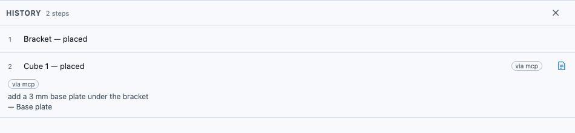
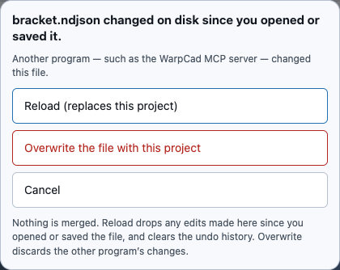

# Driving WarpCad from Claude Code (the MCP server)

WarpCad comes with an **MCP server**: a small program that lets Claude Code, or any other MCP
client, open a WarpCad project file, read it, and add steps to it. It uses the same tools as the
in-app [Assistant](ai-partner.md): place a shape, run an operation, measure, check printability.
The steps it adds show up in the app's History marked **via mcp**, along with what you asked for.

It works on a project **file on your computer**, not on the app while it is running. The app
picks up the changes when you come back to it (see [Seeing the changes in the
app](#seeing-the-changes-in-the-app)).

## Try it: add a base plate from Claude Code

You need a WarpCad checkout with Node.js 22 or newer, and a project saved as a file. In the
app, **File ▾ → Save** (or **Download copy**) writes a `.ndjson` file.

1. Install the server's dependencies, once, from the WarpCad folder:

   ```sh
   npm run mcp:install
   ```

2. Tell Claude Code about it. Use the full path to `mcp/server.js` and to your project file:

   ```sh
   claude mcp add warpcad -- node ~/src/WarpCad/mcp/server.js ~/parts/bracket.ndjson
   ```

3. In Claude Code, say: *add a 3 mm base plate under the bracket*.

   Claude reads the scene, places a 3 mm plate and tells you which History row it added (for
   example *row 2, Place Cube 1*).

4. Open `bracket.ndjson` in WarpCad (**File ▾ → Open…**). If it was already open, switch back to
   the WarpCad window and choose **Reload**. The new step is in **History**, marked **via mcp**.
   Tap the note icon on the row to see *add a 3 mm base plate under the bracket*, the request
   that made it.



The server edits exactly one file, the one named on the command line. If that file doesn't exist
yet, it starts an empty project and creates the file on the first change.

## What Claude can do with it

Lengths are millimetres, Z is up and angles are in degrees, as in the app.

| Tool | Changes the file? | What it does |
|---|---|---|
| `list_ops` | no | What can be placed (Cube, Sphere, a Bolt, a Raspberry Pi…) and which operations exist, with their sizes and defaults. |
| `describe_scene` | no | Every shape: id, name, size and position in mm. |
| `describe_body` | no | One shape in detail. |
| `get_timeline` | no | The History rows, who made each one, and why. |
| `create` | yes | Place one new shape at a position. |
| `operate` | yes | One operation on existing shapes by id: Union, Subtract, Fillet, Mirror, Move… |
| `apply_records` | yes | Several of the above as one change: all of them land, or none do. |
| `measure` | no | Size, volume, surface area and centre of mass. |
| `check_printability` | no | Is it watertight, does it fit the printer, how thin are the walls. |
| `check_clearance` | no | The gap between two shapes, or how much they overlap. |
| `list_variables` | no | The project's [variables](variables.md), their values, and which shapes read each one. Given a shape's id, also which of its sizes or choices can be tied to a variable. |
| `define_variable` | yes | Add a variable, e.g. `{ "name": "piModel", "kind": "enum", "value": 4, "options": [{ "value": 4, "label": "Pi 4" }, { "value": 5, "label": "Pi 5" }] }`. |
| `set_variable` | yes | Change a variable's value, e.g. `{ "name": "piModel", "value": 5 }`. Every size or choice tied to it follows, and the result says how many changed on how many parts. If the new value would break something (a shape snapped to a part the Pi 5 doesn't have), nothing changes and the result names what would break. |
| `bind_param` | yes | Tie one size or choice of a shape to a variable, e.g. `{ "id": "pi-1", "path": "model", "name": "piModel" }`. |
| `unbind_param` | yes | Untie it again, e.g. `{ "id": "pi-1", "path": "model" }`. It keeps the value it has now. |
| `rename_variable` | yes | Rename a variable everywhere it's used, e.g. `{ "from": "piModel", "to": "boardModel" }`. |
| `delete_variable` | yes | Delete a variable, e.g. `{ "name": "piModel", "keepValues": true }`. Without `keepValues`, it's refused while anything still uses it. |

**Example: switch the board.** In a case design where the Pi's model is tied to a `piModel`
variable, ask Claude Code *make this case for a Pi 5*. Claude calls `set_variable { "name":
"piModel", "value": 5 }` instead of hunting for the Pi in the History, and the result reads
*piModel Pi 4 → Pi 5 — 3 parameters on 2 parts changed*. Open the file in the app and the Variables
panel shows the new value, with one History change for it.

The server also offers two read-only resources, `warpcad://scene` and `warpcad://op-catalogue`,
so a client can look at the scene or the catalogue without calling a tool.

Some Assistant tools aren't here. `capture_view` needs a graphics card to draw a picture, and the
server has none. The selection and reference-image tools need the app on screen.

Every change Claude makes carries **why** it was made: the words of your request, plus Claude's
own one-line reason. That's what you see on the History row's note, the same as for the in-app
Assistant ([Design intent](design-intent.md)).

## Seeing the changes in the app

The server edits the **file**. It can't reach into a WarpCad window that has the same file open,
and it doesn't try to merge anything. How the app notices depends on the browser:

| Browser | Notices the change? | What to do |
|---|---|---|
| Chrome or Edge on a computer | **Yes**, when you switch back to the WarpCad window or tab, and before every **Save** | Choose **Reload** in the dialog. |
| Safari, Firefox, and every phone and tablet | **No.** These browsers hand WarpCad a one-time copy of the file when you open it, so the app can't look at it again | **File ▾ → Open…** the file again. |

On Chrome or Edge, coming back to WarpCad after Claude has changed the file shows this:



- **Reload (replaces this project)** loads the file as it is now, with Claude's new steps. Any
  edits you made in the app since you last opened or saved the file are dropped, and Undo starts
  empty, as after any Open.
- **Overwrite the file with this project** writes what you have in the app over the file. Claude's
  changes are lost.
- **Cancel** leaves both alone. The status light in the top bar keeps saying **File changed on
  disk — Reload**. Tap it, or choose **File ▾ → Reload bracket.ndjson from disk…**, to get the
  dialog back. Switching windows again won't ask about the same change twice.

Nothing is ever merged. **Save** won't silently overwrite Claude's changes either: while the file
differs, **Save** brings up this dialog instead of writing.

The simplest habit: let Claude work on a file you don't have open, then open it.

## Safety

- **Only one file.** The server reads and writes the file it was started with and nothing else.
  It doesn't use the network.
- **Text in the file is treated as data.** Shape names, design notes and a project's standing
  instructions come from whoever wrote the file. The server hands them to Claude marked as file
  content, never as instructions to follow, the same way the in-app Assistant does.
- **Limits are enforced by the server, not left to Claude:** at most 50 new steps in one call,
  every step checked by the same rebuild the app uses, and a step that won't build is refused by
  name.
- **A refused change leaves the file untouched**, byte for byte.
- **Writes are all-or-nothing.** The server writes a new copy beside the file and then swaps it in,
  so the file is never left half-written. A lock file (`bracket.ndjson.lock`, there only while a
  write is happening) stops two servers on the same file from overwriting each other.

## When something goes wrong

Every message names the file and says that nothing was written to it.

- **Can't open bracket.ndjson: line 4 is not valid JSON — this is not a WarpCad project file.**
  The file was cut off or edited by hand. The server refuses it, and so would the app. Restore a
  good copy (your autosave, or a copy in a [GitHub repository](save-load.md)).
- **Can't open bracket.ndjson: … was written by a newer version of WarpCad than this one.** Update
  your WarpCad checkout (`git pull`, then `npm run mcp:install`).
- **Another WarpCad MCP server (process 1234) is writing bracket.ndjson…** Another server was in
  the middle of a write for more than ten seconds. Try again. A lock left behind by a server that
  crashed is cleared automatically.
- **bracket.ndjson changed on disk while this call ran.** Something else saved the file during
  that change. Nothing was written; ask again.

## Not yet

- **Projects in a GitHub repository.** The server works on a local file only. To use it with a
  project you keep in a repository, **Load from** it in the app, **Save** it as a file, run the
  server on that file, then open the file and **Save to** the repository.
- **Live editing of the open app.** Claude working directly in a WarpCad window you're looking at
  is planned separately; for now, the file is the hand-off.

<!-- SPDX-License-Identifier: CC-BY-SA-4.0 -->
