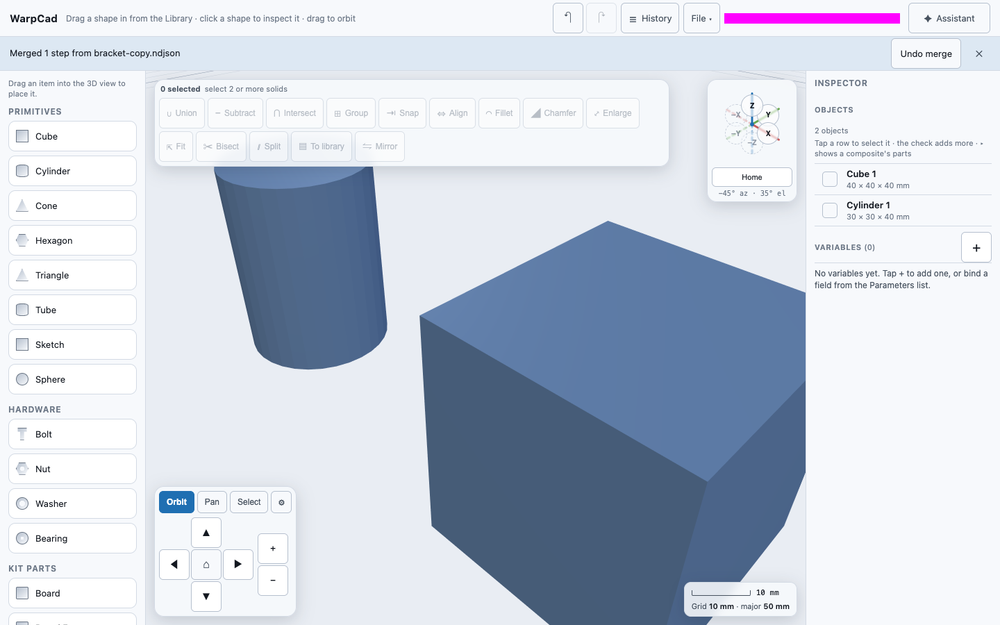

# Merging two copies of a project

If you work on the same project in two places, say on your laptop and on your phone, each copy
picks up its own changes. **File ▾ → Merge file…** puts them back together: pick the other copy's
file, and its changes are added to the project you have open. Your own changes stay as they are.

Merging only adds, changes or removes the steps the other copy changed. It never replaces your
project, so WarpCad doesn't ask "Replace the project?" first, and a merge you didn't want can be
taken back out with **Undo merge**.

## Try it

1. Open your project on your laptop and choose **File ▾ → Download copy**. In desktop Chrome or
   Edge, where the menu has **Save** and **Save As…** instead, use **Save As…**.
2. Send the file to your phone and open it there with **File ▾ → Open…**. Add a cylinder.
3. Back on the laptop, move the cube.
4. On the phone, choose **File ▾ → Download copy**, and send that file to the laptop.
5. On the laptop, choose **File ▾ → Merge file…** and pick it. The cylinder appears and the cube
   stays where you moved it. A strip under the top bar says **Merged 1 step from**
   *the file's name*, with an **Undo merge** button.
6. If a step shows a red **broken** chip reading *conflicts with step 6*, open it in History
   and either edit it or suppress it (see [What a conflict is](#what-a-conflict-is) below).

## When Claude Code edits the file you have open

You don't have to pick the file yourself when the other copy is a project file that Claude Code
(the [MCP server](mcp.md)) is editing, and you have it open in Chrome or Edge: WarpCad notices
when you switch back to its window and does the same merge by itself, with the same strip and
**Undo merge**. The strip then names the source **Claude Code** when every step that came in was
Claude's, and the file's name otherwise.

**Example.** Open `bracket.ndjson` in Chrome and move the cube without saving. In Claude Code say
*add a 20 mm sphere on top of the cube*, then click back into WarpCad: the sphere appears, the
cube stays where you moved it, and the strip reads **Merged 1 step from Claude Code**.

**In Safari, Firefox, or on a phone** WarpCad can't look at the file again, so it can't notice.
Choose **File ▾ → Merge file…** and pick the project file instead: the strip reads **Merged 1 step
from bracket.ndjson**. See [Working on a project you have open](mcp.md#working-on-a-project-you-have-open).

**Merge file…** sits directly under **Open…** in the File menu and opens the same file picker.
The new steps show up in [History](timeline.md) like any others. A step that came from another
program, such as the AI assistant, keeps its `via …` label.

## What the strip says

The strip counts **History rows**, the same steps you see in the History list:

- **Merged 3 steps from bracket-copy.ndjson**: three new steps came in.
- **Merged 3 steps from bracket-copy.ndjson (1 added, 1 changed, 1 removed)**: one new step, one
  step the other copy edited, suppressed or moved, and one step the other copy deleted.
- **Merged a rollback point from bracket-copy.ndjson**: the other copy only moved its
  [rollback point](timeline.md#parking-at-an-earlier-point-roll-back). A copy that only changed a
  setting says which one, for example **Merged the standing instructions from …**.
- **bracket-copy.ndjson has nothing this project doesn't already have**: nothing changed, and
  there is nothing to undo.

The same sentence also appears in the status line at the right of the top bar, and in the first
line of the File menu. The strip stays until you close it with **✕**.

## What a conflict is

Sometimes both copies change the same thing in ways that can't both be kept. Say that on the
laptop you **moved** Cube 1, and on the phone you **filleted** its top edge. Both steps start
from the same cube, but a body can only go one way at a time. The move and the fillet each want
to be the next step for that cube, and only one of them can be.

WarpCad keeps one and marks the other. It never quietly attaches a step to a different shape.
The marked step stays in History but builds nothing for now. It gets a red **broken** chip, and
when you select it the reason is printed under it: **conflicts with step 6 (Move Cube 1, by
you)**. That means the step was built for a version of the cube that step 6 has since changed.

When any step conflicts, a yellow strip shows up in place of the usual one and stays until
you close it: **Merged 4 steps from bracket-copy.ndjson — 2 steps conflicted**, with **Show** and
**Undo merge**.

### Fixing a conflicted step

1. Press **Show** on the yellow strip. History opens (on a phone, as the sheet at the bottom of
   the screen) with the first conflicted step selected and its reason underneath.
2. Use that step's own buttons:
   - **Suppress** switches it off. It stops trying to build, and the chip goes away.
   - **Edit** changes its numbers. This only helps if the conflict is about a value.
   - To drop a whole shape, select it and delete it as usual.
3. A step that builds again loses its chip straight away. There is no separate "resolve" step.

## Undo merge

**Undo merge** on the strip takes the merge back out in one go. It removes the steps the merge
added, puts back the steps and settings it changed, and brings back any it deleted. Your own
steps stay, including ones you made after the merge.

- It is **not** on the **Undo** button in the top bar. **Undo** only ever takes back your own
  steps, one at a time (see [Undoing and redoing a change](undo-redo.md)).
- It is available until the next merge, the next **Open…** or **New**, or a reload. If you close
  the strip, it goes with it.
- Merging the same file again afterwards adds nothing: it reads **has nothing this project
  doesn't already have**, because the merge is remembered as taken back out. To bring those
  steps in again, save a fresh copy from the other device and merge that.
- If you have since built on a merged step, for example you moved the cylinder that came in,
  Undo merge refuses. The strip shows a line starting **Can't undo the merge:** that names your
  step and the merged step it depends on, and nothing changes. Undo or delete your step first,
  then press Undo merge again. The same happens if you edited a step the merge changed.

If you press the top bar's **Undo** after a merge and the merge has since removed or changed the
step it would undo, Undo explains this under the button and takes that step off its list. It
won't bring back something the other copy deliberately deleted.

## When the Assistant's turn is merged

You can keep editing while the [Assistant](ai-partner.md#while-the-assistant-works) works. It
builds on its own copy of the project, and when it finishes, that copy is merged into yours the
same way **Merge file…** merges a file: your changes and its changes both stay, and a step that
can no longer be built is marked as a conflict, never attached to a different shape.

- A clean turn shows no strip. The chat says *Merged with 2 changes you made meanwhile* if you
  changed anything while it worked.
- A turn with a conflict shows the yellow strip, naming the Assistant as the source: **Merged 2
  steps from the Assistant — 1 step conflicted**, with **Show**. Fix the marked step the same way
  as [above](#fixing-a-conflicted-step).
- The strip has no **Undo merge**. To take the Assistant's work back out, use **Undo AI turn** in
  the chat. It works like Undo merge, but for that turn only.
- If you and the Assistant both changed the same step or setting, the later change is kept, and
  the chat says whose it was.

**Example.** Drag a Cube in. Ask the Assistant to *round the top edge of the cube*, and while it
says *Working…*, move the cube. When it finishes, the strip reads **Merged 1 step from the
Assistant — 1 step conflicted**. Press **Show**: History opens on the Assistant's fillet, with the
reason **conflicts with step 2 (Move Cube 1, by you)**. Suppress it, or ask the Assistant again.

## When a merge is refused

Nothing changes in any of these cases:

- **bracket-v2.ndjson is a different project. Merge only works between copies of the same
  project.** The file isn't a copy of the project you have open. To combine two separate
  projects, open one of them and rebuild what you need from the other.
  This check is not complete yet. WarpCad can only tell two files apart when they came from
  older (version 1) saves. Two projects you each started from **New** in this version are not
  recognised as different, and merging one into the other combines them, with **Undo merge**
  to take it back. Only merge a file you know is a copy of the open project.
- A file that isn't a WarpCad project, or that needs a newer WarpCad, gets the same message
  **Open…** would show, for example **Couldn't open notes.txt: line 1 is not valid JSON — this
  is not a WarpCad project file**.
- Cancelling the file picker does nothing and says nothing.

**Merge file…** is greyed out, with the reason printed under it, when:

- **Nothing to merge into**: the project is empty. Use **Open…** instead.
- **Return to the latest step to merge**: History is showing an earlier step. Click the last row
  or close History first.
- **Wait for the Assistant to finish**: an Assistant turn is running. Merge the file when it is
  done. (Everything else, including your own edits, works while the Assistant works.)

## Good to know

- Merging doesn't change which file **Save** writes to. The project still saves where it did
  before.
- After a merge, the project autosaves as usual, so reloading keeps the merged result.
- Saved files remember which copy made each step and when. That's what lets two copies be
  merged, and why merging the same file twice adds nothing the second time. See
  [Older versions of WarpCad](save-load.md#older-versions-of-warpcad).

## See also

- [Saving and reopening your work](save-load.md)
- [Working on a project you have open: Claude Code and the app](mcp.md#working-on-a-project-you-have-open)
- [The History panel: revisiting any step you've taken](timeline.md)
- [Undoing and redoing a change](undo-redo.md)
- [Using WarpCad on a phone or tablet](mobile.md)
- [The Assistant: while it works](ai-partner.md#while-the-assistant-works)

<!-- SPDX-License-Identifier: CC-BY-SA-4.0 -->
