# Using WarpCad on a phone or tablet

WarpCad is built for a finger as much as for a mouse. Nothing on a phone needs a keyboard,
a right mouse button or hovering. What changes is **where things live**: a phone is too
narrow for side columns, so panels become sheets that slide up from the bottom of the
screen, and the navigation pad folds away when a sheet is open. This page is the map. The
other pages explain what each control *does*; start here to find where it is on a small
screen.

Two sizes are described below. **Phone** means a narrow screen such as an iPhone (390 px
wide). **Tablet** means something like an iPad held upright (820 px wide).

> **A note on these pictures.** They are captured automatically in Chromium at 390 and 820
> pixels wide, with real touch events. That shows the layout and the gestures, but it is
> **not** a substitute for trying WarpCad on a real phone or tablet. In particular, Safari
> on an iPhone or iPad handles touch differently from Chromium, and only a real device
> proves it works there. If something here does not match what you see on your device, that
> is worth reporting.

## Try it: place a shape and move the camera

1. Open WarpCad on your phone. The 3D view fills the screen; the **Library** is a tab at the
   very bottom.
2. Tap **Library**. A sheet slides up with the **Primitives** list.
3. Press the **Cube** row and drag it up into the 3D view. You do not need to hold still
   first: put your finger on the row and start dragging. A translucent preview of the cube
   follows your finger. Lift your finger to drop it.
4. The Library sheet stays open so you can drop another shape. Tap the **Library** bar to
   put it away.
5. **Two-finger drag** slides (pans) the view. **Pinch** zooms in and out. A **one-finger
   drag** orbits.
6. **Tap the orientation cube** in the top-right corner (the X, Y, Z triad), for example its
   **Z** cap, to snap the view to a standard direction. **Home** puts the camera back where
   it started.

## The whole screen

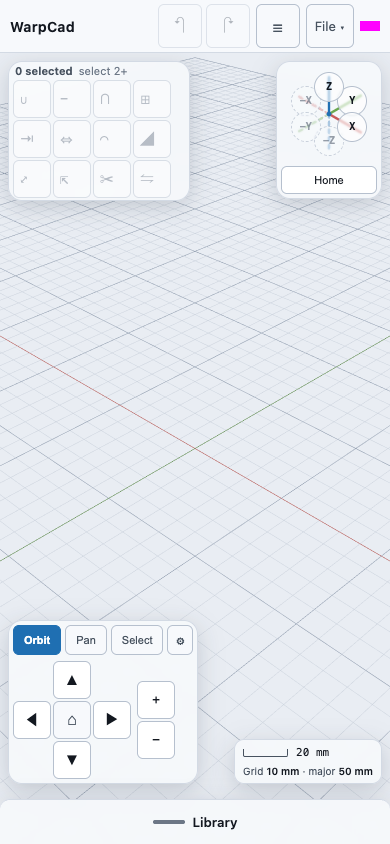

On a phone:

| Where | What |
|---|---|
| Top bar | Undo and redo, the **History** button (the three-line icon), the **File** menu and a small status light. |
| Top-left of the 3D view | The **Operations toolbar** (Union, Subtract and the rest). |
| Top-right | The **orientation triad** with its **Home** button. |
| Bottom-left | The **navigation pad** (Orbit / Pan / Select, arrows, zoom). |
| Bottom-right | The scale readout. |
| Bottom edge | The **Library** tab, and, once there is something in the scene, the **Objects** or **Inspector** tab above it. |

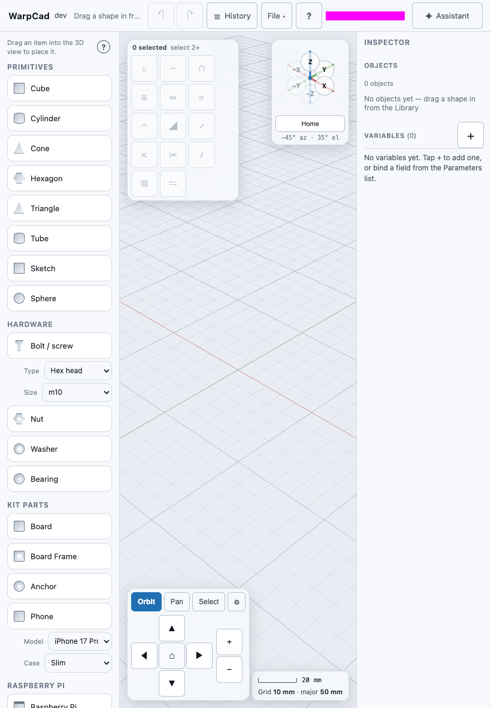

On a tablet there is room for columns: the **Library** is always on the left and the
**Inspector** always on the right, so there are no sheets to open. Everything else is where
it is on a phone, and the **History** button in the top bar is spelled out.

## The Library

On a phone, tap the **Library** tab to raise the sheet. Rows are the same as on a laptop:
Primitives, Hardware, Kit Parts, Raspberry Pi. See
[Placing a shape](primitive-placement.md) for what each one gives you.

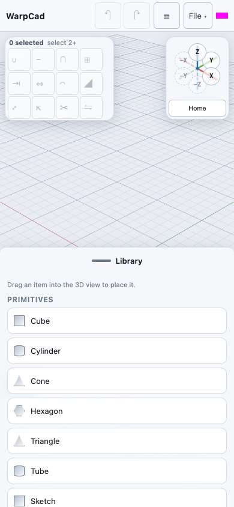

On a tablet it is the left-hand column and is always open:

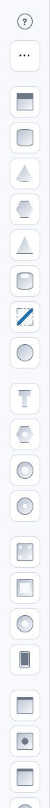

Open the Library *before* you start to drag, because a row has to be on screen to be
dragged. If you open **History** or tap the Inspector's tab while the Library is up, the
Library puts itself away: there is room for one sheet at a time.

## The Inspector

Tap a shape in the 3D view and the **Inspector** sheet rises by itself, titled with the
shape's name, showing its size, position, colour and a **Delete** button. See
[Selecting a shape](selection-and-inspector.md) for each field.

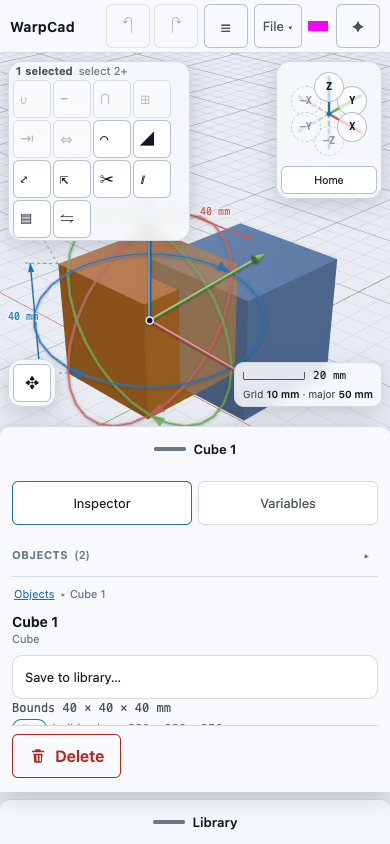

- To put it away, **swipe the sheet down** by its grab handle, or tap an empty patch of the
  3D view. Both also let go of the selection.
- With nothing selected, the same tab reads **Objects (n)**. Tap it for the list of everything in
  the scene.

On a tablet the Inspector is the right-hand column, not a sheet:

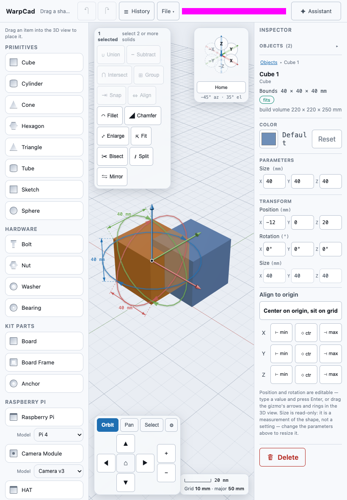

## Selecting two shapes, and the Operations toolbar

The Operations toolbar buttons stay dimmed until enough shapes are selected: two for Union,
Subtract and Intersect. A phone has no Shift key, and a tap on a shape selects only that
shape, so there are two touch ways to select a second one:

- **Select mode and a box.** In the navigation pad tap **Select**, then drag a box around the
  shapes you want with one finger. Everything the box encloses is selected. (While the Inspector sheet is
  open the pad is folded to a **✥** button, see below. Tap **✥** first to reach **Select**.)
- **The Objects list.** Open the Inspector's **Objects** list and tap the small box beside
  each shape.

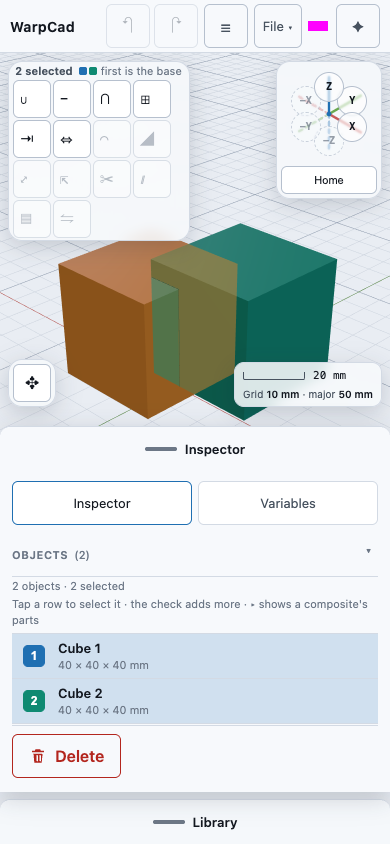

Subtract cuts the **first** shape selected. See [Combining shapes](booleans.md).

On a tablet the same toolbar sits at the top-left of the 3D view:

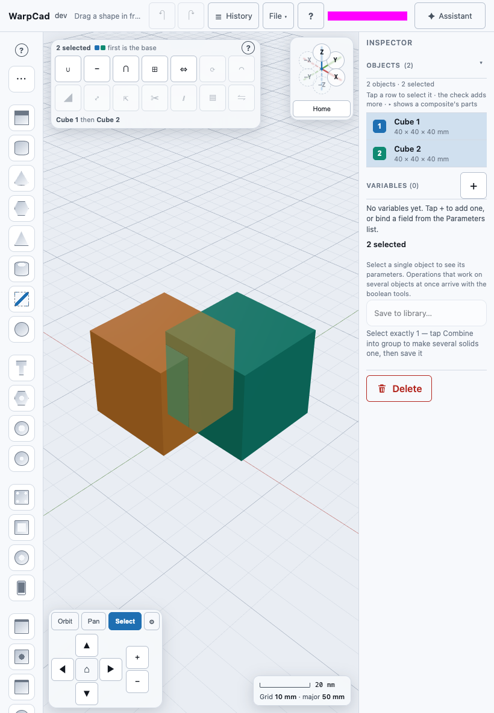

## The navigation pad folds behind a button

On a phone, while a sheet is open, the navigation pad would sit on top of your shapes. So it
folds to a single **✥** button in the corner, and **a tap on a shape goes to the shape**.
Tap **✥** to open the pad (Orbit, Pan, Select, the arrows, **⌂** and the zoom buttons) and
tap it again to fold it. You can always move the camera with your fingers, whether or not the
pad is folded.

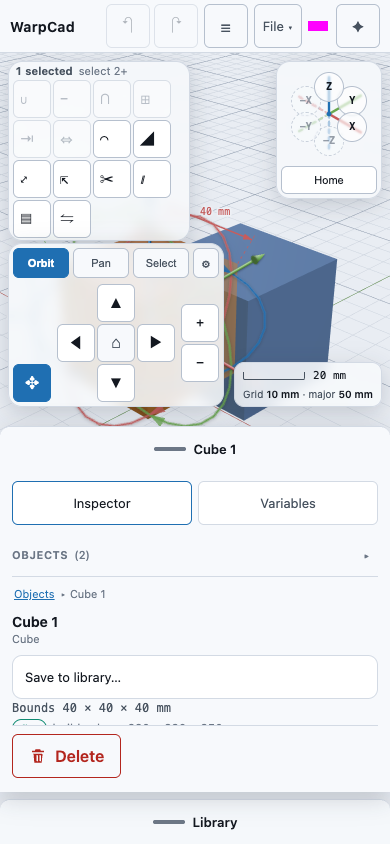

On a tablet there are no sheets, so the pad is always open. See
[Moving around the 3D view](viewport-navigation.md) for what each control does.

## The File menu

Tap **File** in the top bar. The menu drops down over the 3D view: **New**, **Download copy**,
**Open...**, **Export...**, **Resolution...**, and **Connect repository...** for GitHub
storage. See [Saving and reopening your work](save-load.md) and [Exporting](export.md).

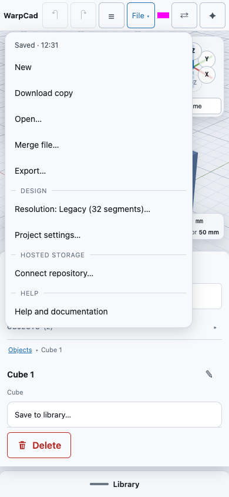

## Sketching

Drag **Sketch** out of the Library like any other shape. The sketch editor opens with a
toolbar at the top-left (Select, Line, Rectangle, Circle, Polygon, Snap, Hole, Slices, the
extrude method, Done and Cancel), and the navigation pad folds to **✥**. The **Extrude** and
**Slices** panels open as a short sheet along the bottom, so most of the screen stays on the
drawing. New points snap to the corners, centres and edges of outlines already drawn; with no
Shift key on a phone, tap **Snap** to turn that off. See [Sketch primitives](sketch-mode.md#snapping-to-other-outlines).

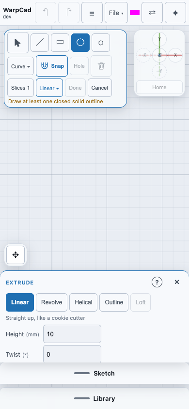

## What the AI chat will do here

The AI chat panel does not exist yet. When it does, on a phone and tablet it will slide over
the 3D view rather than sit beside it, so the model stays visible behind it.

## Gestures at a glance

| Gesture | Result |
|---|---|
| Tap a shape | Selects it. The Inspector rises on a phone. |
| Tap empty space | Clears the selection. |
| Drag a Library row into the view | Places the shape where you let go. |
| One-finger drag on empty view | Orbits (or pans when **Pan** is chosen). |
| Two-finger drag | Pans. |
| Pinch | Zooms. |
| Tap a triad cap, or **Home** | Snaps the view. |
| Swipe an Inspector sheet down | Puts it away and clears the selection. |

<!-- SPDX-License-Identifier: CC-BY-SA-4.0 -->
