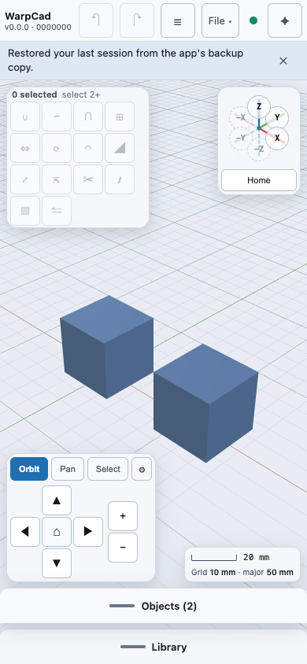

# The native apps: iPhone, iPad, Mac, Android and Windows

WarpCad also comes as an installed app for **iPhone and iPad**, **Mac**, **Android** and
**Windows**. It is the same WarpCad you use at `app.warpcad.com`: the same Library, the same
Inspector, the same tools, packaged inside a small native shell (built with
[Tauri](https://tauri.app)). Every control on these help pages works the same way in the
app as in a browser at the same screen width.

> **Not in the app stores yet.** The apps are being built now. Until a release is
> published, the only way to get one is to build it yourself (see
> [Building the apps yourself](#building-the-apps-yourself) below).

## How the app differs from the web app

- **It works offline from the first launch.** The whole web app is bundled inside the
  install, so it never downloads WarpCad from the internet. The one exception is these help
  pages, which the app reads from `app.warpcad.com` (see [Help in the app](#help-in-the-app)
  below). There is no "Install app"
  prompt, no browser address bar, and no update banner: a new version arrives as an app
  update from the store.
- **It has its own storage.** Projects you make in the app are kept by the app. They are
  **not shared** with the projects you saved in Safari, Chrome or any other browser at
  `app.warpcad.com`, and the browser cannot see the app's projects either. Moving a project
  between the two takes a project file: in the browser, **File ▾ → Download copy** (or the save
  item your browser shows) writes one, and **File ▾ → Open…** reads one.
- **Your projects are files in the Files app** (iPhone and iPad). **File ▾ → Save** writes the
  project to WarpCad's folder, **On My iPhone › WarpCad**, and saves over the same file each
  time; **Open…** lists those projects and **Browse…** picks one from iCloud Drive. See
  [Saving in the iOS app](save-load.md#in-the-ios-app). Exports go to the **Exports** folder
  beside them: see [Exporting in the iOS app](export.md#in-the-ios-app).
- **No analytics.** The app does not load Google Analytics. See
  [Privacy](privacy.md) for what the web app measures.

## Help in the app

The app does not carry these help pages inside it. It reads them from `app.warpcad.com` each
time you open one, so they stay current without making the install larger. Help opens in
the same sheet as in a browser, and every tool's **?** still opens the right section.

**Try it:** tap **?**, or open **File ▾ → Help and documentation**. Help loads from
app.warpcad.com, so it needs a connection the first time you open a page. If you are offline
you see **Help needs a connection. Everything else in WarpCad works offline.** Tap **Retry**
once you are back online and the page opens. Modelling, saving and opening projects all keep
working while you are offline; only Help waits for the connection.

The help pages are published for the current web version of WarpCad, and your app may be a
version behind or ahead. When the two differ, a line under the version line at the bottom of
each page says so, for example `This help is for WarpCad 1.14.0; this app is 1.13.0.` A
control described on the page may then look different, or not exist yet, in your app.

## Links open in your browser

A link in WarpCad that goes to another website opens in your **system browser**, not inside
the app. The app itself never leaves WarpCad: it has no address bar or back button, so it
would have nowhere to come back from.

**Try it: set up the Assistant key.**

1. Tap **Assistant** (the chat button) to open the **Assistant key** sheet.
2. Tap **Anthropic console**. Safari (on iPhone and iPad), or your default browser on a Mac,
   Windows or Android device, opens the page where keys are made.
3. Create a key and copy it.
4. Come back to WarpCad: on iPhone swipe back from the left edge, or tap **◀ WarpCad** at the
   top left of the screen. The **Assistant key** sheet is still open.
5. Paste the key into the field and tap **Save and test**.

The same applies to **Open GitHub's token page** (Connect to GitHub), **Open on GitHub** (after
you share a gist), and **Source code** and **Third-party notices** at the foot of a help
page, and to any link inside a help page. Only `https://` pages open this way.

## iPhone and iPad

One app runs on both. It opens straight into the 3D view, with the Library and Inspector as
sheets on a phone and side panels on an iPad, as described in
[Using WarpCad on a phone or tablet](mobile.md). The view stays clear of the notch and the
home indicator.

**Try it:**

1. Open WarpCad from your home screen. The 3D view fills the screen.
2. Tap **Library** at the bottom. The sheet slides up with the **Primitives** list.
3. Press the **Cube** row, drag it up into the view and lift your finger. A cube appears
   where you let go, and stays there.
4. Tap the **Library** bar to put the sheet away.
5. Open **File ▾ → Help and documentation** and scroll to the bottom of the page. The version
   line reads, for example, `WarpCad 1.13.0 (a1b2c3d) · iOS app 1.13.0`: the WarpCad version,
   the exact commit it was built from in brackets, and then the app's own version. It ends in
   `iOS app` on an iPhone or iPad.

If you come back to the app after a while and the 3D view is blank, with a banner reading
*Restoring…* or offering **Restore view**, see
[If the 3D view goes blank](viewport-navigation.md#if-the-3d-view-goes-blank). The app
has no reload button, so the view restores itself, or restores when you tap that button,
without losing your parts or your undo history.

### Let an AI agent edit the open project

The app can let an MCP agent, such as Claude Code on your computer, edit the project you have
open, with nothing else to install. Open **Assistant → Live MCP access…**, choose how long, and
tap **Enable access**. To reach it from a computer on the same Wi-Fi, turn on **Allow devices on
this Wi-Fi** and copy the command the sheet shows. It works while WarpCad is open on screen.
[From the iOS app](mcp.md#from-the-ios-app) gives the steps and says which agents can connect.

## Where your work is kept

In the iPhone and iPad app, your open project and your My parts are kept in two places on the
device: the app's web storage, where the editor saves as you work, and a backup copy in the
app's own Application Support folder. iOS can clear web storage on its own to free space. The
backup copy is what lets WarpCad recover from that.

**What you'll see:** if iOS clears the web storage, WarpCad finds the backup copy the next time
you open the app and shows *Restored your last session from the app's backup copy.* The project
that was open comes back with its History, and the parts you had in My parts come back with it.
Nothing needs to be reinstalled.

**Try it:**

1. Open the app, tap **Library** and place two parts in the 3D view. Wait until the saved
   indicator shows that the project is saved.
2. Delete and reinstall nothing. If iOS clears the app's web storage to free space, WarpCad finds
   the backup copy the next time you open it and shows *Restored your last session…*.
3. Check that your two parts are there, and that **History** lists the placements you made.

The backup copy is written after each save, and again when the app goes to the background. It is
not a second project to manage: it always holds the same project the editor has open.

If iOS ends the app's web content to free memory (most often while the app is in the background),
WarpCad reloads the page by itself and your project comes back from the same saved copy, with no
tap needed. Only the undo history is lost, so keep working as you were and use **History** to see
what you placed. If the page fails again within a few seconds of reloading, WarpCad leaves the
window as it is instead of reloading in a loop; close the app from the app switcher and open it
again, and your project is still there.

## Mac

The Mac app opens WarpCad in its own window, with the persistent side panels of the laptop
layout. Mouse, trackpad and keyboard shortcuts work as they do in a desktop browser. Follow
the same steps as above with a mouse: drag **Cube** from the Library into the view and
release. The Help version line ends in `macOS app` and the app's version.

An MCP client on the same Mac, such as Claude Code, can edit the open project through the app's
own endpoint, `http://127.0.0.1:5184/mcp`, once you enable **Assistant → Live MCP access…**. See
[From the iOS app](mcp.md#from-the-ios-app); the Mac app works the same way, and keeps serving
while another app is in front.

## Android

The Android app is the phone and tablet layout, driven by touch, exactly as in Chrome on the
same device. The Help version line ends in `Android app` and the app's version.

## Windows

The Windows app opens WarpCad in its own window, like the Mac app. The Help version line ends
in `Windows app` and the app's version.

## Installing a test build

Before the app is in the App Store, test builds reach an iPhone or iPad through Apple's
**TestFlight** app. You need an invitation from whoever builds the app.

1. On the iPhone or iPad, install **TestFlight** from the App Store, if it is not there already.
2. Open the invitation, in the TestFlight app or in the email or message it came with, and tap
   **View in TestFlight**.
3. Tap **Install**. WarpCad appears on the home screen, with a small orange dot beside its name
   while it is a test build.
4. Open WarpCad. The 3D view fills the screen. Open **File ▾ → Help and documentation** and
   scroll to the bottom: the version line ends in `iOS app <version>`, for example `iOS app
   1.17.0`. Tell whoever sent the invitation if it reads something else.

A test build stops working after 90 days, and TestFlight tells you when a newer one is
available. There are no pictures of these steps: TestFlight is Apple's app, and no test here
can open it.

## Checking which build you have

Every page of Help ends with the version line. In a browser it reads `WarpCad build
a1b2c3d`. In an app it reads `WarpCad <version> (<commit>) · <platform> app <app version>`.
If you report a problem with an app, copy this whole line into the report: it says which
WarpCad commit is bundled inside and which version of the app is wrapping it, and those
two can differ.

## Building the apps yourself

The native shell lives in its own repository, `warpcad-native`, next to this one. Its
`README.md` lists what each platform needs (Rust, and Xcode for iPhone, iPad and Mac;
Android Studio with its SDK and NDK for Android; a Windows machine or the repository's
Windows build job for Windows) and the commands, for example `npm run mac:dev` for the Mac
window and `npm run ios:dev` for the iPhone and iPad simulator. Each build first runs
`npm run build:native` in this repository to make the bundled copy of WarpCad.

## About the pictures on this page

The pictures here, the offline Help sheet and the restore toast, are recorded automatically by
the test suite in a browser that stands in for the iPhone app, with a fake of the native shell
in place of the real one. Any other picture here would have to be a hand-made screenshot, and
those are not allowed on these pages.

<!-- SPDX-License-Identifier: CC-BY-SA-4.0 -->
