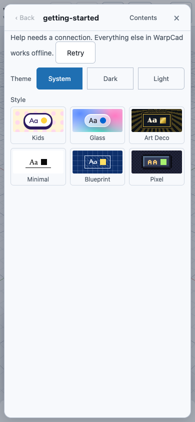

# The native apps: iPhone, iPad, Mac, Android and Windows

WarpCad also comes as an installed app for **iPhone and iPad**, **Mac**, **Android** and
**Windows**. It is the same WarpCad you use at `app.warpcad.com`: the same Library, the same
Inspector, the same tools, packaged inside a small native shell (built with
[Tauri](https://tauri.app)). Every control on these help pages works the same way in the
app as in a browser at the same screen width.

> **Not in the app stores yet.** The apps are being built now. Until a release is
> published, the only way to get one is to build it yourself (see
> [Building the apps yourself](#building-the-apps-yourself) below).

## How the app differs from the web app

- **It works offline from the first launch.** The whole web app is bundled inside the
  install, so it never downloads WarpCad from the internet. The one exception is these help
  pages, which the app reads from `app.warpcad.com` (see [Help in the app](#help-in-the-app)
  below). There is no "Install app"
  prompt, no browser address bar, and no update banner: a new version arrives as an app
  update from the store.
- **It has its own storage.** Projects you make in the app are kept by the app. They are
  **not shared** with the projects you saved in Safari, Chrome or any other browser at
  `app.warpcad.com`, and the browser cannot see the app's projects either. Moving a project
  between the two takes a project file: in the browser, **File ▾ → Download copy** (or the save
  item your browser shows) writes one, and **File ▾ → Open…** reads one.
- **Your projects are files in the Files app** (iPhone and iPad). **File ▾ → Save** writes the
  project to WarpCad's folder, **On My iPhone › WarpCad**, and saves over the same file each
  time; **Open…** lists those projects and **Browse…** picks one from iCloud Drive. See
  [Saving in the iOS app](save-load.md#in-the-ios-app). Exports go to the **Exports** folder
  beside them: see [Exporting in the iOS app](export.md#in-the-ios-app).
- **No analytics.** The app does not load Google Analytics. See
  [Privacy](privacy.md) for what the web app measures.

## Help in the app

The app does not carry these help pages inside it. It reads them from `app.warpcad.com` each
time you open one, so they stay current without making the install larger. Help opens in
the same sheet as in a browser, and every tool's **?** still opens the right section.

**Try it:** tap **?**, or open **File ▾ → Help and documentation**. Help loads from
app.warpcad.com, so it needs a connection the first time you open a page. If you are offline
you see **Help needs a connection. Everything else in WarpCad works offline.** Tap **Retry**
once you are back online and the page opens. Modelling, saving and opening projects all keep
working while you are offline; only Help waits for the connection.

The help pages are published for the current web version of WarpCad, and your app may be a
version behind or ahead. When the two differ, a line under the version line at the bottom of
each page says so, for example `This help is for WarpCad 1.14.0; this app is 1.13.0.` A
control described on the page may then look different, or not exist yet, in your app.

## iPhone and iPad

One app runs on both. It opens straight into the 3D view, with the Library and Inspector as
sheets on a phone and side panels on an iPad, as described in
[Using WarpCad on a phone or tablet](mobile.md). The view stays clear of the notch and the
home indicator.

**Try it:**

1. Open WarpCad from your home screen. The 3D view fills the screen.
2. Tap **Library** at the bottom. The sheet slides up with the **Primitives** list.
3. Press the **Cube** row, drag it up into the view and lift your finger. A cube appears
   where you let go, and stays there.
4. Tap the **Library** bar to put the sheet away.
5. Open **File ▾ → Help and documentation** and scroll to the bottom of the page. The version
   line reads, for example, `WarpCad 1.13.0 (a1b2c3d) · iOS app 1.13.0`: the WarpCad version,
   the exact commit it was built from in brackets, and then the app's own version. It ends in
   `iOS app` on an iPhone or iPad.

If you come back to the app after a while and the 3D view is blank, with a banner reading
*Restoring…* or offering **Restore view**, see
[If the 3D view goes blank](viewport-navigation.md#if-the-3d-view-goes-blank). The app
has no reload button, so the view restores itself, or restores when you tap that button,
without losing your parts or your undo history.

## Mac

The Mac app opens WarpCad in its own window, with the persistent side panels of the laptop
layout. Mouse, trackpad and keyboard shortcuts work as they do in a desktop browser. Follow
the same steps as above with a mouse: drag **Cube** from the Library into the view and
release. The Help version line ends in `macOS app` and the app's version.

## Android

The Android app is the phone and tablet layout, driven by touch, exactly as in Chrome on the
same device. The Help version line ends in `Android app` and the app's version.

## Windows

The Windows app opens WarpCad in its own window, like the Mac app. The Help version line ends
in `Windows app` and the app's version.

## Checking which build you have

Every page of Help ends with the version line. In a browser it reads `WarpCad build
a1b2c3d`. In an app it reads `WarpCad <version> (<commit>) · <platform> app <app version>`.
If you report a problem with an app, copy this whole line into the report: it says which
WarpCad commit is bundled inside and which version of the app is wrapping it, and those
two can differ.

## Building the apps yourself

The native shell lives in its own repository, `warpcad-native`, next to this one. Its
`README.md` lists what each platform needs (Rust, and Xcode for iPhone, iPad and Mac;
Android Studio with its SDK and NDK for Android; a Windows machine or the repository's
Windows build job for Windows) and the commands, for example `npm run mac:dev` for the Mac
window and `npm run ios:dev` for the iPhone and iPad simulator. Each build first runs
`npm run build:native` in this repository to make the bundled copy of WarpCad.

## About the pictures on this page

The one picture here, the offline Help sheet, is recorded automatically by the test suite in
a browser that stands in for the iPhone app. No automated test drives the native apps
themselves yet, so any other picture here would have to be a hand-made screenshot. Those are
not allowed on these pages.

<!-- SPDX-License-Identifier: CC-BY-SA-4.0 -->
