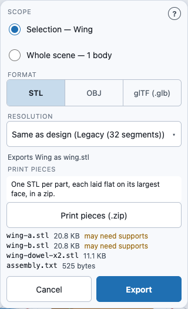
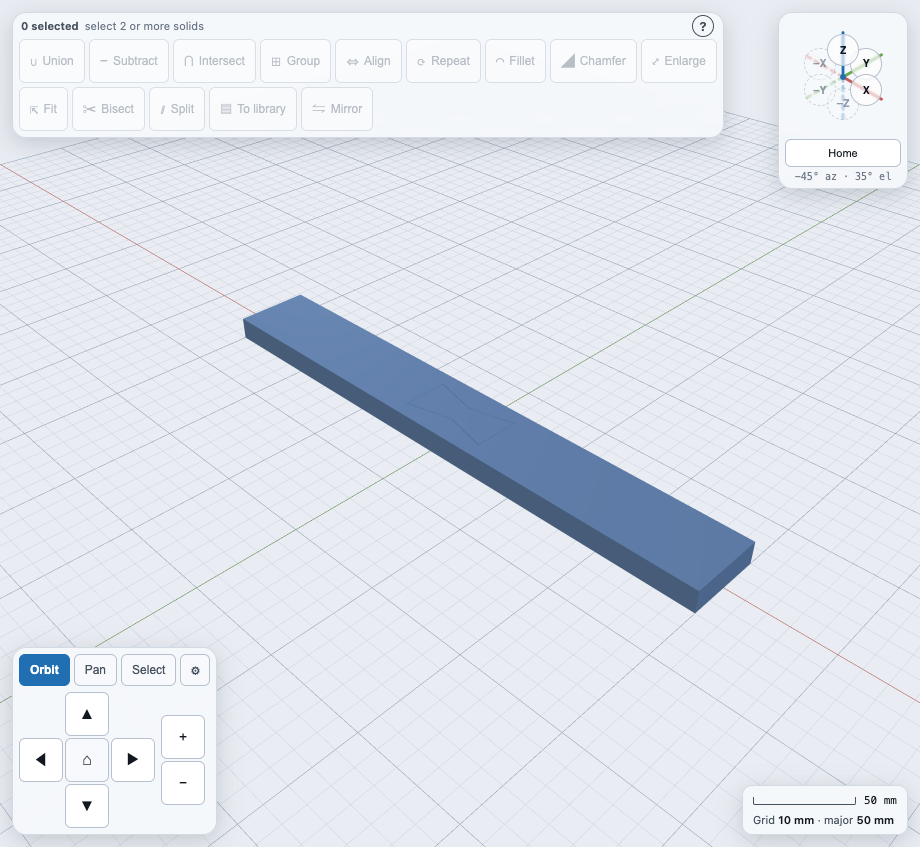

# Printing a part that is bigger than your printer

If a part is longer than your print bed, WarpCad can **split** it into pieces that each fit,
cut with a matching joint so you can glue or press them back together, and then **export
every piece as its own STL**, already laid flat. Three things work together:

- the **build volume** (your printer's bed size), set in **File ▾ → Project settings…**;
- **Split…** in the Operations toolbar, which cuts one selected shape along a plane;
- **File ▾ → Export… → Print pieces**, which writes a zip with one STL per piece.

On a phone, **Split…** and **Export…** are in the same places as on a laptop (see
[Using WarpCad on a phone or tablet](mobile.md)); the Split sheet opens as a bottom sheet.

## Try it: split a 300 mm wing and export two pieces

The default bed is 220 × 220 × 250 mm, so a 300 mm bar does not fit. Place a **Cube**, select it
and set its **Size** in the Inspector to X 300, Y 40, Z 12 (millimetres; or open a project that
already has a long part), and rename it **Wing**.

1. Click the wing in the 3D view. The Inspector shows its bounds, `300 × 40 × 12 mm`, and a red
   badge: **too large by 80 mm**.
2. In the Operations toolbar press **Split…**. The button is dimmed with the tooltip *Select
   exactly 1 solid* until exactly one shape is selected (a group counts as one).
3. The **Split into printable pieces** sheet opens and a translucent **cut plane** appears across the
   wing, with a round handle at its centre. Set **Axis** to **X** and **Offset from the minimum
   face (mm)** to **150**. The plane moves as you type; you can also drag the handle, and the
   number follows. The list underneath tells you, before you commit, that **Wing A** and **Wing B**
   are each `150 × 40 × 12 mm` and **fits**.
4. Set **Joint** to **Tongue and groove** (use **Pins and sockets** for thicker parts) and leave **Clearance per
   side** at **0.2** mm.
5. Press **Apply**. The sheet closes, the Inspector's **Parts** list shows **Wing A** and **Wing B**,
   and the badge turns green: **fits**.

   

6. Open **File ▾ → Export…** and press **Print pieces (.zip)**. Your browser downloads
   `wing-print-pieces.zip` containing `wing-a.stl` and `wing-b.stl`. The panel lists each file
   with its size.

   

To check the joint, hide one piece: see [Hide and show](selection-and-inspector.md#hide-and-show).

## Try it: choose where the connectors go

**Pins and sockets** and **Tongue and groove** pick their own places on the cut face. When you want a
post near the spar, a second one near the tip, a wedge key, or a screw boss you can take apart and
reassemble, place them yourself. With the wing split at offset 150:

1. Turn the view to face the cut: in the view cube press **X** (camera on +X). On a tablet the
   Split sheet covers the cube, so do this first, or drag the view round with a finger.
2. Open **Split…**, set the offset, and tick **Place connectors by hand**. The **Joint** list is replaced
   by a **Connector kind** row (**Post**, **Wedge**, **Screw boss**, **Dowel**, **Butterfly**, **Tenon**, **Magnet**), and the cut plane
   shows what the automatic search found as markers: a disc for a post, a diamond for a wedge, a
   ring for a screw boss, a ring with a dot for a dowel, a hollow stadium for a tenon, a hollow disc with one half filled for a magnet. Red patches on the plane are where nothing
   fits. Picking **Dowel** adds a **Dowels are** list (**Printed**, **Steel pin**, **1.75 mm
   filament**); bought dowels show under the pieces as **You'll also need**.
3. Press **Screw boss**, then **tap the plane** where you want one. It appears as a ring if it
   fits. A tap where it does not fit is turned back, and the sheet says why, for example
   *placement 2 (screwBoss at y = 19.7, z = 6 mm): its socket and 1.2-2 mm wall would break out of
   piece B*.
4. **Drag a marker** to move it. It turns red while the spot is no good, and goes back to where it
   was when you let go, with the reason. With a marker selected, pressing a kind changes that
   marker (at the same spot), and the **×** beside it removes it; a right-click or a long press
   removes it too.
5. Press **Apply**. It stays dimmed, with the reason, until at least one connector fits. Untick
   **Place connectors by hand** at any time to go back to the automatic joint.

## Choosing a joint

The **Joint** list is grouped by what you end up with: joints printed into the pieces, separate
keys you print as well, and hardware you buy. The line under the list says what the choice is
for.

| Joint | Resists | Glue? | Comes apart? | Extra to print or buy | Best for |
|---|---|---|---|---|---|
| **Pins and sockets** (*printed into the pieces*) | sliding across the cut, twisting (with two pins) | yes, to stop it pulling apart | if not glued | nothing | thick parts that print with the cut face up |
| **Tongue and groove** (*printed into the pieces*) | sliding across the cut | yes | if not glued | nothing | thin sections: a trailing edge, a panel |
| **Sliding dovetail** (*printed into the pieces*) | pulling apart, sliding across the cut in every direction but along the rail | yes, to stop it sliding off the rail | by sliding it back off the rail, if not glued | nothing | beams that pull apart in use: a shelf, a long bar |
| **Puzzle tabs** (*printed into the pieces*) | pulling apart and sliding in the plate's plane | no: they lock in the plane | by lifting one piece straight off, if not glued | nothing | flat signs, panels and tiles (plate-like sections only) |
| **Half lap** (*printed into the pieces*) | sliding across the cut, pushing together | yes: the joint is mostly glue area | if not glued | nothing (magnets or dowels can be added) | thin plates that will be glued (plate-like sections only) |
| **Finger joint** (*printed into the pieces*) | sliding along the seam | yes: it has the most glue area | if not glued | nothing | boxes, frames, any section you will glue and want lined up |
| **Butterfly keys** (*separate keys to print*) | pulling apart, sliding across the cut | no: the only joint here that locks without glue | with a pry, if not glued | one printed bowtie key per pocket | flat signs, planks and beams: pieces you can push together first and lock from the outside |
| **Tenons** (*separate keys to print*) | sliding across the cut, twisting (one is enough) | yes | if not glued | one printed flat stadium-shaped key per mortise pair | thin sections where one dowel would not stop a twist: planks, panels |
| **Dowels** (*separate keys to print*) | sliding across the cut, twisting (with two) | yes, or a press fit | if not glued | one printed dowel per socket pair | beams and anything that prints on its cut face, where a pin printed upright would snap |
| **Steel or filament dowels** (*hardware you buy*) | as dowels, and stronger | yes, or a press fit | if not glued | steel dowel pins, or 1.75 mm filament cut to length | the strongest joint for the least printing |
| **Magnets** (*hardware you buy*) | light pulling apart | no, glue the magnets in | yes, on purpose | disc magnets, two per pocket pair | display models, lids, transport splits; pair with dowels for location |
| **No joint** | nothing | yes | no | nothing | parts you will glue or bolt some other way |

A dowel needs a socket and a wall in **both** pieces, so a cut close to the end of a part may have
room for pins but not for dowels; the sheet then says *no room for a dowel* before you press Apply.

A tenon is a flat key with round ends, set into a matching mortise in **both** cut faces, like a
Domino joint. Leave **Tenon width** and **Tenon thickness** blank (**Auto**) and the search picks a
size that fits the face, and places two end to end along the long side when they fit. The width is at
least twice the thickness. **Print pieces** lays each tenon on its big flat side; the side that goes
down has its round ends chamfered at 45° so it prints without supports, and the mortise is still the
full stadium.

**Magnets** cut a disc pocket in both cut faces, open at the cut, and print nothing extra. Choose
**Magnet size** (6 × 2, 6 × 3, 8 × 3, 10 × 2, 10 × 3 or 12 × 3 mm, diameter × thickness, or
**Custom**), or leave **Auto**. A pocket is the magnet plus the clearance on every side, and each
face keeps at least a 1.2 mm floor behind it, so a 6 × 3 magnet needs a section about 10 mm thick.
Two magnets are bought per pocket pair. `assembly.txt` gives the polarity rule: stack the magnets
and mark the top face of the stack, glue every magnet in piece A mark-out, and every magnet in piece
B mark-in, so the pieces attract.

A butterfly key sits in a bowtie-shaped pocket that straddles the seam on an outer face. Its
wings slope 1 : 4, so the pocket grows by 0.2 mm × √17, about 0.8 mm, of play along the cut axis at the
default clearance; glue the key if you want that gone. A key reaches the outside, so it is clipped
to the part: on a curved face its top follows the surface. The pocket's floor keeps at least
1.2 mm of material unless you tick **Cut right through**. In this version a key goes in straight
along one axis (**Side** is Auto, or Front, Back, Bottom or Top for an X cut), even on a slanted edge.

### Seam profiles: dovetail, puzzle tabs, half lap, fingers

The four joints added last shape the **whole seam** instead of sitting at points on it. Each is
printed into piece A and cut, with the clearance, out of piece B; nothing extra is printed or bought.

- **Sliding dovetail** — a rail, wider at its top than at the face (15° per side), runs the full
  length of the face's longer side on piece A; piece B has the matching channel. Piece B slides on
  **from one end, along the rail**, the only way it goes on, and then cannot be pulled straight off.
  **Rail height** is 3–8 mm (Auto: half the thickness) and **Neck width** at least 2.4 mm. The
  section must be thick enough for the rail plus a 1.2 mm wall each side of the channel; a section
  thinner than about 7 mm is refused with the sizes.
- **Puzzle tabs** — jigsaw tabs through the whole thickness, each head twice as wide as its neck.
  Piece B drops onto piece A through the thickness and then locks in the plate's plane.
  **Tabs** (Auto: one per ~40 mm of seam) and **Neck width** (2–20 mm).
- **Half lap** — piece A keeps the lower half of the thickness for **Lap length** past the cut
  (Auto: twice the thickness, at least 10 mm), piece B the upper half. Lots of glue area, and the
  step stops the pieces sliding while the glue sets.
- **Finger joint** — alternating fingers through the thickness, **Finger depth** past the cut
  (Auto: twice the thickness). **Fingers** on Auto is an odd number near the seam length over three
  times the thickness, so both end fingers are piece A's.

Puzzle tabs and a half lap need a **plate-like** section: thickness at most a quarter of the
seam's length (a 10 mm plank 120 mm wide is plate-like; a 20 × 20 mm bar is not). On anything
else the sheet says so before you press Apply.

A profile makes piece A **longer than the offset** by how far it stands proud of the cut, so for a
profile the pieces list shows each piece's **real** size from the planned joint, and its **fits**
badge is judged on that — a lap can push a piece that fit by the plane alone past your bed.

A profile shapes the whole seam, so it cannot be placed by hand: with a dovetail, puzzle tabs or
fingers the **Place connectors by hand** box is greyed out, and the sheet says why. A **Half lap**
is the exception: tick the box and the kind row offers **Dowel** and **Magnet** only. They go in the
half of the cut face where the two pieces meet (the top half, for a lap on the bottom); a tap on
piece A's own lap half is refused. With connectors, piece B slides onto the lap along the cut axis.

### Try it: a half lap across a plank

1. Place a **Cube**, set its **Size** to X 300, Y 120, Z 10 (mm) and rename it **Plank**.
2. Select it and press **Split…**. Set **Axis** to **X** and **Offset** to **150**. The pieces
   list reads **Plank A** `150 × 120 × 10 mm` and **Plank B** `150 × 120 × 10 mm`.
3. Set **Joint** to **Half lap** (under *Printed into the pieces*). Leave **Lap length** blank
   (**Auto**). Plank A now reads `170 × 120 × 10 mm`: the 20 mm lap is in its size and its fit.
   Type **30** in **Lap length** and it reads `180 × 120 × 10 mm`.
4. Press **Apply**, then **File ▾ → Export… → Print pieces**. The zip holds `plank-a.stl`,
   `plank-b.stl` and `assembly.txt`, which says: *Lay Plank B's step over Plank A's along Z, so
   the two halves overlap and both steps meet.* Glue the faces that touch.

For a beam that must not pull apart, choose **Sliding dovetail** instead: `assembly.txt` then says
which way to slide piece B onto the rail (*slide Plank B along Y … it only goes on that way*).

## Printing and assembling keys

A printed dowel is its own part, a **key**: after **Apply** the Parts list shows **Wing A**,
**Wing B**, **Wing key 1**, **Wing key 2**, and each key sits in its sockets so the view shows the
assembled part. Hide a piece to see them ([Hide and show](selection-and-inspector.md#hide-and-show)).
A later split refuses a plane that would cut through a key, by the key's name.

- **Orientation.** A butterfly key is laid on its big flat face, waist in the bed plane, so the
  narrow waist is held by layers running along it, the strong way. Each dowel has one flat along its length (a fifth of its diameter deep), and
  **Print pieces** lays it on that flat, so it prints lying down with its layers running along it
  (the strong way) and cannot roll. The socket stays round; the flat leaves room for glue.
- **One file per size.** Identical keys share one STL with the count in its name,
  `wing-dowel-x2.stl`: tell your slicer to print that many copies.
- **`assembly.txt`.** When a split has keys, bought hardware or a seam profile, the zip also has
  `assembly.txt`. It lists the pieces, each key file with how many to print, what to buy (or
  *Nothing to buy.*), and for each joint which two pieces go together and along which axis. For a
  sliding dovetail it names the axis to slide piece B along the rail; for puzzle tabs, a half lap
  or fingers, the axis piece B goes on along.
- **Glue.** Dry-fit first. For a permanent joint put a little glue in each socket and on the cut
  faces, push the dowels into piece A, then slide piece B on along the cut axis.
- **Clearance.** The dowel is 2 × clearance shorter than its two sockets and the sockets are
  wider by the clearance per side. 0.2 mm is a starting point that has not yet been checked
  against a test print: print one dowel joint and adjust.

### Try it: dowels across the wing

1. With the 300 × 40 × 12 mm **Wing** selected, press **Split…**, set **Axis** to **X** and
   **Offset** to **150**.
2. Set **Joint** to **Dowels** (under *Separate keys to print*). Leave **Dowel diameter** blank
   (**Auto**) and **Clearance per side** at **0.2**. Under the pieces the list now reads
   **Dowel × 2**, `12.2 × 4.2 × 3.4 mm`, **fits**.

   

3. Press **Apply**. The Parts list shows **Wing A**, **Wing B**, **Wing key 1** and **Wing key 2**.
4. **File ▾ → Export…** and press **Print pieces (.zip)**. The zip holds `wing-a.stl`,
   `wing-b.stl`, `wing-dowel-x2.stl` and `assembly.txt`.

   

5. Print two copies of `wing-dowel-x2.stl`, push them into the sockets in Wing A, then slide
   Wing B on along X.

### Try it: butterfly keys across the wing

1. With the 300 × 40 × 12 mm **Wing** selected, press **Split…**, set **Axis** to **X** and
   **Offset** to **150**.
2. Set **Joint** to **Butterfly keys** (under *Separate keys to print*). Leave **Keys** at **Auto**
   and **Side** at **Auto**, which picks the top face; leave **Clearance per side** at **0.2**. The
   list reads **Butterfly key × 1** with its size, `fits`: the seam is 40 mm wide, and Auto places one key per
   50 mm of seam.

   

3. Press **Apply**. A bowtie inlay appears across the seam on the top face, and the Parts list
   shows **Wing A**, **Wing B** and **Wing key 1**.
4. **File ▾ → Export… → Print pieces**. The zip holds `wing-a.stl`, `wing-b.stl`,
   `wing-butterfly-key-x1.stl` and `assembly.txt`.
5. Print the key, push Wing A and Wing B together along X, then press the key
   into its pocket from the top. To place one yourself, tick **Place connectors by hand**, pick
   **Butterfly**, and tap near an edge of the cut face: the key snaps to the nearest edge.

### Try it: a tenon and magnets across the wing

1. With the 300 × 40 × 12 mm **Wing** selected, press **Split…**, set **Axis** to **X** and
   **Offset** to **150**.
2. Set **Joint** to **Tenons** (under *Separate keys to print*). Leave the width and thickness on
   **Auto**. The list reads **Tenon × 2** or **Tenon × 1**, with its size, `fits`.
3. Press **Apply**, then **File ▾ → Export… → Print pieces**. The zip holds `wing-a.stl`,
   `wing-b.stl`, `wing-tenon-x2.stl` (the count is in the name) and `assembly.txt`. Print the tenon
   flat, press it into Wing A's mortises, then slide Wing B on along X.
4. For a joint that comes apart, undo, and set **Joint** to **Magnets** (under *Hardware you buy*)
   instead. The sheet says **You'll also need: 2 × magnets 6 × 3 mm** (the size depends on the
   face) and the Inspector's [Bill of materials](bill-of-materials.md) lists them. To place one
   yourself, tick **Place connectors by hand**, pick **Magnet**, and tap the plane.

To buy dowels instead, choose **Steel or filament dowels** and set **Dowels are** to **Steel pin**
or **1.75 mm filament**: the sockets are sized for them, nothing extra is printed, the sheet says
what to buy under **You'll also need** (for example *2 × steel dowel pin Ø4 × 10 mm*), and the
Inspector's [Bill of materials](bill-of-materials.md) lists them.

## The build volume

**File ▾ → Project settings…** has a **Build volume** group: width, depth and height in
millimetres, default 220 × 220 × 250. It is saved with the project, and the AI assistant is told
it, so it designs to your bed.

Select a body and the Inspector shows its bounds and a fit badge:

| Badge | Meaning |
|---|---|
| green **fits** | fits as placed |
| **fits turned 90°** / **fits with its Y axis vertical** | fits if you rotate it onto another face |
| red **too large by 80 mm** | does not fit in any of the six axis-aligned orientations; the number is how far over it is |

## The Split sheet

- **Axis** and **Offset from the minimum face** — the cut plane's position, measured from the body's
  lowest face on that axis. Drag the handle (a 44 px touch target) or type; both change the same
  number.
- **Joint** — a grouped list (see [Choosing a joint](#choosing-a-joint)): **Pins and sockets**
  (round pins on one piece, matching sockets on the other, 2-8 mm across), **Tongue and groove** (a
  rib along the cut, for thin sections such as a trailing edge where a pin cannot fit), **Dowels**
  (a socket in both pieces and a printed dowel, 2-10 mm across; **Dowel diameter** blank lets the
  sheet size it), **Steel or filament dowels** (the same sockets for bought dowels; **Dowels are**
  picks steel or filament), the seam profiles **Sliding dovetail**, **Puzzle tabs**, **Half lap**
  and **Finger joint** (each with its own size fields; see
  [Seam profiles](#seam-profiles-dovetail-puzzle-tabs-half-lap-fingers)) or **No joint** (a plain
  cut). On a phone the list is your browser's own picker, with the group headings.
- **Place connectors by hand** — replaces the **Joint** list with a kind picker and makes the cut
  plane tappable: tap to add, drag to move, **×** to remove. Posts, wedges, screw bosses and dowels can be mixed.
  The marker positions are millimetres along the cut face (for a cut across X, Y then Z); a marker's
  bore or wall must stay inside both pieces. A **screw boss** is drilled from the far face of piece A
  through to the boss, so it is refused where that bore would leave piece A before reaching it; there is
  no side-access counterbore. The face must be seen squarely (the sheet says when it is not), and
  the plane's own offset handle sits at its centre, so zoom in before placing near it.
- **Clearance per side** — the gap left around the joint so it goes together after printing.
  The default 0.2 mm is a starting point, not a measurement of your printer: print a test and
  adjust. Setting 0 shows a warning, because the pieces would not fit together.
- The pieces list shows each piece's size and whether it fits the build volume, then any keys the
  joint makes (**Dowel × 2** with its printed size) and **You'll also need** for anything to buy.
  For a seam profile the sizes are the pieces' real sizes with the profile, not the plane's.

A cut is refused, by name, in the sheet (and nothing is written) if the plane is outside the body,
if pins would not fit the section (use tongue and groove), if a dowel has no room in both pieces,
if puzzle tabs or a half lap are asked of a section that is not plate-like, if a profile would run
past the end of piece B,
if the body is not a closed solid, if the plane would cut through more than one part of a group,
or if it would cut through a key (*the cut plane crosses Wing key 1 — move it clear of the keys*).

**Splitting again.** Select the group, press **Split…** again and cut at a second offset: only the
part the plane crosses is cut and gains the next letter (**Wing C**). Do it as many times as the
part needs.

## Print pieces

**Export… → Print pieces (.zip)** exports each top-level part of what the panel's **Scope** says
(your selection, or the whole scene) as its own STL. Each piece is turned so its largest flat face
is on the bed, centred on the origin of its own file, so it opens ready to slice. A piece marked
**may need supports** has a face pointing downward more than 45° from vertical; that is a rule of
thumb, not a promise, so check it in your slicer. A body that is not a closed solid is refused by
name rather than exported for the slicer to repair. A split's keys are written one file per size,
laid on their flat, and the zip gains `assembly.txt` (see
[Printing and assembling keys](#printing-and-assembling-keys)).

<!-- SPDX-License-Identifier: CC-BY-SA-4.0 -->
