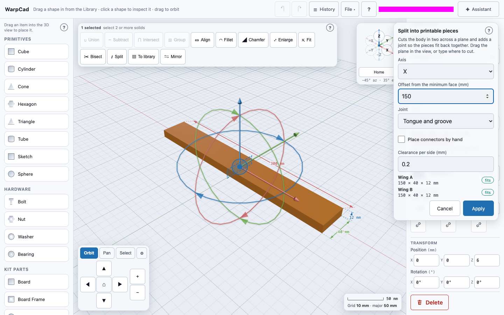
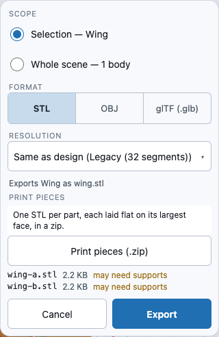
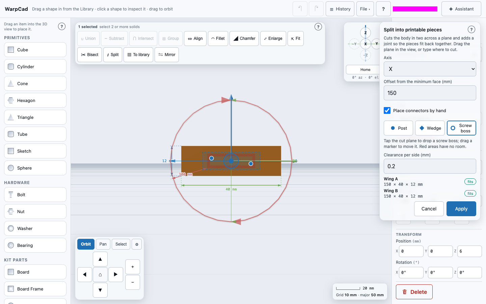

# Printing a part that is bigger than your printer

If a part is longer than your print bed, WarpCad can **split** it into pieces that each fit,
cut with a matching joint so you can glue or press them back together, and then **export
every piece as its own STL**, already laid flat. Three things work together:

- the **build volume** (your printer's bed size), set in **File ▾ → Project settings…**;
- **Split…** in the Operations toolbar, which cuts one selected shape along a plane;
- **File ▾ → Export… → Print pieces**, which writes a zip with one STL per piece.

On a phone, **Split…** and **Export…** are in the same places as on a laptop (see
[Using WarpCad on a phone or tablet](mobile.md)); the Split sheet opens as a bottom sheet.

## Try it: split a 300 mm wing and export two pieces

The default bed is 220 × 220 × 250 mm, so a 300 mm bar does not fit. Place a **Cube**, select it
and set its **Size** in the Inspector to X 300, Y 40, Z 12 (millimetres; or open a project that
already has a long part), and rename it **Wing**.

1. Click the wing in the 3D view. The Inspector shows its bounds, `300 × 40 × 12 mm`, and a red
   badge: **too large by 80 mm**.
2. In the Operations toolbar press **Split…**. The button is dimmed with the tooltip *Select
   exactly 1 solid* until exactly one shape is selected (a group counts as one).
3. The **Split into printable pieces** sheet opens and a translucent **cut plane** appears across the
   wing, with a round handle at its centre. Set **Axis** to **X** and **Offset from the minimum
   face (mm)** to **150**. The plane moves as you type; you can also drag the handle, and the
   number follows. The list underneath tells you, before you commit, that **Wing A** and **Wing B**
   are each `150 × 40 × 12 mm` and **fits**.
4. Set **Joint** to **Tongue and groove** (use **Pins and sockets** for thicker parts) and leave **Clearance per
   side** at **0.2** mm.
5. Press **Apply**. The sheet closes, the Inspector's **Parts** list shows **Wing A** and **Wing B**,
   and the badge turns green: **fits**.

   

6. Open **File ▾ → Export…** and press **Print pieces (.zip)**. Your browser downloads
   `wing-print-pieces.zip` containing `wing-a.stl` and `wing-b.stl`. The panel lists each file
   with its size.

   

## Try it: choose where the connectors go

**Pins and sockets** and **Tongue and groove** pick their own places on the cut face. When you want a
post near the spar, a second one near the tip, a wedge key, or a screw boss you can take apart and
reassemble, place them yourself. With the wing split at offset 150:

1. Turn the view to face the cut: in the view cube press **X** (camera on +X). On a tablet the
   Split sheet covers the cube, so do this first, or drag the view round with a finger.
2. Open **Split…**, set the offset, and tick **Place connectors by hand**. The **Joint** list is replaced
   by a **Connector kind** row (**Post**, **Wedge**, **Screw boss**), and the cut plane shows what
   the automatic search found as markers: a disc for a post, a diamond for a wedge, a ring for a
   screw boss. Red patches on the plane are where nothing fits.
3. Press **Screw boss**, then **tap the plane** where you want one. It appears as a ring if it
   fits. A tap where it does not fit is turned back, and the sheet says why, for example
   *placement 2 (screwBoss at y = 19.7, z = 6 mm): its socket and 1.2-2 mm wall would break out of
   piece B*.
4. **Drag a marker** to move it. It turns red while the spot is no good, and goes back to where it
   was when you let go, with the reason. With a marker selected, pressing a kind changes that
   marker (at the same spot), and the **×** beside it removes it; a right-click or a long press
   removes it too.
5. Press **Apply**. It stays dimmed, with the reason, until at least one connector fits. Untick
   **Place connectors by hand** at any time to go back to the automatic joint.

## The build volume

**File ▾ → Project settings…** has a **Build volume** group: width, depth and height in
millimetres, default 220 × 220 × 250. It is saved with the project, and the AI assistant is told
it, so it designs to your bed.

Select a body and the Inspector shows its bounds and a fit badge:

| Badge | Meaning |
|---|---|
| green **fits** | fits as placed |
| **fits turned 90°** / **fits with its Y axis vertical** | fits if you rotate it onto another face |
| red **too large by 80 mm** | does not fit in any of the six axis-aligned orientations; the number is how far over it is |

## The Split sheet

- **Axis** and **Offset from the minimum face** — the cut plane's position, measured from the body's
  lowest face on that axis. Drag the handle (a 44 px touch target) or type; both change the same
  number.
- **Joint** — **Pins and sockets** (round pins on one piece, matching sockets on the other, 2-8 mm across),
  **Tongue and groove** (a rib along the cut, for thin sections such as a trailing edge where a pin
  cannot fit) or **No joint** (a plain cut).
- **Place connectors by hand** — replaces the **Joint** list with a kind picker and makes the cut
  plane tappable: tap to add, drag to move, **×** to remove. Posts, wedges and screw bosses can be mixed.
  The marker positions are millimetres along the cut face (for a cut across X, Y then Z); a marker's
  bore or wall must stay inside both pieces. A **screw boss** is drilled from the far face of piece A
  through to the boss, so it is refused where that bore would leave piece A before reaching it; there is
  no side-access counterbore. The face must be seen squarely (the sheet says when it is not), and
  the plane's own offset handle sits at its centre, so zoom in before placing near it.
- **Clearance per side** — the gap left around the joint so it goes together after printing.
  The default 0.2 mm is a starting point, not a measurement of your printer: print a test and
  adjust. Setting 0 shows a warning, because the pieces would not fit together.
- The pieces list shows each piece's size and whether it fits the build volume.

A cut is refused, by name, in the sheet (and nothing is written) if the plane is outside the body,
if pins would not fit the section (use tongue and groove), if the body is not a closed solid, or
if the plane would cut through more than one part of a group.

**Splitting again.** Select the group, press **Split…** again and cut at a second offset: only the
part the plane crosses is cut and gains the next letter (**Wing C**). Do it as many times as the
part needs.

## Print pieces

**Export… → Print pieces (.zip)** exports each top-level part of what the panel's **Scope** says
(your selection, or the whole scene) as its own STL. Each piece is turned so its largest flat face
is on the bed, centred on the origin of its own file, so it opens ready to slice. A piece marked
**may need supports** has a face pointing downward more than 45° from vertical; that is a rule of
thumb, not a promise, so check it in your slicer. A body that is not a closed solid is refused by
name rather than exported for the slicer to repair.

<!-- SPDX-License-Identifier: CC-BY-SA-4.0 -->
