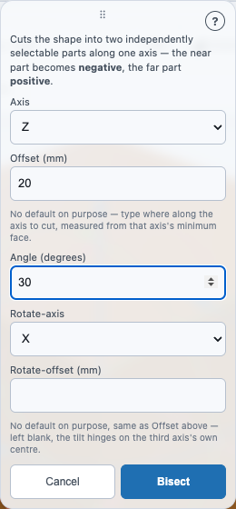

# Resizing and cutting a shape: Enlarge, Fit and Bisect

**Enlarge**, **Fit** and **Bisect** change one already-placed shape's size, or cut it
into two independently selectable parts. They live on the same **Operations
toolbar** as [Union, Subtract and Intersect](booleans.md), [Group](groups.md),
[Align](snap-align.md) and [Fillet and Chamfer](fillet-chamfer.md), as the
eighth, ninth and tenth buttons.

| Button | What it does |
|---|---|
| **⤢ Enlarge** | Grows or shrinks the shape by a millimetre amount on each axis, scaled about its own centre. |
| **⇱ Fit** | Resizes the shape to an exact millimetre size on each axis. |
| **✂ Bisect** | Cuts the shape into two independently selectable parts along one axis. |

## You need exactly 1 shape selected

Like [Fillet and Chamfer](fillet-chamfer.md), all three of these are
**single-object** tools. They stay dimmed and unclickable unless **exactly one**
shape is selected — not zero, and not two or more. Click one shape to select it,
and all three buttons light up.

## A worked example: Enlarge

1. Drag a **Cube** into the 3D view and click it to select it.
2. Click **Enlarge** in the Operations toolbar. A popover opens with three
   millimetre fields — **X delta**, **Y delta**, **Z delta** — all starting at `0`.
3. Set **Z delta** to `10` and click **Enlarge** inside the popover.
4. The cube grows 10mm taller, centred on its own middle — the bottom drops and
   the top rises by 5mm each, rather than the whole shape growing up from one
   face. The popover closes, and the cube stays selected.

## A worked example: Fit

Fit asks for the finished size instead of a change. With a cube selected, click
**Fit** and set **X size** to `60`; the box grows to 60 mm along X and the other
two axes stay as they were. Open Fit again, set **X size** to `30`, tick **Keep
aspect ratio** and press **Fit**: this time all three axes shrink by the same
factor, so the shape keeps its proportions.

## A worked example: Bisect

1. Select a cylinder already placed in the scene.
2. Click **Bisect**. A popover opens with an **Axis** dropdown (X/Y/Z) and an
   **Offset (mm)** field, with no default value.
3. Choose axis **Z**, set **Offset** to `0`, and click **Bisect** inside the
   popover.
4. The cylinder becomes two independently selectable parts — click once to
   select the pair as a whole (the gizmo and dimension lines attach to the
   combined shape, exactly as before), click again on either half to drill into
   it specifically, per the group-selection behaviour described in
   [Selecting a shape, and reading its size](selection-and-inspector.md). Step
   back out the same way that page describes — via the breadcrumb — to return
   to the whole pair.

Here is a straight cut on a cube at Z = 20, then a click into the upper half
(`positive`): it is 20 mm tall and its centre sits at Z = 30.

## A worked example: an angled Bisect

Bisect can also tilt the cut plane instead of keeping it flat, for an
asymmetric split.

1. Select a cylinder already placed in the scene.
2. Click **Bisect**. Choose axis **Z** and set **Offset** to `0`, same as the
   straight-cut example above (offsets are millimetres).
3. Set **Angle** to `30` (degrees) and leave **Rotate-axis** at its own
   default (**X**). Leave **Rotate-offset** blank.
4. Click **Bisect** inside the popover.
5. Instead of a flat cut straight across, the cut plane tilts 30° around the
   X axis — the two resulting halves are asymmetric, not mirror images of each
   other, and the same click-once/click-again/breadcrumb behaviour described
   above still applies to each one.

The Bisect popover with those values filled in:

## The popovers' fields

### Enlarge

- **X / Y / Z delta (mm)** — how much to grow (positive) or shrink (negative)
  the shape along that axis, in millimetres. All three default to `0`. The
  popover's own **Enlarge** button stays disabled until at least one field is
  non-zero — an all-zero commit would be a no-op.
- A delta large enough to invert or collapse an axis (for example, shrinking a
  40mm cube by more than 40mm on one axis) is rejected, with an explanation
  appearing directly in the popover rather than only in the browser's own
  console.

### Fit

- **X / Y / Z size (mm)** — the exact size you want that axis to end up at.
  Unlike Enlarge, these fields start at the shape's **own current size** on
  each axis, not `0` — so an untouched field reads as "leave this as-is," the
  same thing typing the shape's current size back in would do.
- **Setting a field to `0` on purpose** also means "leave this axis alone," not
  "shrink it to nothing" — this is the underlying tool's own convention, kept
  the same here rather than reinterpreted. If you genuinely want an axis to
  read as unchanged, `0` and the shape's current size behave identically.
- **Keep aspect ratio** — when checked, all three axes scale together by one
  uniform factor rather than independently.
- The popover's own **Fit** button stays disabled until at least one field
  differs from the value it opened with — an untouched popover would otherwise
  be a silent no-op commit.

### Bisect

- **Axis** — which axis to cut along: **X**, **Y**, or **Z**.
- **Offset (mm)** — where along that axis to cut, measured from the axis's own
  minimum face. There is **no default value** — you must type one before the
  popover's own Bisect button turns on, since a pre-filled value here could
  easily be mistaken for a safe default when it isn't.
- **Angle (degrees)** — tilts the cut plane away from flat. Defaults to `0`,
  meaning no tilt — leaving it at `0` produces exactly the straight cut
  described above. A non-zero value tilts the plane, per the worked example
  above.
- **Rotate-axis** — which world axis the cut plane physically tilts about.
  Only offers the two axes other than the one you're cutting along (a plane
  can't tilt about the same axis it's already perpendicular to), and defaults
  to a sensible choice for whichever cut axis is selected — leaving it alone
  reproduces the common case.
- **Rotate-offset (mm)** — positions the tilt hinge along the one remaining
  axis (neither the cut axis nor the rotate axis). Like Offset, there is **no
  pre-filled value** — but unlike Offset, leaving it blank is a valid, expected
  choice: the hinge defaults to that axis's own centre, not to `0`.
- **Cancel** closes any of the three popovers without changing anything.

## What happens to the shape afterward

### Anything snapped to the shape

If another shape was [snapped](snap-align.md) to the one you resize, how you
resize decides what happens. Typing a new **Size** in the Inspector's
**Parameters** (the movie above, Z from 8 to 24) rebuilds the shape and every
snap against it, so the lug keeps standing on the plate's new top. **Enlarge**
and **Fit** are different: they add a step on top of the shape, and a part
snapped to it stays where it was, so it can end up buried or floating. To keep a
snapped part attached, resize in the Inspector.

**Enlarge and Fit** replace the selected shape's size in place — it's still the
same shape, same id, same position in the scene list, just a new size. Nothing
new appears in the scene.

**Bisect** is different: the one shape you selected becomes a **two-part
group**, named `negative` and `positive`. `negative` is always the piece on
the lower side of the cut and `positive` the piece on the higher side — on
every axis, including **Y**, with no exception to remember.

The group as a whole is still one selectable item in the scene — click
it once and the gizmo and dimension lines attach to the whole pair, exactly as
they did before the cut. Click again to drill into either half individually,
the same way any other grouped body works — see
[Selecting a shape, and reading its size](selection-and-inspector.md) for the
full click-once/click-again mechanism.

## Not yet supported

- **A live size preview while dragging.** All three fields are typed values,
  committed on click — there's no drag-to-resize handle in the viewport for
  these operations (unlike moving or rotating, which do have a gizmo).

## Notes and gotchas

- **Units are millimetres**, as everywhere else in WarpCad.
- **A rejected Enlarge value doesn't close the popover.** If your typed delta
  would invert or collapse the shape, fix the value and try again — nothing
  was committed, and the shape is unchanged.
- **The shape (or, for Bisect, the resulting group) stays selected throughout**,
  including immediately after a successful commit — the gizmo, dimension
  lines, and Inspector panel all keep working on it normally.
- **Fit's zero-means-unchanged rule is easy to forget.** If a Fit commit
  doesn't seem to have changed an axis you expected it to, check whether that
  field was left at `0` or at the shape's own current size — both mean
  "unchanged" here, which can surprise a first-time user expecting `0` to mean
  "shrink to nothing."

## See also

- [Rounding or bevelling an edge: Fillet and Chamfer](fillet-chamfer.md) — the
  toolbar's other exactly-1-gated pair, and the popover pattern this page's
  three controls reuse.
- [Precise placement: Align](snap-align.md) — the toolbar's
  one-or-two-gated tool, for moving one shape against another rather than
  resizing or cutting a single shape.
- [Selecting a shape, and reading its size](selection-and-inspector.md) — what
  selection does, and how drilling into one part of a group (including a
  Bisect result) works.

<!-- SPDX-License-Identifier: CC-BY-SA-4.0 -->
