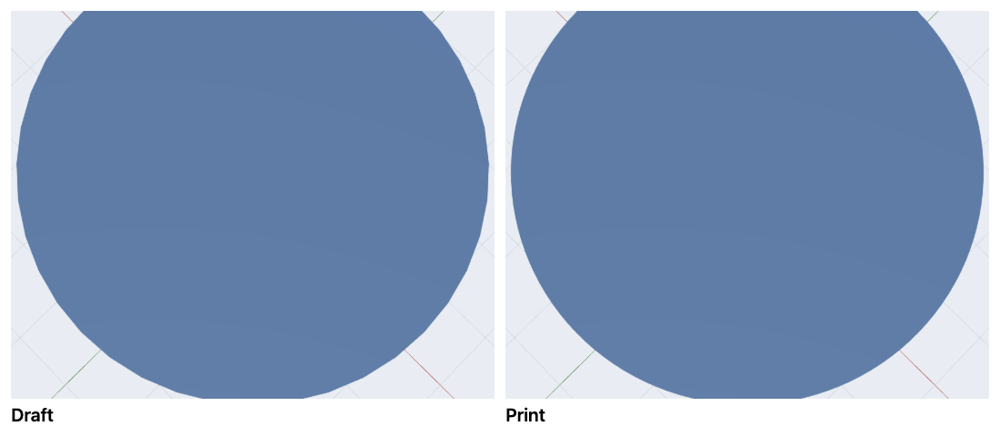
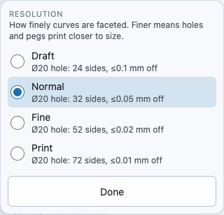

# Resolution: how smooth curves are, and why it matters for fit

WarpCad draws every round thing — a cylinder, a sphere, a hole, a rounded corner, a
fillet — as a ring of flat sides. **Resolution** decides how many. You set it once for
the whole design, and you can raise it again for one export without touching the design.

## Why it matters: holes print small, pegs print loose

The corners of those flat sides sit exactly on the circle you asked for, but the flats
themselves cut *inside* it. So a faceted hole comes out a little **tighter** than its
dimension, and a faceted peg a little **looser**, and the **bigger the circle, the bigger
the gap** when the number of sides stays the same.

How much smaller a hole measures across its flats (mm):

| Hole | Legacy (always 32 sides) | Draft | Normal | Fine | Print |
|---|---|---|---|---|---|
| Ø3 screw hole | 0.014 | 0.102 | 0.058 | 0.026 | 0.014 |
| Ø8 | 0.039 | 0.154 | 0.098 | 0.039 | 0.017 |
| Ø22 bearing seat | 0.106 | 0.188 | 0.084 | 0.035 | 0.019 |
| Ø50 bore | **0.241** | 0.190 | 0.091 | 0.039 | 0.020 |
| Ø100 | **0.482** | 0.182 | 0.095 | 0.039 | 0.019 |

A quarter of a millimetre on a Ø50 bore is enough to stop a bearing seating. Each
setting other than Legacy fixes this by adding sides as circles get bigger, so the error
stays about the same at any size.

## The four settings

The same 60 mm cylinder seen from above at **Draft** (left) and **Print** (right): the flat
sides you can count on the left have all but disappeared on the right.

Each setting promises that no flat sits more than a fixed distance inside the true
circle. Across a whole hole that gap counts twice, which is why the table above shows
numbers about double these.

| Setting | Each side at most | A Ø20 hole gets | Use it for |
|---|---|---|---|
| **Draft** | 0.1 mm inside | 24 sides | A big, slow scene where you want the 3D view fast |
| **Normal** | 0.05 mm inside | 32 sides | Everyday work; what a new design starts at |
| **Fine** | 0.02 mm inside | 52 sides | Parts that have to fit something: bearings, press fits, pegs |
| **Print** | 0.01 mm inside | 72 sides | The file you actually send to the printer |

Small holes never drop below a minimum number of sides (12 for Draft, up to 32 for
Print), so a bolt never catches on facets. Very large circles stop at 256 sides so a big
disc can't slow everything down.

**Legacy (32 segments)** is what a design saved before this setting existed opens as. It
keeps every circle at 32 sides, exactly as it was, so reopening an old project never
changes its shape. It only appears in the list while it is the active setting. Pick any
other setting to move off it.

## Changing the design's resolution

1. Open **File ▾** in the top bar. Near the bottom, under **Design**, the row reads
   **Resolution: Normal…**, which is your current setting.
2. Press it. A small panel opens under the button with the four settings. Each one shows
   what it means for a Ø20 hole, for example *Fine — Ø20 hole: 52 sides, ≤0.02 mm off*.
3. Tap a setting. It applies straight away: curved shapes in the 3D view redraw with
   the new number of sides. There is no Apply button.
4. Press **Done**, press **Esc**, or tap outside the panel to close it.

The change is **one step of Undo**: the Undo button's label reads **Undo Resolution →
Fine**, and pressing it puts the old setting (and the old shapes) back. It is saved with
your project, so it is still set after a reload, in a saved file, and in a copy on
GitHub.

The setting isn't a row in the **History** list, because it isn't a step in how the
model was built. It's a property of the whole design, like its units. Use Undo, or
open the panel again, to change it back.

While **History** is showing a past step, the settings are greyed out with the reason
*Return to the latest step to change resolution*, the same as every other edit.

On a phone the panel is the same one, the full width of the screen, with
finger-sized rows.

## Exporting at a higher resolution than the design

You can keep the 3D view quick and still print smooth. **File ▾ → Export…** has a
**Resolution** choice under **Format**:

- **Same as design (Normal)** is the default, and exports the shapes exactly as you
  see them.
- **Draft / Normal / Fine / Print** rebuilds the export at that setting, **for this file
  only**. A note says *Re-evaluating at Print resolution — the design itself is
  unchanged.*

After the download starts, the status message at the right of the top bar names the
file and its triangle count, for example `Exported cylinder-1.stl — 400 triangles`
(a default cylinder at Print; the same one at Normal is 192), so
you can see that the setting made a difference. Your design, the 3D view and your Undo
history don't change. WarpCad remembers the export choice until you close the tab, but
never saves it into the project.

A Print export of a big scene takes a moment. It is built in the background, so the
**Exporting…** state from [Exporting](export.md#a-big-export-tells-you-it-is-working)
shows while it runs, and **Cancel** really stops it.

## Example: a bearing seat that prints tight

*Your Ø22 bearing seat is printing tight.* Open **File ▾ → Resolution…** and pick
**Fine**. The seat is now drawn with 56 sides and is at most 0.02 mm under size on each
side, instead of 0.05 mm at Normal. If you'd rather keep the 3D view fast and only
print fine, leave the design on **Normal** and choose **Print** in **File ▾ → Export… →
Resolution** before pressing **Export**. The exported seat has 76 sides and the design
stays as it was.

## What resolution can't fix

Resolution only removes the error that comes from flat sides. A printer that squeezes out
slightly too much plastic makes every hole small and every peg large, whatever the
resolution. That's a clearance you design in (make the hole a little bigger on
purpose), not a number of sides. Get the facets right with **Fine** or **Print** first,
then measure what's left and allow for it.

Some shapes keep a fixed number of sides at every setting, because the flat sides are
the design, not an approximation: a **hex** bolt head or nut is always six-sided. A
shape that was given its own number of sides (by the AI partner, or written into a
project file by hand) keeps it too. There is no control for that in the app.

## Related

- [Exporting your model](export.md) — the rest of the Export panel.
- [Undoing and redoing a change](undo-redo.md) — resolution changes are ordinary Undo steps.
- [Saving and reopening your work](save-load.md) — the setting is saved with the project.

<!-- SPDX-License-Identifier: CC-BY-SA-4.0 -->
