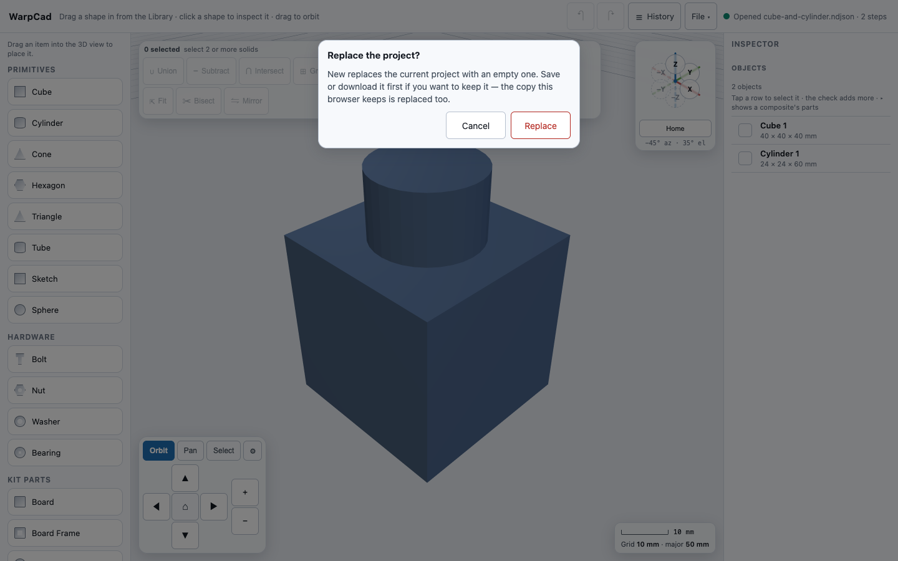
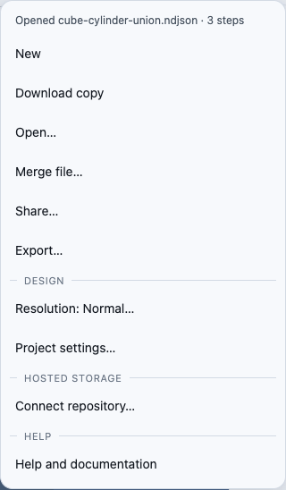
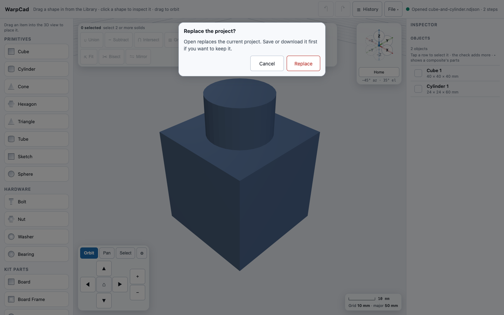
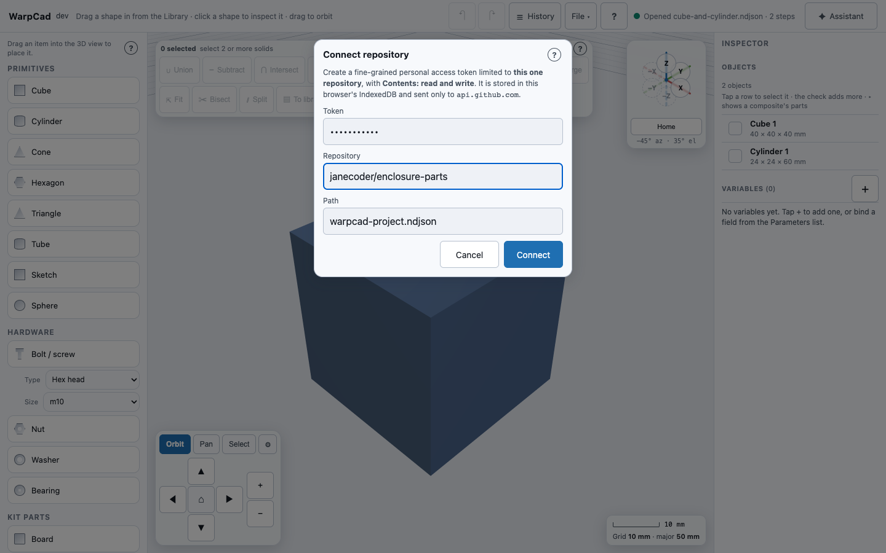
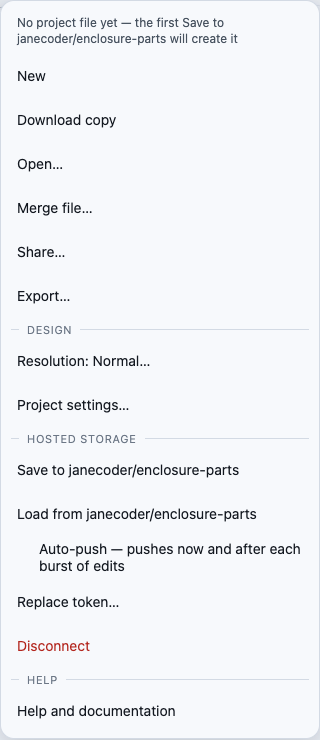
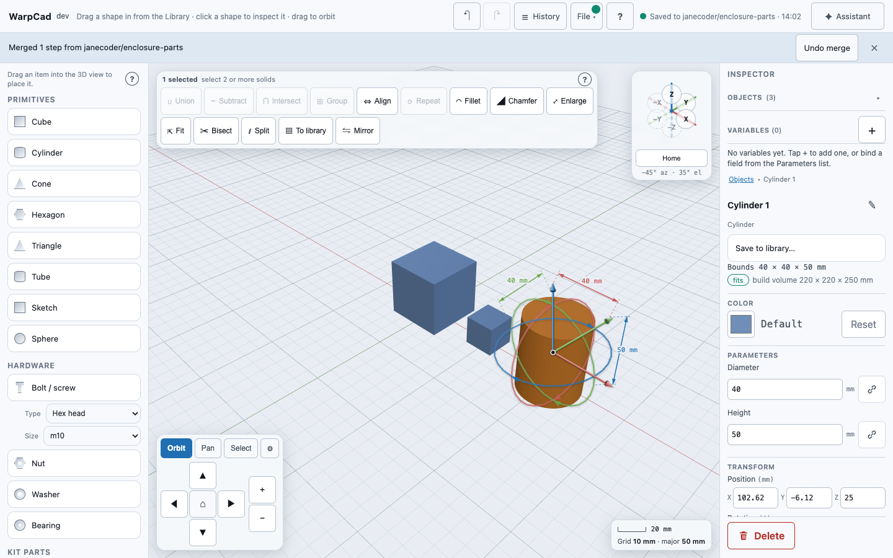
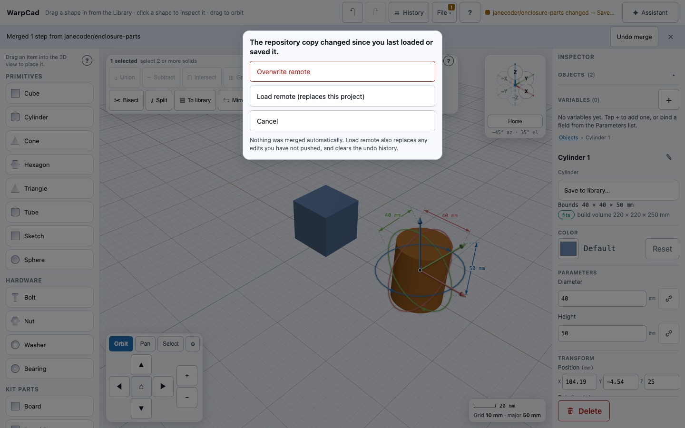

# Saving and reopening your work

On a phone, the File menu drops down from the top bar; see [Using WarpCad on a phone or tablet](mobile.md#the-file-menu).

WarpCad keeps your work for you. You don't press Save to keep a model safe: every change
you make is stored in your browser automatically, a moment after you make it, and the
next time you open WarpCad on the same device and browser your model is right there.

## Try it

1. Open WarpCad. Drag a **Cube** and a **Cylinder** from the Library into the 3D view.
2. Select both (click one, Shift-click the other) and press **Union** in the toolbar over
   the 3D view.
3. Look at the far right of the **top bar**. Right after your last change it says
   **Saving…**, and about half a second later **Saved · 14:02** (with the current time).
4. Reload the page (**F5**, **Ctrl/Cmd+R**, or the browser's reload button).
5. Your unioned shape is back, exactly where it was, and the view has moved to show all
   of it. While it is being rebuilt the top bar says **Restoring your last session…**
   (usually too briefly to notice), then **Restored your last session** for a few seconds.

*The animation places a cube and a cylinder and skips the Union step; the reload works the same either way.*

There is no "Do you want to restore?" question — reopening WarpCad means reopening your
model. Reloading right after a change is fine too: WarpCad saves the moment the page is
being closed, hidden or switched away from, so the last thing you did is not lost.

## Starting a new project

**File ▾ → New** (or **Ctrl+Alt+N**, **Cmd+Option+N** on a Mac) throws the current model away and
gives you what a first-time visitor sees: an empty scene, an empty History strip, nothing
selected, and the default resolution.

1. Drag a **Cube** into the 3D view.
2. Open **File ▾** and choose **New**.
3. WarpCad asks: **New replaces the current project with an empty one. Save or download it first
   if you want to keep it — the copy this browser keeps is replaced too.** Choose **Replace**
   (**Cancel** leaves everything exactly as it was). An empty project skips the question.
   
4. The view is empty and the status line says **New project · 14:02**.
5. Choose **File ▾ → Save**. A file picker appears — **Save** does *not* quietly write over the
   file the previous project came from. (Where the browser can only download, **Download copy**
   makes a new, timestamped file as always.)

Like **Open…**, New can't be undone: undo and redo both start empty, which is why the question
comes first. And because autosave stores whatever is on screen, the copy your browser kept of
the old project is replaced by the empty one a moment later — Save or download first.

**Why not Ctrl+N?** Browsers reserve plain Ctrl/Cmd+N for "new window" and a web page can't
reliably intercept it, so WarpCad doesn't pretend to; the shortcut adds **Alt**/**Option**.
On a phone or tablet the menu item is the whole way in.

**If you are connected to a GitHub repository,** New leaves the connection alone but forgets what
it knew of the repository's file and **pauses auto-push** (the File button's dot shows the paused
`!`, and the Auto-push item reads **Auto-push paused — new project**). That stops the empty
project from being pushed over your saved one. To start using the repository again, choose
**Save to owner/repo** (you'll be asked what to do about the file that is already there) or
**Load from owner/repo**.

## The status light in the top bar

At the right of the top bar, beside the undo and redo buttons, there is a small status
indicator. On a laptop or tablet it shows a light and words; on a phone, where the top
bar is crowded, it shows just the light (screen readers still read out the words).

| Light | Words | What it means |
|---|---|---|
| Grey | **Autosave on** | Nothing to save yet — you haven't changed anything |
| Amber ring | **Saving…** | A change was just made and is about to be stored |
| Amber ring | **Opening warpcad-project.ndjson…** | A file (or a repository copy) is being opened — see [While a file is opening](#while-a-file-is-opening) |
| Amber ring | **Restoring your last session…** | Your model is being rebuilt as the page opens |
| Green dot | **Saved · 14:02** | Your latest change is stored, at that time |
| Green dot | **Restored your last session** | Your model was just reopened from where you left off |
| Red square | **Not saved — browser storage unavailable** | See below |

Three of those states, as they look in the bar:

| Saving | Saved | Not saved |
|---|---|---|
|  |  |  |

The light differs in *shape* as well as colour (ring, disc, square), so it doesn't rely on
telling red from green.

## If it says "Not saved"

WarpCad stores your model in your browser's own storage. Some situations stop the browser
from allowing that:

- **Private or incognito windows**, in some browsers, block storage outright, or wipe it
  when the window closes.
- **Storage that is full**, in which case the message says
  **Not saved — browser storage is full**.
- **Browser settings or extensions** that block site data.

Nothing else stops working: you can keep modelling as normal. But your work will **not**
be there if you reload, and the red light stays on until a save succeeds. If you see it,
either leave the private window or free up space, and make a change — WarpCad tries again
on your next change.

If WarpCad finds a stored model it can't read (for example, one written by a newer
version), it starts empty, says so in the top bar — **Couldn't restore your last session**
followed by the reason — and keeps the unreadable copy aside rather than writing over it.

## What is and isn't kept

- **Kept:** every shape you placed, moved, rotated, combined or edited (sketch shapes
  included, with their outlines, so **Edit sketch** still works after a reload),
  steps you have suppressed, and a rollback point in the history, if you set one.
- **Not kept:** the **undo history** (after a reload both undo and redo start greyed out —
  see [Undoing and redoing a change](undo-redo.md)), what is **selected**, and where the
  **camera** was. WarpCad points the camera at your whole model when it reopens, so a
  model you had panned away from is not mistaken for an empty scene.
- **Only on this browser, on this device.** Autosave is not a backup and does not sync:
  clearing your browser's site data for WarpCad removes it, and a different browser or
  device starts empty. For a copy you can keep or hand to someone, use a project file
  (below).
- **Two tabs of WarpCad on the same browser share one saved model, and the most recent
  change wins.** If you keep two tabs open on different models, whichever changed last is
  the one that reopens. Work in one tab at a time.

## The File menu

Everything on this page beyond autosave starts at **File ▾**, in the top bar, between
**Share** and the status light. It works the same on a laptop, a tablet and a phone: tap
it and a menu opens under it, with three groups: the items for **this device** at the top
(**New**, the save item, **Open…**, **Merge file…**, **Share…**, **Export…**), a **Design** group holding the **Resolution**
setting and **Project settings…** (see [Design intent](design-intent.md)), and **Hosted storage**
below the last divider. The first line of the menu repeats the
status message in full, which is how you read it on a phone, where the status light in the bar
is only a dot.

Opening the menu never changes what is selected, and nothing in it is greyed out because of
what is selected.

### Saving a file you can keep — and what the item is called

A project file is a plain text file named `warpcad-project.ndjson`. It holds the same steps
autosave keeps, so it opens on any device, and it is what you hand to somebody else. To show a
project to someone who doesn't use WarpCad, send a link instead: **Share**, then **Send…** or
**Copy link** ([Sharing a project by link](sharing.md)). They tap it and see the model, with nothing
to open or install.

What the item is *called* depends on your browser, because browsers differ in what a web page
may do:

- **On desktop Chrome and Edge** you get **Save** and **Save As…**. **Save** asks where to put
  the file the first time, and after that writes over the same file with no further question.
  **Save As…** always asks.
- **On every other browser — Firefox, Safari, and all phones and tablets, including Chrome on
  Android —** you get one item, **Download copy**. It downloads a fresh file every time, named
  with the date and time (`warpcad-project-20260921-1402.ndjson`) so copies don't overwrite
  each other. It is never called "Save", because it doesn't save over anything. This isn't a
  limit of WarpCad: those browsers don't let a web page write to a file on your device
  directly. On an iPhone or iPad the file lands wherever Safari's downloads go, usually the
  **Files** app's **Downloads** folder, and Safari's own download indicator is the
  confirmation you'll actually see.

**Ctrl+S** (Cmd+S on a Mac) does the same as that item, from the keyboard. It only ever saves or
downloads a local file — it never sends anything over the network, whether or not you are
connected to a repository.

After you choose it the status line tells you what happened: **Saved to
warpcad-project.ndjson · 14:02** where the browser can save in place, or **Download started:
warpcad-project-20260921-1402.ndjson** where it can only download (it says "started" because a
browser can't confirm a download finished). Cancelling the file picker is not an error, and
says nothing.

### If your browser can't save in place

A few browsers — the editor's built-in browser is one — offer **Save** and **Save As…** and
then refuse to write the file when you pick a place for it. Nothing is lost: WarpCad hands you
a downloaded copy from the same click instead, and says so in the status line:

Two things to know:

- **An empty file may be left behind.** Choosing a place in the picker already created the
  file, before the browser refused the write, and WarpCad can't delete it. It has the name you
  typed (`bracket.ndjson` above) and nothing in it. The downloaded copy is the real one; delete
  the empty file so it isn't mistaken for your project.
- **From then on the menu says Download copy.** **Save As…** disappears and every save is a
  new downloaded file, until you reload the page.

**Try it:** in such a browser, choose **File ▾ → Save**, pick a folder and a name, and confirm.
The status line shows "A copy was downloaded instead", and your browser's downloads list has
`warpcad-project-…ndjson`. Open that file with **File ▾ → Open…** to check your work is in it.

### Opening a file

**File ▾ → Open…** (or **Ctrl/Cmd+O**) replaces your model with the one in a project file.

1. If your current model has anything in it, WarpCad first asks: **Open replaces the current
   project. Save or download it first if you want to keep it.** Choose **Replace** to carry on
   or **Cancel** to stop — nothing has been touched yet, and the file picker hasn't opened.
2. Pick the file. On a phone that is your browser's file chooser (or the Files app).
3. WarpCad checks the *whole* file before it replaces anything. A file that isn't a WarpCad
   project, or that needs a newer version of WarpCad, is refused **by name**, with the line
   where it goes wrong, and your current model is left exactly as it was. The message stays
   until you do something else.
4. While WarpCad rebuilds the model from the file, the **File** button shows a small
   spinning ring and **Opening…**, and the status line says **Opening
   warpcad-project.ndjson…** — see [While a file is opening](#while-a-file-is-opening).
5. If it is good, the model appears, the view moves to show all of it, nothing is selected,
   any history preview is ended, and the status line says **Opened warpcad-project.ndjson · 5
   steps**.

Opening a file can't be undone — undo and redo both start empty, like a reload — which is
exactly why the question comes first.

### Merging another copy instead of replacing

If the file is another copy of the project you have open, say one you changed on your phone,
choose **File ▾ → Merge file…** instead of **Open…**. Its changes are added to your project and
yours are kept, there is no "Replace" question, and **Undo merge** takes it back out. See
[Merging two copies of a project](merging.md).

### When WarpCad can't see the file change

On Safari, Firefox and phones, WarpCad cannot look at the file again after it opens it, so it
cannot tell that another app changed it. When you open a file this way and come back to the
WarpCad window, the status line in the top bar reads *This file may have changed. Use File ▾ →
Merge file… to bring it in.* Nothing is read or merged for you. To bring the changes in:

1. Tap **File ▾ → Merge file…**.
2. Pick the file, the same one you opened.
3. The status line goes away and the merge summary appears, with **Undo merge** on it.

A save clears the line too. On Chromium desktop, which can read the file again, WarpCad merges the
change by itself and this line never appears.

A project is given its own identity the first time you change it, and the file keeps it on
that same last line, so a copy of the project can be told from a different one when you
**Merge file…**. A project you start with **New** and don't touch has none, and is saved as an
empty file. A file saved by an older WarpCad is never given one, so the bytes of an unchanged
old file stay exactly as they were; WarpCad recognises copies of it by the steps they share.

### Older versions of WarpCad

Once you have changed a project, the file WarpCad writes also remembers *which copy made each
step and when*, so two copies of one project can be put back together later. It sits on the
last line of the file; every step above it is unchanged. See
[Merging two copies of a project](merging.md).

If you open such a project in a copy of WarpCad that has not updated yet, that copy says
**This project was saved by a newer WarpCad. Update the app to open it. The file was not
changed.** and leaves the file — and whatever project you had open — alone.

Try it: open a project you saved from the latest WarpCad in a browser tab you left open since
yesterday. If you see that sentence, reload the page so the app updates, then open the file
again. A file you have never edited, or one saved by an older WarpCad and not changed since, is
written exactly as it was and opens everywhere.

### While a file is opening

WarpCad rebuilds every shape in a file from its steps when you open it. A small model takes
a few thousandths of a second. A large one (hundreds of steps, or dozens of library parts)
can take a noticeable moment, around half a second on a phone. So as soon as you have
picked the file, before any rebuilding starts:

- the **File** button shows a spinning ring and the word **Opening…** (on a phone, just the
  ring — the button is narrow there),
- the status light turns to the amber ring, and its text reads **Opening** and the file's name,
- **Open…** and **Load from owner/repo** are greyed out in the File menu until it finishes, so
  a second open can't start on top of the first.

Your current model stays on screen during that moment. The screen may not respond to
clicks until the rebuild is done. When it is, the ring goes away and the status line says
**Opened … · N steps**, or, if the file was refused, **Couldn't open …** with the step that
failed. In both cases nothing about your current model changed until the file was fully
checked. **Load from owner/repo** shows the same ring, with the repository's name.

#### Try it: watch a large file open

1. Save or download a project with plenty in it. Twenty or more Raspberry Pi boards and bolts
   from the Library works well.
2. Drag a single **Cube** into the 3D view so there is something to replace.
3. **File ▾ → Open…**, press **Replace**, and pick the file from step 1.
4. Look at the **File** button straight away: the ring and **Opening…** appear first, while
   the cube is still on screen.
5. A moment later the cube is replaced by the saved model, the ring disappears, and the status
   line says **Opened … · N steps**.

### Try it: save a copy, change your mind, and get it back

1. Drag a **Cube** and a **Cylinder** into the 3D view.
2. Open **File ▾** and choose **Download copy** (or **Save**). The status line names the file.
3. Drag a **Sphere** in as well — three shapes now.
4. **File ▾ → Open…**, press **Replace**, and choose the file you just downloaded.
5. The sphere is gone, and the cube and cylinder are back, framed in the view. The status line
   says **Opened … · 2 steps**.

### While History is showing a past step

If you have selected an earlier step in **History**, the 3D view is showing that step, read-only.
**Save and Download copy still write your *current* project** — not the step you are looking
at — and the menu says so at the top while it is true. **Open…** still works, and ends the
preview when the new project loads.

## Keeping a copy in a GitHub repository

Autosave keeps your work in *this* browser, on *this* device. Connecting a GitHub
repository gives you the other thing: a copy that outlives the browser, that you can open
on another machine, and that has a history of commits you can read.

Everything here is in the **Hosted storage** group of the **File ▾** menu. It is optional: the
rest of WarpCad never needs it, and nothing is sent anywhere until you connect.

### What you will need

A **fine-grained personal access token**, created at
`github.com/settings/personal-access-tokens`, with:

- **Repository access** limited to the *one* repository you want WarpCad to write to —
  not "all repositories". WarpCad only ever touches one file in one repository, so
  anything wider is access it will never use.
- The **Contents** permission set to **Read and write**. Nothing else.
- An **expiry date** you are comfortable with. When it expires, WarpCad tells you the
  token was rejected, and you paste a new one; nothing is lost, because your work is also
  autosaved in the browser.

### Connecting

1. **File ▾ → Connect repository…** A dialog opens.
2. Paste the token, type the repository as `owner/repo` (for example
   `janecoder/enclosure-parts`), and leave the path as `warpcad-project.ndjson` unless you
   want the file somewhere else in the repository.
3. Press **Connect**. WarpCad checks the token against GitHub **before** storing anything,
   so a typo or an expired token is rejected there and then, with the reason: *GitHub
   rejected this token*, *Repository not found, or the token has no access to it*, *This
   token does not have permission to write to that repository*, or *Rate limited — try
   again in N minutes*.
4. If the repository has no project file yet, that is not an error: you will see *No
   project file yet — the first Save to owner/repo will create it*.
   
5. The dialog now says **Token saved in this browser** and offers **Done** and **Replace
   token**. It never shows the token again. A small dot appears on the **File** button to show
   the connection, and the menu now offers the rest of the hosted group:

   

WarpCad writes to the repository's **default branch** (usually `main`), and to the one file
you named. It does not create branches, open pull requests, or touch any other file.

### A worked example

1. Drag a Cube into the 3D view, then open **File ▾ → Connect repository…**, paste your token,
   enter `janecoder/enclosure-parts`, and press **Connect**, then **Done**.
2. **File ▾ → Save to janecoder/enclosure-parts.** The status line reads **Saved to
   janecoder/enclosure-parts · 14:05**, the dot on **File** is a solid green disc, and a commit
   named `WarpCad: save` appears in the repository.
3. Drag a Cylinder in and press **Save to janecoder/enclosure-parts** again for a second commit.
4. On another device, connect the same repository and choose **File ▾ → Load from
   janecoder/enclosure-parts**: your cube and cylinder appear.

### Saving and loading

- **File ▾ → Save to owner/repo** commits the current model, with the commit message
  `WarpCad: save`. The file it writes is exactly the project file described above — the
  same bytes as *Download copy*, so anything saved to GitHub opens with **Open…** and the
  reverse.
- **File ▾ → Load from owner/repo** replaces your current model with the repository's copy.
  If your model has anything in it you are asked to confirm first, the same question **Open…**
  asks. It is checked the same way **Open…** checks a file: a file that isn't a WarpCad project
  is refused by name, with the line that goes wrong, and your current model is left exactly
  as it was. Like opening a file, loading clears the undo history.

### Auto-push, if you want it

**Auto-push is off until you switch it on**, for every repository you connect. Every write
is a commit, and committing on your behalf is not something WarpCad decides for you.

When you do switch it on (**File ▾ → Auto-push**, a tick shows it is on): it pushes once immediately, so you can
see it work, and after that it pushes **about half a minute after you stop making changes**
— so a burst of work (a drag, a few dimension edits, a union) becomes **one** commit named
`WarpCad: auto-push <time>`, not five. If you keep working without a pause it pushes anyway
every five minutes. Undo and redo count as changes; moving a shape *while you are still
dragging it* does not.

The dot on the **File** button tells you where things stand without opening the menu, by
shape as well as colour:

| Dot | Means |
|---|---|
| **●** solid | In sync — the repository has your latest change |
| **◌** hollow ring | Waiting — your recent edits will push in a moment |
| animated ring | Pushing now |
| **!** amber | Paused, and it needs you — see below |
| **✕** red | Stopped — the token was rejected |

The same words appear in the status line, and it and the dot always agree.

**Ctrl/Cmd+S never pushes.** It saves or downloads a local file, with auto-push on or off.
Nothing in WarpCad uses the network because you pressed a keyboard shortcut.

### If the repository copy changed: WarpCad merges it

You edit the same project on two devices and save on both. The second save finds that the file
in the repository moved on since you last loaded or saved it. When that file is **a copy of
this project**, nothing is lost and nothing needs answering: WarpCad fetches it, merges it
into your open project (the same merge as [File ▾ → Merge file…](merging.md)), pushes the
result, and tells you what came in:

**Try it.**

1. On your laptop, **File ▾ → Save to janecoder/enclosure-parts**.
2. On your phone, **File ▾ → Load from janecoder/enclosure-parts**, add a cylinder, and
   **Save to**.
3. On the laptop, move the cube and **Save to**. WarpCad says *Merged 1 step from
   janecoder/enclosure-parts*: the cylinder from your phone is now on the laptop too, and the
   repository has both changes.

The same happens for an auto-push, which is not paused, and for **Load from** when you have
unsaved edits: your edits stay and the repository's changes are merged in. **Undo merge** on
the notice takes the incoming steps back out; the File dot then shows that your project
differs from the repository, as after any edit. If two steps conflict, the banner says so and
**Show** takes you to them (see [Merging](merging.md)).

### If the repository holds a different project: the three-button dialog

Merging two unrelated projects is never automatic. If the file in the repository is a
**different project**, or this is the first time you save into a repository that already had a
file you have not loaded and it is not a copy of this project, WarpCad **refuses to write over
it** and asks:

> **The repository copy changed since you last loaded or saved it.**
> **Overwrite remote** · **Load remote (replaces this project)** · **Cancel**

- **Overwrite remote** — your version wins. Theirs stays in the repository's history, so it
  is recoverable from GitHub, but it is no longer the current file.
- **Load remote (replaces this project)** — their version wins, in front of you. **Anything
  you have not pushed is replaced**, and the undo history is cleared, exactly as opening a
  file does.
- **Cancel** — nothing is written and nothing is loaded. Auto-push stays **paused** (not
  off) so it cannot quietly overwrite anything while you decide; pick it up again with
  *Save to owner/repo*, *Load from owner/repo*, or by switching Auto-push off and on.

The dialog also appears, with the line *The repository keeps changing. Try again in a
moment.*, when the repository moved again after each of three merge attempts in a row.

If the network drops instead, that is not a conflict and you are not asked anything: the
dot goes amber, the status says **Offline — will retry**, and WarpCad retries on its own
(after 10 seconds, then 30, then 2 minutes, then every 5). Your work is still autosaved in
the browser the whole time.

### Where your token is kept, and how to remove it

- The token is stored in **this browser's own storage (IndexedDB)**, on this device only. It
  is not sent anywhere except `api.github.com`, and it is never put in a web address, a
  status message, an error message, or the project file.
- After you connect, WarpCad **never shows the token again** — the dialog says *Token saved
  in this browser* and offers **Replace token** if you need to change it.
- Browser storage is **not encrypted**. That is exactly why the advice above is a
  fine-grained token limited to one repository: if someone can read your browser profile,
  the worst they get is write access to one repository's parts file, not your account.
- **File ▾ → Replace token…** asks for a new token for the same repository — for when the old
  one expired or was revoked (the status line turns red and says so, and tapping it opens the
  File menu). Replacing starts a fresh connection, so Auto-push comes back **off**; switch it
  on again if you want it.
- **File ▾ → Disconnect** deletes the stored token and the connection outright, and turns
  auto-push off. Your model stays exactly where it is — disconnecting is about the
  repository, not about your work.
- Clearing site data for WarpCad removes the token too, along with the autosave.

<!-- SPDX-License-Identifier: CC-BY-SA-4.0 -->
