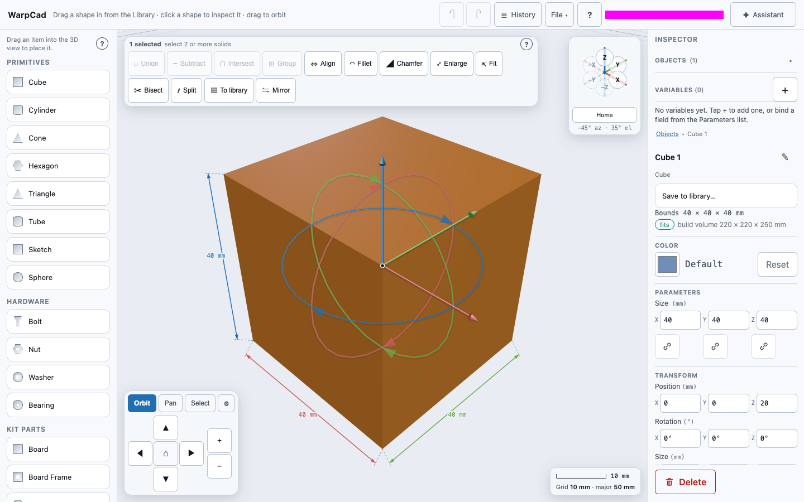
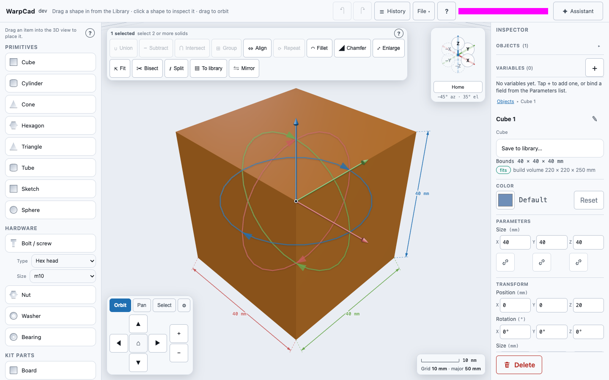
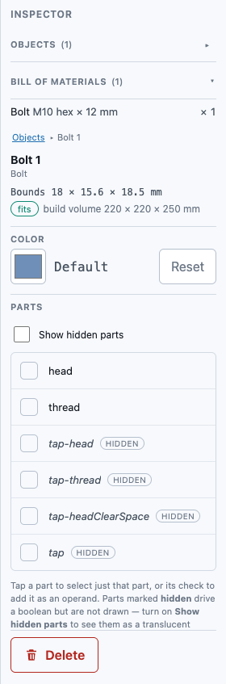
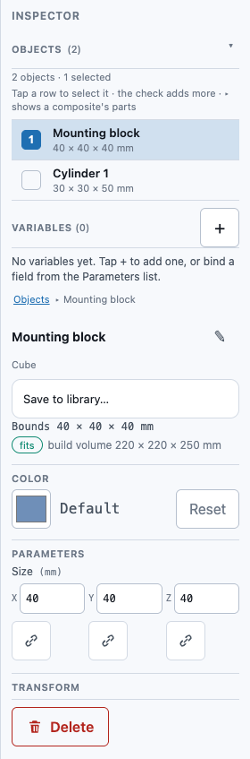
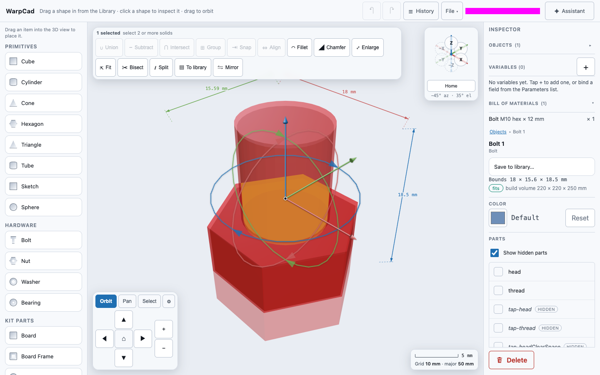
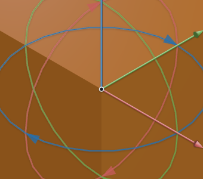
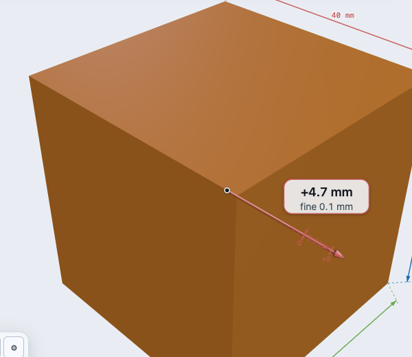
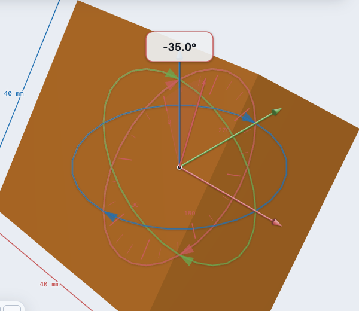
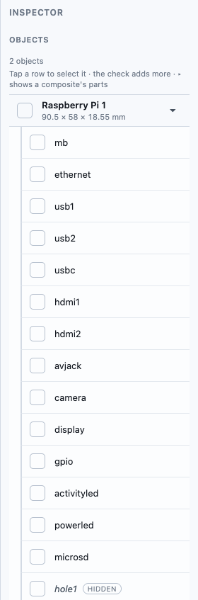
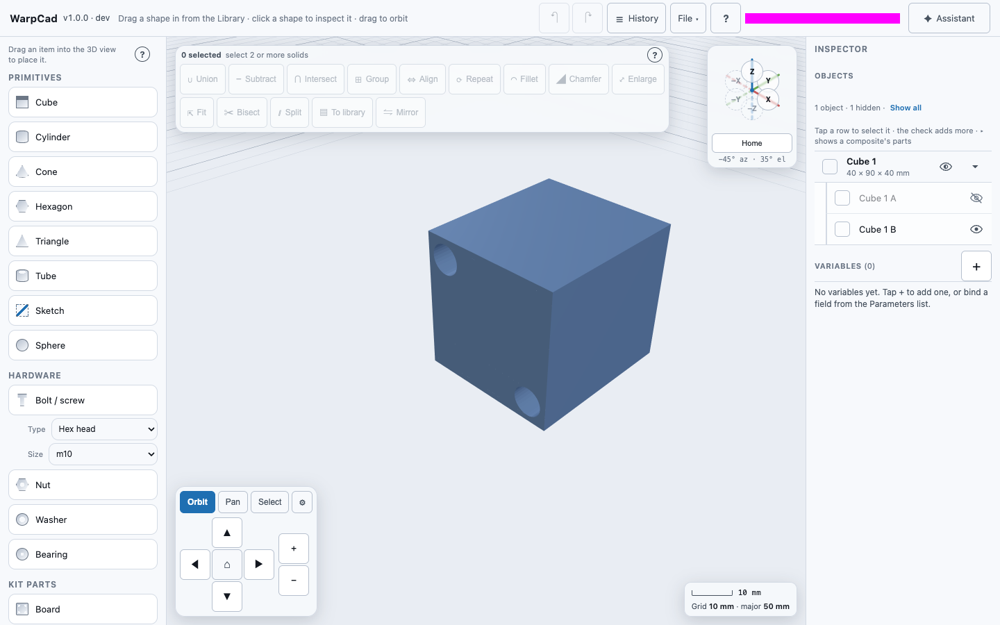

# Selecting a shape, and reading its size

On a phone, the Inspector is a sheet that rises when you select a shape; see [Using WarpCad on a phone or tablet](mobile.md#the-inspector).

Once you have placed something (see [Placing a shape](primitive-placement.md)), the next
thing you will want to know is **how big it is** and **what it is made of**. Both answers
come from the same gesture: click it.

## Selecting

**Worked example.** Click the cube. The Inspector shows its size and position and handles
appear on it. Drag the red arrow, and the X field changes as you drag. Type `25` into X and
press Enter, and the cube moves to X = 25 mm.

Click — or tap — directly on a shape in the 3D view. Three things happen at once:

1. **A gizmo appears at the middle of the shape.** Three coloured arrows point along the
   part's X, Y and Z directions, and three faint rings circle it. Each arrow is a thin
   rod with a small **cone** at its tip, and it ends just past the ring of the same
   colour. The rods and cones are lit from the upper left, so one side of each is
   brighter than the other. When an arrow points toward you, you can see the rim of
   the cone's base behind the tip. When it points away, you see the cone's flat base
   face-on. The cones stay the same small size whatever you select, so they never
   cover the part you are working on. The rings get the same highlight and a soft
   drop shadow. The colour-coding is unchanged. The arrows are the
   move handles and the rings are the rotate handles — both draggable, see
   [Moving and turning a shape](#moving-and-turning-a-shape). **The rotate rings carry
   small arrow markers along their circumference**, so they read as "drag along me to
   spin the object" rather than as a plain decorative circle or a selection halo — two
   small triangles per ring, pointing the way a drag there turns the shape.
   **The gizmo's size follows the shape it is attached to**, rather than staying a
   fixed size: its arms and rings
   always extend a short distance past the shape's own outline, growing for a larger
   shape (or as you zoom in) and shrinking for a smaller one (or as you zoom out) — down
   to a comfortably grabbable minimum, so a tiny part's handles never shrink to nothing.
   Select a small bolt and a large case shell in turn — the gizmo's arms and rotate rings
   resize each time, always extending a short distance past whichever object's outline,
   rather than staying a fixed size that disappears inside a large object or dwarfs a
   small one.
2. **Three dimension lines are drawn**, one per direction, each with a dashed leader
   line, an arrow at each end, and a number in millimetres. You always get all three at
   once — the width, the depth and the height — so you can read a part's real size
   straight off the screen without opening anything.
3. **The Inspector fills in** with the shape's own parameters and its position.

You do not have to be precise about where you click: anywhere on the shape works.

## What the colours mean

The gizmo's arrows and the dimension lines use the same colour for the same direction
everywhere in the app, matching the axis triad in the top-right corner of the 3D view:

| Colour | Direction | What it measures |
|---|---|---|
| Red | **X** | left-to-right |
| Green | **Y** | front-to-back |
| Blue/accent | **Z** | up |

If you orbit the view, the gizmo and the dimension lines swing round with the shape and
re-draw themselves from the new angle. The numbers do not change — a 40 mm cube is 40 mm
from every angle — but which edge each dimension line is drawn against does, so the
numbers stay clear of the solid instead of disappearing behind it.

### Once a shape is turned

The dimension lines measure the **shape's own** width, depth and height, along the
shape's own edges — not along the grid. Turn a shape and the three lines tilt over with
it and keep reading the same three numbers, because turning something does not change
how big it is.

That is the useful behaviour, and it is worth being clear about it, because the obvious
alternative is not useful at all: the smallest *grid-aligned* box a tilted shape fits
inside is bigger than the shape on nearly every axis, and none of its three numbers is a
measurement of the shape. A cylinder tipped over on its side would stop showing you its
diameter and its length, and start showing you the size of an invisible crate around it.

So the red line is the part's own width wherever the part is pointing, the green line is
its depth, and the blue line is its height. The gizmo's arrows are a separate thing and
deliberately keep pointing along the **grid's** directions, which is what you want when
you are moving something in the room rather than measuring it.

## The Inspector

**On a laptop or a tablet**, the Inspector is the column down the right-hand side of the
window. It is always there. With nothing selected it says *"(nothing selected)"* — that
is the panel waiting for you, not a fault.

**On a phone**, there is no room for a permanent column, so the Inspector is a sheet that
slides up from the bottom of the screen. **It opens by itself the moment you select
something** — you do not have to tap anything extra. To put it away, either swipe the
sheet down by its grab handle, or tap an empty patch of the 3D view. Both also clear the
selection, which is the point: putting the panel away and letting go of the shape are the
same idea.

### What it shows

**Color** — a colour swatch at the top of the panel. Click it to pick a new colour for
the shape. See [Colouring a shape](#colouring-a-shape) below.

**Parameters** — the shape's own settings, which differ per shape because they are read
from the shape's own definition rather than from a fixed form. **These are editable**:
type a new number and press **Enter** and the shape is rebuilt at that size, staying
exactly where it is. See [Resizing a shape](#resizing-a-shape) below.

| Shape | Parameters |
|---|---|
| Cube | Size (X, Y, Z) |
| Cylinder | Diameter, Height |
| Cone | Diameter, Height |
| Hexagon | Diameter, Height |
| Triangle | Side lengths (A, B, C), Height |
| Tube | Diameter, Inner diameter, Height |
| Sphere | Diameter |

**Transform** — where the shape is and how it is turned:

- **Position X/Y/Z** — the middle of the shape, in millimetres from the grid's origin.
  **Editable** — see [Moving and turning a shape](#moving-and-turning-a-shape) below.
- **Rotation X/Y/Z** — in degrees. **Editable**, the same way.
- **Size X/Y/Z** — the same three numbers the dimension lines are showing, in case you
  would rather read them in the panel. Read-only: this is a *measurement* of the shape,
  not a setting. To change how big a shape is you change its parameters above.

## Resizing a shape

The **Parameters** boxes at the top of the Inspector are how you change how big a shape
is. Click into one, type a number, and press **Enter** (or click away). The shape is
rebuilt at the new size straight away, and **it stays centred where it already was** —
resizing is not a move, so nothing jumps back to the origin or to where you first
dropped it. The gizmo and the dimension lines resize to match, because they measure the
shape rather than remembering it. Anything [snapped or aligned](snap-align.md) to the
shape follows the resize, and a Fillet or Chamfer on it is re-applied at the new size.

Parameters are in millimetres, the same as Position, and you can leave the `mm` in place
when you retype a value. Each box sets **that one parameter** and leaves the others
alone, so changing a cylinder's Diameter does not touch its Height. For a shape with a
multi-part parameter — a cube's **Size X/Y/Z**, a triangle's **Side lengths A/B/C** —
each box is one part of it, so you can make a cube into a slab by changing X alone.

If you type something that is not a number, the box puts the old value back and nothing
changes. If you type a number the shape cannot be built from — a diameter of `0`, or a
negative height — nothing changes either, and a short message appears under the boxes
saying what was wrong. Correct the number and it commits normally; the message is not a
state you have to clear.

### Worked example: narrow a cylinder

1. Drag a **Cylinder** onto the grid and click it. The Inspector's **Parameters**
   section shows **Diameter 40.000 mm** and **Height 50.000 mm**.
2. Click into the **Diameter** box, type `10`, and press **Enter**.
3. The cylinder narrows to 10 mm across, **staying centred on the same spot** — it does
   not slide anywhere. The box now reads `10.000 mm`, and the Inspector's **Size** row
   below reads `10 / 10 / 50`: two of the three numbers changed, the height did not.
4. Move the cylinder somewhere else with the gizmo, then come back and change its
   **Height** to `20`. It stays exactly where you moved it. Editing a parameter never
   undoes a move.
5. Press **Undo** once. The cylinder is 50 mm tall again, **still where you moved it**:
   one press takes back the whole edit, and the Undo button's tooltip now reads
   `Undo: Move Cylinder 1`, the move you made in step 4. In **History** the edit is a
   change to the cylinder's own creation row rather than a new row at the bottom, and the
   `Move Cylinder 1` row stays where it was.

### Worked example: a cube snapped to the top of another

1. Place two cubes, then [snap](snap-align.md) the small one onto the top of the large
   one (Size Z `40`), so the small cube sits at Z = 40.
2. Select the large cube, click into **Size Z**, type `60`, and press **Enter**.
3. The large cube grows around its centre, to a top at Z = 50, and **the small cube moves
   up with it** to sit on the new top. Press **Undo** once and both go back.

### When Parameters are greyed out

Two cases, and the panel tells you which:

- **You are looking inside a group.** The breadcrumb at the top of the panel shows
  `Group ▸ Part`. A part inside a group is shown for measurement only — step back up to
  the group with the breadcrumb link to change anything.
- **The shape was made by combining others.** A Union, Subtract or Group has no numbers of
  its own: its shape *is* the shapes it was built from. Select one of those and change it.

A shape with a **Fillet** or **Chamfer** on it is editable. The rim is re-applied at the
new size; if the new size is too small for it (a 5 mm fillet on a cylinder you shrink to
4 mm across), nothing changes and a message under the boxes names the Fillet step. Make
the fillet smaller first, or pick a size it fits.

## A sketch shape

A shape made from a [Sketch](sketch-mode.md) selects, moves, turns and combines like any
other shape. In place of the **Parameters** list, its Inspector has a **Sketch** section:

- **Extrusion**: how its outlines become a solid (Linear, Revolve, Helical, Outline or
  Loft), and **Slices**: how many outline layers it has;
- that method's numbers, such as **Height** and **Twist** for Linear. Type a value and press
  Enter to change it in place, exactly like a Parameters box. It is one step to undo, and a
  move or a fillet you added afterwards is kept;
- **Edit sketch**, which reopens the outlines on the shape's own plane, wherever you have
  moved or turned it since. **Done** applies your changes as one step; **Cancel** leaves the
  shape as it was.

**Edit sketch** is greyed out, with the reason underneath, when the selected shape can't be
rebuilt from its outlines. Once a sketch has been combined into a Union or Subtract, the
selected shape is the combination, which has no outlines of its own. Its Inspector shows the
combination instead.

While the sketch editor is open, the Inspector shows the **selected outline** instead of a
shape: its kind, **Solid** / **Hole**, its numbers (centre, radius, width, height, sides)
and **Delete outline**. On a phone, tap the **Sketch** tab to see it. It does not pop up by
itself while you draw, so it never covers the drawing.

### Worked example: make a tube taller

1. Draw the tube from [Sketch primitives](sketch-mode.md#worked-example-a-tube) and tap
   **Done**. It is selected, and the Inspector's **Sketch** section reads **Linear**, Height
   **30**.
2. Type **45** into Height and press Enter. The tube grows to 45 mm.
3. Tap **Edit sketch**, select the inner circle, and type **12** into its Radius in the
   Inspector. The preview's bore narrows. Tap **Done**.
4. Press **Undo** once: the bore goes back to 15 mm and the height stays at 45, because
   each was its own step.

## Changing a part's model or size

A ready-made part from the Library — a **Raspberry Pi**, a **Bolt / screw**, a **Nut**, a
**Washer**, a **Bearing**, the Pi **Camera Module** — can be changed after you have placed
it, not just before. Select it and look at its **Parameters**:

- A **choice** is a dropdown: a Pi's **Model** (Pi 2 / 3 / 4 / 5, the same list the
  Library row offers before you drag), a bolt's **Spec** and **Fit**, a nut or washer's
  **Spec** and **Fit**, a bearing's **Spec**. Pick a different option and the part is
  rebuilt straight away. On an iPhone or iPad the dropdown opens as the system's own wheel
  picker.
- A **size** is an ordinary number box, the same as a cube's: a bolt's **Length**, a Pi's
  **Clearance**. Type a number and press **Enter**.

The part is rebuilt **in place**: it keeps its position, its rotation and any colours you
gave it, and it stays selected. A bolt's **Fit** list is always the fits the chosen
**Spec** actually has, because they come from that spec's own row in the size table.

Anything positioned against the part **follows the change** when it can. A plug you
[snapped](snap-align.md) to a Pi 4's Ethernet jack moves to where the Pi 5's Ethernet
jack is, because both boards have one. When the new option is missing a part that
something depends on — a Pi 5 has no AV jack — the change is held and a dialog asks what
to do first. See [When the part you snapped to goes away](snap-align.md#when-the-part-you-snapped-to-goes-away).

**Why a part's own parameters are greyed out.** If you have drilled into one part of the
Pi (the breadcrumb reads `Raspberry Pi 1 ▸ ethernet`), the Parameters section shows the
whole Pi's Model read-only, with *"Select the whole Raspberry Pi 1 to change its model"*
and a link that does it. A part has no model of its own: the Ethernet jack is whatever the
board's model says it is. Kit parts (boards, standoffs, fans and the like) don't have
their options described yet, so theirs stay read-only and the panel says so.

### Worked example: turn a Pi 4 into a Pi 5

1. From the Library's **Raspberry Pi** section, leave the row's Model on **Pi 4** and
   drag it into the 3D view. It is selected, and its Inspector shows **Model: Pi 4**.
2. Open the **Model** dropdown and choose **Pi 5**.
3. The board is rebuilt as a Pi 5 on the same spot, still selected, gizmo attached. No
   dialog appears, because nothing depended on it.
4. Press **Undo** once. It is a Pi 4 again.

### Worked example: change a bolt's type and size

1. Drag a **Bolt / screw** in from the Library's Hardware section and select it. **Type** reads
   `Hex head`, **Size** reads `m10`, and **Fit** lists `tap`, `close` and `loose`.
2. Change **Type** to `Socket cap` and **Size** to `1/4`. The bolt is rebuilt with a socket head, and the
   **Fit** list now shows only the fits a 1/4 socket has.
3. Type `20` into **Length** and press **Enter**. The bolt is now 20 mm long.

### A part that only exists on one model

The repair dialog can make something **conditional**: *"Only when Raspberry Pi 1's Model
is Pi 4"*. The Inspector then shows a **Condition** row for it, with **Edit** (tick more
than one option, e.g. Pi 3 **or** Pi 4) and **Remove**. While the condition does not hold
the part isn't drawn, so you can't click it in the 3D view — find it at the bottom of the
Inspector's object list, greyed, with its condition beside it, and tap it there to edit
or remove the condition. Removing it on a Pi 5 brings the part back as a *broken*
dependent with its warning, rather than quietly hiding the problem.

### Binding a field to a variable

A number, choice or yes/no field can be bound to a project **variable**, so one change in the
Variables section moves every field bound to it. The link button beside a field does it, and
a bound field shows a chip with the variable's name in place of its editor. See
[Variables](variables.md).

## Naming a part

A part arrives called `Bolt / screw 1`, `Cube 2`, `Raspberry Pi 1`. With two dozen bolts on the
board that tells you nothing, so give a part or a group a name of your own. The name shows
at once in the Inspector header, the object list, the phone tab, the Bill of materials and
the history.

**Worked example.** Open **Library**, drag an **M3 bolt** into the view twice. Select the
first, tap the name **Bolt / screw 1** at the top of the **Inspector**, type `Pi camera bolt` and
press **Enter**. Select the second and name it `Screen bolt`. Open the object list: the rows
now read *Pi camera bolt* and *Screen bolt*.

- **Start**: tap or click the name, or the pencil beside it (it is always there, so it works
  on a touchscreen), or press **F2** with a part selected.
- **Finish**: **Enter**, or tap away, keeps the new name. **Escape** puts the old one back
  and changes nothing — it does not cancel anything else you have armed.
- **Blank** gives the generated name back (`Bolt / screw 1`), and the helper line under the field
  says so.
- **A name another part already uses** shows *Another part is already called this*. It is
  only a hint: the name is kept, because two `Screw`s is a legitimate model.
- **Up to 60 characters.**
- **Undo** (Ctrl/Cmd+Z) takes the rename back like any other step, and the name is saved
  with the project, so it is there after a reload.

The field appears only when **exactly one** part or group is selected. With nothing or
several selected there is no name to edit, and while you are drilled into one of a
recipe's own parts (a Pi's `ethernet`, a bolt's `head`) the name is plain text — those
names belong to the recipe. Step back out to the group (the breadcrumb) to rename it.

## Colouring a shape

A shape you draw yourself (Cube, Cylinder, and the rest of the Primitives section)
starts in the app's default colour. A **ready-made part** from the Library's Hardware
or Kit Parts / Raspberry Pi sections — a Washer, a Bolt, a Pi board — instead arrives
in **its own colour**, the same one it would be as a real part: a Washer is gray, a
Raspberry Pi board's PCB is translucent green. That is not the app's default; it is
that specific part's own colour, and it is what **Reset** puts a part back to.

To change a shape's colour, select it and use the **Color** row at the top of the
Inspector:

- **The swatch** (the coloured square) opens your browser's colour picker. While the
  picker is open, the shape in the 3D view changes colour as you move around it, so you
  can judge the colour on the actual shape. When you close the picker or confirm a
  colour, that colour is kept. For a ready-made part, the swatch starts on that part's
  own colour rather than a plain default — pick a new one and it works exactly the
  same way.
- **The readout** next to the swatch shows the colour as a code such as `#ff0000`. For
  a shape with no colour of its own and nothing picked yet, it reads **Default**; for
  an un-touched ready-made part, it reads that part's own colour (e.g. `#808080` for a
  Washer) — the readout always says what you'd actually see on screen, not a generic
  word.
- **Reset** clears a colour you picked. It puts the shape back to whatever it would be
  without your pick: the app's default for a plain shape, or the ready-made part's own
  colour for one of those. It is greyed out when there is nothing of yours to reset —
  which is also true for a ready-made part you have never recoloured, since there is no
  pick of yours sitting on top of its own colour yet.

While a coloured shape is selected it keeps its own colour and glows slightly warmer, so
you can see the colour you are picking and still tell that the shape is selected. Shapes
you haven't coloured still turn amber when selected, as before.

Each colour you pick is one step in **History** (for example `Color #ff0000 on Cube 1`)
and one press of **Undo**. Trying out colours while the picker is still open doesn't add
steps. Only the colour you settle on counts. The colour is saved with the project like
everything else.

### Worked example: colour a cube red

1. Drag a **Cube** and a **Cylinder** onto the grid, a little apart.
2. Click the cube. At the top of the Inspector, the **Color** row reads **Default**.
3. Click the swatch and choose a red. The cube turns red while you choose. Close the
   picker, and the readout now says `#ff0000` (or whichever red you picked).
4. Click an empty patch of the grid. The cube stays red and the cylinder keeps its
   original colour.
5. Click the cube again. The swatch and readout still show your red.
6. Press **Undo** once and the cube goes back to the default colour. The Undo button's
   tooltip read `Undo: Recolor Cube 1` before you pressed it.

### Worked example: a ready-made part keeps its own colour

1. From the Library's **Hardware** section, drag a **Washer** onto the grid. It is
   gray — that is the Washer's own colour, not the app's default.
2. Select it. The Color row's readout already reads `#808080`, and **Reset** is greyed
   out: there is nothing of yours to reset yet.
3. Click the swatch and choose red. The washer turns red, and the readout now says
   `#ff0000`.
4. Press **Reset**. The washer goes back to gray — its own colour — not to the app's
   default blue. The readout reads `#808080` again and **Reset** greys out.

### Colouring one part of a group or ready-made part

For a group, or a ready-made part like a bolt or a Raspberry Pi board, you can colour a
single piece. Select the part, click the piece again to look inside it (the breadcrumb at
the top of the Inspector changes to `Group ▸ Part`), and use the same **Color** row. Only
that piece changes.

A piece's own colour always wins over the whole part's colour. If you colour a board's
USB-C socket blue and later colour the whole board red, the board turns red and the
socket stays blue. To make the socket follow the board again, look inside, select the
socket, and press **Reset**. That only clears the socket's own colour, so it takes on
the board's red.

A ready-made composite like a Bolt or a Pi board can also arrive with **more than one
piece already coloured differently** — a Bolt's head is gray and its thread is silver,
straight out of the catalogue, with nothing picked yet. Colouring the whole Bolt red
still beats those built-in piece colours, the same way your own whole-body pick always
beats a piece's built-in one; Reset on a single piece returns just that piece to its
own built-in colour, not to the app's default.

Parameters and Transform are read-only while you are looking inside a part. Color is the
one row you can still change there, because a colour can belong to a single piece.

## Parts

A ready-made shape built from named pieces, like a bolt (`head`, `thread`, `tap`) or a
Raspberry Pi (`mb`, `ethernet`, `usb1`, `hdmi` and so on), gets a **Parts** section in
the Inspector, right below Color, whenever exactly that one shape is selected. It lists
**every** piece in the shape's own order: the ones you can see first, then any that are
real geometry but are **not drawn** by default. Those carry a small **hidden** label. A
bolt's `tap` (the clearance envelope its thread actually needs) and a washer's
`clearance` are hidden pieces.

A plain Cube, Sphere or any other one-piece shape has no Parts section at all. It is not
there and greyed out. It simply is not there.

- **Tap a piece** to select just that piece. The breadcrumb changes to
  `Objects ▸ Bolt / screw 1 ▸ tap`, and the piece is ready to use as an operand for Union,
  Subtract or Intersect. It is the same as clicking the shape a second time in the 3D
  view, but it also reaches the pieces you cannot click, like the hidden ones.
- **Tap the small box on the left of a piece** to add the shape to the selection
  addressed at that piece, which is how a piece becomes the *second* operand of a
  boolean. See [The Inspector's object list](#the-inspectors-object-list) for the order
  rules.
- **Point at a piece** with a mouse (or reach it with the keyboard's Tab key) and that
  piece lights up in the 3D view in a violet tint, and only that piece. Pointing at a
  hidden piece shows it as a translucent overlay for as long as you point at it, even
  with **Show hidden parts** off, so you can see where a clearance is before you cut
  with it. Touch screens have no pointing, so on a phone or tablet the tap itself is
  the feedback.
- **Show hidden parts** is a toggle above the list (a checkbox, sized as a full tap
  target). It is only there when the shape has hidden pieces. Turn it on and every
  hidden piece of that shape stays visible in the 3D view as a **translucent overlay in
  its own colour**. A bolt's `tap` reads as a soft red envelope around its gray head and
  silver thread. Turn it off and the overlay disappears; the shape itself is completely
  unaffected either way.
- **None of this changes your project.** Pointing at a piece, the toggle, and opening or
  closing any list write nothing to the project and add no step to **History**, so there
  is nothing to Undo. The toggle stays on for that one shape until you turn it off
  again, even if you select something else and come back later in the same session.
  Reloading the page starts every shape hidden again, the same as the camera position
  does.

### Worked example: see and use a bolt's hidden clearance

1. Drag a **Bolt / screw** from the Library's **Hardware** section onto the grid. It arrives
   selected, and under **Parts** the Inspector lists `head`, `thread`, and then four
   pieces labelled *hidden*: `tap-head`, `tap-thread`, `tap-headClearSpace` and `tap`.
2. With a mouse, point at the **tap** row. A translucent red cylinder, tinted violet
   while you point at it, appears around the bolt: that is the hole size it actually
   needs to slide through, not the size of its visible metal. Move the pointer away and it disappears again. To keep it on screen,
   turn on **Show hidden parts** instead.
3. Tap **tap** in the list. The breadcrumb reads `Objects ▸ Bolt / screw 1 ▸ tap`, and the bolt
   is now addressed at just that piece.
4. Drag a **Cube** in to stand in for a case wall and select it. Tap **Objects** in the
   breadcrumb (or the **Objects** bar at the top of the Inspector) to open the list, tap
   ▸ on *Bolt / screw 1*, and tap the small box on its **tap** row so it lands second. Press
   **Subtract** for a clearance-fit hole. See
   [Combining shapes](booleans.md#cutting-with-just-one-part-of-a-multi-part-shape)
   for the full mechanics of cutting with one named piece.

## Moving and turning a shape

The handles, close up: three arrows to move, three rings to turn.

Drag a coloured arrow and the Position field follows your hand, live, not only when you let go.

Drag a ring and the Rotation field follows the same way.

### The translate ruler

While you drag an arrow, a **ruler** appears along that arrow, starting where you pressed, so
you can see how far you have moved and from where.

- **Ticks** along the arrow's own line, in the arrow's colour, every 1, 2, 5, 10 mm and so on,
  widened as needed so there are never more than about 40. Every fifth tick is labelled.
- **Start mark**: a dim cross-bar where the drag began. It never moves.
- **Live marker** (an arrowhead) follows your pointer along the arrow, and the shaded **span**
  between the two is the distance moved.
- **Readout**: the signed distance to 0.1 mm, e.g. `+12.5 mm`, and under it the step in force
  (`1 mm steps`, `fine 0.1 mm`), or nothing for the coarser speed steps. Positive is the
  arrow's direction. Dragging back the other way reads negative.
- While the ruler is up the other arrows and all three rings are hidden. Release and the shape
  keeps exactly the distance on the readout, as one step you can Undo. The Position field in the
  Inspector shows the same number.

**Landing on a round number.** Hold **Shift** while dragging and the distance snaps to whole
millimetres. Press or release Shift mid-drag and it takes effect at once. Without Shift, **how
fast you drag picks the step**, and it works the same with a mouse, a pen or a finger: fast is
coarse (up to 10 mm), then 5 mm, then 1 mm, and nearly stopped is `0.1 mm`. Slow right down at
the end of the drag to settle on the exact distance. Shift always wins over speed.

**Example:**

1. Click a cube in the viewport. Three coloured arrows and three rings appear on it.
2. Press on the **red** arrow and drag a little way along it. A red ruler appears, starting
   where you pressed; the cube slides along it and the readout counts up in `mm`.
3. Hold **Shift** and keep dragging: the readout jumps in whole millimetres, `+10 mm`,
   `+11 mm`, `+12 mm`. Release with it on `+12 mm`.
4. The Inspector's Position X says `12`. Ctrl+Z puts the cube back in one step.
5. *Without a keyboard* (a mouse, or a finger on a tablet): drag the red arrow quickly and the
   readout moves in big steps; slow right down near the end and it falls to `0.1 mm`, so you can
   settle on `12.4 mm` or `12.5 mm`.

### The rotation dial

While you drag a ring, a **dial** appears in that ring's own plane and colour, so you can
see how far you have turned, not only that the shape is moving. It is drawn a little larger
than the shape, so the ticks and hands are never hidden behind it, and the other two rings
and the three move arrows are hidden until you let go, so only the one you are turning is
on screen.

- **Ticks** every 15°, longer every 45°, labelled `0`, `90`, `180`, `270`. `0` is
  where you grabbed the ring, not a world direction.
- **Dim hand** stays where the drag began. **Bright hand** (with an arrowhead) follows the
  rotation, and the shaded wedge between them is the amount turned. It keeps growing past
  half a turn, so three quarters of a turn reads `+270.0°`.
- **Readout**: the signed angle turned, to 0.1°, e.g. `+37.5°`. Positive is
  counter-clockwise looking down the ring's axis toward the origin (the right-hand rule).
  Under it a small line names the active step: `5° steps`, `fine 0.1°` and so on. Every
  drag has a step, with a mouse as much as with a finger.
- Release and the shape keeps exactly the angle on the readout, as one step you can Undo.
  The Rotation field in the Inspector shows the same number.

**Landing on a round number.** Hold **Shift** while dragging and the
turn snaps to 5° steps of the turn from where you grabbed. Press or release Shift
mid-drag and it takes effect at once. The steps are relative to the start: a shape
already at 17° lands on 22°, 27° and so on. To reach a specific absolute angle, type it
into the Rotation field.

**Without Shift, how fast you drag picks the step**, the same for a mouse, a pen and a
finger, and the same rule the move arrows follow: fast is a coarse step (up to 15°), slower
is 5°, then 1°, and nearly stopped is 0.1°. Slow right down at the end of the drag to settle
on the exact angle; the readout says which step you are in. A touch screen has no Shift, so
speed is its only way to choose. Holding Shift always overrides the speed rule.

**Example:**

1. Click a cube in the viewport. Three coloured rings appear around it.
2. Press on the **blue** ring and drag a quarter of the way round. A blue dial appears,
   a bright hand follows your pointer and the readout counts up.
3. Hold **Shift** and keep dragging: the readout moves in jumps, `+45.0°`, `+50.0°`,
   `+55.0°`. Release with it on `+90.0°`.
4. The Inspector's Rotation Z says `90`. Ctrl+Z puts the cube back in one step.
5. *Without a keyboard* (a mouse, or a finger on a tablet): drag the blue ring quickly and
   the readout jumps in big steps; slow right down near the end and it falls to `0.1°`
   steps, so you can settle on `89.9°` or `90.0°`.

Typing a number does the same job from the other side. The two always agree.

There are two ways to move a selected shape, and they always agree with each other —
they are the same change made from two places, not two separate features.

**In the 3D view**, drag any of the gizmo's three arrows to move the shape along that
direction. The shape follows your pointer as you drag, and the Inspector's **Position**
numbers count up or down in step with it — you do not have to let go to see where you
are. Drag one of the three rings to turn the shape about that axis; it turns on the
spot, about its own middle, and the **Rotation** numbers track the drag the same way.
Let go and the change is made. The small arrow markers on each ring are there for
exactly this: they show you which way a drag along that ring will spin the shape,
before you have grabbed anything.

**In the Inspector**, click into any Position or Rotation box, type a value, and press
**Enter** (or click away). The shape moves to match straight away. A Position is in
millimetres from the grid's origin and a Rotation is in degrees; you can leave the `mm`
or `°` in place when you retype a value, and a negative number is fine.

If you type something that is not a number, the box puts the old value back and nothing
moves.

The handles have a generous invisible catchment around them, wider than they look, so
they are reachable with a fingertip on a phone as well as with a mouse pointer — you do
not have to hit the thin line exactly. If you press a handle and change your mind
without moving, nothing happens except that you select whatever is underneath.

### Worked example: slide a Raspberry Pi along X

1. Drag a **Raspberry Pi** from the Library into the 3D view and let go. It is selected
   straight away.
2. The three arrows end just past the three coloured rings, each with a small cone at
   its tip.
3. Drag the **red cone** to the right. The Pi slides along X, and **Position X** in the
   Inspector counts up in millimetres as you drag.
4. Now select a small part, such as a **Nut**. Its gizmo is smaller overall, but the
   cones are the same small size they were on the Pi.

### Worked example: move and turn a cube

1. Drag a **Cube** onto the grid and click it. The Inspector shows **Position** with a Z
   of `20`, because a 40 mm cube resting on the grid has its middle 20 mm up.
2. Drag the **red arrow** (X) to the right. Watch the **Position X** box: it changes as
   you drag, not just when you let go. Release at about 60 mm.
3. Now click into the **Position X** box, type `0`, and press **Enter**. The cube slides
   straight back to where it started.
4. Drag the **blue ring** (the one circling the Z arrow) about a quarter turn. The
   **Rotation Z** box counts up as you go.
5. Click into **Rotation Z**, type `45`, press **Enter**. The cube snaps to exactly 45°.
   Watch the dimension lines: they swing round to sit along the cube's new edges, and
   all three still read **40 mm**. A turned 40 mm cube is still a 40 mm cube, so the
   numbers should not — and do not — move.
6. Note that there is still exactly **one** cube. Moving a shape moves it; it never
   leaves a copy behind.

### Worked example: read a tipped-over cylinder

1. Drag a **Cylinder** onto the grid and click it. Standing upright, the red and green
   lines read **40 mm** (its diameter, measured twice) and the blue one reads **50 mm**
   (its height).
2. Drag the **red ring** — the one circling the red arrow — about a quarter turn, so the
   cylinder tips over onto its side.
3. Read the lines again. They have tilted over with the cylinder, and they still say
   **40**, **40** and **50**. The blue one is now lying almost flat across the screen,
   because "the height of the cylinder" is now pointing sideways — but it is still the
   cylinder's length, and it is still 50 mm.
4. Check the Inspector's **Size** row while you are there: **40 / 40 / 50**, the same
   three numbers. The panel and the lines always agree, because they are the same
   measurement shown twice.

### Worked example: turn a shape about two different axes

Turning about one axis and then a *different* one is worth its own walkthrough, because
the numbers behave in a way that surprises people the first time.

1. Drag a **Cylinder** onto the grid and click it. Upright, the lines read **40**, **40**
   and **50**.
2. Drag the **blue ring** (the one circling the blue Z arrow) about a quarter turn. The
   **Rotation Z** box counts up as you go.
3. Now drag the **red ring** about a quarter turn as well. The cylinder tips over on top
   of the turn it already had.
4. Read the dimension lines: still **40**, **40** and **50**. Two turns about two axes is
   still the same cylinder, and the lines are still quoting its diameter and its length,
   not the size of the box it now happens to occupy.
5. Look at the **Rotation** boxes. They describe where the shape has actually ended up —
   which is often **not** the two numbers you dragged. Turning 90° about Z and then 90°
   about X does not leave you at "90 about Z and 90 about X": turns applied one after
   another combine into a single new direction, and the boxes show you that combined
   result. This is the same reason that turning a book face-down then sideways lands
   somewhere different from doing those two moves the other way round.
6. Type `0` into all three **Rotation** boxes, one at a time. The cylinder stands back up
   exactly as it started, and the lines return to reading straight along the grid.

> Each Rotation box sets **that one axis** and leaves the other two alone. So typing `90`
> into Rotation X puts the shape at 90° about X while keeping whatever Y and Z currently
> say — it does not reset them.

> Turns are always reported between **-180°** and **180°**. If you keep dragging a ring
> the same way past half a turn, the number wraps round to the negative side rather than
> counting on to 200° or 350°. It is the same orientation either way.

### Align to origin

To put an object on the origin, select it and use [Align](snap-align.md#aligning-to-the-origin).

## Worked example

1. Drag a **Cylinder** out of the Library and drop it on the grid.
2. Click it.
3. The Inspector shows **Diameter 40 mm** and **Height 50 mm** — the cylinder's own two
   settings — plus a Position with a Z of `25`, because the cylinder sits *on* the grid
   and 25 mm is halfway up a 50 mm-tall part.
4. In the 3D view, the red and green dimension lines both read **40 mm** (the diameter
   across, twice) and the blue one reads **50 mm** (the height).
5. Drag a **Cube** in next to it and click *that*. Everything re-points at the cube:
   the gizmo jumps across, the dimension lines all read **40 mm**, and the Inspector
   swaps Diameter/Height for a single **Size** row. You never see two shapes annotated
   at once.
6. Click an empty patch of grid. The gizmo, the dimension lines and the Inspector's
   fields all go away together.

## Selecting more than one shape

Hold **Shift** (or **Cmd**/**Ctrl**) and click a second shape to add it to the selection.
Shift-clicking a shape that is already selected takes it back out again.

With two or more selected, the Inspector says how many — for example *"2 selected"* — and
shows no parameter fields, because there is no longer a single shape to describe. The
gizmo and dimension lines go away for the same reason. This state is the starting point
for operations that need two shapes, such as cutting one out of another; those tools
arrive with the boolean operations.

### Dragging a selection box (marquee)

To select several objects at once, press and drag from empty space in the viewport — a
selection box follows your pointer; release it, and every object inside the box is
selected, showing *"<n> selected"* in the Inspector. It's the fastest way to grab
several shapes without clicking each one individually, and it's the only way to
multi-select on a touch device, where there is no Shift key to hold at all.

An object only needs to be **partly** inside the box to be picked up — you don't have to
enclose a shape completely, just clip it.

**On a laptop or desktop with a mouse**, hold **Ctrl** (or **Cmd** on a Mac) and drag
from empty space to draw the box. An ordinary drag with no modifier still orbits the
camera, exactly as it always has — the marquee only starts once Ctrl/Cmd is held down,
so navigating the viewport by dragging never changes. Add **Shift** at the same time
(**Ctrl+Shift**, or **Cmd+Shift**) to add the enclosed shapes to whatever is already
selected, instead of replacing it — the same thing Shift already means for a click.

**On a touch device** — or if you'd rather not hold a modifier key on a mouse — tap the
**Select** button in the navigation controls at the bottom of the viewport (next to
Orbit and Pan). While it's active, a one-finger drag from empty space draws the
selection box instead of orbiting the camera. Tap **Orbit** or **Pan** again to go back
to navigating. Additive marquees (adding to an existing selection with a second drag)
need Shift, which isn't available on touch, so a touch marquee always replaces the
current selection rather than adding to it.

Dragging a box over nothing clears the selection, the same as clicking empty space.

## The Inspector's object list

The Inspector is also where you find **every shape in your model**, listed by name. It
answers "what is in here?", and it is the way to select a shape you cannot click.

A shape that sits **completely inside** another one cannot be clicked, from any angle:
your click always lands on the outer shape first. A bolt standing inside a case shell is
the usual example, and it is exactly the shape you most want to select, to cut it out of
the shell. The object list names it, and tapping the name selects it with no clicking in
the 3D view at all.

**Where it is:**

- **With nothing selected**, the list *is* the Inspector. On a laptop or tablet it is the
  right-hand column. On a phone, the Inspector's tab at the bottom of the screen reads
  **Objects (3)** (with your own count). Tap it to open the list as a sheet. An empty
  model has no tab, because there is nothing to list yet. Start from the Library.
- **With one shape selected**, the Inspector shows that shape's details, and the list
  folds into an **Objects** bar at the top of the Inspector. Tap the bar, or tap
  **Objects** at the start of the breadcrumb above the shape's name, to open the list
  again. Your selection stays as it is.
- **With two or more selected**, the list is open under the Objects bar, because that is
  where you can see which shape is first.

**What you can do with a row:**

- **Tap a row** to select that shape and *only* that shape. Everything you get from
  clicking a shape happens: the Inspector switches to it, the gizmo and dimension lines
  appear, and the shape is highlighted. The list then folds away so the shape's details
  are in front of you.
- **Tap the small box on the left of a row** to add that shape to the selection (or take
  it out again). This is the way to select two shapes on a phone, where there is no Shift
  key, and it works on a laptop too. On a laptop you can also Shift-, Ctrl- or Cmd-click
  the row. Ticking a box keeps the list open, so the next box is one more tap. The box
  shows a number: **1** is the shape that comes first (the one Subtract cuts *from*),
  **2** and up are the rest, in the same two colours the Operations toolbar uses.
- **Point at a row** with a mouse, or reach it with the Tab key, and that shape lights up
  in the 3D view in a violet tint, even when it is hidden inside another shape. Point at
  a piece row (see below) and only that piece lights up. Nothing is selected by pointing;
  move away and the tint goes. Touch screens have no pointing, so on a phone the tap
  itself is the feedback.
- **Tap the eye** at the right of a row to take that shape, or one of its pieces, out of
  the 3D view and put it back. See [Hide and show](#hide-and-show).
- You can mix the routes freely: click one shape in the 3D view, then add a hidden one
  from the list, or the other way round.
- Each row shows the shape's name and its size (width × depth × height, in millimetres),
  so you can tell a 40 mm shell from the small bolt inside it.

**You can see a hidden shape is selected.** Because the shell would otherwise hide it, a
selected shape that is out of sight shows through as a translucent tint in its selection
colour. A shape that is not hidden looks exactly as it always did.

The list only shows shapes that are in your model *right now*. If you have suppressed a
step, or rolled History back past it, that shape is not in the scene, so it is not in the
list, and a note at the bottom says how many steps are missing for that reason. The list
and the [History panel](timeline.md) are different lists: History is numbered *steps* you
have taken; the object list is the *shapes* that result. Picking a History step never
selects a shape, and picking a shape never selects a step.

### Worked example: find, point at and combine two shapes

1. Drop a **Raspberry Pi** and a **Bolt / screw** from the Library, then tap empty space in the 3D
   view so nothing is selected. The Inspector lists both: *Raspberry Pi 1* and *Bolt / screw 1*.
   (On a phone, tap the **Objects (2)** tab first.)
2. Move the pointer over **Bolt / screw 1**. The bolt lights up violet in the 3D view.
3. Tap **▸** on **Raspberry Pi 1** to list its pieces, then point at `ethernet`. Only the
   Ethernet jack lights up, not the whole board.
4. Tap `ethernet` to select just that piece. The Inspector shows
   `Objects ▸ Raspberry Pi 1 ▸ ethernet`.
5. Tap **Objects** in that breadcrumb to get back to the list, and tick **Bolt / screw 1**'s box.
   The box shows **2**, the Pi's shows **1**, and the Operations toolbar says
   *2 selected*: the Ethernet jack is the base, the bolt the second operand.

### Worked example: cut a hidden bolt out of a shell

You need a Cube (the shell) and a Bolt (the hardware) with the bolt entirely inside it. A
drag always places a new shape flush against its neighbour, so build the overlap by hand:
place a Cube and a Bolt, then use **Align** from the Operations toolbar (see
[Precise placement: Align](snap-align.md)) to move the bolt inside the cube, or
open a project that already has one inside the other.

1. Tap empty space so nothing is selected. The Inspector lists two rows: *Cube 1* and
   *Bolt / screw 1*.
2. Try clicking the bolt in the 3D view. You get the cube every time, because the bolt is
   inside it. That is the problem the list solves.
3. **Tap the little box on the *Cube 1* row.** The cube is selected (*1 selected* in the
   Operations toolbar) and the list stays open.
4. **Tap the little box on the *Bolt / screw 1* row.** The box turns teal and shows **2**; the
   *Cube 1* box shows **1**. The Operations toolbar now says *2 selected — first is the
   base*, and **Subtract** lights up. In the 3D view the hidden bolt shows through the
   cube as a teal tint.
5. Press **Subtract**. The cube now has a bolt-shaped cavity, the *Bolt / screw 1* row disappears
   from the list (that shape has been used up), and the cube's volume has dropped by
   exactly the bolt's volume. Press **Undo** to bring the bolt back.

If you tap the *Bolt / screw 1* row itself instead of its box, the bolt alone is selected: its
Inspector and gizmo appear, and you can move or rotate it, even though the cube is in
front of it, by dragging the gizmo's arrows or typing into the Position boxes. On a phone,
tap the Inspector's tab to lower the sheet first so the gizmo is in view; that keeps the
selection.

### Picking one piece of a hidden shape

A shape built from named pieces — a bolt's head/thread/`tap`, a Raspberry Pi's jacks and
ports — normally opens those pieces by clicking it a *second* time in the 3D view (see
[Combining shapes](booleans.md)). A shape that is completely hidden inside another one
cannot be clicked even once, let alone twice, so the object list gives every row that
has pieces a small **▸** disclosure arrow at its right edge. Tap it to show the shape's
pieces as indented rows underneath — including pieces that are themselves invisible
(like a bolt's `tap` clearance), because those are exactly what you would want to
subtract with.

**Worked example: an Ethernet port opening in a fully enclosed case.** You have a
Raspberry Pi B+ built entirely inside a case shell — the whole board, not just resting
against a wall of it.

1. With nothing selected, the Inspector lists two rows: *Shell 1* and *Raspberry Pi B+*.
   Trying to click the Pi in the 3D view gets you the shell every time.
2. **Tap the little box on the *Shell 1* row first.** The shell is selected
   (*1 selected*) and the list stays open. This step has to come first: Subtract always
   cuts from whatever you selected *first*, and you want the case to be what gets cut,
   not the board.
3. **Tap the ▸ next to *Raspberry Pi B+*.** Its pieces list opens underneath — `mb`,
   `ethernet`, `usb1`, `hdmi`, and so on, with a handful of invisible mounting pieces
   at the bottom (each labelled *hidden*).
4. **Tap the little box on the *ethernet* row.** It turns teal and shows **2**; the
   *Shell 1* box still shows **1**. The Operations toolbar reads **Shell 1 then
   Raspberry Pi B+ › ethernet**, and **Subtract** lights up.
5. Press **Subtract**. The case gets a jack-sized opening — **4 545.0 mm³** worth of
   material removed, not the board's whole **23 168.2 mm³** footprint — and the Pi
   disappears from the list, used up like any Subtract operand.

**Tap a piece row itself** (not its box) to select *only* that piece of that shape,
replacing whatever was selected before, the same as tapping a plain row does for a
whole shape. The Inspector then shows that piece, and **Objects** in the breadcrumb
takes you back to the list. Tapping the parent's own row there steps back up to the
whole shape.
A piece you have addressed stays named on its parent row (`› ethernet`) even while the
pieces list is collapsed, so you can always see what a Subtract is about to cut with
before you press it.

**Order matters, and the list shows you before you commit.** If you tap *ethernet*
before *Shell 1*, the Pi becomes the base and the shell becomes the thing subtracted
*from* it — the badge reads **Raspberry Pi B+ › ethernet then Shell 1**, the wrong way
round. Read the badge before pressing Subtract; it always names which shape is the base.

A hardware bolt's `tap` piece is worth calling out for the opposite reason from most
pieces: cutting with the **whole** bolt (no piece selected) now cuts with its metal
only, because `tap` — the full clearance envelope — is a hidden part and not part of
that default. For a hole the bolt actually slides through rather than jams in, address
`tap` explicitly: either via its ▸ disclosure row here, or from the Inspector's own
[**Parts**](#parts) section while the bolt is selected. Pointing at the `tap` row in
either place previews the clearance as a translucent overlay before you cut with it.

## Hide and show

After a **Split**, the two pieces sit together exactly where the shape was, so the joint
between them (the pins and sockets, or the tongue and groove) is on faces that cover each
other. To look at one piece on its own, hide the other. Nothing moves and nothing is
deleted: hiding only changes what the 3D view draws.

- **The eye** is at the right of every row in the Inspector's object list: on each shape's
  row (between its name and the ▸) and on each piece's row once you open the ▸. The same
  eye is on the rows of a selected shape's **Parts** list. Tap it to hide that shape or
  piece; tap it again to show it. A hidden row is dimmed and its eye is crossed out.
- **A shape and its pieces have separate eyes.** A piece is drawn only when both it and its
  shape are shown. Hiding `Cube 1` hides both pieces; showing it again brings back each
  piece as it was, so a piece you hid stays hidden.
- **Some pieces hidden.** When a shape is shown but one of its pieces is hidden, the shape's
  eye is half filled. Tapping it then shows every piece.
- **Show all.** While anything is hidden, the count line above the list reads, for example,
  `3 objects · 1 hidden · Show all`. Tap **Show all** to bring everything back at once.
- **Keyboard.** Press **H** to hide the selected shape (or the piece you have selected
  inside it), or to show it again if it is already hidden. **Shift+H** is Show all. The
  keys do nothing while you are typing in a field or editing a sketch.
- **You cannot click a hidden shape.** A click where it was goes through to whatever is
  behind it, and a selection box never picks it up. Hiding a shape that is selected takes
  it out of the selection, so an operation never uses something you cannot see.
- **You can still select it from the list.** Tick a hidden shape's box, or tap its name, and
  it is selected as usual: the Inspector shows its fields with the note **Hidden in the view
  · Show**, and the 3D view draws no outline and no gizmo for it, because there is nothing
  on screen to attach them to. **Show** does the same as the eye. This is how you subtract a
  cutter you have hidden to see the shape underneath: tick both rows, then press
  **Subtract**.
- **Hiding is not a modelling step.** It adds nothing to History, and **Undo** undoes your
  last real change, not a hide. It is saved with the project, so a reload or a saved file
  opened later shows the same things hidden.
- **Export is unchanged.** A hidden shape or piece is still exported, still in **Print
  pieces**, and still counted in the bill of materials.
- **This is not Show hidden parts.** A bolt's `tap` and other pieces labelled *hidden* are
  ready-made helper pieces that are never drawn unless you turn on
  [Show hidden parts](hardware-library.md#fit-the-part-you-cant-see); that toggle does not
  bring back a piece you hid with its eye, and **Show all** does not turn it on.

### Worked example: look at both sides of a split joint

1. Drag a **Cube** in from the Library and drop it on the grid.
2. With it selected, choose **Enlarge** in the Operations toolbar, set **Y delta** to `50` and
   press **Enlarge** in the popover. The 40 mm cube is now 40 × 90 × 40 mm (X × Y × Z).
3. Choose **Split…**, keep the default plane across Y and the default pins, and press
   **Apply**. The Objects list now shows `Cube 1` with a ▸.
4. Tap ▸ beside `Cube 1`. Tap the eye on **Cube 1 A**. Piece A disappears and you are looking
   at the cut face of **Cube 1 B**, with its sockets.
5. Tap the eye on Cube 1 A again, then the eye on **Cube 1 B**. Now you see Cube 1 A's pins.
6. Tap **Show all** on the Objects count line to bring everything back.

## Deleting objects and parts

To remove a shape, select it and press **Delete** (or **Backspace**) on the keyboard, or
tap the red **Delete** button at the bottom of the Inspector. The button stays pinned to
the bottom of the Inspector as you scroll, so on a phone it is always in reach without
scrolling past the fields. Phones and tablets have no Delete key, so on those the button
is the way to do it.

- With **several shapes selected**, Delete removes all of them at once. That counts as
  **one** step: Undo reads `Undo: Delete 3 objects` and one press brings all three back.
- There is **no "are you sure?" box**. Undo is the safety net, as it is for everything
  else. **Undo** (Ctrl+Z / ⌘Z, or the ↶ button) puts the shape back exactly where it was,
  with the same size, rotation and colour, and selects it again.
- The keys do nothing while you are typing in a field. Backspace in a Position box only
  deletes a digit, never the shape.
- Delete is not available mid-drag, while a sketch is being edited, or while History is previewing an
  earlier step. The greyed-out button says which one applies.

### Worked example: delete a cube, then bring it back

1. Place two Cubes. Tap the second one so the Inspector shows **Cube 2**.
2. Press **Delete** on the keyboard, or scroll to the bottom of the Inspector and tap
   **Delete**. Cube 2 disappears and Cube 1 stays exactly where it was. On a phone the
   Inspector sheet closes, as it does when you deselect.
3. Press **Undo** (Ctrl+Z / ⌘Z, or the ↶ button). Cube 2 is back where it was, and
   selected.

### Removing one part of a group

To remove just one piece of a group or a ready-made part, select the part so the
breadcrumb shows it (see [Parts](#parts)). The button then reads **Remove part**. The rest
of the body stays, as one body, and the selection steps back up to it with the part gone
from its **Parts** list. History reads `Remove usb1 from Raspberry Pi 1`, and Undo puts
the part back and selects it again.

1. Tap a Raspberry Pi. Then tap its **usb1** block, in the 3D view or in the Inspector's
   **Parts** list, so the breadcrumb reads **Raspberry Pi 1 ▸ usb1**.
2. Tap **Remove part**. The USB block goes and the rest of the Pi stays.

You cannot remove the **last visible** part of a group. The button is greyed out and
says `Last visible part: delete Raspberry Pi 1 instead`, because a group with nothing
left to show is really a group you want to delete. Hidden parts, such as a bolt's `tap`
clearance, can be removed like any other part once **Show hidden parts** lets you select
them.

### Is it safe?

Deleting a shape that no later step depends on is always safe. Delete adds a new step to
the end of your [History](timeline.md). It never removes an earlier one, so nothing that
came before is affected. When something does depend on the deleted shape, WarpCad refuses
by name instead of guessing:

- Moving an older step (a Move of Cube 1, say) to *after* the step that deleted Cube 1 is
  refused: `Step 3 uses step 2's result`.
- A later step that uses a removed part, such as a Subtract of the Pi's `usb1` clearance,
  says it `can't be built: no part named "usb1"`.
- **Suppress** on a `Delete` row in History brings the shape back, because the step that
  deleted it is switched off. **Unsuppress** deletes it again.

## Troubleshooting

- **I clicked a shape and nothing happened.** Check that you clicked the shape itself and
  not the grid beside it. The shape's base sits at the point you dropped it, so the solid
  is drawn *upward* from there on screen — aim slightly above the spot where you dropped.
- **The dimension numbers look wrong.** They measure the smallest box that fits the
  shape, lined up with the *shape's own* edges. For a sphere or a cylinder, that means
  the first two numbers are both the *diameter*, not the radius. For a shape you have
  turned, it means the numbers stay the same as before you turned it — that is the point,
  not a fault.
- **I turned a shape and the dimension lines went diagonal.** They are following the
  shape's own edges, which are diagonal now. The numbers are still the shape's real
  width, depth and height. If you want the lines back on the grid's directions, set the
  **Rotation** boxes back to `0`.
- **I tried to drag a gizmo arrow and the view spun instead.** You caught the grid rather
  than the handle. The handles start a little way out from the middle of the shape, so
  aim at the outer half of the arrow, nearer its head.
- **I typed a position and the shape did not move.** Press **Enter**, or click somewhere
  else, to commit it — the shape moves when you finish editing, not on every keystroke.
- **I deleted the wrong thing.** Press **Undo** straight away. It comes back exactly as it
  was, selected. If you have done other things since, open History and **Suppress** its
  `Delete` row.
- **The Delete button is greyed out.** Its message says why: nothing is selected, a drag
  is in progress, a sketch is being edited, History is previewing an earlier step, or you
  are trying to remove a group's last visible part.
- **I can't click the shape I want — something else is in front of it.** Tap empty space
  so nothing is selected, and tap its name in the Inspector's
  [object list](#the-inspectors-object-list). On a phone, open the list from the
  **Objects** tab at the bottom first.
- **Where did the Objects button go?** The separate Objects panel and its button in the
  top bar were folded into the Inspector. The list is the Inspector's content when
  nothing is selected, and the **Objects** bar at the top of the Inspector otherwise.
- **The object list is greyed out and says it is read-only.** It does that while you are
  previewing a past step in History (or while a sketch is being edited). Come back to the
  latest step, or tap the sketch's **Done** or **Cancel**, and it works again.
- **A shape I know is in the model is missing from the object list.** Its step is
  probably suppressed or rolled back. See the note at the bottom of the list, and the
  [History panel](timeline.md).
- **I picked a colour but the shape looks slightly different from the swatch.** The 3D
  view lights the shape, so faces turned away from the light are darker than the swatch.
  A selected shape also glows a little warmer. Click empty space to deselect it and see
  the plain colour.
- **Reset is greyed out, but the part I'm looking at is coloured.** It is showing the
  whole part's colour (the readout says `(whole body)`). Step back up with the breadcrumb
  and reset it there.
- **The Inspector sheet keeps covering the 3D view on my phone.** Swipe it down by its
  grab handle. The view's own navigation controls move up out of the way while the sheet
  is open, so they are never trapped underneath it.

<!-- SPDX-License-Identifier: CC-BY-SA-4.0 -->
