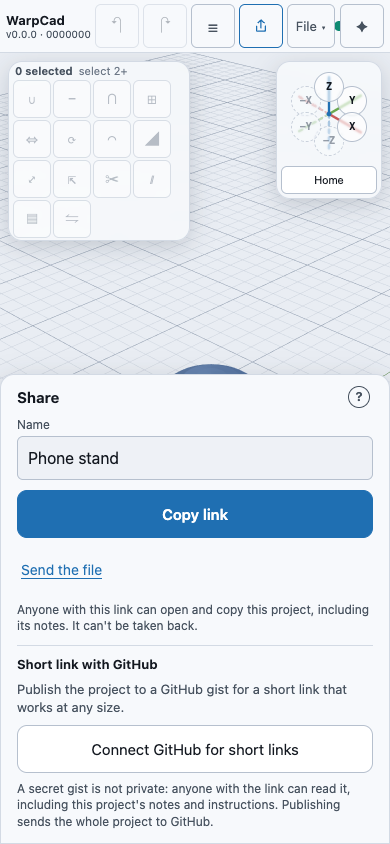
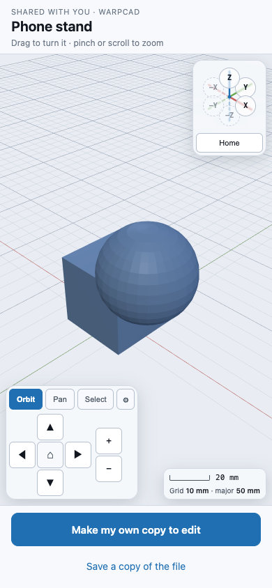
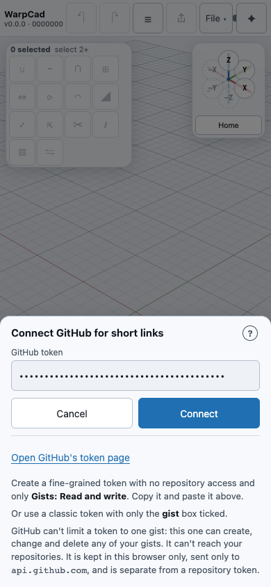
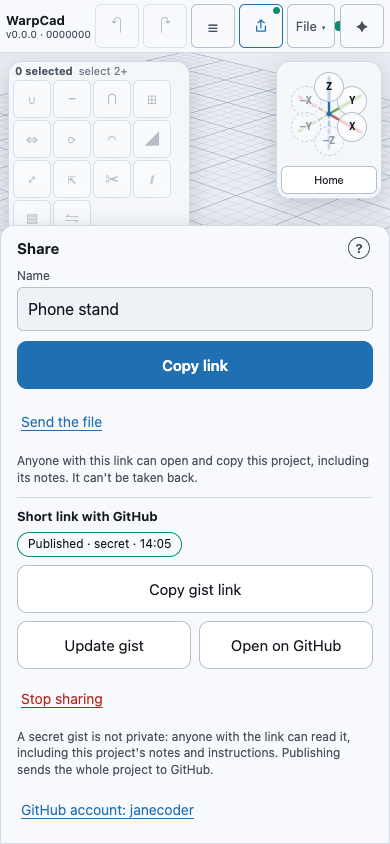

# Sharing a project by link

You can send a project to anyone as a link in a text message or an email. They tap it and see
your model on their phone or computer. They don't need to install anything or sign up, and they
don't need to know what CAD is. The project itself is inside the link, so it doesn't pass through
any WarpCad server.

A project that is too big for a link, or one you want to keep updating, can be published as a
**GitHub gist** instead: a short link to a copy of the project on GitHub. See
[Publish a project as a gist](#publish-a-project-as-a-gist).

## Send a project

1. Open your project. It needs at least one shape. On an empty project **Share** is greyed out,
   and it says *Nothing to share yet*.
2. Tap **Share**, at the top of the screen to the left of **File ▾**. On a phone it is the icon
   with an arrow pointing up out of a box. **File ▾ → Share…** opens the same sheet, if you can't
   find the button.
3. Check the **Name**. It is the title the other person will see over the model. It starts as
   your project's name, or *Untitled*.
4. Send it:
   - **On a phone or tablet**, tap **Send…**. Your device's own share sheet opens, the one with
     Messages, Mail, WhatsApp and AirDrop. Pick one and send. If you change your mind, close the
     share sheet. Nothing else happens.
   - **On a computer**, click **Copy link** and paste it into an email or a chat. A note at the
     top says *Link copied* and how big the link is, for example *Link copied, 2.3 KB*.

**Example.** Open your project. Tap **Share**. Tap **Send…**, pick **Messages** and your dad's
name, and tap send. Dad's message reads *"Here's a model I made in WarpCad: Phone stand"*
followed by the link.

Before you send it, read the line at the bottom of the sheet: *Anyone with this link can open and
copy this project, including its notes. It can't be taken back.* The link holds the whole project,
including the notes and instructions you gave the Assistant. Anyone who has it can make their own
copy, and you can't recall a link once it's sent.

**If your project is too big for a link**, the sheet says *This project is too big to send as a
link*. A project with an imported 3D model file usually is. Publish it as a gist for a short link
([below](#publish-a-project-as-a-gist)), or use **Send the file** instead. It saves
the project file, which you can attach to an email or a message. The person you send it to opens
it with **File ▾ → Open…** ([Saving and reopening your work](save-load.md)). **Send the file** is
always at the bottom of the sheet, for anyone who already uses WarpCad.

**If you send it again after changing it**, the person who already has your project open is asked
whether to **Merge their changes** into theirs. See *Sending an update* below.

## If someone sent you a WarpCad link

You don't need to know anything about WarpCad to look at it.

1. **Tap the link.** WarpCad opens in your browser and the model appears, with its name above it.
2. **Look around.** Drag one finger across the model to turn it. Pinch two fingers to zoom in and
   out. On a computer, drag with the mouse and scroll to zoom. The buttons in the bottom corner do
   the same thing if you prefer to tap, and **Home** in the box at the top right turns it back to
   a standard view.
3. **That's all you have to do.** Tapping the model doesn't change it. Nothing you do on this
   screen changes the model, and nothing on your device is saved or overwritten.

**Example.** Tap the link. The model appears. Drag one finger to turn it, pinch to zoom. Tap
**Make my own copy to edit** only if you want to change it.

There are two buttons:

- **Make my own copy to edit** opens the model in the full WarpCad editor as **your own new
  project**, so you can change it. Your copy is separate from the sender's. Changing it doesn't
  change theirs, and theirs doesn't change yours. If you already had a project open in WarpCad on
  this device, it first asks **Replace the project?**. Tap **Download yours first** (or **Save
  yours first**) to keep a copy of yours, then **Replace**. Tap **Cancel** to go back to the shared
  model.
- **Save a copy of the file** saves the shared project as a file on your device, without opening
  the editor.

**If the link doesn't work**, WarpCad shows *This link looks incomplete*. Some email programs cut
long links short. Ask the person who sent it to send it again, or to send the file instead. Tap
**Start WarpCad** to go to the app anyway.

### Sending an update

If you send a newer version of a project to someone who already has **that same project** open,
not a copy they made of it, their **Make my own copy to edit** asks **Merge their changes?**
instead. **Merge their changes** brings in what's new and keeps their own changes, the same as
**File ▾ → Merge file…** ([Merging two copies of a project](merging.md)), with **Undo merge** if it
wasn't what they wanted. **Open theirs instead** replaces their copy with yours.

## Publish a project as a gist

A **gist** is a small page on GitHub that holds a few files. Publishing puts two there: your
project file, and a short page anyone can read on GitHub with the project's name, how many shapes
it has and what they're called, and an **Open in WarpCad** link. You get a short link,
`https://app.warpcad.com/#/gist/` followed by the gist's id. It works for a project of any size,
and when you publish again the **same link** shows the newer version.

You need a free GitHub account, and you connect WarpCad to it once with a **token**, a password
made just for this. Nothing is sent to GitHub until you tap **Publish to a gist**.

### Connect GitHub once

1. Tap **Share**. Under **Short link with GitHub**, tap **Connect GitHub for short links**.
   **File ▾ → Connect GitHub for gists…** opens the same thing.
2. Tap **Open GitHub's token page**, and sign in to GitHub if it asks.
3. Create a fine-grained token with **no repository access** and only the account permission
   **Gists: Read and write**. Give it a name you'll recognise, like *WarpCad gists*, and an expiry
   date. Copy the token GitHub shows you.

   A **classic** token works too, if that's what you have: tick only the **gist** box.
4. Back in WarpCad, paste the token into **GitHub token** and tap **Connect**. WarpCad checks it
   with GitHub first. It then says *Connected as* your GitHub name, which kind of token it is and
   when it expires. Tap **Done**.

GitHub can't limit a token to one gist: this one can create, change and delete any of your gists.
It can't reach your repositories. WarpCad keeps it in this browser only, separately from a
[repository token](save-load.md#two-github-tokens-and-how-they-differ), and never shows it again.

### Publish

1. Open your project. It needs at least one shape.
2. Tap **Share**. Under **Short link with GitHub**, read the line at the bottom of the group:
   *A secret gist is not private: anyone with the link can read it, including this project's
   notes and instructions. Publishing sends the whole project to GitHub.*
3. Tap **Publish to a gist**. When it's done a note says *Published. Link copied*: the short link
   is on your clipboard, ready to paste.

**Example.** Open your project. Tap **Share**. Under **Short link with GitHub**, tap **Connect
GitHub for short links**, tap **Open GitHub's token page**, make a fine-grained token with only
**Gists: Read and write**, paste it, and tap **Connect**, then **Done**. Back in the sheet tap
**Publish to a gist**. The short link is copied. Paste it into a text to your dad. Change the
model, tap **Share → Update gist**, and the same link now shows the new version.

A gist is **secret** unless you tick **Make it public** before publishing. Secret means it isn't
listed anywhere, but anyone who has the link can open it. A public gist is listed on your GitHub
profile and can be found by searching. GitHub can't change one into the other later, so the box
is only there before the first publish.

A small **Published** mark appears beside **Share** while the open project is published from
your account. On a phone it's a dot on the Share button.

### Update it, copy the link, or stop sharing

Once a project is published, the group in the Share sheet offers:

- **Copy gist link** puts the short link on the clipboard again.
- **Update gist** publishes the project as it is now, to the same gist. Anyone who opens the link
  afterwards sees the new version. If the gist changed somewhere else since you last published it
  (you updated it from another device, or edited it on GitHub), WarpCad doesn't overwrite it. It
  says *This gist changed since you last published it. Open its link first, then update.* Open
  the link on this device, choose **Open it to edit**, then update.
- **Open on GitHub** shows the gist's page on github.com, with the readable page first.
- **Stop sharing** deletes the gist from GitHub, after asking: the link stops working. People who
  already opened or saved a copy keep it, and GitHub may keep serving it for a few minutes.

If publishing fails, the sheet says why in plain words (the token was rejected or has expired, no
network, GitHub is busy). Your project is always still saved in this browser.

## If someone sent you a gist link

It opens exactly like a long link: tap it and the model appears, with its name above it. You
don't need a GitHub account, and nothing is saved on your device unless you tap **Make my own
copy to edit**. The two buttons and the controls are the ones in
[If someone sent you a WarpCad link](#if-someone-sent-you-a-warpcad-link).

**Example.** Your daughter texts you a link that starts `https://app.warpcad.com/#/gist/`. Tap it.
The phone stand appears. Drag to turn it. Tap **Make my own copy to edit** if you want to change it;
your copy has nothing to do with her gist, and changing it never changes hers.

If WarpCad shows **Can't show this shared project**, the line under it says why:

- *This shared project can't be found.* The gist was deleted (its owner stopped sharing it), or
  the link was copied wrong.
- *GitHub is busy. Try again in a few minutes.* GitHub lets each internet connection open 60 gists
  an hour without an account. A classroom or an office shares one connection, so it can run out.
  Wait a few minutes and reload.
- *This shared project can't be opened.* The gist holds something that isn't a WarpCad project.

Tap **Start WarpCad** to go to the app anyway.

**If it's your own link**, opened where your project is, WarpCad doesn't offer a read-only copy
of your own work. **Open it to edit** keeps your project open and brings in anything newer from
the gist (with **Undo merge**, as in [Merging](merging.md)). **Make a copy** opens it as a
separate new project instead.

## Where the project goes

The project is packed into the part of the link after `#`. Browsers never send that part to any
server, so the project doesn't pass through WarpCad's host and isn't recorded by its page-view
counter ([Privacy](privacy.md)). The link is opened only in the browser of the person who taps it.
Once the project has loaded, WarpCad removes it from the address bar. Reloading the page then opens
WarpCad as normal, and a screenshot of the address bar doesn't show the project.

Opening a link never saves anything on that device. Only **Make my own copy to edit** does, and
it asks before replacing anything.

A **gist link** is different: it carries only the gist's id, and the project is on GitHub, in the
gist you published. Opening it reads the gist from GitHub without an account. Publishing, updating
and stopping are the only times WarpCad sends anything to GitHub, and only when you tap them
([Privacy](privacy.md)).

<!-- SPDX-License-Identifier: CC-BY-SA-4.0 -->
