# Sketch primitives

On a phone, the Extrude and Slices panels are a short bottom sheet; see [Using WarpCad on a phone or tablet](mobile.md#sketching).

A **Sketch** is a shape you draw instead of size. You drop it into the 3D view like a
Cube, draw outlines on its flat plane, and choose how those outlines become a solid.
When you tap **Done** it is a solid like any other shape: you can select it, move and
turn it with the gizmo, combine it with Union / Subtract / Intersect, mirror it, export
it, and come back later to change the drawing.

A sketch is always a solid. There are no loose lines left in the scene. An outline
that is not closed is shown in amber and is not part of the solid until you close it.

## Placing a sketch

1. Open the **Library** (the left column on a computer or tablet, the **Library** tab at
   the bottom on a phone).
2. Drag **Sketch** from **Primitives** into the 3D view. While you drag, a thin square
   shows where the sketch's plane will go.
3. Let go. That spot becomes the sketch's **origin**. The view turns to look straight
   down at it, the grid lies flat in front of you, and the **Sketch toolbar** appears
   in the top-left corner where the Operations toolbar normally is.

Nothing is added to your model yet. The sketch only becomes a shape when you tap
**Done**. **Cancel** throws the whole thing away and leaves no shape behind.

While the sketch editor is open:

- a drag on the grid **draws** with the current tool. On a touch screen, one finger
  draws; two fingers still pan and pinch-zoom;
- the camera stays square-on to the sketch: the orientation triad's view buttons are
  off, and the navigation arrows **pan** rather than orbit;
- **Undo**, **Redo** and the shape-level **Delete** are off until you tap **Done** or
  **Cancel**, because nothing you've drawn is in the model yet. The whole editing session
  then becomes one step you can undo. Inside the editor the toolbar's own **Delete** (and
  the Delete / Backspace keys) remove the selected *outline*, never the shape underneath
  (see Selecting, editing and deleting an outline, below);
- on a phone, the navigation pad folds to a single **✥** button so the drawing area
  stays clear. Tap it to get the arrows and zoom back.

## The four drawing tools

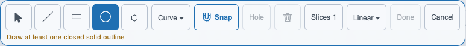

Left to right the toolbar has **Select** (the arrow, see the next section), the four
drawing tools below, **Snap** (see **Snapping to other outlines**, below), **Hole**,
**Delete**, **Slices**, **Extrude ▾**, **Done** and **Cancel**. **Hole** and **Delete** are greyed out until you pick an outline, and **Done**
is greyed out until there is a closed Solid outline to build.

Rectangle, Circle and Polygon are a single press, drag and release. **Line** is different:
it keeps going until you stop it (see **Drawing a continuous line**, below). No modifier key
is needed for any of them, with a mouse or a finger.

| Tool | Button | Drag | You get |
|---|---|---|---|
| **Line** | ╱ | Click or tap one point after another | A continuous outline: every point you add starts the next segment from it. Click the first point again to close it. |
| **Rectangle** | ▭ | Corner to opposite corner | A closed rectangle |
| **Circle** | ◯ | Centre out to the rim | A closed circle |
| **Polygon** | ⬡ | Centre out to a corner | A regular polygon. Set how many sides in the box that appears next to the tool. 6 gives you a hexagon. |

### Drawing a continuous line

The Line tool draws a whole outline in one go. After the first point, the next segment is
already started: a dashed line runs from the last point to your pointer, with its length in
millimetres beside it.

1. Tap **Line**.
2. Click (or tap) at about (0, 0), then (40, 0), then (40, 20). Each click fixes a point and
   starts the next segment from it. On a computer the dashed segment follows the mouse;
   on a touch screen it shows while your finger is down, and the next tap or drag-release
   fixes the next point. You can also press and drag: the first drag fixes the first two
   points, and any later drag fixes the point where you let go.
3. Click the **first** point again to close the triangle. The first point pulses when you are
   close enough. The outline turns blue and is part of the solid.
4. Or leave it open instead: press **Esc** or **Enter**, tap **Finish**, double-click the last
   point, or pick another tool. An open outline is drawn in amber and is not part of the
   solid.

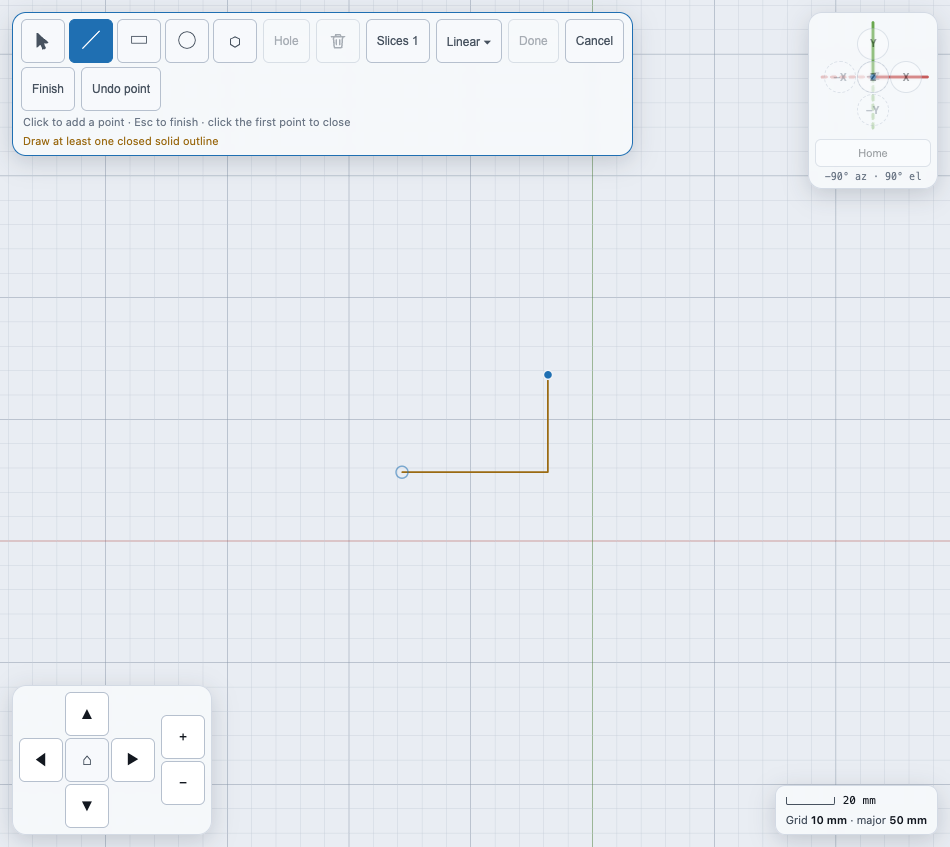

**Finish** and **Undo point** appear in the toolbar while a line is in progress, and are the
only way to do either on a phone. **Undo point** (or **Backspace**) removes the last point
and keeps going; removing the only segment discards the line. Press **Esc** twice in a
row to throw the whole line away. A line you finished is not selected: use **Select** to pick
it.

A drag that hardly moves draws nothing. With Rectangle, Circle or Polygon armed, a tap without
dragging **selects** the outline under your finger or pointer, and a drag draws, even
when it starts on an existing outline. With Line armed a tap adds a point instead. To pick an outline without any risk of drawing,
use the **Select** tool (next section).

### A closed outline

An outline that is closed is drawn in blue. The moment a closed Solid outline exists, a
see-through tan preview of the solid appears inside it, and **Done** switches on. Until
it closes, a Line chain stays amber, shows no preview, and is not part of the solid.

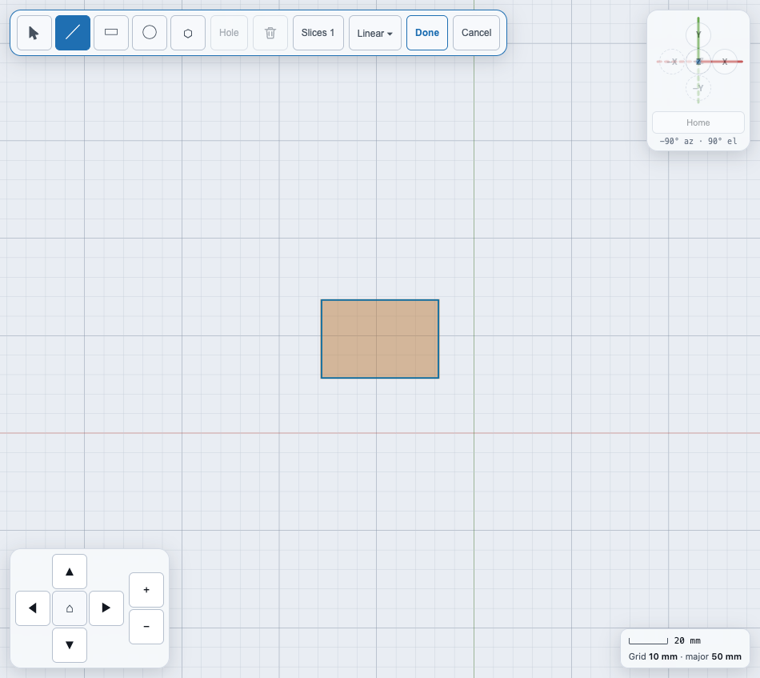

## Snapping to other outlines

While you draw, every point you place jumps onto the nearest useful spot of the outlines
already on the slice, when your pointer or finger comes within about 12 pixels of it.
A small marker shows where the point will land, and a word beside it says what it found:

| Marker | Word | What it snaps to |
|---|---|---|
| Square | **Corner** | A rectangle's corner, a polygon's corner, or a point of a Line outline |
| Ring | **Centre** / **Quadrant** | The centre of a circle, rectangle or polygon; or the top, bottom, left or right of a circle |
| Triangle | **Midpoint** | The middle of an edge |
| Cross | **On edge** | The nearest point on an edge or on a circle's rim |
| Diamond | **Origin** | The sketch's origin |

When two of these are in reach, the one higher in the table wins, so a corner beats the edge
right next to it. Snapping works for every point a drawing tool places: each Line point, a
Rectangle's two corners, a Circle's or Polygon's centre and its rim, and a point you drag
with **Select** (see **Editing an outline's points**). It only uses the slice you are
drawing on, never the faint ones, and never the outline you are drawing or dragging. On an
empty slice nothing snaps. On a computer the marker shows as soon as you hover, before you
press. On a touch screen it shows while your finger is down, drawn a little above your
finger with a short line down to the real point, so your finger does not hide it.

To place a point exactly where you point instead:

- **Hold Shift** while you press or drag, for that one shape;
- or tap **Snap** in the toolbar to turn snapping off until you tap it again. It stays off
  until you reload the page, even if you close and reopen the editor. This is the only way
  on a phone or tablet, which has no Shift key. **Snap** is highlighted while it is on.

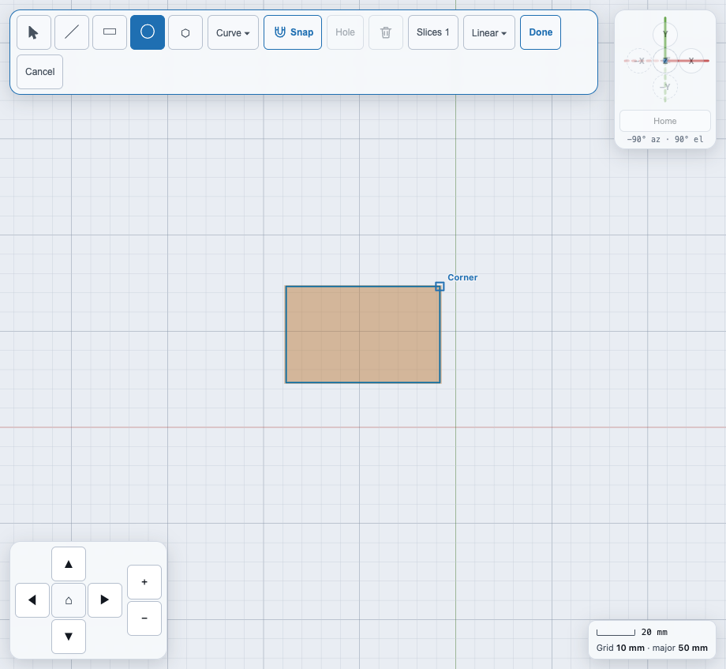

**Example.** Draw a rectangle. Pick **Circle**, press near the rectangle's top-right corner:
a square marker and the label *Corner* appear and the circle's centre lands exactly on it.
Hold **Shift** while you press (or tap **Snap** off) to place the centre wherever you point
instead. To check, pick the circle with **Select**: the Inspector's Centre X and Y are the
corner's exact numbers.

## Selecting, editing and deleting an outline

The first button in the tool group, an arrow, is **Select**. It never draws.

- **Pick** an outline: tap or click its edge (within about a finger's width), or tap
  anywhere inside a closed outline. Where a tap could mean two outlines, the edge you are
  nearest to wins; inside two outlines the **smaller** one wins, which is how you pick the
  inner of two circles. An open Line outline is picked by its line.
- **See** what you picked: it draws thicker and in the accent colour, a Hole also shows a
  small "hole" label, and a line under the toolbar names it, for example *Circle, Hole —
  15 mm radius*. On a computer the outline under the mouse is lightly highlighted before
  you click. On a phone the Inspector stays closed so the drawing area is not covered, and
  the line under the toolbar is your confirmation. Tap **Sketch** at the bottom to open the
  Inspector.
- **Change** it: **Hole** in the toolbar switches Solid and Hole, and the Inspector has
  the outline's numbers (see below).
- **Delete** it: tap the trash button **Delete** in the toolbar, or press Delete or
  Backspace on a keyboard. Both are greyed out until exactly one outline is picked. (If
  you have picked one of the outline's *points*, they delete that point instead; see
  **Editing an outline's points** below.) It
  removes that outline from the drawing only, and it is part of the editor's one undo
  step, so **Cancel** brings it back and **Done** commits the result.
- **Clear** the selection: tap empty grid.

A drag that starts on an outline while Select is armed does not draw, and does not turn the
camera either; the press still picks whatever it landed on.

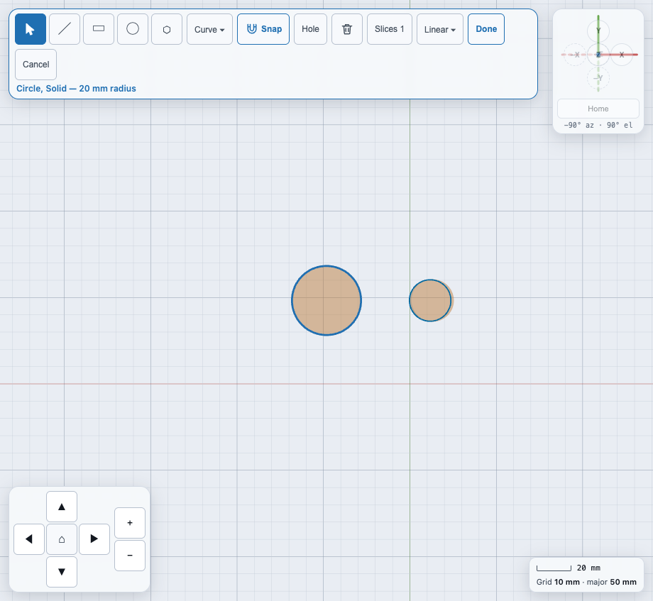

**Example.** Draw two circles with **Circle**. Tap **Select**, then tap the larger
circle's edge: it turns thick and the status line reads *Circle, Solid — 20 mm radius*.
Tap **Hole** to make it a hole (its outline turns dashed and the status says *Hole*),
then tap **Delete** to remove it. Tap empty grid to clear the selection.

## Solid and Hole

Every closed outline is either **Solid** (material) or **Hole** (a cut-out). New
outlines are Solid. To make one a hole, select it and tap **Hole** in the toolbar. Its
outline turns **dashed** and a small "hole" label appears next to it. Tap **Hole**
again to make it solid again. The Inspector shows the same choice as **Solid** /
**Hole** buttons.

The outlines are combined from largest to smallest: a solid adds material, and a hole
cuts it away. So a hole inside a solid makes a bore, and a solid drawn inside a hole
stays as an island.

**Example.** With **Rectangle**, drag out an 80 by 50 mm rectangle (read the size off the
grid, or type it into the Inspector afterwards). With **Circle**, drag from the same centre
out to 15 mm. Its centre snaps onto the rectangle's centre (the ring marker says *Centre*), so
the hole is exactly in the middle. Tap **Select**, tap the circle's rim, then tap **Hole**: the circle turns
dashed and a "hole" label appears. Set Height to 10 (mm) in **Extrude ▾** and tap **Done**:
you get a 10 mm thick plate with a round hole straight through it.

## Changing an outline's size

Pick an outline with **Select**, then look in the **Inspector**. On a phone, tap the **Sketch** tab at
the bottom. It shows the outline's kind, Solid or Hole, and its numbers: a circle's centre
and radius, a rectangle's centre, width and height, a polygon's centre, radius, sides
and rotation. Type a value and press Enter. **Delete outline** removes it, the same as the
toolbar's **Delete**. To drag, add or remove an outline's individual points, see the next
section.

## Editing an outline's points

An outline drawn with **Line**, or any shape you have converted (below), has points you can
move, add and remove. Pick the outline with **Select** (see above); its points then show as
dots. The dots are there only while **Select** is armed: with a drawing tool armed they go
away, so a drag that starts on the outline always draws.

- **Convert to outline.** A rectangle, circle or polygon has no free points: it is kept as
  its numbers (a centre and a radius, say). To edit its points, pick it, open the
  Inspector (on a phone, tap **Sketch** at the bottom) and tap **Convert to outline**. It
  becomes a closed outline with the same shape, Solid or Hole unchanged: a rectangle gets
  its 4 corners, a polygon its corners, a circle 32 points round its rim. You can't turn it
  back into a rectangle afterwards, except with **Cancel**.
- **Move a point**: drag its dot. Each dot has a finger-sized target (44 px across) even
  though it is drawn small, so you don't have to land exactly on it. On a computer the
  dot under the mouse fills in before you press.
- **Add a point**: every edge long enough to hold one has a smaller, hollow dot in its
  middle. Drag that dot: a new point appears there and follows your finger or mouse. No
  key needs holding. On a short edge (less than about two finger-widths on screen) the
  middle dot is hidden; zoom in to get it back.
- **Pick a point**: tap its dot without dragging. It fills in, the line under the toolbar
  adds *point 3 selected*, and the Inspector shows its **X** and **Y** in millimetres, which
  you can type into.
- **Remove a point**: pick it, then tap **Delete vertex** in the Inspector, or the toolbar's
  trash **Delete**, or press Delete or Backspace. While a point is picked, those delete the
  **point**, not the outline. To delete the whole outline, tap its edge between two dots
  (this clears the point) and then Delete. An outline can't go below 3 points (a Line's
  open chain, 2): the button is greyed out and says *An outline needs at least 3 points*.
- **Simplify**: an outline with many points (a traced shape, a converted circle) can be
  thinned. In the Inspector, type a **Tolerance** in millimetres and tap **Apply**: every
  point that lies closer than that to the line through its neighbours is removed. 0
  changes nothing. If the result would have fewer than 3 points, nothing changes and the
  Inspector says to use a smaller tolerance.

On an outline with many points close together (a converted circle, say) the dots' targets
overlap and cover the whole line, so a tap on the line picks the nearest point. Zoom in, or
**Simplify**, to spread them out. Every one of these changes is part of the
editor's one undo step: **Cancel** throws them all away, and **Done** commits the result.

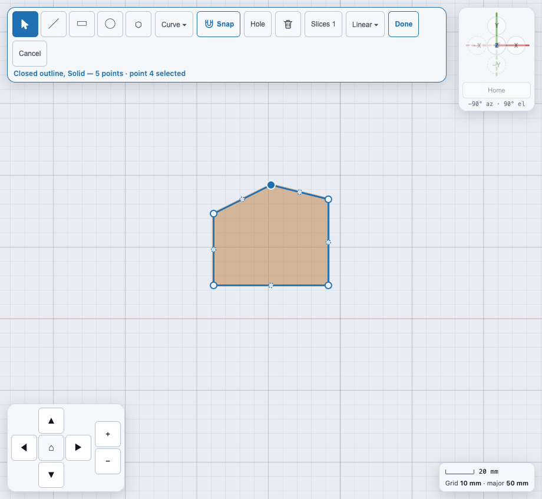

**Example.** Draw a rectangle with **Rectangle**. Tap **Select** and tap the rectangle's
edge, then tap **Convert to outline** in the Inspector: four dots appear on its corners
and a smaller hollow dot in the middle of each edge. Drag the top-right corner's dot up
about 10 mm; the top edge now slopes. Drag the hollow dot in the middle of the top edge
up to add a peak. Tap the bottom-left corner's dot (it fills in, and the line under the
toolbar reads *point 1 selected*) and tap **Delete vertex**; the outline becomes a
four-sided shape again. With **Extrude ▾** set to Linear, the translucent preview follows
each change.

## Slices

A sketch can have more than one **slice**: a set of outlines at its own height above the
sketch's origin. One slice is the usual case. Several slices are what **Loft** skins a
solid through, like the ribs of a wing.

Tap **Slices** in the toolbar. On a phone and tablet it opens as a panel at the bottom
of the view. On a computer it's a small card at the bottom right. Each row is one slice:

- tap a slice's name to make it the **active** slice. New outlines go onto it, and the
  view turns to look straight at it. The other slices stay visible, drawn faint;
- type its **Z** height (in mm) and press Enter;
- **＋ Slice** adds a new slice 50 mm above the highest one and makes it active;
- **Delete slice** removes the active slice and everything drawn on it. The last slice
  can't be deleted.

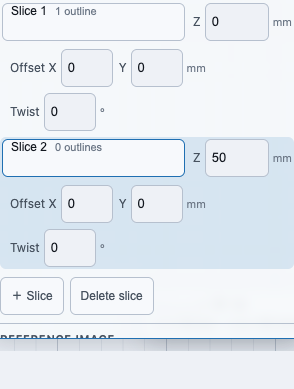

Under the rows, the **Reference image** group puts a photo on the active slice to trace
over, and sets its real scale from a ruler in the photo. See
[Tracing a photo](sketch-tracing.md).

## Curves and airfoils

Tap **Curve ▾** in the sketch toolbar to get a smooth outline from a formula instead of
clicking hundreds of points. A small sheet opens (a bottom sheet on a phone) with three
choices:

- **Airfoil (NACA 4-digit)**: a wing section. Enter the four-digit **Code** (for example
  `2412`), the **Chord** in mm (leading edge to trailing edge) and the number of **Points**.
  The trailing edge is closed with a tiny flat so the solid is watertight.
- **Ellipse**: **Width** and **Height** in mm, and the number of **Points**.
- **Spline through points**: select a closed outline first. **Smooth selected outline**
  rounds it into a smooth closed curve through its points. It stays greyed out, with the
  reason underneath, until exactly one closed outline is selected.

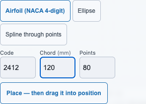

For an airfoil or an ellipse, tap **Place — then drag it into position**, then drag in the
view. A preview follows your pointer and the outline lands when you let go. The line under
the toolbar reads **Airfoil NACA 2412 · 120 mm chord**. An airfoil's leading edge sits at the
spot you release on, and its chord runs along the sketch's X axis.

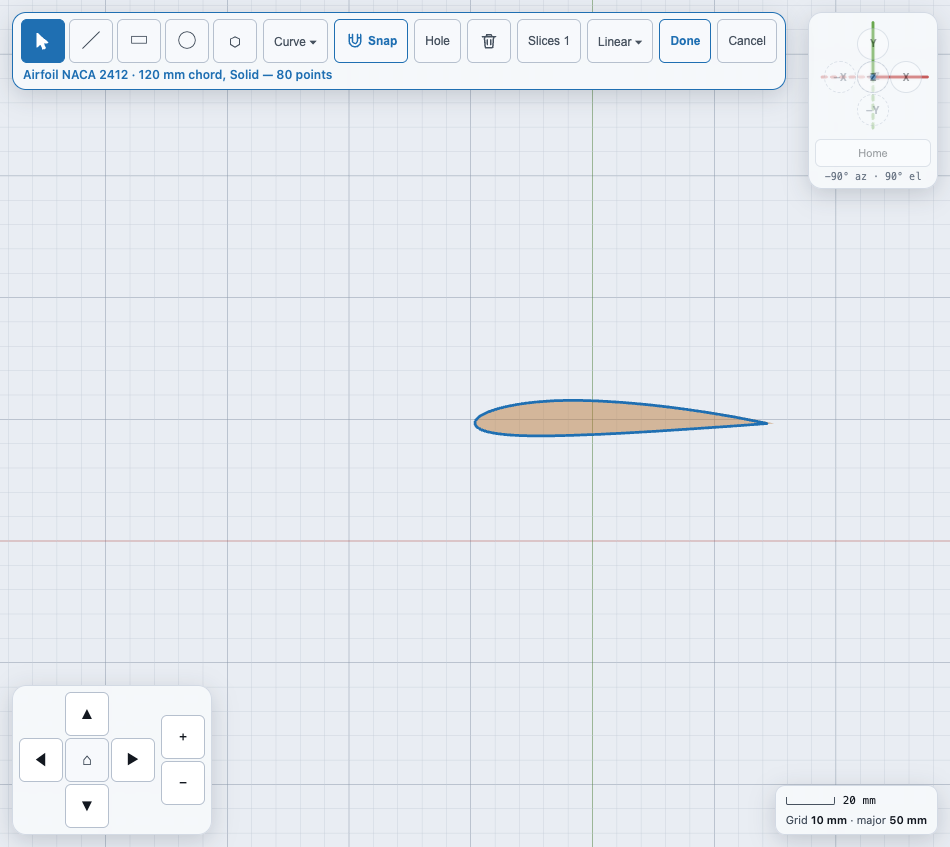

A bad number is refused in the sheet, and the message names the field (for example
`chordMm`). Nothing is armed until it is fixed.

### Editing a curve

Select the outline with **Select**. The Inspector shows its numbers (code and chord, or width
and height). Type a new value and press Enter, and the outline is regenerated in place. A curve's
points are not dragged one at a time. If you want that, tap **Convert to outline** in the
Inspector. The points become an ordinary outline you can edit (see
**Editing an outline's points**), and the curve's numbers are
dropped.

## Tapered and twisted lofts

Each slice row in the **Slices** card has an **Offset X**, **Offset Y** (mm) and **Twist** (°)
field under its **Z**. The slice's outlines are moved by the offset and turned by the twist
before the Loft skins through them, so a wing tip can be swept back and washed out without
redrawing it. Twist turns the outline about the slice's origin, which for an airfoil placed
on the origin is its leading edge. A positive twist turns counter-clockwise as seen from
above the sketch.

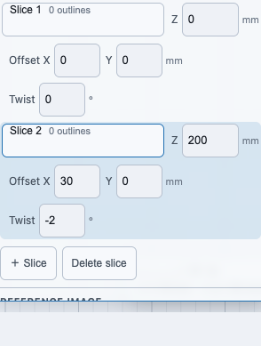

Step by step, a tapered and washed-out wing panel:

1. Drag **Sketch** into the view. Tap **Curve ▾**, leave **Airfoil (NACA 4-digit)** chosen,
   enter Code `2412` and Chord `120`, tap **Place**, and drag the airfoil onto the origin.
2. Tap **Slices**, then **＋ Slice**. Set its **Z** to `200`, **Offset X** to `30` and
   **Twist** to `-2`, pressing Enter after each.
3. With the new slice active, tap **Curve ▾** again and place a `2412` airfoil with Chord
   `70` on the origin.
4. Tap **Extrude ▾**, choose **Loft**, and tap **Done**.

You now have a 200 mm tall, tapered wing panel whose tip is swept back 30 mm and twisted
2 degrees. The sketch's Z axis is the span, so turn the finished solid with the gizmo to lay
it flat. Export it from **File ▾ → Export…** as usual.

The assistant can do the same: its `create` tool takes a `curve` outline (an airfoil or an
ellipse) in place of a list of points.

## Extrusion methods

Tap **Extrude ▾** (it shows the current method's name) to choose how the outlines become
a solid, and to set that method's numbers. A see-through preview of the result appears
behind your outlines and updates as you change things.

| Method | What it makes | Its numbers |
|---|---|---|
| **Linear** | Straight up, like a cookie cutter | Height (mm), Twist (°), Twist steps |
| **Revolve** | Spun around the sketch's Y axis, like a lathe: a ring, a bowl, a knob | Angle (°), Start angle (°), Segments |
| **Helical** | Spun and lifted at the same time: a spring or a coil | Pitch (mm per turn), Turns, End offset (mm), Segments per turn |
| **Outline** | Each closed outline becomes a wall of the given thickness, making a hollow shell. Solid and Hole are ignored. | Wall (mm), Height (mm) |
| **Loft** | One solid skinned through every slice in height order | Points per slice (0 = automatic) |

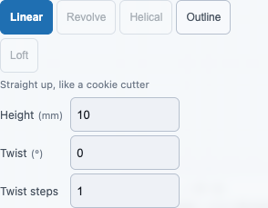

A method you can't use right now is greyed out, and its reason shows when you point at it:

- **Loft** needs two or more slices. Each slice needs exactly one Solid outline and no
  Holes. Cut holes afterwards with **Subtract**.
- Every other method uses exactly **one** slice. Remove the others, or pick Loft.
- **Revolve** and **Helical** spin around the dashed line (the sketch's Y axis), so every
  outline must stay to the right of it.

## Done, and why it is sometimes greyed out

**Done** builds the solid and closes the editor. The new shape becomes the selection,
with the gizmo and Inspector, like a freshly dropped Cube. **Done** stays greyed out, with
the reason written under the toolbar, whenever the drawing can't become a solid yet. For
example: no closed Solid outline, an outline that crosses itself, holes that cover every
solid, or a method that doesn't suit the slices. The model never holds a sketch that
can't be built.

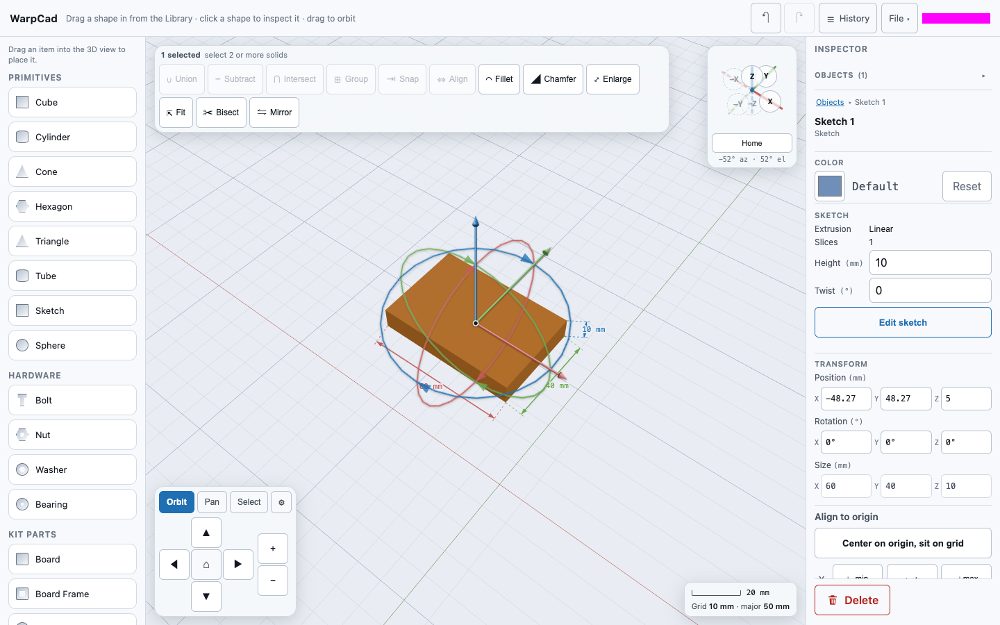

## Editing a finished sketch

Select the sketch shape. The Inspector's **Sketch** section shows its extrusion method,
how many slices it has, and that method's numbers. Type a new Height (for example) and
press Enter to change it right there. Tap **Edit sketch** to reopen the outlines. The
view turns square-on to the sketch's plane, even if you have moved or turned the shape
since. Make your changes, then:

- **Done** applies them as **one** step. Undo takes the whole edit back at once. Anything
  you did to the shape afterwards, like a move, a turn or a fillet, is kept and re-applied
  to the new outline;
- **Cancel** leaves the shape exactly as it was.

## Worked example: a block

Drag **Sketch** into the view and release. Click the **Line** tool. Drag along each side
of a rectangle, starting each drag where the last one ended, and finish the fourth drag on
the first corner: the outline turns blue and the tan preview appears. Tap **Extrude ▾**, choose **Linear**
and type 10 in Height (millimetres), then press Enter. A see-through block appears behind
the outline. Tap **Done**: it is now a solid 10 mm tall, selected and ready to move or
combine.

## Worked example: a tube

Open the Library and drag **Sketch** from Primitives into the viewport, then release.
The view turns to look straight down at a flat grid and the Sketch toolbar appears. Pick
**Circle**, press at the grid's centre and drag out to 20 mm. Draw a second circle from
the same centre out to 15 mm, holding **Shift** (or with **Snap** off): its rim is only 5 mm
inside the first one, close enough at the editor's starting zoom that it would otherwise snap
onto the first circle. Tap the smaller circle, then tap **Hole**: its outline turns
dashed. Open **Extrude ▾**, choose **Linear** and type 30 in Height (millimetres). A
see-through preview of a tube appears. Tap **Done**. You now have a 30 mm tall tube with
a 30 mm bore, which you can move with the gizmo or subtract from another solid.

To hit 20 mm and 15 mm exactly, select each circle afterwards and type the radius into
the Inspector.

## Worked example: a lofted wing

With a sketch open, tap **＋ Slice** twice and set the new slices' Z offsets to 100 and
200 mm. On each slice, draw one closed outline with **Line**, finishing on the first point
to close it. Open **Extrude ▾** and choose **Loft**. Tap **Done**, and the solid is skinned
through all three outlines in order.

Step by step:

1. Drag **Sketch** into the view. On slice 1, draw the root rib. With **Line**, drag from
   point to point around the shape, starting each drag where the last one ended, and
   finish the last drag on the first point. The outline turns from amber to blue when it
   closes.
2. Tap **Slices**, then **＋ Slice**. Type **100** into the new row's **Z** and press Enter.
   The view moves up to that slice, with the first rib shown faintly below.
3. Draw the middle rib the same way. Tap **＋ Slice**, type **200**, and draw the tip rib.
4. Tap **Extrude ▾** and choose **Loft**. **Linear** is greyed out now, because it uses
   one slice. Tap **Done**.

## Older projects with sketch lines

Before sketch primitives, WarpCad had a **Sketch** button in the navigation pad that drew
loose lines. Those lines are gone. If you open a project, or reload a session, that still
contains them, everything else loads normally. Each old line is skipped, and the status
in the top bar says so, for example **Opened plan.ndjson, but skipped 2 steps (sketch-1,
sketch-2): sketch lines are no longer supported — redraw them in a Sketch primitive**.
They are not converted, because a loose line has no Solid/Hole role and no height, so
there is nothing correct to turn it into.

## Not available yet

Coming in later updates: automatic tracing of a photographed part (loading the photo and
setting its scale are already here — see [Tracing a photo](sketch-tracing.md)); and
alignment guides (lining a point up with another outline's corner without touching it).

<!-- SPDX-License-Identifier: CC-BY-SA-4.0 -->
