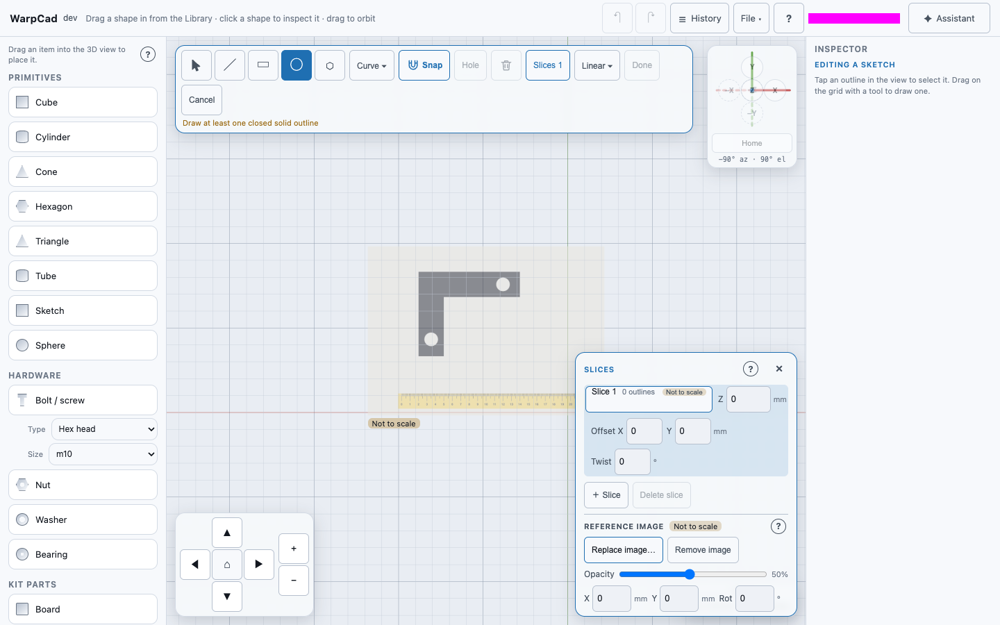
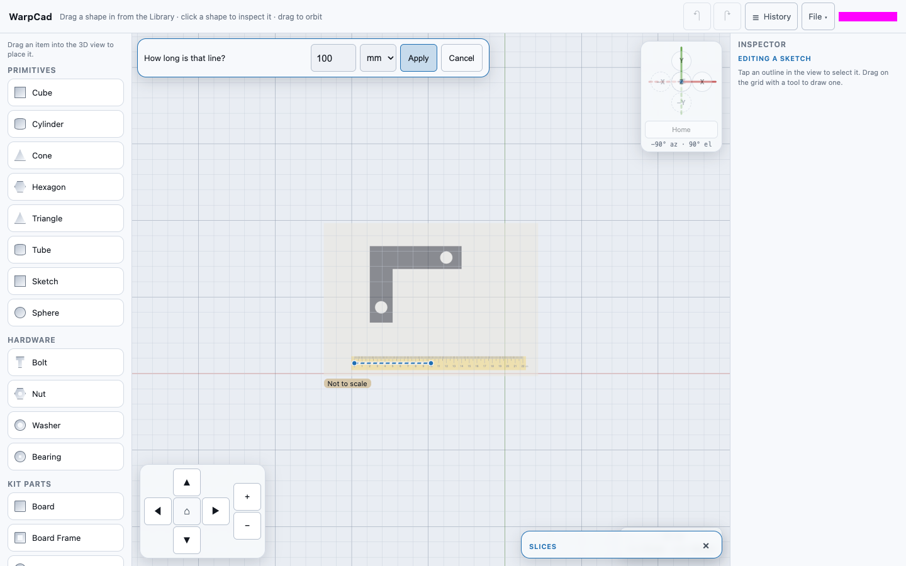
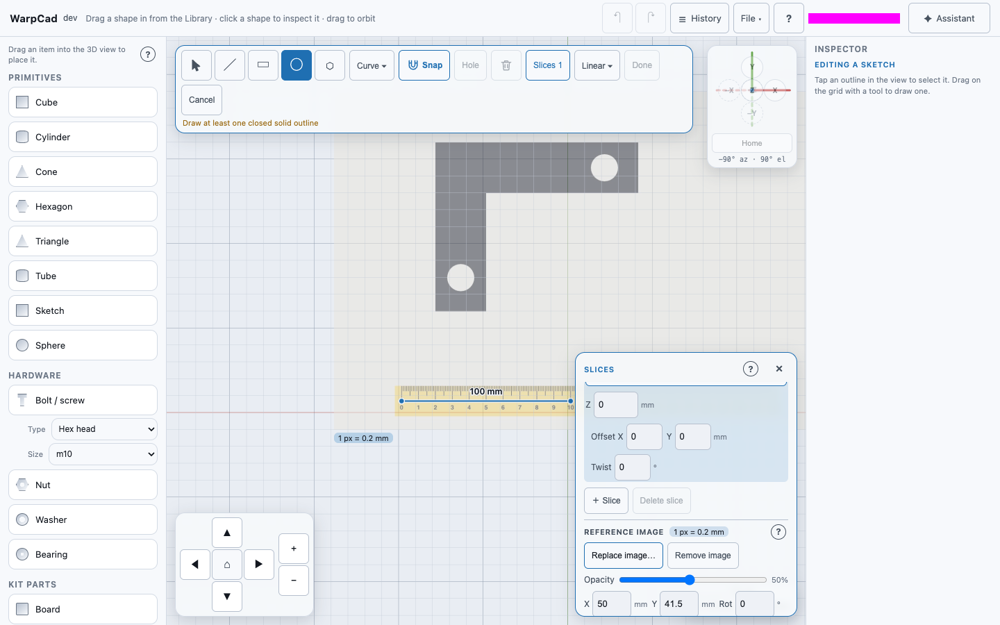
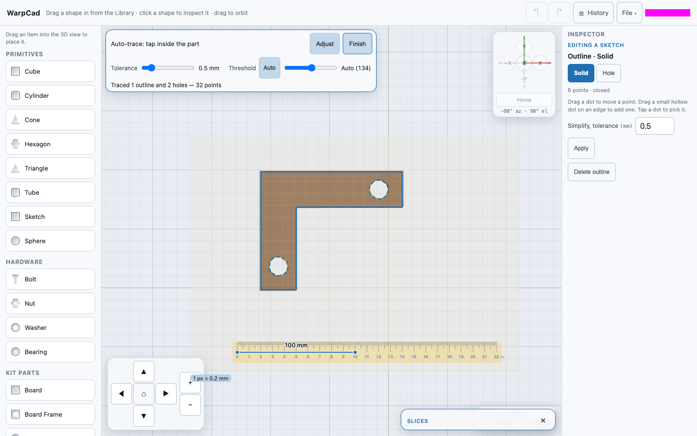

# Tracing a photo

You can put a photo under a sketch and draw over it. The usual case: a part broke and
you want to print a replacement. Photograph it next to a ruler, load the photo onto a
sketch's slice, tell WarpCad how long a stretch of the ruler is, and let **Auto-trace**
find the part's outline at its real size. Then tidy the outline and extrude it.

This page covers taking a usable photo, loading it, setting its scale, auto-tracing,
and what happens to the photo when you share the project. Drawing and editing outlines
by hand is on [Sketch primitives](sketch-mode.md).

## Taking a usable photo

- Lay the part **flat** on a plain surface that contrasts with it (a dark part on a light
  table, or the other way round).
- Put a **ruler** right beside it, flat on the same surface.
- Photograph from **straight above**, with the part and the ruler filling most of the
  frame. Avoid shadows across the edges you want to trace.

WarpCad takes **PNG, JPEG and WebP** images. An iPhone normally hands a JPEG to the
browser. If it offers a HEIC file instead, WarpCad says *Choose a JPEG or PNG — iPhone
HEIC photos can be exported as JPEG*. Export the photo as a JPEG first, or in iOS
Settings → Camera → Formats choose **Most Compatible**. Images larger than 40 megapixels,
or over 8192 pixels on a side, are refused. Save a smaller copy and load that instead.

## Loading the photo

1. Drag **Sketch** from the Library into the view. The sketch editor opens.
2. Tap **Slices** in the Sketch toolbar. The photo belongs to the **active slice**, so
   each slice (each rib of a wing, say) can have its own.
3. Under **Reference image**, tap **Add image…** and choose the photo. On a phone you can
   take a new photo with the camera or pick one from your library.

The photo appears on the slice, centred on the sketch's origin, under the grid lines,
at half opacity. Until you set its scale it shows a **Not to scale** badge, both in the
Slices panel and under the photo's bottom-left corner. Its starting size is a guess:
one pixel of the photo is 0.1 mm.

The **Reference image** group then offers:

- **Replace image…**: choose a different photo for this slice. It keeps the opacity but
  not the scale, because a new photo needs a new measurement.
- **Opacity**: from faint to solid. Fainter makes your outlines easier to see.
- **X** and **Y** (mm) and **Rot** (degrees): move and turn the photo to line it up with
  the sketch's axes. X and Y are where the photo's centre sits on the slice.
- **Set scale**: see below.
- **Auto-trace**: see [Auto-trace](#auto-trace) below.
- **Remove image**: takes the photo off the slice. Your outlines stay.

The photo is a tracing aid, not part of the shape. It is only shown while the sketch
editor is open. It never appears in the 3D view, in an export or in a boolean. Tapping
it does nothing: a drag that starts on the photo draws, exactly as on an empty grid.

## Setting the scale from the ruler

1. Tap **Set scale**. The Sketch toolbar gives way to a banner with the instruction and a
   **Cancel** button. The Slices panel folds down to its title (on a phone and tablet it
   steps aside completely) so the photo is free to tap. It comes back when you are done.
2. Press on one mark of the ruler in the photo and drag to another, then let go. Or tap
   one mark, then the other. No modifier key is needed, and two fingers still pan and
   zoom while you look for the marks.
3. Type the real length between the two marks, pick its unit (**mm**, **cm** or
   **in**), and tap **Apply**.

The photo resizes to its real scale **about the first mark**, so the ruler stays where
you were looking. The line stays drawn, labelled with the length as you typed it
("100 mm"). The badge now reads the photo's real scale, for example *1 px = 0.2 mm*.

If the slice already has outlines when you apply a scale, WarpCad asks: *Rescale the N
outlines on this slice to match the image?* **Yes** (the default) resizes them with the
photo, about the same point, for when you traced first and measured second. **No**
leaves them as they are.

Press **Esc**, or tap **Cancel** in the banner, to stop without changing anything. To
measure again, tap **Set scale** again. Everything here is part of the sketch you are
editing: **Cancel** in the Sketch toolbar throws it all away, and **Done** keeps the
photo and its scale with the sketch, as one step that **Undo** takes back in one go.

## Auto-trace

Auto-trace finds the outline of the part you tap, with any holes in it, and adds it to
the slice. Set the scale first so the outline comes out at the part's real size.

1. In the Slices panel, under **Reference image**, tap **Auto-trace**. The Sketch toolbar
   gives way to a banner reading *Auto-trace: tap inside the part*. As with Set scale,
   the Slices panel gets out of the way.
2. Tap (or click) anywhere **inside the part** in the photo. A small spinner shows while
   WarpCad works. It takes a moment on a large photo, and the app stays responsive.
3. The part's outline appears as a **Solid** outline. Each hole inside it (a bolt hole
   in a bracket, say) becomes a dashed **Hole** outline. The banner says what it made,
   for example *Traced 1 outline and 2 holes — 32 points*.
4. Tap **Finish** (or press **Esc**). The **Select** tool comes back with the traced
   outline picked and its points showing, ready to clean up.

Auto-trace only follows the region you tapped, so the ruler, shadows and the table's
texture stay out of the outline. You can tap a second part to trace that too. If a tap
can't be traced, nothing is added and the banner says why:

- *That region runs off the edge of the photo — tap inside the part*: you tapped the
  table, or the part runs off the edge of the photo. Retake the photo with a margin all
  round the part.
- *Tap on the photo, inside the part*: you tapped beside the photo.
- *That spot is too small to trace — tap inside the part*: you tapped a speck.

If the photo **hasn't been scaled** yet, the banner says *Not to scale yet*. You can
still trace: the outline uses the photo's provisional 1 px = 0.1 mm. Set the scale
afterwards and answer **Yes** when WarpCad asks to rescale the outlines.

**Adjust** shows two sliders. On a phone they are folded away until you tap it. Moving
either slider traces the last tap again and replaces its outlines.

- **Tolerance** (mm, 0.5 to start): how closely the outline follows the photo's pixels.
  Lower keeps more detail and more points. Higher gives fewer, straighter points that are
  quicker to edit.
- **Threshold**: where the line between "part" and "background" falls, from dark to
  light. **Auto** picks it from the photo, which suits a part that contrasts with the
  table. If the outline leaks into a shadow, or misses a pale edge, turn **Auto** off and
  move the slider.

To clean up the result, use the point editing on the Sketch primitives page. Drag a
stray point back onto the edge. Tap a point that shouldn't be there and tap
**Delete vertex**. Drag a segment's small midpoint dot to add a point where a corner was
cut off. **Simplify** in the Inspector thins a busy outline. Everything Auto-trace adds
is part of the sketch you are editing, so **Cancel** throws it away with the rest.

## Example: a replacement part from a photo

Put the broken part flat on a table with a ruler beside it. Photograph it from straight
above, filling the frame. Drag **Sketch** into the view. In the Slices panel tap
**Add image…** and choose the photo. It appears under the grid with a *Not to scale*
badge. Tap **Set scale**, press on the ruler's 0 mark and drag to its 5-inch mark, type
**5**, pick **in**, then tap **Apply**. The badge now reads the image's real scale. Tap
**Auto-trace**, then tap anywhere inside the part. An outline appears around it, with any
bolt holes as dashed Hole outlines. Tap **Finish**. Drag stray points back onto the
edge. Tap one that shouldn't be there and tap **Delete vertex**. Drag a segment's
midpoint dot to add a point where a corner was cut off. Open **Extrude ▾**, choose
**Linear**, enter the part's thickness in **Height**, then tap **Done**.

## Getting an accurate result

The scale is uniform: one number for the whole photo. That makes a few limits worth
knowing.

- **Shoot straight down.** A photo taken at an angle is stretched more in one direction
  than the other, and no scale setting can fix that.
- **Keep the ruler level with the surface you trace.** With a thick part, its top outline
  is closer to the lens and looks bigger than its bottom. Trace the outline that sits at
  the ruler's height.
- **Measure along the longest stretch of ruler you can.** A pixel of error at each end
  matters less over 20 cm than over 2 cm.
- **Check it.** After setting the scale, draw a circle over a hole you can measure and
  compare its size in the Inspector with your calipers.
- **Give Auto-trace contrast.** A dark part on a light table (or the reverse) traces
  cleanly. A shadow touching the part's edge gets traced as part of it, so light the part
  evenly, or move **Threshold** by hand.

## What happens to the photo when you share the project

The photo is **saved inside the project file**, so it travels with it: anyone who opens
the project sees the same photo on the same slice at the same scale.

When you add a photo, WarpCad makes a fresh copy of it from its pixels alone. It is
re-saved as a JPEG (or a PNG if it has see-through areas), at most 2048 pixels on its
long side. Everything else the original file carried is left behind, including the
**location** your phone recorded, the camera details and any comments. The original
photo on your device is not changed.

A project from someone else is treated with care. A photo in it is only ever used if it
is plainly a PNG, JPEG or WebP image of a sensible size, stored in the project itself.
One that is anything else (for example a link to an image elsewhere on the internet, or
an SVG drawing) is **removed when the project opens**. WarpCad says so in the status
next to the File menu, the sketch still loads, and its row in the Slices panel reads
*Reference image removed — it couldn't be verified as a safe image*. Tap **Remove image**
there to clear the note. Opening a project never fetches anything from another website.

<!-- SPDX-License-Identifier: CC-BY-SA-4.0 -->
