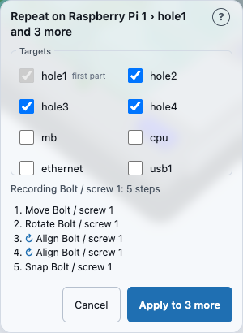
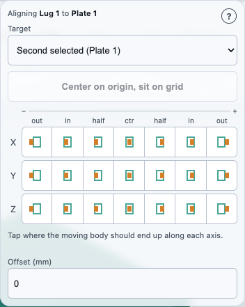
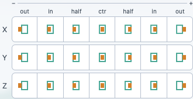

# Precise placement: Align

**Align** puts a shape at an exact position: against another shape that is already
sitting in the scene (flush against a side, flush inside it, or centred), or on the
grid's origin. It is one button on the **Operations toolbar**, **⇔ Align**, next to
[Union, Subtract and Intersect](booleans.md) and [Group](groups.md).

Align is fundamentally different from the toolbar's combining buttons: Union, Subtract,
Intersect and Group all take two or more shapes and produce **one** result, retiring the
originals. Align moves one shape, leaves the other exactly where it was, and **both remain
separate, independently selectable shapes afterward.**

It is the precise, computed counterpart to
[drag-time snap guides](primitive-placement.md): those only ever run while you are
dropping a **new** shape in from the Library, guiding it into place as you drag. Align
works on shapes that are **already** in the scene, any time afterward, no drag required.

## You need 1 or 2 shapes selected

The **⇔ Align** button stays dimmed, with the hint *Select 1 or 2 solids*, unless exactly
one or exactly two shapes are selected. Zero, or three or more, disables it.

- **One shape:** it can only be aligned to the **World origin**.
- **Two shapes:** it can be aligned to the **second selected** shape (the default) or to the
  **World origin**.

To select exactly two shapes: click the first, then hold **Shift** and click the second. On
a touch screen, switch the navigation controls (bottom-left) to **Select** and drag a box
around exactly the two shapes you want.

## Which shape moves: the first one you picked

The shape you select **first** is the one that moves. The shape you select **second** never
moves: it is the **target**. This is the same first-picked/second-picked distinction
[Subtract](booleans.md#which-shape-gets-cut-the-first-one-you-picked) already uses, painted
onto the shapes in the scene the same way (amber for the first pick, teal for the second)
before you open the popover. With the **Target** set to World origin on a two-shape
selection, only the first-picked shape is involved, so the second loses its teal colour.

## One tap, one step

Every button in the popover **does its move the moment you tap it**: there is no Apply
step, and the popover stays open so you can tap X, then Y, then Z without reopening it.
Each tap is one step in the timeline, so **Undo** takes back one tap. A tap that would not
move anything against the World origin (the shape is already exactly there) does nothing
at all and does not add an empty step. Press **Escape**, or tap outside the popover, to
close it.

Units are **millimetres**, Z points **up**, and **−** is always the side with the
**smaller** coordinate (the underside on Z, the left face on X).

## A quick example: a lug against a plate

Select a plate and a lug (the lug first) and press **⇔ Align**. The popover's top line
reads `Aligning Lug 1 to Plate 1`. In the **X** row, tap **outside +** (the last button).
The lug slides against the plate's +X side and stops flush with it, without
merging: the plate has not moved, and both are still two separate shapes you can select on
their own.

To put the lug against the plate's *−X* side instead, tap **X outside −** (the first
button). Each button is named for **where the moving shape ends up**: *outside −* leaves
it beyond the target's −X side, *outside +* beyond its +X side. Hover or tap a button and
the line under the grid spells it out in a full sentence. See
[the popover's fields](#the-popovers-fields).

## A worked example: centring a cube on a cylinder

1. Drag a **Cube** and a **Cylinder** into the 3D view so they don't overlap.
2. Click the Cube, then hold **Shift** and click the Cylinder. The Cube is now the one that
   moves; the toolbar's badge reads `2 selected` and **⇔ Align** lights up.
3. Click **⇔ Align**. The popover opens with **Target** set to `Second selected (Cylinder 1)`.
4. Tap **Z center** (the middle button of the **Z** row).
5. The Cube moves to sit centred on the Cylinder along Z, while its X and Y position stay
   exactly as they were (only the tapped axis moves). The popover is still open: tap
   **X center** as well and the Cube is centred along X too.

Now stand the Cube on the Cylinder: tap **Z outside +**, and the Cube's bottom face lands
on the Cylinder's top face. Tap **Z half +** instead and the bottom face sits at the
Cylinder's mid-height; tap **Z inside +** and the Cube's top lines up with the Cylinder's
top. Switch **Target** to `World origin` and tap **Z outside +** to sit the Cube on the grid.

Both solids remain separately selectable afterward. Click the Cylinder and it opens its own
Inspector entry exactly as before. Nothing was combined.

## Aligning to the origin

Dragging or typing gets a shape *close* to the grid's origin. Align gets it there exactly,
centred or sitting flush on a face, in one tap, without doing the arithmetic yourself.

With **one** shape selected (or two, with **Target** switched to **World origin**), the
popover offers:

- **Measure from**, only shown when the shape has more than one named part (a Raspberry Pi,
  a Bolt). It defaults to **Whole object**, the shape's own outer box, and offers one entry
  per part the shape actually draws. A part that only exists to be subtracted (a bolt's
  `tap`, a washer's `clearance`) is never listed: measuring "flush on the grid" from an
  invisible clearance hole would not mean what you mean by it. The choice is remembered per
  shape for as long as the page stays open, and stepping into one of the shape's own parts
  (see [Parts](selection-and-inspector.md#parts)) sets it to that part.
- **Center on origin, sit on grid**, a full-width shortcut. It does the most common
  combination, X centre, Y centre, Z min, in one tap and one timeline step.
- The [seven-position grid](#the-popovers-fields), one row per axis. A point has no size, so
  against the origin the seven buttons give three different results. **outside −**,
  **half −** and **inside +** put the shape's larger-coordinate face on 0; **inside −**,
  **half +** and **outside +** put its smaller-coordinate face on 0 (so **outside +** on Z
  sits it on the grid); **center** centres it on 0.

Aligning several shapes at once, as one combined unit, is not supported: select one shape,
or [group](groups.md) them first and align the group.

### Example: seat a Raspberry Pi on the grid

1. Drag a **Raspberry Pi** from the Library and drop it anywhere.
2. Click it, then press **⇔ Align** on the Operations toolbar. The popover's top line reads
   `Aligning Raspberry Pi 1 to World origin`.
3. Set **Measure from** to `mb` (the board itself; every part of the Pi keeps the short name
   its own recipe gave it, the same names the Inspector's Parts list shows).
4. Tap **X center**, then **Y center**, then **Z outside +** (it sits the board on the grid).

The board's footprint is now centred on the origin in X and Y and its underside sits exactly
on Z = 0. **Position Z** in the Inspector will not read `0`: it reads the whole Pi's own box
centre, and the micro-SD card hangs about 1.5 mm below the board. Press **Undo** three
times to put the Pi back, or, with **Measure from** already on `mb`, tap **Center on
origin, sit on grid** once instead: it does all three in a single step.

Now Shift-click a **Cube** so two shapes are selected, switch **Target** to
`Second selected (Cube 1)` and tap **X outside +**.
The Pi rests against the cube's +X face, measured by `mb`. Switch **Target** back to
**World origin** to go back to the grid.

> The origin is a one-shot, baked placement: dragging the shape afterwards simply moves it
> from there. Aligning to a **second shape** is different, because that move is *live*,
> see [When the part you snapped to goes away](#when-the-part-you-snapped-to-goes-away).

## A second example: positioning against one named part

A [group](groups.md) — and every composite item from the Library's Hardware,
Kit and Raspberry Pi sections, such as a **Raspberry Pi 5** board or a **Bolt / screw** —
is made of *named parts*. Align can work against one of those parts
specifically, instead of against the whole item's overall bounding box. That is
how you position something against a **particular mounting hole** on a board,
rather than against the middle of the board.

To do it, [drill into the part](selection-and-inspector.md) first:

1. From the Library's "Raspberry Pi" section, pick **Pi 5** in the **Raspberry
   Pi** row's Model dropdown and drag the row into the 3D view. Drag a **Cube**
   in as well, as the thing you want to position.
2. **Click the board once.** The whole board is selected — the Inspector shows
   its overall size (about 85 × 56 mm).
3. **Click again, on the part you care about** — say the Ethernet jack at the
   board's end. The selection narrows to that named part, and the Inspector
   grows a breadcrumb reading `Raspberry Pi 1 › ethernet`. (Each part carries
   the name the board's recipe gives it: `mb` for the PCB itself, `ethernet`,
   `usb1`, `usb2`, `gpio`, and so on.)
4. Hold **Shift** and click the Cube. Two things are now selected, and the board
   is still drilled into that one part.
5. Click **⇔ Align**. The popover's top line names exactly what it is about to do:
   **Aligning Raspberry Pi 1 › ethernet to Cube 1**. That `›` is the
   confirmation you drilled to the depth you meant. (**Measure from** is hidden: the
   part you drilled into is what is measured.)
6. Tap **X center** and **Y center**.

The picture above does the same with a **mounting hole**: the screw is the moving shape,
and the board's `hole1` part is the reference. A hole passes through the board and can't be
clicked in the 3D view, so the second operand is ticked in the Inspector's
[Objects list](selection-and-inspector.md#picking-one-piece-of-a-hidden-shape) instead.
The popover's top line reads `Aligning Screw 1 to Raspberry Pi 1 › hole1`, and afterwards
the screw's axis lies on the hole's axis.

The board moves so that **the Ethernet jack** — not the board's centre — lines
up with the Cube. The rest of the board comes along with it: addressing a part
changes what gets *measured*, never what gets *moved*. A bolt snapped by its
head brings its thread and tap with it.

**You can only drill into a part you can click** — in the 3D view. A part that sits
*inside* another one — a Raspberry Pi's mounting holes, for instance, which pass through
the board — is hidden behind the part in front of it, so clicking never reaches it. Tick it
in the Inspector's [Objects list](selection-and-inspector.md#picking-one-piece-of-a-hidden-shape)
instead, or orbit the view (bottom-left navigation controls) until the part you want is the
one facing you.

**You can address a part on both sides.** The moving item and the reference item each
keep their own part, so *this hole on the board* against *that post on the screen* is one
Align. Either side can also be whole: a whole screen positioned against one hole
on a board is just as ordinary. Whichever side carries a `›` in the popover's top line is
measured by that part; a side with no `›` is measured whole. The app never quietly drops a
part you addressed: if it can't use one, the popover says so in red and nothing moves.

### Mounting a Raspberry Pi on a screen's posts

This is the both-sides case: a hole on the board against a post on the screen, then the
board itself against the top of the post. Units are millimetres, with Z pointing up.

1. From the Library's "Raspberry Pi" section, set the **Raspberry Pi** row's Model to
   **Pi 5** and drag it into the 3D view. Drag a **Touchscreen 2** in as well.
2. Click the Pi, then open the Inspector's **Objects** list, open the Pi's parts (the
   chevron on its row) and tap **hole1**. The breadcrumb reads `Raspberry Pi 1 › hole1`.
3. Open the screen's parts and tap the check next to **piMountingPost1**. That adds the
   screen to the selection *at that post*, and the Pi keeps `hole1`: both part rows stay
   ticked, numbered `1` and `2`. (With a keyboard, Shift-clicking the **piMountingPost1**
   row does the same. Shift-clicking the screen's own row would add the *whole* screen.)
4. Press **⇔ Align**. The top line reads
   **Aligning Raspberry Pi 1 › hole1 to Touchscreen 2 1 › piMountingPost1**. Tap **X center**
   and **Y center**. The axis of `hole1` is now on the axis of post 1. The whole
   board moved with it, so the other three holes are on the other three posts too: the
   board's holes are 58 × 49 mm apart, and so are the posts.
5. Now the height. Press **Escape** to close the popover, then in the Objects list tap the
   Pi's **mb** part (the circuit board itself) and tick **piMountingPost1** on the screen
   again. Press **⇔ Align**, tap **Z outside +**. The underside of `mb` now sits on the top of the post,
   with no gap and no overlap.

Use **mb** for the height, not the hole and not the whole Pi. The hole runs from 3.34 mm
below the board to 3.34 mm above it, so snapping the hole would leave the board floating.
The whole Pi's lowest point is the underside of the microSD card, 1.5 mm below the board, so
snapping the whole Pi would leave a 1.5 mm gap above the posts. **outside +** leaves the
moving part on the reference's +Z side, its bottom on the reference's top; **outside −**
would hang the board under the post instead.

**To go back to whole-item addressing**, click the breadcrumb's first segment
(the item's own name) in the Inspector, or click empty space and start the
selection again. The popover's top line always tells you which you are on.

## Repeating a placement on every hole

Some jobs are the same five steps, four times: an M2.5 bolt turned, centred on a hole and
sunk into its post, once per mounting hole. **⟳ Repeat** does the first one with you, then
copies the whole job to the other holes. You make **one** bolt the normal way; the app
places the rest. The repeats stay **linked** to that first bolt (see below).

Units are millimetres, with Z pointing up.

1. Seat a Pi 5 on a Touchscreen 2's posts, as in
   [Mounting a Raspberry Pi on a screen's posts](#mounting-a-raspberry-pi-on-a-screens-posts).
2. In the Inspector's **Objects** list, open the Pi's parts and tap **hole1**. Press
   **⟳ Repeat** in the toolbar, beside **⇔ Align**. The panel reads
   **Repeat on Raspberry Pi 1 › hole1 and 3 more**, with **hole1** to **hole4** ticked
   (**hole1** is the first part and stays ticked). Untick a hole to leave it out; tick another
   part of the Pi to add it.
3. In the Library, set the **Bolt / screw** row to **Type: Socket cap** and **Size: m2.5**,
   and drag it into the 3D view. Drop it clear of the panel, which sits low in the view. In
   the Inspector set **Length** to `12`. A new bolt starts head-down, so type `180` into
   **Rotation X** to turn it head-up. The panel now reads *Recording Bolt / screw 1* and lists
   what you have done.
4. With the bolt selected, tick the Pi's **hole1** in the Objects list (the check next to
   its name) and press **⇔ Align**. The top line reads **Aligning Bolt / screw 1 to
   Raspberry Pi 1 › hole1**. Tap **X center** and **Y center**. The bolt's axis is now on
   the hole's. Press **Escape** to close the popover (the Repeat panel stays open).
5. Tap the bolt's row in the Objects list, then tick the Pi's **mb** (the circuit board) and
   press **⇔ Align** again. Set **Offset** to `-5`, and tap
   **Z inside −**. The bolt's tip now ends 5 mm below the underside of the board, which is
   5 mm inside the post. Press **Escape**.
6. The panel lists five steps: the drop (*Move*), *Rotate*, two *Align* rows marked **↻**, and
   *Snap*. The **↻** ones mention **hole1**, so each repeat aims them at its own hole; the
   others are copied as they are. Press **Apply to 3 more**. Three more bolts appear on
   **hole2**, **hole3** and **hole4**, each turned the same way, centred on its hole and 5 mm into
   its post. A toast reads *Repeated Bolt / screw 1 on 3 more holes*, with **Undo**.
7. Select **Bolt / screw 1** and change its **Length** from `12` to `16`. All four bolts get
   longer.

### How it works

- **Start first.** Press **⟳ Repeat** *before* you make the first part. The panel watches the
  next shape you create and records every step you do to it. A bolt you finished earlier can't
  be the first part: delete it and make it again with the panel open.
- **Where the button is.** **⟳ Repeat** is on only when you have **one shape selected and drilled
  into one named part**, such as a hole, and that shape has other parts. Otherwise it is
  greyed with the reason (*Drill into a part first, such as a hole*, or *This part has no
  others to repeat on*). Pressing it again, or **Cancel**, or **Escape**, ends the session and
  keeps the first part as it is; nothing is undone. If an Align popover is open, **Escape**
  closes that first.
- **Apply to N more** is greyed until the first part exists, at least one step mentions the
  first hole, and at least one other target is ticked. Under the list the panel says why in red:
  for example *Nothing in Bolt / screw 1's steps refers to hole1*. A step you did not make (one
  the Assistant, Claude Code or a merge added to the first part) does not stop Apply. It is listed
  under **Not part of the repeat** with a line saying who made it, and **no copy carries it**: the
  first part keeps it, the copies are built from your steps alone. The example below ("A step you
  did not make") walks through it.
- **On a phone** the panel is a sheet at the bottom that shrinks to one bar (*Repeating on 4 ·
  Bolt / screw 1: 5 steps · Apply*) when you press in the 3D view or open the Library. The bar's
  own **Apply** works without opening the sheet; tap the bar's text to open it again.
- While the panel is open the Library says *Repeating on 4 targets: drag the part you want
  onto hole1*, and the other ticked holes are outlined in the 3D view so you can see where the
  repeats will go.

### Linked, not copied

The repeats are one body in the History, **Bolt / screw 1 ×3**, one row reading
*Repeat → hole2, hole3, hole4*. One **Undo** removes it and leaves Bolt 1.

- **Edit Bolt 1's steps and every repeat follows**: its Parameters (Length, Size, Type),
  an Align or Snap you **Edit** in History, a variable bound to its length.
- **A new move of Bolt 1 moves Bolt 1 only, and so does a new move of the Pi.** Dragging either
  one with the gizmo *after* the Repeat adds a step that comes later in History than the Repeat,
  so the repeats don't see it. The repeat body has no gizmo of its own; the Inspector says
  *Move Bolt / screw 1 or Raspberry Pi 1; the repeats follow them*, which holds for steps made
  **before** the Repeat. To move the whole assembly, **Edit** an earlier step in
  [History](timeline.md). In this example the Pi is aligned to the screen and the bolts to the Pi,
  so editing the screen's **Move** row carries the Pi, Bolt 1 and all three repeats with it.
- Select the repeat and the Inspector shows what it repeats and where. **Go to Bolt / screw 1**
  selects the first bolt, where its steps are edited. **Detach** turns each repeat into its own
  bolt, no longer linked (one Undo puts the link back), for the one screw that needs to be
  different.
- **A step you did not make.** Say you press **⟳ Repeat**, make Bolt / screw 1 as
  usual, and while the panel is open you ask the Assistant to *lift Bolt 1 by 3 mm*.
  1. Look at the panel: under your steps there is now **Not part of the repeat**, and below it
     *Move Bolt / screw 1 …* with the line *From the Assistant, so it is left out of the copies*.
     (Claude Code reads *From Claude Code, …* and a merge reads *From a merge, …*.)
  2. **Apply to 3 more** is still on. Tap it.
  3. Bolt 1 stays 3 mm up. The three copies sit where your own steps put them, 3 mm lower, each on
     its hole. Any step of yours made *after* the Assistant's still counts in the copies.

  A step on a *different* shape is listed there too (*On another body, so it is not copied*).
  Apply goes grey only when leaving the step out leaves nothing to repeat: if the only step that
  points at the hole is the Assistant's, the panel says so (*The only step that points at hole1
  is from the Assistant … Make that step yourself*), and you make that step by hand. Because the
  copies leave the step out for good, **Detach** also gives you copies without it.
- **A shape that was cut can't be repeated.** If the first part's steps include a Subtract (a plate
  drilled with the Pi's `hole1`, say), Repeat refuses with *so a repeat would copy the whole of it
  once per target*, because each copy would be a whole new plate. Drill each hole with its own
  Subtract instead; the Pi stays in the scene for that
  ([Example: drill a Pi's mounting hole](hardware-library.md#example-drill-a-pis-mounting-hole-into-your-own-plate)).
- **Remove one repeat.** Tap the repeat's part (for example **hole3**) in the Objects list and
  press **Remove this repeat**. The other repeats stay.
- **Deleting what a repeat follows asks first.** Delete Bolt 1 or the Pi and the Inspector asks
  *Delete the repeats too, or leave them broken?*: **Delete the repeats**, **Leave broken**
  (the History row stays, labelled `broken`) or **Cancel**.
- If a hole goes away, because you [changed the Pi's model](selection-and-inspector.md#changing-a-parts-model-or-size)
  to one without it, the repair dialog (next section) has a row for that repeat.

## When the part you snapped to goes away

An Align against a second shape's named part is **live**: it is worked out again whenever the
thing it points at changes. So if you
[change the board's model](selection-and-inspector.md#changing-a-parts-model-or-size), a
cube snapped to a Pi 4's Ethernet jack moves to where the Pi 5's Ethernet jack is, with
no questions asked.

If the new model **doesn't have that part at all** — a Pi 5 has no AV jack — nothing is
changed yet. A dialog opens instead: *"This change affects 1 item"*. Each row names the
item (point at it to find it in the 3D view), what it is attached to (`Snap → avjack`),
and why that no longer works (*"Pi 5 has no part named `avjack`"*). Pick a **Fix** for
each row:

| Fix | What happens |
|---|---|
| **Only when Raspberry Pi 1's Model is Pi 4** | Keep the item, but only on a Pi 4. On a Pi 5 it simply isn't there (not broken, not drawn); switch back to a Pi 4 and it returns, still snapped. One design can then hold parts for several board revisions. |
| **Remap to another part…** | Point the snap at a part the new board *does* have. Pre-filled only when the part really was renamed (a Pi 4's `camera` is a Pi 5's `camera0`); otherwise you choose. |
| **Remove this repeat** | For a [Repeat](#repeating-a-placement-on-every-hole) aimed at that part: drop just that one repeat. The others stay. |
| **Detach — keep it where it is** | The item stays exactly where it is now and forgets the link. Offered for the Align tool's snaps and aligns only. |
| **Leave broken** | Make the change anyway and fix it later. |

**Apply** makes the model change and every fix as **one** step — a single **Undo** puts
the old model *and* the original snap back. **Cancel** (or **Escape**) changes nothing and
puts the dropdown back. Apply stays greyed until every row has a fix; the default is
Remap when there is a real rename to suggest, and Leave broken otherwise. **Only when…**
is never picked for you, because it changes what the design means.

On a phone the dialog is a full-height sheet: each Fix dropdown sits full width under its
row, and Apply/Cancel stay pinned to the bottom.

**Leave broken, then Resolve….** An item left broken still shows where it last was, so you
can find it. The Pi's Inspector says *"1 item refers to parts this Pi 5 doesn't have."*,
the item's own Inspector says *"Snapped to Raspberry Pi 1 ▸ avjack, which no longer
exists."*, and its History row carries the `broken` label. Both banners have a
**Resolve…** button that reopens the same dialog, where you can Remap, Detach or make it
conditional now.

### Worked example: detach a cube from a jack that went away

1. Drag a Raspberry Pi into the viewport and choose **Pi 4** in the Library before
   dropping it. Drop a Cube next to it.
2. Select the Cube, then Shift-click the Pi's AV jack (or, in the Inspector's object list,
   tick the Cube and then tick `avjack` under the Pi's ▸) so both are selected, and use
   **⇔ Align**'s Snap buttons to sit the cube against the jack.
3. Now select the whole Pi and change **Model** to **Pi 5**. A dialog explains that the
   Pi 5 has no AV jack.
4. For the Cube's row choose **Detach** and press **Apply**. The Pi becomes a Pi 5 and the
   cube stays exactly where it was.
5. Press **Undo** once and you're back to a Pi 4 with the cube snapped to its jack.

### Worked example: keep a part for one board revision only

Do the same again, but in step 4 choose **Only when Raspberry Pi 1's Model is Pi 4** for
the Cube and press **Apply**. The Cube disappears, and its History rows show
`if Raspberry Pi 1 = Pi 4`. Change the Model back to **Pi 4** and the Cube reappears,
still snapped to the AV jack. Use this to keep parts for several board revisions in one
design.

## The popover's fields

Top to bottom:

- **What's being aligned**: the top line, naming the moving item first and the target
  second, each with its `›` part name if you drilled into it. Read this before tapping: a
  part-addressed move and a whole-item move look identical once they have happened, and
  this line is the only place the difference is visible beforehand.
- **Target**: `Second selected (<name>)` or `World origin`. Only shown when two shapes are
  selected; with one, the target is always the origin.
- **Measure from**: which part of the moving shape is measured, or **Whole object**. Hidden
  for a plain solid, and hidden when you have already drilled into a part.
- **Center on origin, sit on grid**: enabled only when **Target** is **World origin**. One
  tap, one step. It is the same as tapping **X center**, **Y center** and **Z outside +**.
- **The position grid**: one row per axis, X, Y and Z, each with seven buttons that read
  from **−** on the left to **+** on the right. A thin `− … +` rule and a one-line header
  (*out · in · half · ctr · half · in · out*) sit above the rows, and each button shows a
  small picture: the amber block is the shape that moves, the teal outline is its target.
  Every button names **where the moving shape ends up** along that axis:

  

  | Header | Button | Where the moving shape ends up | Faces that meet |
  |---|---|---|---|
  | **out** | **outside −** | beyond the target's − face | your + face on its − face |
  | **in** | **inside −** | inside, − faces flush | your − face on its − face |
  | **half** | **half −** | over the target's − half | your + face on its centre |
  | **ctr** | **center** | centred on it | your centre on its centre |
  | **half** | **half +** | over the target's + half | your − face on its centre |
  | **in** | **inside +** | inside, + faces flush | your + face on its + face |
  | **out** | **outside +** | beyond the target's + face | your − face on its + face |

  Hover or focus a button, or tap it on a touch screen, and the **caption** under the grid
  reads its full sentence (for example *"Z half +: your − face sits on the target's centre,
  so you cover its + half"*). A tap commits at once. A moving shape bigger than the target
  still works for **inside** and **half**; it simply overhangs. Against a **second
  selected** shape the move follows the target afterwards. Against **World origin** it is a
  one-time move, and the seven buttons give three distinct results because the origin is a
  point (see [Aligning to the origin](#aligning-to-the-origin)).
- **Offset (mm)**: a nudge, applied to the **next** tap against a second shape (not against
  the origin). Defaults to `0`. Change it, then tap.
- **Error line**: if the move can't be made, the reason appears here and nothing moves.

## What happens to the two shapes

Unlike Union, Subtract, Intersect or Group, **neither shape is retired.** The
moving shape's position changes; the reference shape's position is untouched,
to the millimetre. The scene still lists two shapes, and clicking either one
still selects only that one.

## Not yet supported

- **A per-axis offset.** The Offset field is a single millimetre value applied to the tap
  you make next, not a separate value per axis.

## Notes and gotchas

- **Units are millimetres**, Z is up, and **min** is the smaller coordinate.
- **Order matters.** Selecting the same two shapes in the other order swaps which one
  moves, the same as reversing Subtract's operand order gives a different result.
- **There is no Apply or Cancel.** Every tap commits one step; **Undo** is the way back.
- **Projects saved before the single Align tool open unchanged.** The same snap and align
  steps are stored as before, so an old design replays to the same geometry; only the
  buttons that make them have changed.

## See also

- [Combining shapes: Union, Subtract and Intersect](booleans.md) — the same
  toolbar's other buttons, which retire their operands into one new shape.
- [Combining shapes into a group](groups.md) — the toolbar's Group button,
  which also keeps every original shape intact but, unlike Align, merges
  them into one selectable body.
- [Rounding or bevelling an edge: Fillet and Chamfer](fillet-chamfer.md) — the
  toolbar's exactly-one-shape tools, reusing the same popover pattern.
- [Resizing and cutting a shape: Enlarge, Fit and Bisect](resize-bisect.md) —
  another exactly-1-gated trio, for changing one shape's size or cutting it in
  two rather than moving it against a second shape.
- [Placing a shape](primitive-placement.md) — drag-time snap guides, the
  live-alignment mechanism Align's own precise, computed positioning
  is the after-the-fact counterpart to.
- [Selecting a shape, and reading its size](selection-and-inspector.md) — what
  selection does, and reading a shape's new position after a move.

<!-- SPDX-License-Identifier: CC-BY-SA-4.0 -->
