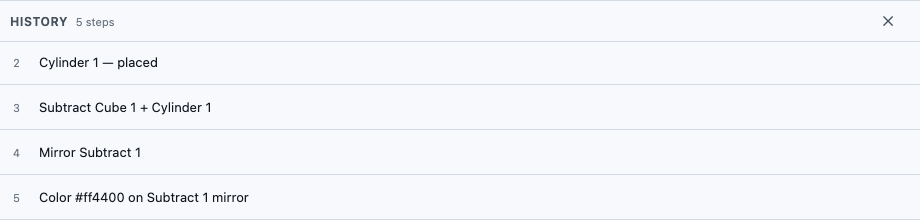
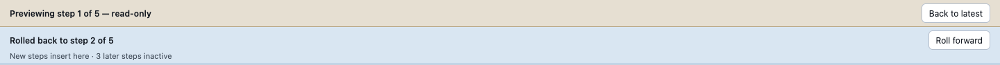

# The History panel: revisiting any step you've taken

On a phone, History is the three-line button in the top bar and opens as a bottom sheet; see [Using WarpCad on a phone or tablet](mobile.md).

Every change you make in WarpCad is kept as a **step** in an ordered list — placing a
shape, moving it, chamfering an edge, combining two shapes. The History panel shows that
list and lets you go back to any point in it: look at what the model was like earlier,
change a step's numbers and have everything after it rebuild automatically, take a step
out without deleting it, reorder steps, or park the model at an earlier point and carry
on building from there.

Nothing in this panel ever deletes anything. The only thing in WarpCad that removes a
step is **Undo**.

## Opening it

Press **History** in the top bar, to the right of Undo and Redo. Press it again (or the
**✕** in the panel's own header) to close it.

- On a **laptop or tablet** the panel appears as a strip along the bottom of the 3D
  view. The Library and Inspector panels stay where they are.
- On a **phone** it slides up as a sheet over the bottom of the screen. While it's open
  the Inspector won't pop up on its own when you select something — tap the Inspector's
  tab if you want it, and History will close to make room.

History starts closed every time you open WarpCad, on every device.




The laptop strip is about four rows tall; when a model has more steps than that, scroll the
list (the picture above is scrolled to the end of a five-step model).

History is not the same list as the Inspector's **object list**, which names the
*shapes* in your model rather than the *steps*: with nothing selected it is the
Inspector's content (on a phone, tap the Inspector's **Objects** tab at the bottom) — see
[The Inspector's object list](selection-and-inspector.md#the-inspectors-object-list).
A step selected here never selects a shape there. On a phone, opening the Library also
closes History, and tapping the Inspector's tab closes it too.

## Reading the list

Each row is one step, numbered from 1, in the order it happened:

```
1  Cube 1 — placed
2  Chamfer Top (+Z) 5 mm on Cube 1
3  Sphere 1 — placed
```

A boolean row names **both** shapes that went into it, so you can tell at a glance what a
Subtract cut from what:


A row can also carry a small label on the right:

| Label | Meaning |
|---|---|
| `suppressed` | the step is switched off — it's still here, but the model is built as if it never happened |
| `inactive` | the step is after the rollback point, so it isn't being built at all right now |
| `broken` | this step can't be built as things currently stand; select the row and the reason is printed under it (on a laptop, hovering the chip shows it too) |
| `via …` | somebody or something other than you added this step |
| `if … = …` | the step only happens while another part has that option, e.g. `if Raspberry Pi 1 = Pi 4` (dashed; see below) |

Tap a row to select it. The buttons for that row appear underneath it — deliberately
only on the selected row, so there aren't five small buttons crowding every line.

**Steps from a merge.** After **File ▾ → Merge file…**, the other copy's steps are rows here
like any other. A row that couldn't survive the merge is `broken` with a reason such as
`conflicts with step 6 (Move Cube 1)`; fix it with its own **Edit** or **Suppress**. See
[Merging two copies of a project](merging.md#what-a-conflict-is).

**Why a step exists.** A row with a small note icon at its right end carries a note saying
why it was made, usually recorded by the AI assistant. Tap the icon to read it; see
[Design intent](design-intent.md).

**Conditional rows.** A row can carry a dashed chip such as `if Raspberry Pi 1 = Pi 4`,
set by the repair dialog's **Only when…** choice. While the condition does not hold, the
row is greyed like a suppressed one but keeps the chip instead of the word "suppressed",
so you can tell "switched off by me" from "only exists on a Pi 4". See
[A part that only exists on one model](selection-and-inspector.md#a-part-that-only-exists-on-one-model).

**Variable rows.** Defining a variable adds a **Define piModel** row, and binding a field
to one is a step of its own (or part of the same step, when you bound it with **New variable
from this value…**). A binding whose variable has since been deleted shows as a *broken* row
that names the variable and the field. See [Variables](variables.md).

## Looking at an earlier point (preview)

Tap any row *except the last one* and the 3D view shows the model **as it was just after
that step**. A strip appears under the top bar reading, for example:

> Previewing step 2 of 3 — read-only

and the 3D view gets an amber outline. While you're previewing, everything that would
change the model is switched off: the Library, the Operations toolbar, the move/rotate
gizmo, and Undo and Redo. This is deliberate — you're looking at the past, and a button
that quietly changed the present instead would be worse than no button at all.

Press **Back to latest** on the strip (or the `Esc` key) to return — or simply tap the
last row, which is the live model. Previewing changes nothing and is forgotten as soon as
you leave it or close the panel.


The strips under the top bar are the two ways the panel tells you the 3D view is not
simply "the latest model". The amber one is a preview; the blue one, further down this
page under *Roll back*, says part of the history is switched off. They can show together,
the preview on top:



## Changing a step (Edit)

This is what the panel is really for. Say you chamfered the top of a cube by 5 mm, then
placed a few more things, and now you want the chamfer to be 3 mm instead.

1. Open **History**.
2. Tap the row reading `Chamfer Top (+Z) 5 mm on Cube 1`.
3. Press **Edit**. The step's own fields appear in the row — here, a **Radius** box
   reading `5` and a **Face** menu reading `Top (+Z)`.
4. Type `3` into Radius and press **Apply**.

The cube's chamfer is now 3 mm, and **everything you did after that step is rebuilt on
top of the change** — so the sphere you placed afterwards is still exactly where it was,
the same size. The row's text updates to `Chamfer Top (+Z) 3 mm on Cube 1`.

All numbers are in **millimetres**.

### Example: rewind to the cube and resize it

1. Drag a **Cube** and then a **Cylinder** into the 3D view, so the cylinder pokes through
   the cube. Select both and press **Subtract**. History now has three rows:
   `Cube 1 — placed`, `Cylinder 1 — placed` and `Subtract Cube 1 + Cylinder 1`.
2. Press **History** and click the **Cube 1** row. The 3D view rewinds to just the cube,
   with the amber `Previewing step 1 of 3 — read-only` strip above it.
3. Press **Edit**. The row shows a **Size** with three boxes (X, Y, Z). Type `30` into
   each and press **Apply**.
4. The preview ends and the model comes back: the cylinder and the Subtract are replayed
   on the new 30 mm cube, so the hole is cut again through the smaller cube.


**If the change can't work**, nothing happens at all — you'll get a message naming the
step that broke, such as:

> Step 5 (Fillet Top (+Z) 4 mm on Cube 1) can't be built: radius 4 mm doesn't fit

and the model stays exactly as it was, with your typed value still in the form so you can
try a different one. WarpCad will not half-apply a change or quietly drop a shape.

The whole edit is one press of **Undo**.

### When Edit is greyed out

The button tells you why when you hover or long-press it:

- **"This step has no parameters"** — a Union, Subtract, Intersect or Group step has no
  numbers of its own; it's made entirely from the shapes that went into it. Change those
  instead.
- **"This library part's options aren't described yet, so they can't be edited"** — a Kit
  part or Raspberry Pi accessory whose options the app doesn't list yet. A Raspberry Pi
  board, a Bolt, Nut, Washer or Bearing, and the Camera Module *can* be edited here: their
  choices appear as dropdowns, and a change that would break something opens the same
  repair dialog the Inspector does — the only way to change a Pi that a Subtract has
  already used up.
- **"Rotation is carried as an absolute value on every later step, so it can't be edited
  here"** — turn the shape with the gizmo in the 3D view, or type an angle in the
  Inspector, instead.
- **"Roll forward first — inactive steps can't be checked yet"** — see Rollback, below.

## Switching a step off (Suppress)

Select a row and press **Suppress**. The model rebuilds as if that step had never
happened — suppress the chamfer above and the cube goes back to being a plain cube — and
the row greys out with a line through it and a `suppressed` label. Everything else is
untouched.

Press **Unsuppress** on the same row to bring it back exactly as it was. Nothing is
deleted at any point.

If a later step depends on the one you're switching off — suppressing a cube that a Union
later swallowed — it's refused with a message naming the step, like `Step 3 (Union) needs
Cube 1`, and nothing changes.


Deleting a shape ([Deleting objects and parts](selection-and-inspector.md#deleting-objects-and-parts))
adds a `Delete Cube 1` step to the end of the list. It does not remove the rows that
placed or changed the shape. So **Suppress** on that `Delete` row is another way to bring
the shape back, even after Undo can no longer reach it.

## Changing the order (Move up / Move down)

Select a row and press **Move up** or **Move down** to shift it one place. The model
rebuilds in the new order.

A move that couldn't possibly work is greyed out before you press it, with the reason on
the button — `Step 2 uses step 1's result`, for instance, because you can't chamfer a
cube before you've placed it.

Each move is one press of **Undo**.

## Parking at an earlier point (Roll back)

Rollback is different from preview: it's a real, saved property of your model, and you
can keep working while it's on.

Select a row and press **Roll back to here**. Everything after that row stops being built
— those rows dim, get an `inactive` label, and a line is drawn across the list showing
where the boundary is. A strip appears under the top bar:

> Rolled back to step 2 of 3
> New steps insert here · 1 later step inactive

**Nothing is blocked while you're rolled back.** The Library, the Operations toolbar, the
gizmo and the Inspector all keep working. Anything new you do is inserted **at the
line** — so drag a cone in now and it becomes step 3, directly above the boundary, while
the steps below it keep their order and simply renumber.

The strip stays visible even if you close the History panel, so you can't forget you're
rolled back.

Press **Roll forward** on the strip to switch everything back on. The steps that were
inactive are rebuilt — after whatever you inserted — and the model comes back complete,
with nothing deleted and nothing reordered.

If one of those steps can no longer be built (say you shrank a shape that a later step
rounds the edge of), roll-forward is refused with a message naming it, the boundary stays
where it is, and that row is labelled `broken`. To get past it, either **Suppress** the
broken row or **Undo** the change that broke it, then press Roll forward again.

There is no "delete everything after here" anywhere in WarpCad. Rolling back never throws
work away.

## A worked example, start to finish

1. Drag a **Cube** into the 3D view.
2. With it still selected, press **Chamfer** on the Operations toolbar, choose
   **Top (+Z)**, type `5` for Radius, and press **Chamfer**. The top edge bevels.
3. Drag a **Sphere** in somewhere else.
4. Press **History** in the top bar. You'll see three rows.
5. Tap row 2. The 3D view shows the chamfered cube with **no sphere**, and the strip says
   `Previewing step 2 of 3 — read-only`.
6. Press **Edit**, change Radius from `5` to `3`, press **Apply**.
7. The preview ends, the whole model comes back, the cube's bevel is visibly smaller, and
   the sphere hasn't moved at all.
8. Press **Undo** in the top bar — the bevel goes back to 5 mm. Press **Redo** — back to
   3 mm.
9. Tap row 2 again and press **Suppress** — the cube is plain again. Press **Unsuppress**
   — the 3 mm bevel returns.

## See also

- [Undoing and redoing a change](undo-redo.md)
- [Merging two copies of a project](merging.md)
- [Rounding or bevelling an edge: Fillet and Chamfer](fillet-chamfer.md)
- [Selecting a shape, and reading its size](selection-and-inspector.md)

<!-- SPDX-License-Identifier: CC-BY-SA-4.0 -->
