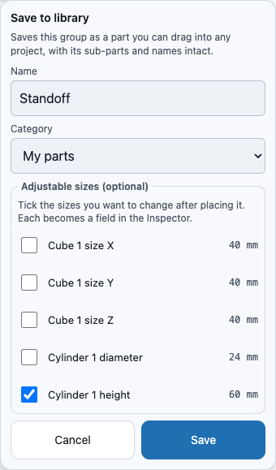

# Saving your own parts: Save to library and My parts

Build something once, then drag it into any project like a built-in part. **Save to
library…** turns a group you built into a part in the Library's **My parts** section, next
to the Primitives, Hardware and Raspberry Pi rows. It is stored in your browser, so it is
there in every new project and after you reload the page.

A saved part keeps everything inside it: the same shapes, the same **named sub-parts**
(so you can still select, align or subtract *Cylinder 1* on its own), and the same
colours. It does not keep a picture of the shape: it keeps the steps that built it, so it
can be resized if you choose to expose a size (below).

## A worked example: a standoff

1. Drag a **Cube** and a **Cylinder** from the Library into the 3D view.
2. Select both. On a laptop, click one and Shift-click the other. On a touch screen, open
   the **Objects** list in the Inspector and tick both.
3. Tap **Group** in the Operations toolbar. The two shapes are now one selected body,
   *Group 1*. (See [Combining shapes into a group](groups.md).)
4. Tap **Save to library…** (in the Inspector, or **To library** in the Operations
   toolbar). The Save sheet opens.
5. Name it **Standoff**. Under **Adjustable sizes**, tick *Cylinder 1 height* if you want
   to change the height after placing it. Tap **Save**.
6. A toast says **Saved Standoff** and the new row is at the top of **My parts**. On a phone
   the Library is a sheet: tap **Library**, then **My parts** to open the section.
7. Start a new project (**File ▾ → New**), open the Library, expand **My parts** and drag
   **Standoff** into the view. It lands where you release, with both shapes, complete.

## When Save to library… is available

It needs **exactly one** group or body selected. With nothing selected, or with two or more,
the button is dimmed and says why: *select a group or body*, or *select exactly 1: tap
Combine into group to make several solids one, then save it*. A step that is not built (its
condition does not hold) and a History preview also dim it.

Some histories cannot be saved: a step with a condition, or a broken step. The sheet stays
open and names the step.

## Names

A part's name is what you see in the Library. It cannot be empty, cannot be longer than 80
characters, and cannot match another part's name when the capitals, spaces and punctuation
are ignored (*Standoff* and *standoff* are the same name; *Stand-off* is different). The
sheet tells you which rule you hit and keeps **Save** dimmed until it is fixed.

## Adjustable sizes

The sheet lists the sizes in the group's history: a cube's width, depth and height, a
cylinder's diameter and height, a bolt's length. Tick the ones you want to change after
placing the part. On every copy you place, each ticked size becomes a numeric field under
**Parameters** in the Inspector, with a range from a tenth to ten times the saved value, so
one saved Standoff can be 8 mm tall in one place and 20 mm in another. A size you did not
tick is fixed.

## The ⋯ menu on a My parts row

| Item | What it does |
|---|---|
| **Rename** | Changes the name. Copies you already placed are unaffected. |
| **Duplicate** | Makes *Name copy* as a separate part. |
| **Export part file** | Downloads a `.warpcad-part.json` file you can share or keep. |
| **Delete…** | Removes the part from My parts. See below. |

**Import part file…** in the My parts header adds the parts in such a file. A part whose name
you already have is skipped; a file that is not a part file, or a part that does not pass the
same safety checks as a project file, is reported by name.

On a phone the menu is a bottom sheet with large buttons.

### Deleting a part you have used

A small dot on a row means the part is used in the open project. Deleting a part that has
placed copies **never deletes them**: each project keeps its own copy of the part's
definition. The dialog says how many copies there are and offers **Keep a copy in the
project** (the default) or **Cancel**. The row stays in My parts for the rest of the session,
from the project's copy, until you start a new project.

## Where parts are stored

My parts lives in your browser's storage on this device. It is not synced and not part of any
project file, but a project that uses a part carries a copy of its definition, so a project
opens on another machine without that machine having the part. Use **Export part file** to
move a part between machines.

<!-- SPDX-License-Identifier: CC-BY-SA-4.0 -->
