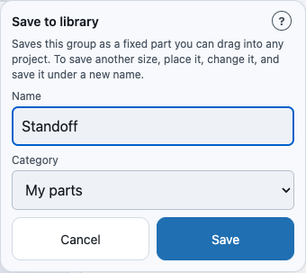
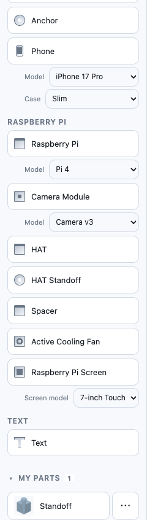
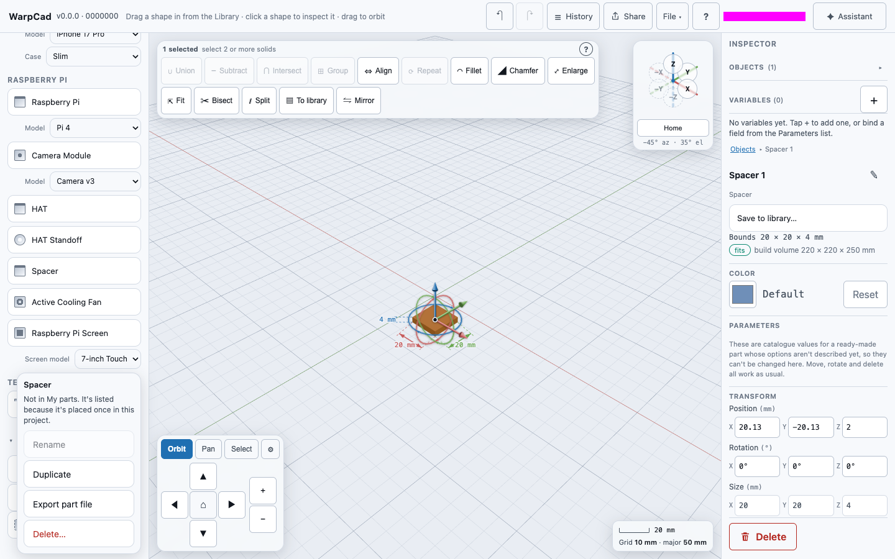

# Saving your own parts: Save to library and My parts

Build something once, then drag it into any project like a built-in part. **Save to
library…** turns a group you built into a part in the Library's **My parts** section, next
to the Primitives, Hardware and Raspberry Pi rows. It is stored in your browser, so it is
there in every new project and after you reload the page.

A saved part keeps everything inside it: the same shapes, the same **named sub-parts**
(so you can still select, align or subtract *Cylinder 1* on its own), and the same
colours, including any colour you set yourself in the Inspector's **Color** control (on the
whole group, or on one named part). It does not keep a picture of the shape: it keeps the
steps that built it. A saved part is fixed: to get another size, see
[Saving another size](#saving-another-size).

## A worked example: a standoff

1. Drag a **Cube** and a **Cylinder** from the Library into the 3D view.
2. Select both. On a laptop, click one and Shift-click the other. On a touch screen, open
   the **Objects** list in the Inspector and tick both.
3. Tap **Group** in the Operations toolbar. The two shapes are now one selected body,
   *Group 1*. (See [Combining shapes into a group](groups.md).)
4. Optional: with the group still selected, pick a colour in the Inspector's **Color**
   control. The saved part will keep it, and so will every copy you drop in later (you can
   still recolour a copy, or **Reset** it to the default colour, on its own).
5. Tap **Save to library…** (in the Inspector, or **To library** in the Operations
   toolbar). The Save sheet opens.
6. Name it **Standoff**. Tap **Save**.
7. A toast says **Saved Standoff** and the new row is at the top of **My parts**. On a phone
   the Library is a sheet: tap **Library**, then **My parts** to open the section.
8. Start a new project (**File ▾ → New**), open the Library, expand **My parts** and drag
   **Standoff** into the view. It lands where you release, with both shapes, complete.

## Importing a model file

An STL or 3MF file is not imported here any more. **File ▾ → Import model…** brings it into the
project you have open, placed in the 3D view, and it does not appear in My parts. To keep an
imported model, select it and choose **Save to library…**. See
[Importing a model file](import.md).

## When Save to library… is available

It needs **exactly one** group or body selected. With nothing selected, or with two or more,
the button is dimmed and says why: *select a group or body*, or *select exactly 1: tap
Combine into group to make several solids one, then save it*. A step that is not built (its
condition does not hold) and a History preview also dim it.

Some histories cannot be saved: a step with a condition, or a broken step. The sheet stays
open and names the step.

### A repeat can't be saved

Saving is a final step, and a **repeat** (⟳ Repeat, for example *Bolt 1 ×3*) is a live link to
its source, so it can't live inside a saved part. Select a repeat, or a group built from one, and
*Save to library…* is dimmed with the line *A repeat can't be saved to the library: it's a live
link to its source. Save the source part instead.* To save the part, tap **Go to Bolt 1** in
the Inspector to select the source, then tap *Save to library…*.

## Names

A part's name is what you see in the Library. It cannot be empty, cannot be longer than 80
characters, and cannot match another part's name when the capitals, spaces and punctuation
are ignored (*Standoff* and *standoff* are the same name; *Stand-off* is different). The
sheet tells you which rule you hit and keeps **Save** dimmed until it is fixed.

Only the parts already in **My parts** count. A part your open project carries (one you placed
and then deleted from My parts, or one that came with a project you opened) never blocks a name,
so you can put it into My parts under its own name. A group built from a part cannot take that
part's name, because the new part would contain itself: the sheet says *Standoff is built from a
part with that name, pick another name*.

Saving a group also copies into My parts any part inside it that My parts does not have yet, so
the saved part never depends on something that is only in this project. A part My parts already
has is left as it is.

## Saving another size

A saved part is fixed: the sheet has no sizes to tick. To get a different size, get the scene to
the size you want, then save it again under a new name.

1. Drag a copy of the part in, or build the shape again: for a standoff, a **Cylinder** whose
   **Height** you set to `20` in the Inspector, grouped with whatever else it needs.
2. Select the finished group (or the placed copy, if you changed it) so it is the one selected
   body.
3. Tap **To library**, type **Standoff 20 mm** and tap **Save**.

**Standoff 20 mm** is a new row in My parts. Standoff itself is unchanged, and so are any copies of
it you placed earlier.

A part you saved in an older version of WarpCad with a size ticked still shows that size as a field
under **Parameters** when you place it, and the field still works.

## The ⋯ menu on a My parts row

| Item | What it does |
|---|---|
| **Rename** | Changes the name. Copies you already placed are unaffected. |
| **Duplicate** | Makes *Name copy* as a separate part. |
| **Export part file** | Downloads a `.warpcad-part.json` file you can share or keep. |
| **Delete…** | Removes the part from My parts. See below. |

**File ▾ → Import part file…** adds the parts in such a file to My parts, and a toast says so
(*Added Standoff to My parts. Open Library to place it*). A part whose name you already have is
skipped; a file that is not a part file, or a part that does not pass the same safety checks as
a project file, is reported by name.

On a phone the menu is a bottom sheet with large buttons.

### Deleting a part you have used

A small dot on a row means the part is used in the open project, either placed itself or
inside a placed part. Deleting a part that has placed copies **never deletes them**: each
project keeps its own copy of the part's definition. The dialog says how many copies there are
and offers **Keep a copy in the project** (the default) or **Cancel**. The row then stays in
My parts, marked *Only in this project*, for as long as the project uses the part. See
[A part that's only in this project](#a-part-thats-only-in-this-project).

A part that another saved part uses inside it can't be deleted on its own, because the other
part would no longer load. The dialog names the parts that use it, for example *Spacer is used
inside Spacer pair in My parts. Delete Spacer pair first.*, and offers only **Cancel**. Delete
the part that uses it first, then this one.

For example:

1. Save a cube as **Spacer** (select it, **Save to library…**). Drag Spacer in, select the
   placed copy together with a second cube, and save the two as **Spacer pair**.
2. Tap **⋯** on the Spacer row, then **Delete…**. The dialog reads *Spacer is used inside
   Spacer pair in My parts. Delete Spacer pair first.* Tap **Cancel**.
3. Delete **Spacer pair** from its **⋯** menu. Spacer can now be deleted.

### A part that's only in this project

After you delete a part you have used, the project still holds its own copy, so the part's row
stays in My parts. The row reads **Only in this project**, and a small **Project** label marks
its tile on a narrow rail. Such a row isn't saved anywhere else, so it can't be renamed. It can
still be dragged in, and **Duplicate** puts a copy back into My parts for good. You can also put
it back by saving a placed copy, as the example below does.

Tap **⋯** on the row and the menu says why it is listed, for example *Not in My parts. It's
listed because it's placed once in this project.* If the part is used inside another placed
part, the menu names that part: *…because Feather enclosure, placed in this project, uses it.*
**Delete…** is available, but it has nothing to remove. It explains what keeps the row there and
offers only **Cancel**.

The row leaves the list on its own once nothing in the project uses the part. If you undo that
last delete, the row comes back.

For example:

1. Save a cube as **Spacer**, drag Spacer into the view, then delete Spacer from My parts
   (**⋯**, **Delete…**, **Keep a copy in the project**).
2. The Spacer row stays and reads *Only in this project*. Tap **⋯**: the menu says it's listed
   because it's placed once in this project. Tap **Delete…**: the dialog says to delete the
   placed copy from the view, or choose Duplicate to keep it. Tap **Cancel**.
3. Select the placed Spacer in the view and delete it. The Spacer row leaves My parts. Undo, and
   it comes back.
4. Put it back for good: select the placed copy (named *Spacer 1*), tap **To library**, keep the
   name *Spacer 1* and tap **Save**. A toast reads *Saved Spacer 1*. My parts now holds *Spacer 1*,
   which contains Spacer, and the Spacer row has lost its *Only in this project* label because
   saving copied it in too. If you type *Spacer* as the name instead, the sheet refuses it, since
   *Spacer 1* is built from Spacer.

## A part that can't be loaded

Now and then a saved part can't be read back, for example one saved by an older version of
WarpCad that uses a part you no longer have. My parts still lists it, after your other parts,
with a warning sign in place of its picture and the reason in place of its size, such as
*Can't be loaded: it uses esp8266-feather, which is no longer in My parts*. The message above
the list names it too.

A part that can't be loaded can't be dragged into the view. Its **⋯** menu offers **Delete…**:

1. Tap **⋯** on the row with the warning sign.
2. Tap **Delete…**, then **Delete**.

The row and its line in the message go away, and stay gone when you reload. If you still have
the missing part as a part file, **File ▾ → Import part file…** brings it back instead, and the part
that uses it loads again the next time you open WarpCad.

## Where parts are stored

My parts lives in your browser's storage on this device. It is not synced and not part of any
project file, but a project that uses a part carries a copy of its definition, so a project
opens on another machine without that machine having the part. Use **Export part file** to
move a part between machines.

<!-- SPDX-License-Identifier: CC-BY-SA-4.0 -->
