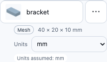
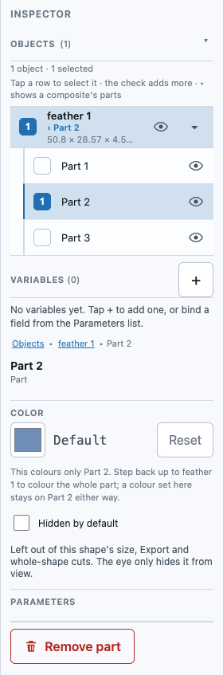

# Saving your own parts: Save to library and My parts

Build something once, then drag it into any project like a built-in part. **Save to
library…** turns a group you built into a part in the Library's **My parts** section, next
to the Primitives, Hardware and Raspberry Pi rows. It is stored in your browser, so it is
there in every new project and after you reload the page.

A saved part keeps everything inside it: the same shapes, the same **named sub-parts**
(so you can still select, align or subtract *Cylinder 1* on its own), and the same
colours, including any colour you set yourself in the Inspector's **Color** control (on the
whole group, or on one named part). It does not keep a picture of the shape: it keeps the
steps that built it, so it can be resized if you choose to expose a size (below).

## A worked example: a standoff

1. Drag a **Cube** and a **Cylinder** from the Library into the 3D view.
2. Select both. On a laptop, click one and Shift-click the other. On a touch screen, open
   the **Objects** list in the Inspector and tick both.
3. Tap **Group** in the Operations toolbar. The two shapes are now one selected body,
   *Group 1*. (See [Combining shapes into a group](groups.md).)
4. Optional: with the group still selected, pick a colour in the Inspector's **Color**
   control. The saved part will keep it, and so will every copy you drop in later (you can
   still recolour a copy, or **Reset** it to the default colour, on its own).
5. Tap **Save to library…** (in the Inspector, or **To library** in the Operations
   toolbar). The Save sheet opens.
6. Name it **Standoff**. Under **Adjustable sizes**, tick *Cylinder 1 height* if you want
   to change the height after placing it. Tap **Save**.
7. A toast says **Saved Standoff** and the new row is at the top of **My parts**. On a phone
   the Library is a sheet: tap **Library**, then **My parts** to open the section.
8. Start a new project (**File ▾ → New**), open the Library, expand **My parts** and drag
   **Standoff** into the view. It lands where you release, with both shapes, complete.

## Importing a model file

You do not have to build every part: if you already have a model as an **STL** file (from
Thingiverse, a scan, a bracket someone else designed), **Import model file…** in the My
parts header turns it into a part you can drag into the view like any other. A **3MF** file
keeps the model's separate components as parts you can select one by one: see
[Importing a model with its parts: 3MF](#importing-a-model-with-its-parts-3mf).

1. Open the Library and expand **My parts** (on a phone, tap **Library** first).
2. Tap **Import model file…** and choose `bracket.stl`. A *Reading bracket.stl…* line shows
   while it is read. Choosing a second file while one is still being read replaces it.
3. A row appears at the top of **My parts** with a thumbnail, the name, a **Mesh** tag and its
   size in millimetres, and a toast reads *Imported bracket.stl, 12 triangles, 40 × 20 × 10 mm*.
4. **Check the size under its name.** STL files carry no units, so the row says
   **Units assumed: mm** until you touch **Units**. If a bracket reads 0.04 × 0.02 × 0.01 mm,
   switch **Units** to *inch* (or *cm*) and the size updates. Do this before you place it: a
   copy already in the project keeps the units it was placed with.
5. Drag the row into the view. It lands on the ground plane under the pointer, centred, not
   buried or off at the file's own origin.
6. Select it: the Inspector shows its name and its size (read-only). To cut a pocket, add a
   **Cube**, select the model first and the cube second, and tap **Subtract**.

### What it reads, and its limits

- **Formats:** binary and ASCII **STL** (`.stl`), and **3MF** (`.3mf`), which keeps a model's
  components as separate parts (below). OBJ and glTF are planned; the importer is built so
  each is one more reader.
- **Size caps:** a file up to 25 MB and **250,000 triangles**, and a stored mesh up to 5 MB.
  A file over a cap is refused with its reason shown under the **My parts** header, and nothing
  is added. A file that is not an STL, or is cut short, is refused the same way.
- **Cleaned up on the way in:** corners that coincide are welded so the faces share edges,
  and triangles with no area are dropped, so the part exports as a closed shape.
- **Not parametric.** An imported mesh has no sizes to edit: the Inspector says so and shows
  its size as a measurement. You can move, rotate, scale, combine and cut it (Union, Subtract,
  Intersect work as with any body), but not change its dimensions as numbers.
- **STEP, IGES and BREP are out of scope.** Those are exact solid models, not triangle meshes,
  and reading them needs a different kind of geometry engine than this app has. "STEP does not
  import" is how the app is built, not a bug. Export STL from your other program instead, or
  3MF, to keep the parts. A `.step` or `.stp` file dropped on the panel is refused with *STEP
  files are not read yet. Export 3MF or STL from your CAD program*.
- **Exporting the part** (⋯ ▸ **Export part file**) carries the mesh. It is refused with a
  reason if the file would be larger than **Import part file…** reads (8 million characters).

On a laptop you can also drop a `.stl` or `.3mf` file straight onto the Library panel. Touch
screens have no file drag, so the button is the way in there.

## Importing a model with its parts: 3MF

An STL is one fused shell: a circuit board's STL has nothing to design against but its
outline. A **3MF** file can hold each component of the model separately, and WarpCad keeps
them: the import is **one part** you drag in as a whole, and each component inside it is a
**sub-part** you can select, measure, align against or cut with, exactly like the named parts
of a Raspberry Pi ([Selecting a part inside a group](groups.md#selecting-a-part-inside-a-group)).

Many parts are published as STEP. WarpCad does not read STEP yet, so convert it to 3MF in
another program first. FreeCAD (free) does it; the steps below were checked with FreeCAD 1.1.4.

### Example: the Adafruit Feather HUZZAH ESP8266

Millimetres, Z up.

1. Download `2821 Adafruit ESP8266 Feather.step` from Adafruit's
   [CAD parts repository](https://github.com/adafruit/Adafruit_CAD_Parts/tree/main/2821%20Feather%20HUZZAH%20ESP8266).
   Open it in FreeCAD with **File ▸ Import…**. The Model tree shows one top item,
   **Adafruit ESP8266 Feather v4**, holding a **PCB Component** group with the board and its
   28 components.
2. In the Model tree, click **only the top item**, then **File ▸ Export…**, choose the type
   **3D Manufacturing Format (\*.3mf)**, and save `feather.3mf`. (If you select every item in the
   tree instead, FreeCAD writes each component three times over. WarpCad notices the exact copies
   and skips them, so the result is the same; the toast just says how many it skipped.)
3. In WarpCad, open the Library, expand **My parts**, tap **Import model file…**, and choose the
   `.3mf`. The row reads **Mesh**, **29 parts** and **51.3 × 22.9 × 6.37 mm**, and a toast
   reads *Imported feather.3mf, 29 parts, 29,718 triangles, 51.3 × 22.9 × 6.37 mm.* (The
   triangle count depends on FreeCAD's export settings.)
4. Drag the row into the view and release. Drag a **Cube** in beside it.
5. **Click the board once**: all of it is selected, and the Inspector shows the whole model's
   size. **Click again on the large 24 × 16 mm module** (the ESP-12): the breadcrumb reads
   `feather 1 ▸ Part 22`, and the Inspector shows that part's own size, 24 × 16 × 2.95 mm.
6. Hold **Shift** and click the Cube, then press **⇔ Align**. The popover's top line reads
   **Aligning feather 1 › Part 22 to Cube 1**: the board is the shape you picked first, so it
   moves, and the part you addressed is what is measured. Tap the button you want, say
   **X center**. To move the **Cube** against the part instead, pick the Cube first, then
   tick `Part 22` under the board in the Inspector's **Objects** list.
7. To cut a pocket for a connector, follow
   [Cutting with just one part](booleans.md#cutting-with-just-one-part-of-a-multi-part-shape):
   select the plate, tick the part in the Objects list, and tap **Subtract**. A part used as a
   cutting shape uses the model up, as any cutting shape is; drag in another copy, or Undo.

**Small parts are easier to reach from the list.** A 1.6 mm resistor is hard to hit with a
click and impossible with a finger. Select the model, open the Inspector's **Objects** list,
and expand it with its **▸**: every part has its own row. Tap a row to select that part, or
its check box to add it to what is already selected.

### What a 3MF import keeps, and what it does not

- **Each placed component is one part**, in the place the file puts it. The whole model lands
  centred under the pointer with its lowest point on the ground, and the parts keep their
  places relative to each other. A component placed twice is two parts; an exact copy at the
  same place is skipped and counted in the toast.
- **Names only if the file has them.** A part takes its object's name from the file. FreeCAD
  writes no names, so its parts are `Part 1`, `Part 2`, … in the file's order. Click a part
  and read its size to tell them apart. A name used twice is numbered: `10K 1`, `10K 2`.
  Once you know which is which, give it a name of your own: tap `Part 22`, tap its name at the
  top of the Inspector, type `ESP-12` and press **Enter**
  ([Naming a part of a group](selection-and-inspector.md#naming-a-part-of-a-group)). **Save to
  Library** afterwards so new copies keep the names.
- **A hole in a part is not a part.** A board's mounting holes are holes in the `Board` mesh,
  not parts of their own, so you can align against `Board` or the ESP-12 module, but not
  against one mounting hole by itself (unlike the Raspberry Pi, whose holes are named parts).
- **Units come from the file.** A 3MF says which units it is in, so the row has no **Units**
  control and no *Units assumed* badge.
- **Not parametric**, like an STL: sizes are measurements, not settings.
- **Ignored:** colours and materials, thumbnails and slices. Beam lattices are refused. A 3MF
  whose objects live in separate files inside the package (the *production extension*, which
  some slicers write) is refused in words rather than imported in part; so is a file that
  requires an extension WarpCad does not understand.
- **The same caps as an STL:** 25 MB per file and 250,000 triangles in the whole model, every
  placed copy counted.
- **Exporting:** a component the source file left broken stays broken. In the Feather's file,
  `Part 19` (the JST connector) has 12 edges shared by more than two triangles and `Part 23`
  (the button) has 6 open edges, so **Export ▸ Print pieces** refuses at `Part 19` with its
  reason.

## When Save to library… is available

It needs **exactly one** group or body selected. With nothing selected, or with two or more,
the button is dimmed and says why: *select a group or body*, or *select exactly 1: tap
Combine into group to make several solids one, then save it*. A step that is not built (its
condition does not hold) and a History preview also dim it.

Some histories cannot be saved: a step with a condition, or a broken step. The sheet stays
open and names the step.

### A repeat can't be saved

Saving is a final step, and a **repeat** (⟳ Repeat, for example *Bolt 1 ×3*) is a live link to
its source, so it can't live inside a saved part. Select a repeat, or a group built from one, and
*Save to library…* is dimmed with the line *A repeat can't be saved to the library: it's a live
link to its source. Save the source part instead.* To save the part, tap **Go to Bolt 1** in
the Inspector to select the source, then tap *Save to library…*.

## Names

A part's name is what you see in the Library. It cannot be empty, cannot be longer than 80
characters, and cannot match another part's name when the capitals, spaces and punctuation
are ignored (*Standoff* and *standoff* are the same name; *Stand-off* is different). The
sheet tells you which rule you hit and keeps **Save** dimmed until it is fixed.

## Adjustable sizes

The sheet lists the sizes in the group's history: a cube's width, depth and height, a
cylinder's diameter and height, a bolt's length. Tick the ones you want to change after
placing the part. On every copy you place, each ticked size becomes a numeric field under
**Parameters** in the Inspector, with a range from a tenth to ten times the saved value, so
one saved Standoff can be 8 mm tall in one place and 20 mm in another. A size you did not
tick is fixed.

## The ⋯ menu on a My parts row

| Item | What it does |
|---|---|
| **Rename** | Changes the name. Copies you already placed are unaffected. |
| **Duplicate** | Makes *Name copy* as a separate part. |
| **Export part file** | Downloads a `.warpcad-part.json` file you can share or keep. |
| **Delete…** | Removes the part from My parts. See below. |

**Import part file…** in the My parts header adds the parts in such a file. A part whose name
you already have is skipped; a file that is not a part file, or a part that does not pass the
same safety checks as a project file, is reported by name.

On a phone the menu is a bottom sheet with large buttons.

### Deleting a part you have used

A small dot on a row means the part is used in the open project. Deleting a part that has
placed copies **never deletes them**: each project keeps its own copy of the part's
definition. The dialog says how many copies there are and offers **Keep a copy in the
project** (the default) or **Cancel**. The row stays in My parts for the rest of the session,
from the project's copy, until you start a new project.

## Where parts are stored

My parts lives in your browser's storage on this device. It is not synced and not part of any
project file, but a project that uses a part carries a copy of its definition, so a project
opens on another machine without that machine having the part. Use **Export part file** to
move a part between machines.

<!-- SPDX-License-Identifier: CC-BY-SA-4.0 -->
