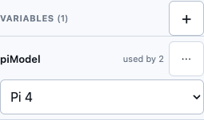
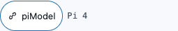
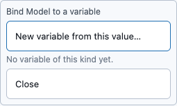
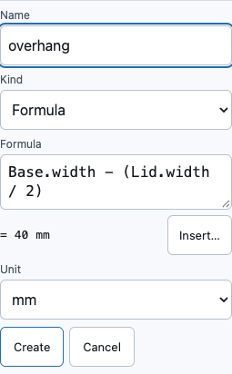
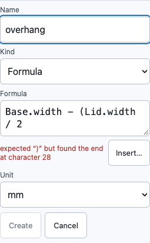

# Variables: change one number, and everything that uses it follows

A **variable** is a named value that belongs to the whole project, not to one shape. Wire a
field to a variable and that field stops being its own number: it *is* the variable. Change
the variable once and every field bound to it changes with it, with the model rebuilt in a
single step you can Undo.

This is the "`const piVersion = 4` at the top of the file" habit, reachable by hand. You
never need to open the part itself.

## The Variables section

It sits in the Inspector column, under the object list, and it works with **nothing
selected**: variables belong to the project, so you do not pick a shape first. On a phone
it is the **Variables** tab at the top of the same bottom sheet the Inspector uses (the
sheet has two tabs, **Inspector** and **Variables**), so there is no new panel to find.

| Control | What it does |
|---|---|
| **+** | Adds a variable by hand: a name, a kind (**Number**, **Yes / no**, **Choice** or **Formula**), a starting value, and for a choice the options as a comma-separated list such as `4, 5`. A **Formula** is calculated instead; see [Formulas](#formulas). |
| The value | Edits the variable in place: a number box, a checkbox, or a dropdown, to match its kind. A number is **millimetres** (or **degrees** for an angle) — the same units the Inspector's own fields use. |
| **used by N** | How many fields and conditions currently read it, including the ones that read it through a formula. *read by 1 formula* is added when a formula uses it. |
| **⋯** | **Rename** (every field bound to it follows, in one step) and **Delete**. |

Names are letters, digits and underscores, starting with a letter or underscore, up to 40
characters, and case matters: `wall` and `Wall` are different variables. If you type
something that is not allowed, the panel says why and nothing changes.

## Binding a field to a variable

Select a shape. Next to every field that can be bound (a number, a choice, or a yes/no)
there is a small **link** button. Tap it and a list opens:

- **New variable from this value…** — the shortest path from "I want this to be
  switchable" to done. It creates a variable that starts at the field's *current* value (and,
  for a choice, with the same options), binds the field to it, and does both as one Undo
  step. Nothing on screen changes.
- A variable you already have — binds the field to it. Only variables of a kind the field
  takes are listed. If the variable's value is not allowed there (outside the field's range, or
  not one of its options) the list shows the reason instead of binding.

Once bound, the field shows a **chip** with the variable's name, and its value read-only
beside it, in place of the editor. You cannot type into it, by design. Tap the chip:

- **Edit variable** — jumps to that variable's row in the Variables section.
- **Unbind** — puts the field back to the number it has right now. Nothing jumps.

A field that cannot be bound has no link button at all, rather than a dimmed one. When the
whole step cannot take a variable (a rotate step, say), each field's label says why when you
hover or long-press it.

### What cannot be bound

- **Position and rotation in the Transform section.** Moving or turning a shape with the
  gizmo adds a step that is not a parameter, so the Transform rows never show a link button.
- **A rotate step's angles.** Each later move carries the shape's *absolute* rotation forward,
  so a variable there would be silently overwritten by the next move. A rotation is not
  bindable, and the app says so rather than letting it look like it worked.
- Text, a combination (Union, Subtract, Intersect, a group), and a ready-made part whose
  options are not described yet.

## Using a variable in a condition

A shape can be made to exist only while a variable has certain values. Select it, find the
**Condition** row, and press **Only when a variable…**. Pick the variable, tick the values
to keep it for, and Save. The shape then appears in the 3D view only while the variable is
one of those values; otherwise it is listed greyed in the object list, and you edit or
remove the condition from there. **Edit** on an existing condition has a **Based on** choice
for switching it between a variable and the part parameter it read.

## Changing a value

Change a variable in its row. The model rebuilds, **every bound field in the Inspector
updates** with it, and a line below the list says how far it reached:

> piModel 4 → 5 — 2 parameters on 2 parts changed

That line is there so you always know what moved. It is replaced by the next change.

If the new value would break something that depends on it (a part snapped to a connector
the new Pi does not have), nothing is changed yet. The same **repair dialog** used for
changing a Pi's model opens and lists each affected item with its fix; **Apply** commits
the value and the fixes together as one step.

Undo reverses a value change, a bind, a rename and a delete, each in **one** step.

## Deleting a variable that is in use

There is no plain destructive delete. **Delete** on a variable something still reads opens a
list of every consumer with two buttons: **Delete and keep current values** (each field turns
back into the number it has now) and **Cancel**. A condition that reads the variable has no
number to keep: change or remove that condition first.

A field whose variable no longer exists is never silently replaced with a guess: its chip
turns into an error naming the missing variable, and the History row for that step is
flagged broken with the same reason. Undo brings the variable back.

## Worked example: switch a design between Pi models

1. From the Library's **Raspberry Pi** section, drag a **Raspberry Pi** onto the grid.
2. Select it. In the Inspector, next to **Model**, tap the link button and choose **New
   variable from this value…**. Name it `piModel` and tap **Create and bind**. The Model
   field is now a `piModel` chip reading **Pi 4**.
3. Drag a **Cube** in next to it, as an enclosure. In its **Condition** row press **Only
   when a variable…**, keep **Based on** on `piModel`, tick **Pi 4** and **Save**. The cube
   exists only on a Pi 4 (say, because it carries a cut-out a Pi 5 does not need).
4. Deselect everything and open **Variables** (the **Variables** tab on a phone). Change
   `piModel` from **Pi 4** to **Pi 5**. The board swaps, the cube disappears, and the line
   *piModel 4 → 5 — 2 parameters on 2 parts changed* appears.
5. Press **Undo** once. Everything returns to the Pi 4.

## Formulas

A **formula** is a variable that is calculated. Its value comes from other variables and from
the measured size and position of your shapes and their parts, so it stays right when those
change. It is the same idea as writing `cameraCase.parts.caseShell.size().z / 2` in a JSCAD
file, except you never write the number down yourself.

You bind a field to a formula exactly as you bind it to any other variable, and the field
follows whenever a shape the formula measures changes.

### Example: a third cube sized from two others

1. Drag in a Cube and name it `Base`. Set **Size X** to `60`. Drag in a second Cube and name it `Lid`;
   leave **Size X** at `40`.
2. With nothing selected, open **Variables**, press **+** and choose **Formula**. Name it `overhang`.
3. Type `Base.width - (Lid.width / 2)`. The line below the box reads **= 40 mm**. Press **Create**.
4. Drag in a third Cube. Press the link button beside **Size X** and choose `overhang`. The field
   becomes a chip reading 40.
5. Select `Base` and change **Size X** to `80`. The third cube's Size X becomes 60, and a line says what
   changed. Press **Undo** once and it returns to 40.

The line in step 5 reads *overhang 40 mm → 60 mm — 1 parameter on 1 part changed*. It appears in the
Variables section (the **Variables** tab on a phone).

### Writing a formula

While you type, the line under the box shows the value (**= 40 mm**) or says what is wrong and
where, such as *expected ")" but found the end at character 28*. **Create** and **Save** stay off
until the formula works.

**Insert…** beside the box lists every shape, then its parts (hidden parts too, marked
*hidden*), then what to measure. Your choice goes in where the cursor is. You never need to
type a bracket or remember a name, which helps most on a phone.

After you press **Create**, the row shows the value (marked *calculated*, so you can't type over
it) with the formula underneath. Tap the formula to change it. **⋯** has **Rename** and
**Delete**, as for any variable. Creating, changing, renaming and deleting a formula are each
**one** Undo step.

WarpCad saves a formula in a tidy form, so brackets that change nothing are dropped:
`Base.width - (Lid.width / 2)` is shown as `Base.width - Lid.width / 2`. It is the same sum.

A field can also start a formula. In its link list, **New formula from this value…** opens a
name and a formula box that already holds the field's current number, so nothing moves until
you edit it. **Create and bind** adds the formula and binds the field in one step.

### What you can measure

`Shape.quantity` measures a whole shape. `Shape.part.quantity` measures one named part of it,
hidden or not. A shape with no part measures the parts you can see, the same box the
Inspector's **Bounds** line shows.

| Quantity | What it is |
|---|---|
| `width`, `depth`, `height` | The size along X, Y and Z |
| `size.x`, `size.y`, `size.z` | The same three, by axis |
| `min.x`, `min.y`, `min.z` | The left, front and bottom faces |
| `max.x`, `max.y`, `max.z` | The right, back and top faces |
| `center.x`, `center.y`, `center.z` | The middle of the box |

Everything is in **millimetres**, measured along the **world** axes, with Z up. A part you
have rotated is measured as it sits: its `width` is how far it reaches along world X, not along
its own edge. A distance between two faces is a subtraction: `box.top.max.z - box.board.max.z`.

**Names with spaces or hyphens go in square brackets**: `[Cube 1].width`,
`BPlus.[pi-mb].height`. If two shapes have the same name, WarpCad asks you to pick one by its id
(`#cube-a1-3.width`); **Insert…** does this for you. Renaming a shape later doesn't break a
formula, because the file stores the shape's id and the panel shows its current name.

### Functions

| Function | What it does |
|---|---|
| `abs(x)`, `min(a, b, …)`, `max(a, b, …)`, `clamp(x, low, high)` | The usual |
| `round(x)`, `floor(x)`, `ceil(x)` | To a whole number |
| `roundTo(x, step)`, `floorTo(x, step)`, `ceilTo(x, step)` | To a multiple of `step`, e.g. a wall to a nozzle width: `ceilTo(2.5, 0.4)` is 2.8 |
| `sqrt(x)`, `pow(x, y)`, `hypot(a, b, …)` | Roots, powers, the length of a diagonal |
| `sin`, `cos`, `tan`, `asin`, `acos`, `atan2(y, x)` | Trigonometry, in **degrees**, like every angle in WarpCad |
| `pi()` | 3.14159… (with brackets, so a shape named `pi` still works) |
| `inch(x)` | Inches to millimetres: `inch(3 / 8)` is 9.525 |
| `if(test, a, b)` | `a` when the test is true, else `b`. Only the side it takes is worked out, so `if(piModel == 5, pi.fan.height, 0)` is fine on a Pi 4, which has no fan |

You can use `+ - * /`, brackets, comparisons (`== != < <= > >=`) and `&& || !` inside `if`. A
choice variable can be compared with one of its options, such as `piModel == 5`. A formula's
result is always a number.

A formula that can't be worked out says why. It never quietly becomes 0. Dividing by zero,
`sqrt(-1)`, a shape that was deleted, or a part a model does not have each give an error that
names the problem, in the Variables row and in the History.

### A formula reads a shape as it stands just above the step that uses it

WarpCad works out a formula **at each step that uses it**, from the shapes as they are just
before that step in the History. That is what a line in a JSCAD file does: it measures `head`
when the line runs. Two things follow:

- A step can't use a formula that measures a shape added further down the History. The link
  list says so instead of binding, with a reason such as *reads Base, which is not built until step 7*.
- If you move or resize a shape **later** in the History, a step that measured it earlier keeps
  the earlier value. WarpCad doesn't hide this. The chip and the formula's row both show a note
  such as *Reads Base before step 12 (Move Base) changed it (uses 34 mm, now 41 mm)*. Only a real
  difference shows: moving `Base` changes `Base.max.z` but not `Base.width`, so a formula on the
  width stays quiet.

Editing a shape's own fields, as in the example, rebuilds everything after it, so that never
leaves a note.

**Delete** on a shape that a formula measures still works (Undo brings it back). Under the button,
before you tap it, WarpCad says which formulas read the shape and how many fields they feed.

**Save to library** saves a bound field as the number it has at that step. A saved part carries no
variables.

### From JSCAD

| In a JSCAD file | As a formula |
|---|---|
| `part.size().z`, `util.size(part).z` | `Shape.part.height` |
| `calcSnap(a, b, 'z', 'inside+')` | a subtraction of two faces: `a.max.z - b.max.z` |
| `centroid()` | `Shape.center.x` (the middle of the box) |
| `util.inch(3 / 8)` | `inch(3 / 8)` |
| `util.nearest.over(2.5, 0.2)` | `ceilTo(2.5, 0.2)` |
| `Math.PI`, `Math.abs(x)` | `pi()`, `abs(x)` |
| `const outer = inner + 2 * wall` | a formula `inner + 2 * wall` named `outer` |

`.snap()` and `.align()` stay operations (**Align** and snapping in the 3D view), not formulas.

An assistant can do all of this too: see `define_formula`, `set_formula` and
`evaluate_formula` in [the AI partner](ai-partner.md) and [Connect Claude Code](mcp.md).

## Good to know

- A variable is part of the project: it is saved with it, reopens with it and appears in the
  History as a **Define piModel** step. Reload the page and your chips and values are still
  there.
- On a phone with an empty scene there is no sheet to hold the tab yet. Place something and
  it appears, or bind a field and the variable is created for you.
- A **formula** is saved as text. A file shared with you can't run code through it: WarpCad reads
  it with its own small calculator, which can only do sums and measure shapes.

## See also

- [Selecting a shape, and reading its size](selection-and-inspector.md)
- [The History panel](timeline.md)
- [Undoing and redoing a change](undo-redo.md)

<!-- SPDX-License-Identifier: CC-BY-SA-4.0 -->
