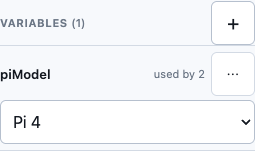
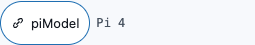
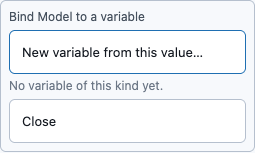

# Variables: change one number, and everything that uses it follows

A **variable** is a named value that belongs to the whole project, not to one shape. Wire a
field to a variable and that field stops being its own number: it *is* the variable. Change
the variable once and every field bound to it changes with it, with the model rebuilt in a
single step you can Undo.

This is the "`const piVersion = 4` at the top of the file" habit, reachable by hand. You
never need to open the part itself.

## The Variables section

It sits in the Inspector column, under the object list, and it works with **nothing
selected**: variables belong to the project, so you do not pick a shape first. On a phone
it is the **Variables** tab at the top of the same bottom sheet the Inspector uses (the
sheet has two tabs, **Inspector** and **Variables**), so there is no new panel to find.

| Control | What it does |
|---|---|
| **+** | Adds a variable by hand: a name, a kind (**Number**, **Yes / no** or **Choice**), a starting value, and for a choice the options as a comma-separated list such as `4, 5`. |
| The value | Edits the variable in place: a number box, a checkbox, or a dropdown, to match its kind. A number is **millimetres** (or **degrees** for an angle) — the same units the Inspector's own fields use. |
| **used by N** | How many fields and conditions currently read it. |
| **⋯** | **Rename** (every field bound to it follows, in one step) and **Delete**. |

Names are letters, digits and underscores, starting with a letter or underscore, up to 40
characters, and case matters: `wall` and `Wall` are different variables. If you type
something that is not allowed, the panel says why and nothing changes.

## Binding a field to a variable

Select a shape. Next to every field that can be bound (a number, a choice, or a yes/no)
there is a small **link** button. Tap it and a list opens:

- **New variable from this value…** — the shortest path from "I want this to be
  switchable" to done. It creates a variable that starts at the field's *current* value (and,
  for a choice, with the same options), binds the field to it, and does both as one Undo
  step. Nothing on screen changes.
- A variable you already have — binds the field to it. Only variables of a kind the field
  takes are listed. If the variable's value is not allowed there (outside the field's range, or
  not one of its options) the list shows the reason instead of binding.

Once bound, the field shows a **chip** with the variable's name, and its value read-only
beside it, in place of the editor. You cannot type into it, by design. Tap the chip:

- **Edit variable** — jumps to that variable's row in the Variables section.
- **Unbind** — puts the field back to the number it has right now. Nothing jumps.

A field that cannot be bound has no link button at all, rather than a dimmed one. When the
whole step cannot take a variable (a rotate step, say), each field's label says why when you
hover or long-press it.

### What cannot be bound

- **Position and rotation in the Transform section.** Moving or turning a shape with the
  gizmo adds a step that is not a parameter, so the Transform rows never show a link button.
- **A rotate step's angles.** Each later move carries the shape's *absolute* rotation forward,
  so a variable there would be silently overwritten by the next move. A rotation is not
  bindable, and the app says so rather than letting it look like it worked.
- Text, a combination (Union, Subtract, Intersect, a group), and a ready-made part whose
  options are not described yet.

## Using a variable in a condition

A shape can be made to exist only while a variable has certain values. Select it, find the
**Condition** row, and press **Only when a variable…**. Pick the variable, tick the values
to keep it for, and Save. The shape then appears in the 3D view only while the variable is
one of those values; otherwise it is listed greyed in the object list, and you edit or
remove the condition from there. **Edit** on an existing condition has a **Based on** choice
for switching it between a variable and the part parameter it read.

## Changing a value

Change a variable in its row. The model rebuilds, **every bound field in the Inspector
updates** with it, and a line below the list says how far it reached:

> piModel 4 → 5 — 2 parameters on 2 parts changed

That line is there so you always know what moved. It is replaced by the next change.

If the new value would break something that depends on it (a part snapped to a connector
the new Pi does not have), nothing is changed yet. The same **repair dialog** used for
changing a Pi's model opens and lists each affected item with its fix; **Apply** commits
the value and the fixes together as one step.

Undo reverses a value change, a bind, a rename and a delete, each in **one** step.

## Deleting a variable that is in use

There is no plain destructive delete. **Delete** on a variable something still reads opens a
list of every consumer with two buttons: **Delete and keep current values** (each field turns
back into the number it has now) and **Cancel**. A condition that reads the variable has no
number to keep: change or remove that condition first.

A field whose variable no longer exists is never silently replaced with a guess: its chip
turns into an error naming the missing variable, and the History row for that step is
flagged broken with the same reason. Undo brings the variable back.

## Worked example: switch a design between Pi models

1. From the Library's **Raspberry Pi** section, drag a **Raspberry Pi** onto the grid.
2. Select it. In the Inspector, next to **Model**, tap the link button and choose **New
   variable from this value…**. Name it `piModel` and tap **Create and bind**. The Model
   field is now a `piModel` chip reading **Pi 4**.
3. Drag a **Cube** in next to it, as an enclosure. In its **Condition** row press **Only
   when a variable…**, keep **Based on** on `piModel`, tick **Pi 4** and **Save**. The cube
   exists only on a Pi 4 (say, because it carries a cut-out a Pi 5 does not need).
4. Deselect everything and open **Variables** (the **Variables** tab on a phone). Change
   `piModel` from **Pi 4** to **Pi 5**. The board swaps, the cube disappears, and the line
   *piModel 4 → 5 — 2 parameters on 2 parts changed* appears.
5. Press **Undo** once. Everything returns to the Pi 4.

## Good to know

- A variable is part of the project: it is saved with it, reopens with it and appears in the
  History as a **Define piModel** step. Reload the page and your chips and values are still
  there.
- On a phone with an empty scene there is no sheet to hold the tab yet. Place something and
  it appears, or bind a field and the variable is created for you.
- A variable holds one value. It cannot be a formula of other variables (`outer = inner +
  2 × wall`) yet.

## See also

- [Selecting a shape, and reading its size](selection-and-inspector.md)
- [The History panel](timeline.md)
- [Undoing and redoing a change](undo-redo.md)

<!-- SPDX-License-Identifier: CC-BY-SA-4.0 -->
