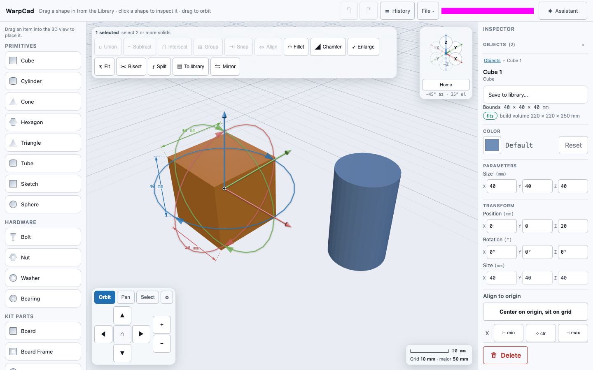
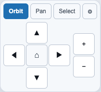
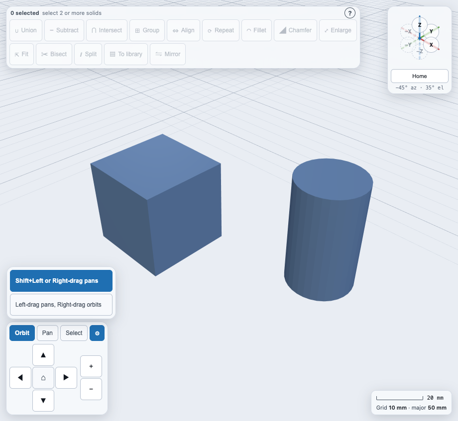
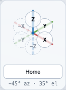

# Moving around the 3D view

On a phone, the navigation pad folds behind a **✥** button while a sheet is open; see [Using WarpCad on a phone or tablet](mobile.md#the-navigation-pad-folds-behind-a-button).

WarpCad opens on a single screen: a dark 3D view with a millimetre grid, the
**orientation triad** in the top-right corner, the **navigation pad** in the
bottom-left, and the **scale readout** in the bottom-right. Everything on this
page works with a mouse, with a finger, or with on-screen buttons alone — you
never need a keyboard to move the camera.

---

## A first walkthrough

Try these in order, with the app open:

1. **Click and drag anywhere in the 3D view** to orbit the camera around the
   scene. Drag right and the view swings around to the left of where you were;
   drag down and you tip up to look at the scene from above. On a phone or
   tablet, drag with one finger — same result.

   
2. **Tap `Pan`** in the bottom-left pad. The pad's arrows relabel themselves
   ("Pan camera up" instead of "Orbit camera up"), and dragging in the 3D view
   now slides the view sideways instead of rotating it. Tap `Orbit` to switch
   back.
   - **With a mouse, you don't have to switch modes at all just to pan for a
     moment.** Hold Shift and drag with the left mouse button, or just drag with
     the right mouse button, to pan the camera without touching the `Orbit`/`Pan`
     toggle. Release Shift or the right button and a plain left-drag orbits
     again, following whatever the toggle is currently set to. This is purely a
     desktop shortcut — it doesn't change what the toggle does for touch or for
     the direction pad.

   
3. **Use the `+` and `−` buttons** to the right of the direction pad to zoom in
   and out. With a mouse you can also scroll the wheel over the view; on a touch
   screen, pinch with two fingers.

   
4. **Tap `Z` on the orientation triad** in the top-right corner to snap the
   camera to the top view — looking straight down the Z axis, with Y running up
   the screen. Try `−Y` for the front view and `X` for the right view.

   
5. **Tap `Home`** under the triad to return to the standard three-quarter
   (isometric) view.
6. **Read the scale off the bottom-right readout.** Each minor grid line is
   **10 mm** apart and each brighter major line is **50 mm** apart. The bar above
   the legend shows how long a round real-world distance — 100 mm, 200 mm, and
   so on — is at your current zoom, and it relabels itself as you zoom.

   

---

## The navigation pad (bottom-left)

Pressing the pad's buttons does the same as the gestures above — no mouse drag needed:

| Control | What it does |
|---|---|
| `Orbit` / `Pan` | Chooses what a drag in the 3D view does. The direction pad follows this choice too. |
| ▲ ▼ ◀ ▶ | Moves the camera one step in that direction — 15° of orbit, or a short pan, depending on the mode above. |
| `⌂` (centre of the pad) | Resets the camera completely: orientation, zoom, and the point it is looking at. |
| `+` / `−` | Zooms in and out one step. |

The buttons and the drag gesture are the same controls underneath, so the view
never ends up in a state you can only reach one way.

### On a phone: the pad folds away while a panel is open

On a phone, opening a bottom panel (the Inspector, including its object list, or
History) pushes the navigation pad up so it sits above the panel. Up there it would
cover the middle of the 3D view, where your objects usually are. So instead the
whole pad folds down to a single **✥** button in the corner. That way a tap on an
object in that area selects the object, and can't nudge the camera by accident.

Example: place a cube near the lower-left of the view, then drop a cylinder
somewhere else.

1. The cylinder is selected and the Inspector panel slides up. The navigation
   pad is now just the **✥** button, sitting above the panel.
2. Tap the cube. It becomes the selected object and the camera stays where it
   was.
3. Tap **✥** to open the full pad (`Orbit`/`Pan`/`Select`, the arrows,
   `⌂` and zoom). The **✥** button turns highlighted and stays in the same
   corner.
4. Use the arrows as usual, then tap **✥** again to fold the pad back down.

Closing or switching the panel folds the pad again, so the next panel always
opens with the view clear. You can still move the camera with your fingers while
the pad is folded (see Touch gestures below). The fold only happens on a phone
with a panel open. On a tablet or a computer, the pad is always shown in full.

**Mouse-only shortcuts**, on top of the `Orbit`/`Pan` toggle above:

| Gesture | Result |
|---|---|
| Shift + left-button drag | Pans, regardless of the toggle's current setting |
| Right-button drag | Pans, regardless of the toggle's current setting, no modifier needed |

Both are an *additional* way to reach the same pan the toggle already gives
you — a plain left-drag with no Shift held still follows whatever the toggle
currently says. Note that Shift plus a left-button **click** (no drag) still
adds the clicked object to the current selection instead — see
`docs/selection-and-inspector.md` — because a Shift+left press that never
turns into a real drag is a click, not a pan.

### Changing which mouse button pans (the gear icon)

The Shift/right-button shortcuts above are one convention, but not the only
one people are used to — some other tools put pan on the plain left button
instead. Click the **gear icon** next to `Orbit`/`Pan` in the navigation pad
to choose which one WarpCad uses:

1. **Click the gear icon** in the navigation chrome. A short list opens with
   the current choice already marked.
2. **Choose "Left-drag pans, right-drag orbits"** to switch — or choose
   "Shift+Left or Right-drag pans" to go back to the default.
3. Your very next drag in the 3D view already follows the new choice; nothing
   else needs a reload or a re-selection.
4. The choice is remembered: it's saved in your browser and is still active
   the next time you open WarpCad, even after closing the tab.

| Preset | Left-drag | Right-drag |
|---|---|---|
| Shift+Left or Right-drag pans (default) | Orbit, or pans if Shift is held | Pans |
| Left-drag pans, right-drag orbits | Pans | Orbits |

This only changes the *mouse* shortcuts above — the `Orbit`/`Pan` toggle, the
direction pad, and every touch gesture on this page work exactly the same
regardless of which preset is chosen, since there is no Shift key or right
mouse button on a touchscreen to remap.

## The orientation triad (top-right)

The triad shows which way the camera is currently pointing: the red spoke is the
X axis, green is Y, and blue is Z. Solid spokes point toward you; dashed ones
point away. Each spoke's colour is visible right through the button sitting on
top of it, and pokes a short tail out past the button's edge, so you can read
the current orientation off the triad itself rather than off the numeric
"az/el" caption underneath. The buttons for the axes pointing away from you
are drawn fainter and dashed, so the three axes actually facing you stand out.

Each labelled cap is a button, and clicking one moves the camera **onto** that
axis:

| Cap | View you get |
|---|---|
| `Z` | Top — looking straight down the Z axis |
| `−Z` | Bottom |
| `X` | Right |
| `−X` | Left |
| `Y` | Back |
| `−Y` | Front |
| `Home` | Isometric three-quarter view |

Zoom and the point you are looking at are left alone by a snap — only the
direction changes — so you can line up a view without losing your place.

## Touch gestures

| Gesture | Result |
|---|---|
| One-finger drag | Orbit, or pan if `Pan` is selected |
| Two-finger pinch | Zoom in and out |
| Two-finger drag | Pan, whichever mode is selected |
| Tap a triad cap or a pad button | Same as clicking it |
| Tap **✥** (phone, with a panel open) | Opens or folds away the navigation pad |

The 3D view claims your drags, so the page itself never scrolls or bounces while
you are moving the camera.

## Units

Everything on screen is in **millimetres**. The grid's minor lines are 10 mm
apart and its major lines 50 mm; the scale bar's label always names a real
distance, so you can judge size without opening any panel.

## If the view doesn't appear

If your browser can't start WebGL, the 3D area shows a short message explaining
that instead of a blank rectangle. The navigation pad and triad keep working —
they drive the camera, not the renderer — so the app stays usable while you fix
the browser setting or move to another device.

## While you are drawing a sketch

There used to be a **Sketch** button on the navigation pad. It is gone: a sketch is now a
shape you drag in from the Library, and the pad never starts one. See
[Sketch primitives](sketch-mode.md).

While the sketch editor is open, the camera stays square-on to the sketch, so the
navigation pad changes:

- the `Orbit` / `Pan` / `Select` row and the ⚙ settings are hidden, because a drag
  **draws** instead;
- the arrows **pan** across the sketch, and zoom works as usual;
- the orientation triad still shows where you are looking, but its view buttons are off.
  Snapping to Front mid-sketch would turn the sketch edge-on;
- on a phone, and on a tablet whose view is just as narrow, the pad folds to the **✥**
  button so the drawing area stays clear. When the Slices or Extrude panel is open, the
  **✥** button sits just above it. Two fingers still pan and pinch-zoom.

Everything comes back when you tap **Done** or **Cancel**.

<!-- SPDX-License-Identifier: CC-BY-SA-4.0 -->
