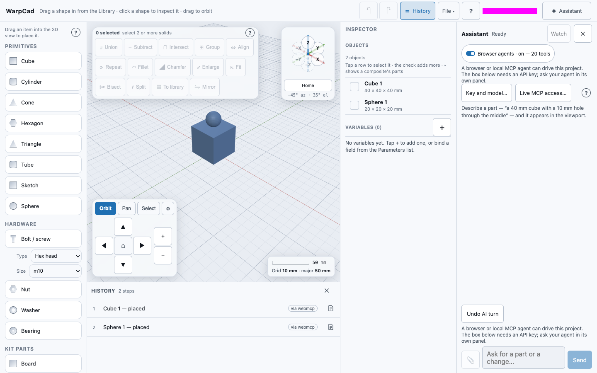

# Browser agents (WebMCP)

Some AI agents run **inside your web browser**, for example as an extension. If your browser
supports **WebMCP**, WarpCad offers such an agent its tools directly: place a shape, run an
operation, measure, check printability. You need no API key, no Claude Code, no helper program
and no pairing code. It works in any copy of WarpCad, hosted or one you run yourself. The tools
are the same ones the in-app [Assistant](ai-partner.md) and [Claude Code](mcp.md) use.

WebMCP is **experimental**. Today only Chrome supports it, behind a flag, on desktop. In any
other browser nothing changes: WarpCad doesn't show the control and doesn't register anything.

## Set it up in Chrome

You need Chrome, an agent that runs in the browser, and WarpCad open on a secure page. These
steps set up all three.

1. **Update Chrome to 146 or newer.** Open the Chrome menu, then **Help → About Google Chrome**,
   and let it update. The WebMCP guides don't agree on the exact minimum version. If the flag in
   the next step isn't on the page, your Chrome is too old, or the feature is only in a preview
   channel (Beta, Dev or Canary).
2. **Turn on the WebMCP flag.** Paste `chrome://flags/#enable-webmcp-testing` into the address bar,
   set the WebMCP testing entry to **Enabled**, and press **Relaunch**. A plain page refresh isn't
   enough; the browser has to restart.
3. **Install an agent that can call a page's tools.** This page uses Google's **Model Context Tool
   Inspector**. It lists the tools a page offers in a DevTools side panel and can call them. Install
   it from the Chrome Web Store by searching for *Model Context Tool Inspector*. Its source code is
   at [github.com/beaufortfrancois/model-context-tool-inspector](https://github.com/beaufortfrancois/model-context-tool-inspector).
   Several similarly named extensions exist, so check the publisher before you install one.
4. **Open WarpCad on a secure page.** Use **https://app.warpcad.com**, or `http://localhost:5183`
   when you run it yourself with `npm run dev`. Browsers offer WebMCP only on secure pages.
5. **Check that the browser offers it.** Open DevTools (**⌥⌘I** on a Mac, **Ctrl+Shift+I** on
   Windows), click the **Console** tab, type `document.modelContext` and press Enter. An object
   means the browser offers WebMCP; `undefined` means it doesn't, so go back to step 1. (Older
   Chromes put it on `navigator.modelContext` instead, and WarpCad uses that if it's all there is.
   Current Chromes use `document`, so `navigator.modelContext` can be `undefined` even when WebMCP
   works.) Then, in WarpCad, the Assistant header should show **Browser agents · on — 20 tools**
   (the number is how many tools WarpCad is offering).

For a longer walk-through of testing WebMCP tools with the inspector, see the
[MCPcat guide](https://mcpcat.io/guides/test-webmcp-tools-model-context-inspector).

## Try it: a cube with a sphere on top

1. Open WarpCad in that Chrome and choose **Assistant**. In the Assistant panel's header, the
   switch reads **Browser agents · on — 20 tools**. It is on by default.
2. In your agent (the Tool Inspector, for example), check that WarpCad's tools are listed:
   `create`, `operate`, `describe_scene` and the rest.
3. Ask the agent: *Add a 40 mm cube and put a 20 mm sphere on top of it.*
4. Both shapes appear in the viewport. Open **History**: there is one row for each, and each is
   marked **via webmcp**. They are ordinary shapes, so you can select one and move it with the
   gizmo.
5. Press **Undo AI turn** in the Assistant panel. Both shapes go in one step. Your own **Undo** is
   untouched: it never takes back the agent's rows, and **Undo AI turn** never takes back yours.

Sizes are in millimetres, Z is up, and angles are in degrees, as everywhere in WarpCad.

## Turning it off

Tap **Browser agents · on** in the Assistant header. It changes to **Browser agents · off**, and
WarpCad withdraws every tool at once, so no agent in this browser can see or change your project.
WarpCad remembers the choice in this browser, not in the project file. Tap the switch again to
turn agents back on.

If the browser won't let WarpCad store the choice (in a private window, for example), the
Assistant panel says so, and the choice lasts until you close the tab.

## How it behaves

- **One Undo AI turn per burst of work.** Changes an agent makes less than a minute apart are one
  **Undo AI turn**. After a minute's pause, the next change starts a new one. If you've since
  built on one of the agent's shapes (moved it, for example), **Undo AI turn** says which step is
  in the way. Undo that first, then try again.
- **You stay in charge of the editing.** The agent's changes are made one at a time. If one
  arrives while you're dragging, or typing in a number field, it waits up to 10 seconds for you to
  finish. Then it's refused, and the agent gets *the user is editing; try again* as its answer.
  If the project changed while it waited, that change is refused too. A refused change leaves
  the project exactly as it was.
- **Only the tab you're looking at.** WarpCad offers its tools only while its tab is visible.
  Switch to another tab or minimise the window, and the tools are withdrawn until you come back.
- **While a change runs** the header shows **Browser agent working**.
- **The agent sees what you select.** `get_selection` tells it what you've picked, so *make this
  5 mm taller* works.
- **No pictures.** `capture_view`, which lets the in-app Assistant and Claude Code look at the
  viewport, isn't offered here. An agent asks `describe_scene` or `measure` instead.
- **Long answers come in pages.** Lists such as `describe_scene`, `get_timeline` and `list_ops` come
  back a page at a time, and each page says how to ask for the next (`offset`, and optionally
  `limit`).
- **With no API key**, the Assistant panel says *A browser agent can drive this project. The box
  below needs an API key; to use your agent, ask it in its own panel.* The message box is greyed
  out and repeats the same sentence. Type your request in the agent's panel (its side panel or
  pop-up), not in WarpCad's box. (When you run WarpCad yourself with `npm run dev`, the line says
  *a browser or local MCP agent* instead.)

## What an agent can see

While the switch is on, **any agent running in this browser** can read the project through
WarpCad's tools and change it. It sees whatever the tools return: shape names, sizes, the design
notes in History, and your variables. WarpCad doesn't know which agent is attached and can't see
what it does with that. If you don't want an agent to read a project, turn the switch off first.

- **Other websites see nothing.** The browser offers WarpCad's tools only to agents working on
  WarpCad's own pages.
- **Text in the project is treated as data.** Shape names and design notes come from whoever wrote
  the project. WarpCad marks the tools that return them as untrusted content, so the agent
  shouldn't take them as instructions.
- **Limits are enforced by WarpCad, not left to the agent:** at most 50 new steps in one call.
  Every step is checked by the same rebuild the app uses, and a step that won't build is refused
  by name.
- **No key or token is involved.** WarpCad supplies the tools, and the agent runs on whatever
  account you set it up with.

## If your agent can't see the tools

Work through these in order. Each one takes a few seconds.

1. **Ask the right object.** In the WarpCad tab's DevTools Console, type `document.modelContext`.
   An object means the browser offers WebMCP. Don't go by `navigator.modelContext`: current
   Chromes don't have it, so it's `undefined` even when WebMCP works. If `document.modelContext` is
   `undefined` too, go back to [Set it up in Chrome](#set-it-up-in-chrome).
2. **Keep the WarpCad tab in front.** WarpCad offers its tools only while its tab is visible. If
   your agent opens its own tab or window and works from there, WarpCad's tab is hidden and offers
   nothing. Bring the WarpCad tab back to the front, then ask the agent to list the page's tools
   again.
3. **Read the switch.** The Assistant header's switch says what WarpCad is offering right now:

   | The switch says | What it means | What to do |
   |---|---|---|
   | **Browser agents · on — 20 tools** | The tools are registered. | If your agent still sees none, it isn't looking at this tab. Check which tab it's attached to. |
   | **Browser agents · on, but the tab is hidden** | The switch is on, but this tab isn't in front, so nothing is offered. | Bring the tab to the front. |
   | **Browser agents · on — registering…** | WarpCad is offering its tools right now. | Wait a moment. |
   | **Browser agents · on — registration failed** | The browser refused every tool. The line under the header gives the browser's reason. | Usually another WarpCad tab has them. Close it, or switch to it and back. |
   | **Browser agents · on — 18 tools, 2 refused** | Some names were already taken by another page. The line under the header names them. | Close the other page, or switch to it and back. |
   | **Browser agents · off** | You turned it off. | Tap it to turn it on. |
   | *(no switch at all)* | This browser doesn't offer WebMCP. | See step 1. |

4. **Read the diagnostic.** The same facts are on the page in one line, for you or your agent. In
   the Console, type
   `document.querySelector('meta[name="warpcad-webmcp"]').content`. It answers something like
   `api=document; enabled=on; visible=yes; registered=20; failed=[]`. WarpCad also prints this line
   in the Console, starting *WarpCad WebMCP:*, when the page loads and whenever it changes.
   `api=none` means the browser doesn't offer WebMCP. `visible=no` means the tab is hidden.
   `failed=[…]` names the tools the browser refused.

### Which agents are known to work

Checked on 2026-10-17, Chrome with the WebMCP flag on, against the hosted app:

- **WarpCad's side works.** `document.modelContext` is an object, the tab was visible, and
  `await document.modelContext.getTools()` listed all 20 tools. You can run that line yourself to
  check any browser.
- **Claude in Chrome (the assistant pane)** first found nothing: it looked only at
  `navigator.modelContext`, which Chrome removed in favour of `document.modelContext`. WarpCad now
  also offers the same object as `navigator.modelContext` whenever the browser doesn't provide one,
  so that probe succeeds. With that alias set by hand it added ten 10 mm cubes at 20 mm spacing
  through the tools, and one **Undo AI turn** took all ten back. (Reminder for agents: `getTools()`
  returns a promise, so `await` it.)
- **Google's Model Context Tool Inspector** reads the same object, so it is the way to confirm
  what WarpCad offers.

No other agent has been tested yet; the check above was on the hosted app before the alias shipped, with the alias set by hand. Until one has, an agent that cannot reach the page's tools can
still drive a project through the [file route](mcp.md) or, on a dev host, live MCP access.

### Example: ten cubes in a row

1. In Chrome 146 or newer with the WebMCP flag on, open **https://app.warpcad.com** and keep its
   tab in front.
2. In DevTools, open the **Console** and type `document.modelContext`. You should get an object.
3. Choose **Assistant**. The switch reads **Browser agents · on — 20 tools**.
4. Ask your agent: *Add ten 10 mm cubes spaced 20 mm apart along X.*
5. Open **History** and watch it fill with ten rows, each marked **via webmcp**. **Undo AI turn**
   takes all ten back in one step.

## When something goes wrong

- **There's no Browser agents switch.** This browser doesn't offer WebMCP. Check the flag in
  `chrome://flags/#enable-webmcp-testing`, relaunch, and make sure WarpCad is open over `https://`
  or from `localhost`.
- **The agent lists no WarpCad tools.** See [If your agent can't see the tools](#if-your-agent-cant-see-the-tools).
- **"Another tab or page already offers …"** Another page has already registered a tool with the
  same name, for example a second WarpCad tab. Close the other tab, or switch to it and back.
- **The Live MCP access sheet says this copy can't offer it.** Live MCP access is for a copy of
  WarpCad you run yourself with `npm run dev`. On the hosted app, use this switch instead. The sheet
  has a button that takes you to it.

## Not yet

- **Two WarpCad tabs at once.** WebMCP doesn't yet say which tab an agent reaches when two offer the
  same tools. WarpCad offers its tools only from the visible tab, but that hasn't been checked with
  a real agent yet. Use one WarpCad tab at a time.
- **Phones and tablets.** No phone browser offers WebMCP yet, so there the switch is simply absent.

## Other ways in

See [the three ways in](mcp.md#three-ways-in) for how this compares with Claude Code on a project
file and Claude Code's live mode. With your own API key, you can also type in the
[Assistant panel](ai-partner.md) itself.

<!-- SPDX-License-Identifier: CC-BY-SA-4.0 -->
